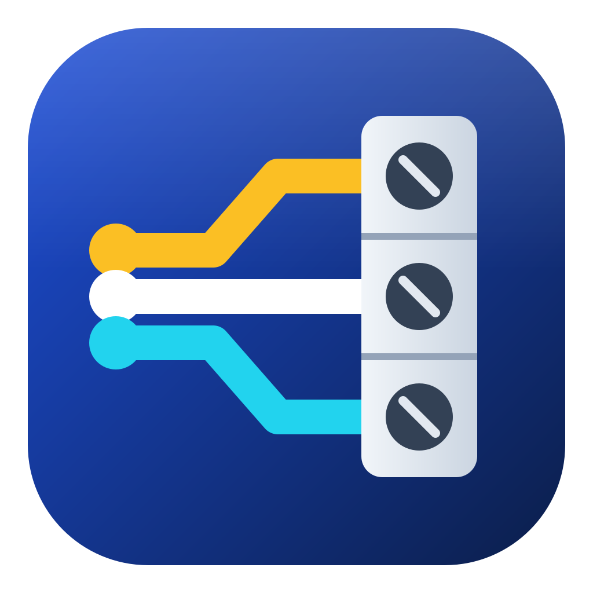
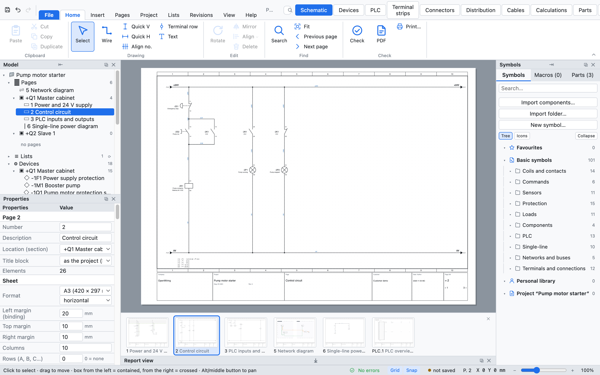

<p align="center"></p>

<h1 align="center">OpenWiring</h1>

<p align="center">
  <b>Open-source electrical CAD for multi-line schematics, control cabinets, terminal strips, cables and PLCs</b><br>
  macOS · Windows · user interface in English, Italiano, Français, Deutsch, Español, Русский
</p>

<p align="center">
  <a href="https://github.com/elconfa/OpenWiring/releases/latest"></a>
  <a href="LICENSE"></a>
  
</p>

<p align="center"><a href="https://elconfa.github.io/OpenWiring/"><b>Website</b></a> · <a href="https://elconfa.github.io/OpenWiring/manual/en/index.html"><b>Online manual (20 chapters)</b></a> · <a href="README.md">Versione italiana</a></p>

OpenWiring is an electrical CAD program for industrial automation. You don't draw lines, you draw
**connected devices**: the program knows that contact `-2K1 13-14` belongs to coil `-2K1`, that two wires
joined by a dot are the same conductor and that terminal `-X1:3` carries wire `1.06` to the motor. From the
schematic it derives cross-references, wire numbers, terminal strips, cables, PLC addresses, network
addresses, reports and checks, and produces the documentation for the control cabinet.



> Up to version 1.23 the program was called **ElettroCAD**. Projects, libraries and settings of the
> previous version open without conversion (see [Upgrading from ElettroCAD](#upgrading-from-elettrocad)).

## Features

**Schematic**
- A3 pages with a 10-column frame and title block filled from the project data; custom title blocks,
  cover page, page templates.
- IEC 60617 symbol library, symbol editor with an AutoCAD-like command line, import of QElectroTech symbols.
- Wires that snap to the grid and break on connection points, junctions, potentials, interruption points
  that pair by name (waiting `/…`, "no counterpart", star sources), conductor buses.
- Device tags according to IEC 81346 (`=function+location-tag`), automatic cross-references between coils and
  contacts with contact image, paired cross-references (a contact also shown on another page).
- Wire numbers with patterns (`{pagina}.{n:2}`, `{quadro}`, letters `{n:A}`), counter per page, per cabinet
  or per project, reserve per page, order by columns or rows; locked or live numbering.

**Cabinet and wiring**
- Terminal strips with levels, jumpers, spares, accessories and automatic terminal strip pages.
- Cables with conductors, colours or numbers, shields, cable lists and cable drawings.
- Connectors and plugs, locations (`+Q1`, `+BM`), single-line diagram.
- Cabinet layout: mounting plate, DIN rails, cable ducts with fill level, automatic placement, drilling,
  estimated wire lengths, wiring sequence for the wireman.
- Marking labels for the most common printers (Excel / CSV).

**PLC and networks**
- PLC cards and stations, I/O points on the schematic, overview pages, I/O assignment list.
- Address formats per station: Siemens TIA (`I0.0`), German Siemens (`E0.0`), IEC 61131 / CODESYS
  (`%IX0.0`), Beckhoff TwinCAT (`AT %I*`), Omron; "analogs first" order for WAGO nodes; IO-Link.
- Export to TIA Portal (tag table), CODESYS / TwinCAT (GVL, PLCopen XML); import of tag tables.
- Network diagram with Profinet, Ethernet, Modbus, EtherCAT, CAN…; network cables; IP plan; a
  **network address table** with IP and Profinet names for every device with a network port, automatic IPs
  and Profinet names.

**Parts, reports, checks**
- Parts library in SQLite, import of manufacturer data (**EDZ** packages, **XML** and **CSV** in the EPLAN
  format), including the manufacturer's drawing from XML macros; export to XML.
- Bill of materials, purchase list, device, terminal, connection, wire, cable and network lists; as pages,
  PDF, CSV, Excel and text.
- Project check with one-click fixes (🔧): short circuits, open ends, duplicate tags, unpaired
  interruption points, duplicate IPs, invalid Profinet names and more.
- Revisions with comparison, find and replace, schematics in several languages with a dictionary.

**Import / export and AI**
- PDF with clickable cross-references, printing, DXF and DWG (with ODA File Converter), Excel.
- Import of schematics from PDF (SEE Electrical and others), QElectroTech projects.
- Built-in AI assistant (Claude, ChatGPT, Gemini with your own key) and a plain-text page format that
  lets AI agents read, write and check schematics; command line (`npm run cli`).

Every function is explained step by step in the **[user manual](docs/manuale/en/00-indice.md)**, also
available in [Italiano](docs/manuale/it/00-indice.md), [Français](docs/manuale/fr/00-indice.md),
[Deutsch](docs/manuale/de/00-indice.md), [Español](docs/manuale/es/00-indice.md) and
[Русский](docs/manuale/ru/00-indice.md). The [Italian README](README.md) is the full technical reference.

## Installation

Download the package from **[Releases](https://github.com/elconfa/OpenWiring/releases/latest)**:

| System | File |
|---|---|
| macOS Apple Silicon (M1/M2/M3/M4) | `OpenWiring-x.y.z-arm64.dmg` |
| macOS Intel | `OpenWiring-x.y.z.dmg` |
| Windows 10/11 (no installation) | `OpenWiring-x.y.z-win.zip` → extract to a folder and start `OpenWiring.exe` |

The apps are **not digitally signed**, so the system asks for confirmation the first time:
- **macOS**: drag OpenWiring into *Applications* and open it once; close the "Apple cannot verify…"
  warning, go to *System Settings ▸ Privacy & Security*, choose *Open Anyway* at the bottom and confirm.
  If macOS says the app "is damaged", run `xattr -cr /Applications/OpenWiring.app` in Terminal.
- **Windows**: in the SmartScreen window choose *More info ▸ Run anyway*.

### Upgrading from ElettroCAD
- `.ecad` projects, `.ecsym` symbols, macros and profiles open as before.
- On first start OpenWiring copies the ElettroCAD settings (preferences, recent projects, language).
- If the *Documents/ElettroCAD* folder (symbols and parts) exists, OpenWiring keeps using it; new
  installations use *Documents/OpenWiring*.
- AI assistant keys are encrypted by the system for each program: enter them again in
  *Settings ▸ AI assistant*.

### From source
Requires **Node.js 20 or later**.

```bash
git clone https://github.com/elconfa/OpenWiring.git
cd OpenWiring
npm install
npm run electron      # desktop app
npm run dev           # in the browser, http://localhost:5173
npm test              # test suite
npm run dist:mac      # .dmg for Apple Silicon and Intel
npm run dist:win-zip  # .zip for Windows x64
```

See [CONTRIBUTING.md](CONTRIBUTING.md) to contribute.

## License

OpenWiring is free software: you can use, study, modify and redistribute it under the terms of the
**GNU General Public License version 3** or later (see [LICENSE](LICENSE)). Whoever distributes a modified
version must make its source code available under the same license. The schematics and projects you draw
with OpenWiring are yours: the license covers the program, not your files.

Copyright © 2026 Massimo Confalonieri. Third-party components and their licenses are listed in
[NOTICE.md](NOTICE.md).

## Trademarks and third-party data

OpenWiring is independent software, not affiliated with or endorsed by EPLAN GmbH & Co. KG, Rittal GmbH &
Co. KG, SDProget or the manufacturers mentioned. EPLAN, Eplan Data Portal, SPAC, AutoCAD, Excel, TIA Portal,
CODESYS, TwinCAT, Siemens, Beckhoff, WAGO, Schneider Electric, QElectroTech and the other product and company
names are trademarks of their respective owners, mentioned only to indicate file formats and compatibility.

OpenWiring does not include or distribute manufacturers' macros, symbols or catalogues: users import only
files they are entitled to use, according to their terms. Reading the EDZ, XML and CSV formats results
from analysing the data files for interoperability. The software is provided "as is", without warranty.
