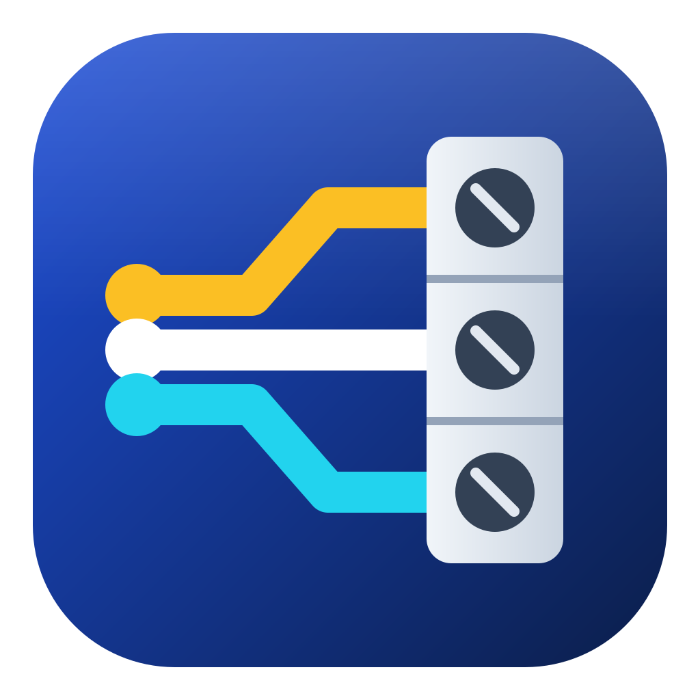
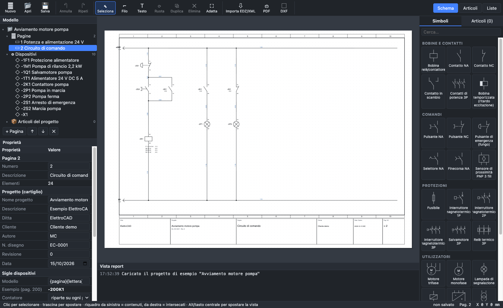

<p align="center"></p>

<h1 align="center">OpenWiring</h1>

<p align="center">
  <b>CAD elettrico open source per schemi multifilari, quadri, morsettiere, cavi e PLC</b><br>
  macOS · Windows · interfaccia in italiano, English, Français, Deutsch, Español, Русский
</p>

<p align="center">
  <a href="https://github.com/elconfa/OpenWiring/releases/latest"></a>
  <a href="LICENSE"></a>
  
</p>

<p align="center"><a href="https://elconfa.github.io/OpenWiring/"><b>Sito e manuale online</b></a> · <a href="README.en.md">English version</a></p>

OpenWiring è un CAD elettrico per l'automazione industriale: non si disegnano linee, ma **dispositivi
collegati**. Dallo schema il programma ricava da solo riferimenti incrociati, numeri filo, morsettiere,
cavi, indirizzi PLC, indirizzi di rete, liste e controlli, e produce la documentazione per il quadro: PDF
con collegamenti cliccabili, DXF/DWG, Excel, etichette, file per TIA Portal, CODESYS e TwinCAT.

Legge i dati articolo dei produttori di materiale elettrico (pacchetti **EDZ**, file **XML** e **CSV** nel
formato EPLAN) e i simboli QElectroTech. L'interfaccia è ispirata a **FreeCAD**: albero del modello,
editor *Proprietà / Valore*, libreria simboli a lato e vista report con i messaggi. Funziona come app
desktop su **macOS** e **Windows** (Electron) e anche nel browser.

> Fino alla versione 1.23 il programma si chiamava **ElettroCAD**. I progetti `.ecad`, le librerie e le
> impostazioni della versione precedente si aprono senza conversioni (vedi [Aggiornare da ElettroCAD](#aggiornare-da-elettrocad)).



> **Stato:** versione 2.0.3. Schema elettrico, morsettiere, cavi, PLC e layout 2D del quadro sono
> utilizzabili; il layout 3D e la firma digitale delle app non ci sono ancora: vedi [Roadmap](#roadmap).

---

> 📘 **[Manuale completo](docs/manuale/it/00-indice.md)**: 20 capitoli con foto ed esempi, funzione per funzione.
> Anche in [English](docs/manuale/en/00-indice.md), [Français](docs/manuale/fr/00-indice.md),
> [Deutsch](docs/manuale/de/00-indice.md), [Español](docs/manuale/es/00-indice.md) e [Русский](docs/manuale/ru/00-indice.md).

## Indice

- [Funzioni](#funzioni)
- [Installazione](#installazione) · [Aggiornare da ElettroCAD](#aggiornare-da-elettrocad)
- [Guida rapida](#guida-rapida)
- [Sigle dispositivi e numeri filo](#sigle-dispositivi-e-numeri-filo)
- [Morsettiere](#morsettiere)
- [Cavi](#cavi)
- [Quadri e schemi di rete](#quadri-e-schemi-di-rete)
- [Cavi di rete e piano IP](#cavi-di-rete-e-piano-ip)
- [Testi multilingua](#testi-multilingua)
- [Luoghi, unifilare, connettori](#luoghi-unifilare-connettori)
- [Revisioni e modelli](#revisioni-e-modelli)
- [PLC avanzato](#plc-avanzato)
- [Macro ed editor dei componenti](#macro-ed-editor-dei-componenti)
- [Etichette di siglatura](#etichette-di-siglatura)
- [Layout del quadro](#layout-del-quadro)
- [Modifica e controlli](#modifica-e-controlli)
- [Assistente IA integrato (Claude, ChatGPT, Gemini)](#assistente-ia-integrato-claude-chatgpt-gemini)
- [Pagine in formato testo e assistenti IA](#pagine-in-formato-testo-e-assistenti-ia)
- [PLC](#plc)
- [Import di schemi da PDF (SEE Electrical e altri)](#import-di-schemi-da-pdf-see-electrical-e-altri)
- [Import dei dati dei produttori (EDZ / XML)](#import-dei-dati-dei-produttori-edz--xml)
- [Scorciatoie da tastiera](#scorciatoie-da-tastiera)
- [Formati dei file](#formati-dei-file)
- [Sviluppo](#sviluppo)
- [Struttura del codice](#struttura-del-codice)
- [Pacchetti di installazione e rilasci](#pacchetti-di-installazione-e-rilasci)
- [Limiti noti](#limiti-noti)
- [Roadmap](#roadmap)
- [Contribuire](#contribuire)
- [Licenza e crediti](#licenza-e-crediti)

---

## Funzioni

### Novità della 2.0
- **Rimandi più semplici** ([manuale](docs/manuale/it/05-disegnare.md#rimandi-in-attesa-senza-corrispondente-e-a-stella)):
  il rimando si collega da solo al corrispondente con lo stesso nome; se manca resta *in attesa* (`/…` in
  arancione) e la barra di stato li conta; *nessun corrispondente* per i conduttori che finiscono lì;
  partenza **a stella** verso tutti gli arrivi con lo stesso nome.
- **Riferimenti a coppie** ([manuale](docs/manuale/it/06-sigle-e-numerazione.md#riferimenti-a-coppie)): un
  contatto disegnato anche su un'altra pagina, solo come disegno, con i rimandi nei due versi.
- **Contatore avanzato dei numeri filo** ([manuale](docs/manuale/it/06-sigle-e-numerazione.md#contatore-avanzato)):
  `{quadro}`, contatore in lettere `{n:A}`, contatore per quadro, riserva di numeri per pagina, ordine per righe.
- **Indirizzi di rete** ([manuale](docs/manuale/it/11-reti-luoghi-unifilare.md#indirizzi-di-rete)): una tabella
  con IP e nomi Profinet di tutti i dispositivi con porte di rete, interfacce separate per porta, IP e nomi
  Profinet automatici, lista stampabile.
- **PLC per stazione** ([manuale](docs/manuale/it/10-plc.md#formato-e-ordine-delle-aree-per-stazione)): formato
  degli indirizzi per stazione (Siemens, IEC/CODESYS, TwinCAT, Omron), Beckhoff TwinCAT con `AT %I*`, ordine
  «prima gli analogici» dei nodi WAGO, esportazioni TIA Portal e CODESYS per stazione.
- Nome nuovo, icona nuova e licenza GPL-3.0.

### Schema elettrico
- **Pagine A3** orizzontali con cornice a 10 colonne, cartiglio compilato dai dati di progetto
  (ditta, progetto, cliente, data, autore, n. disegno, revisione, pagina n/totale).
- **Simboli orientabili**: ogni simbolo ruota di 90° in 90° (tasto **R**) e si può specchiare, quindi
  sta su fili verticali o orizzontali. Le sigle restano orizzontali e leggibili.
- **Griglia** configurabile (1, 2, 4, 5, 8 mm; standard 4 mm). Simboli, fili e coordinate
  scritte a mano si agganciano alla griglia.
- **Libreria simboli IEC 60617** (42 simboli):
  - bobine (anche temporizzate);
  - contatti NA, NC, in scambio e di potenza 3P;
  - pulsanti NA/NC, pulsante di emergenza a fungo, selettore, finecorsa, sensore PNP a 3 fili;
  - fusibile, magnetotermici 1P/2P/3P, salvamotore, relè termico;
  - motori trifase e monofase, lampada, elettrovalvola, alimentatore AC/DC, trasformatore;
  - morsetto, morsetto PE, sezionabile e portafusibile, punto di potenziale, terra PE, rimandi di partenza e di arrivo;
  - PLC: ingresso/uscita digitale e analogica, blocchetti I/O con variabile e commento (1 o 2 morsetti), alimentazione L+/M.
- **Fili ortogonali**: il filo si aggancia ai punti di connessione e le **giunzioni a T** vengono
  riconosciute e disegnate con il pallino. Se due fili si incrociano senza pallino, non sono collegati.
  Arrivando su un filo esistente, il tratto prosegue dritto fino al filo anche se il clic è un po' di lato.
- **Spostamento con elastico**: quando sposti un simbolo (anche in diagonale), i fili collegati lo seguono
  già durante il trascinamento e restano ortogonali, piegandosi a Z se serve; un filo tra due simboli
  spostati insieme si sposta tutto.
- **Modifica dei fili**: trascina un **tratto** per spostarlo (gli estremi restano collegati) o un
  **vertice/estremo** per allungare, accorciare o ricollegare il filo; il cursore indica cosa stai
  trascinando e il filo selezionato mostra i suoi vertici.
- **Fili colorati**: scegliendo il colore di un filo, lo schema lo disegna nel suo colore (impostazione
  *Fili colorati* del progetto, accesa di serie).
- **Tema chiaro/scuro** dell'interfaccia (Sistema, Chiaro, Scuro) e **foglio di disegno scuro**
  (Visualizza → Foglio di disegno: Come il tema di serie, Bianco, Scuro), come nei CAD con sfondo nero. PDF, DXF e stampa restano su foglio bianco.
- Rotazione, specchiatura, duplicazione, selezione a riquadro (da sinistra: elementi contenuti;
  da destra: anche quelli intersecati), annulla/ripeti illimitato (100 passi).

### Logica elettrica
- **Sigle dispositivo** secondo IEC 81346 con modello configurabile, per esempio `-2K1`
  (vedi [Sigle dispositivi e numeri filo](#sigle-dispositivi-e-numeri-filo)).
- **Riferimenti incrociati**:
  - l'immagine dei contatti di ogni bobina sta in fondo alla pagina, sotto la barra 0 V e sulla verticale
    della bobina: contatti di potenza e NA a sinistra della linea, NC a destra, con la
    posizione `/pagina.colonna` (in alternativa sotto il simbolo: *Proprietà del progetto ▸ Sigle dispositivi*);
  - su ogni contatto compare il rimando alla bobina;
  - dando a un componente la sigla di un altro già nello schema, il programma chiede se **unirli** in un
    unico apparecchio (con i rimandi tra bobina e contatti, descrizione e articolo dell'esistente), se
    usare la prima sigla libera o se annullare.
- **Contatto inserito su un filo**: il filo si interrompe sui morsetti del contatto (anche spostando un
  contatto sopra un filo); i due tratti tengono colore e sezione.
- **Numerazione automatica dei contatti** ausiliari secondo EN 50005 (13-14, 23-24, 31-32…), disattivabile per singolo contatto.
- **Punti di potenziale** (L1, L2, L3, N, PE, +24V…): tutti i conduttori con lo stesso nome sono collegati, su qualunque pagina.
- **Rimandi tra pagine**:
  - sono di due tipi, partenza e arrivo (freccia piena); ogni partenza è collegata a **un solo** arrivo,
    anche quando il nome si ripete (il nome è il numero del filo, se c'è);
  - inserendo un arrivo compare l'elenco delle partenze libere (prima quelle con lo stesso nome) e viceversa;
    la prima voce lascia il rimando libero quando il corrispondente non è ancora disegnato. Il collegamento
    si cambia in *Proprietà ▸ Collegato a*; rinominando un rimando si rinomina anche il corrispondente;
  - il nome sta sopra il filo accanto alla freccia, la pagina del corrispondente `/pagina.colonna` di fianco
    alla punta; sui fili verticali nome e pagina sono scritti in verticale, dal basso verso l'alto;
  - un rimando senza corrispondente è segnalato con `/?` in rosso. Nei progetti delle versioni precedenti i
    rimandi restano abbinati per nome finché non si sceglie un corrispondente.
- **Numeri filo** per conduttore, per esempio `200.01`. Sono bloccati di default, così aggiungere componenti non fa scalare gli altri numeri.
  Il numero viene scritto in un punto libero del filo: se a metà del tratto c'è un incrocio, un componente,
  una sigla o un altro numero, si sposta lungo il filo o sull'altro lato (a schermo, nel PDF e nel DXF).
  Il numero si **trascina** dove si vuole e resta lì (segue il filo quando lo si sposta); con il tasto destro
  sul filo se ne aggiungono altri sullo stesso filo, si tolgono o si torna alla posizione automatica.
- **Il numero filo attraversa i morsetti**: un morsetto di passaggio non cambia il numero, i fili ai suoi
  due lati hanno lo stesso numero. Nelle proprietà di ogni elemento con due o più morsetti, *Numero filo ▸
  Il numero filo passa* sceglie il comportamento (spuntato di default sui morsetti, tolto sugli altri
  componenti). I due lati restano conduttori distinti per le liste morsetti e i collegamenti.
- **Sezione e colore di ogni filo** (sigle IEC 60757: BK, BN, BU, DBU, GNYE…).
  - Il colore scelto su un tratto vale per tutto il conduttore: i tratti senza colore proprio lo ereditano,
    anche sulle altre pagine dopo un rimando e oltre i morsetti di passaggio (a schermo, nel PDF e nelle liste).
  - Possono variare lungo lo stesso conduttore: per esempio partenza da 6 mm² e derivazione da 1,5 mm².
  - «Applica a tutto il conduttore» li copia su tutti i tratti collegati.
  - Sono scritti accanto al numero filo (es. `200.01  1,5 mm² BU`) e, a scelta, il filo è disegnato nel suo colore.
  - La lista connessioni usa la sezione del tratto che arriva a ogni morsetto; sulle linee di potenziale ogni
    dispositivo compare collegato al potenziale (es. `L1 → -1Q1:1`).
- **Rimandi cliccabili**: un clic su `/2.4` (contatti, bobine, rimandi tra pagine, PLC) porta alla pagina e
  seleziona l'elemento collegato. Nel PDF diventano collegamenti.

- **Immagini nello schema**: *Inserisci ▸ Immagine…* o incolla dagli appunti; si ridimensionano dall'angolo
  (con Maiusc senza vincolo di proporzioni), stanno sotto o sopra lo schema ed escono nel PDF.
- **Bus di conduttori**: lo strumento *Bus fili* raggruppa i fili in un fascio con derivazioni e il nome del
  conduttore (L1, PE…) accanto a ogni filo.

### Dati dei dispositivi
- Ogni componente ha i campi **descrizione**, **dati tecnici** (es. «24 V DC», «2,2 kW»), **costruttore**,
  **tipo**, **codice di ordinazione**, **note**, **funzione** (`=`) e **luogo** (`+`).
- I dati appartengono al **dispositivo**: se li scrivi sulla bobina valgono anche per i suoi contatti, e viceversa.
- Se al dispositivo è assegnato un **articolo**, i campi lasciati vuoti prendono i dati dell'articolo,
  che compaiono in grigio come suggerimento. I valori scritti a mano prevalgono.
- Con funzione e luogo compilati la sigla diventa completa, per esempio `=A1+Q1-2K1`.
- **Copia proprietà** / **Incolla proprietà di -X** (tasto destro): copiano tutti i dati del dispositivo tranne la
  sigla, anche per sostituire un simbolo con un altro.
- **Proprietà definite dall'utente** (*Progetto ▸ Proprietà definite dall'utente…*): proprietà proprie per
  dispositivi, pagine, collegamenti, progetto e articoli, con import ed export XML.
- **Descrizione e dati tecnici sullo schema**, sotto la sigla dell'elemento principale.
  Si attivano per tutto il progetto e si possono forzare o nascondere per il singolo dispositivo.

### Morsettiere
- Morsettiere con nome libero, anche gerarchico (`X1`, `X1.1.2`); morsetti `X1:1`, `X1:2`…
- **Morsetti a più piani**: `X1:1A`, `X1:1B`, ogni piano disegnato dove serve e un solo articolo in distinta.
- Numerazione bloccata, **Rinumera morsettiera**, **ponticelli** fissi e a pettine, **riserve**, separatori,
  articolo predefinito e accessori automatici, **schema della morsettiera** generato. Dettagli in [Morsettiere](#morsettiere).

### Cavi, macro, etichette, layout, reti
- **Quadri** come sezioni del progetto e **schemi di rete** (Profinet, EtherCAT, Modbus…) con i collegamenti
  tra i quadri ([Quadri e schemi di rete](#quadri-e-schemi-di-rete)).
- **Cavi** con linea di definizione, conduttori automatici, lista cavi e collegamenti cavi ([Cavi](#cavi)).
- **Componenti preferiti** in cima alla libreria (stella ☆ o tasto destro ▸ *Aggiungi ai preferiti*), validi in tutti i progetti.
- **Macro** riutilizzabili ed **editor dei componenti** ([Macro ed editor dei componenti](#macro-ed-editor-dei-componenti)): grafica, ingressi, uscite, morsetti e testi del componente; modifica anche dei componenti importati da EPLAN.
- **Etichette** per Weidmüller M-Print PRO e Cembre GeniusPRO ([Etichette di siglatura](#etichette-di-siglatura)).
- **Layout del quadro 2D** con guide DIN, canaline, posa automatica, DXF di foratura e lista fili con
  lunghezze stimate ([Layout del quadro](#layout-del-quadro)).
- **Copia/incolla** tra progetti, **menu del tasto destro**, **cerca e sostituisci**, **controlli di progetto**
  ([Modifica e controlli](#modifica-e-controlli)).

### PLC
- Schede PLC (CPU compatte e moduli DI/DO/AI/AO, oppure ricavate da articoli EDZ), **punti I/O** e
  **alimentazioni L+/M** disegnati nello schema dove servono.
- **Indirizzi automatici** nei formati Siemens TIA (`I0.0`), Siemens tedesco (`E0.0`), IEC/CODESYS (`%IX0.0`) e Omron (`0.00`).
- **Pagine panoramiche** delle schede generate in automatico, con rimandi dai punti I/O.
- Lista di assegnazione I/O, **export per TIA Portal** (Excel) **e CODESYS** (GVL), **import della tabella variabili**.
  Dettagli nella sezione [PLC](#plc).

### Articoli e liste
- **Gestione articoli**: libreria personale salvata sul computer.
  - Si riempie importando EDZ o XML dai produttori.
  - Per ogni articolo si possono modificare i campi principali e il modello funzione (i punti di connessione).
  - Gli articoli si esportano in XML nel formato EPLAN; si importano anche i CSV dei dati commerciali.
  - **Database degli articoli**: un codice scritto nel campo *Articolo* e non ancora in libreria diventa un articolo
    (con costruttore, tipo, codice di ordinazione e dati tecnici del dispositivo); *Salva questi dati nell'articolo*
    aggiorna un articolo esistente. I link ai documenti dei costruttori compaiono nel dettaglio dell'articolo.
- **Simbolo dell'articolo**: nella scheda articolo puoi scegliere il simbolo da usare nello schema, tra quelli
  di base, i componenti importati e i disegni dei costruttori letti dalle macro in formato EPLAN (associati in automatico
  all'import dell'EDZ). Senza un simbolo, l'articolo si inserisce come **scatola nera automatica** con i
  morsetti del suo modello funzione: ingressi in alto, uscite in basso, contatti e poli disegnati dentro.
- **Assegnazione articoli** ai dispositivi già disegnati.
- **Liste generate dallo schema**:
  - distinta materiali, raggruppata per articolo oppure, per i componenti senza articolo, per costruttore + codice di ordinazione;
  - lista dispositivi, con descrizione, dati tecnici, costruttore, codice di ordinazione e note;
  - lista morsetti, con destinazioni esterne/interne e numeri filo;
  - lista connessioni (da/a, numero filo, sezione, colore).

### Componenti con grafica (QElectroTech)
- **Importa componenti…** (libreria simboli) legge i componenti di [QElectroTech](https://qelectrotech.org):
  file `.elmt`, progetti `.qet` con i loro elementi, oppure archivi `.zip`/`.7z` di intere cartelle
  (per esempio la [collezione ufficiale](https://github.com/qelectrotech/qelectrotech-elements) scaricata da GitHub).
- **Cosa viene convertito**:
  - la grafica: linee, rettangoli, cerchi, ellissi, archi, poligoni, testi;
  - i morsetti con il loro nome;
  - il tipo: bobina = elemento principale con riferimenti incrociati; contatto = contatto secondario NA/NC
    con numerazione automatica; morsetto; rimando;
  - il nome in italiano e la categoria dalla cartella.
  - Scala: 10 px di QElectroTech = 4 mm; i morsetti fuori griglia (es. relè termici a 8,4 mm) vengono portati
    sulla griglia con un breve tratto di raccordo, così i fili si agganciano (anche per i componenti già importati).
  - Lettera della sigla dal tipo e dal nome: interruttori e sezionatori Q, fusibili e relè termici F, bobine K.
  - Attenzione a scaricare il file `.elmt` vero (su GitHub: pulsante *Raw* o *Download raw file*): salvando la
    pagina web si ottiene un file HTML che non contiene il componente.
- **Dove finiscono**: i componenti importati restano nella **libreria personale**, disponibile in tutti i progetti.
  Quando ne inserisci uno, viene copiato nel progetto, così il file `.ecad` resta completo.
- **Licenza**: la collezione QElectroTech è © The QElectroTech team, licenza CC-BY 3.0. L'uso negli schemi è libero;
  OpenWiring non include nessun loro simbolo, li importi tu.

### Dati utente su un'altra installazione
**File ▸ Esporta ▸ Dati utente (per un'altra installazione)…** salva in un solo file JSON la libreria
articoli completa (con simbolo associato, immagine, prezzo, proprietà definite dall'utente e dati dei CSV),
i simboli propri, le macro, i modelli di progetto, i cartigli personalizzati e i preferiti.
**File ▸ Importa ▸ Dati utente (da un'altra installazione)…** li aggiunge a quelli presenti: per gli
elementi già presenti con dati diversi chiede se tenere i propri o quelli del file.

### Export
- **PDF** vettoriale in A3:
  - pagine a scelta (tutte, la corrente, oppure un intervallo come `1-3, 5` o `200-205`);
  - **pagina indice** iniziale e **segnalibri** per pagine e liste;
  - **rimandi cliccabili** (contatti ↔ bobina, rimandi tra pagine, PLC, panoramiche) e posizioni cliccabili nelle liste;
  - opzione **bianco e nero** per la stampa.
- **Stampa diretta** (*File → Stampa…*, ⌘P): pagine a scelta in A3 orizzontale, a colori o in bianco e nero, in un'altra lingua.
- **DXF** R12 della pagina corrente (scala 1:1, mm), con i layer CORNICE, SIMBOLI, FILI, TESTI, SIGLE e NUMERI_FILO;
  *DXF di tutto il progetto (ZIP)* crea un file per pagina.
- **CSV** di ogni lista (separatore `;`, si apre direttamente in Excel).
- **Excel** della tabella variabili PLC per TIA Portal e della lista I/O.

---

## Installazione

### Da pacchetto (consigliato)
Scarica il pacchetto dalla pagina **[Releases](https://github.com/elconfa/OpenWiring/releases/latest)**:

| Sistema | File |
|---|---|
| macOS Apple Silicon (M1/M2/M3/M4) | `OpenWiring-x.y.z-arm64.dmg` |
| macOS Intel | `OpenWiring-x.y.z.dmg` |
| Windows 10/11 (senza installazione) | `OpenWiring-x.y.z-win.zip` → estrai in una cartella e avvia `OpenWiring.exe` |

Le app **non sono firmate digitalmente**, quindi al primo avvio il sistema chiede una conferma:
- **macOS**: trascina OpenWiring in *Applicazioni* e aprilo una volta: compare l'avviso «Apple non può verificare…». Chiudilo, vai in *Impostazioni di sistema ▸ Privacy e sicurezza*, in fondo scegli *Apri comunque* e conferma. Sulle versioni di macOS precedenti alla 15 basta clic destro sull'app ▸ *Apri* ▸ *Apri*.
  Se compare «OpenWiring è danneggiato e non può essere aperto» (versioni 0.14.0 e precedenti), apri il Terminale ed esegui `xattr -cr /Applications/OpenWiring.app`, poi riapri l'app.
- **Windows**: nella finestra SmartScreen scegli *Ulteriori informazioni ▸ Esegui comunque*.

### Aggiornare da ElettroCAD
OpenWiring è la continuazione di ElettroCAD 1.23 con un nome nuovo:
- i progetti `.ecad`, i simboli `.ecsym`, le macro e i profili si aprono come prima;
- al primo avvio OpenWiring copia le impostazioni di ElettroCAD (preferenze, progetti recenti, lingua);
- se c'è la cartella *Documenti/ElettroCAD* (simboli e articoli) OpenWiring continua a usarla; le
  installazioni nuove usano *Documenti/OpenWiring*;
- le chiavi dell'assistente IA sono cifrate dal sistema per il singolo programma: vanno scritte di nuovo in
  *Impostazioni ▸ Assistente IA*;
- la variabile della riga di comando è `OPENWIRING_SIMBOLI` (`ELETTROCAD_SIMBOLI` vale ancora).

### Dai sorgenti
Serve **Node.js 20 o successivo**.

```bash
git clone https://github.com/elconfa/OpenWiring.git
cd OpenWiring
npm install
npm run electron      # app desktop
# oppure
npm run dev           # nel browser, su http://localhost:5173
```

---

## Guida rapida

Al primo avvio si apre il **progetto di esempio** «Avviamento motore pompa», composto da quattro pagine:
- potenza con salvamotore, contattore, morsettiera e motore, più l'alimentatore 24 V;
- circuito di comando con emergenza, marcia con autoritenuta e lampade;
- ingressi e uscite PLC: pulsante e finecorsa sugli ingressi, elettrovalvola su un'uscita, alimentazione della CPU;
- panoramica della scheda PLC, generata in automatico.

Puoi ripartire da zero con **Nuovo**.

1. **Dati di progetto**: clicca sul nome del progetto nell'albero *Modello*. In *Proprietà* compili
   il cartiglio e imposti sigle, numeri filo e griglia.
2. **Pagine**: usa *+ Pagina*, ↑ ↓ per riordinarle, ✕ per eliminarle. Il numero di pagina (per esempio `200`)
   e la descrizione si modificano nelle proprietà della pagina e finiscono nelle sigle e nel cartiglio.
3. **Inserire simboli**: clic su un simbolo nella libreria a destra, poi clic nello schema. Il simbolo
   resta attivo per inserirne altri. **R** lo ruota prima di inserirlo; **Esc** o il tasto destro terminano l'inserimento.
4. **Disegnare fili**: tasto **W** o pulsante *Filo*.
   - Clic sul punto di partenza, poi un clic per ogni angolo.
   - Il filo termina da solo quando clicchi su un punto di connessione o su un altro filo.
   - Altrimenti chiudilo con doppio clic, Invio o tasto destro.
   - I punti di connessione disponibili sono evidenziati in verde.
5. **Contatti di un relè**:
   - inserisci la bobina (prende per esempio la sigla `-2K1`);
   - inserisci i contatti NA/NC: ricevono la sigla dell'ultima bobina e la numerazione 13-14, 23-24…;
   - per assegnare un contatto a un'altra bobina, cambia la sigla nelle proprietà (l'elenco propone quelle esistenti).
6. **Dati del componente**: selezionalo e compila, nel pannello *Proprietà*, i gruppi *Dispositivo*
   (descrizione, dati tecnici, funzione, luogo, note) e *Ordinazione* (articolo, costruttore, tipo,
   codice di ordinazione). Descrizione e dati tecnici compaiono sullo schema e finiscono nelle liste.
7. **Collegare pagine diverse**:
   - inserisci un *Rimando (partenza)* alla fine del filo;
   - sull'altra pagina inserisci un *Rimando (arrivo)* e scegli dall'elenco la partenza a cui collegarlo.
   - In alternativa usa i *Punti di potenziale* (L1, N, +24V…).
8. **Articoli**: *Importa EDZ/XML*, poi dalla scheda *Articoli* puoi:
   - fare *Inserisci* per mettere la scatola nera nello schema;
   - selezionare un simbolo e fare *Assegna* per collegare l'articolo a un dispositivo già disegnato.
9. **Liste ed export**: la scheda *Liste* mostra distinta, dispositivi, morsetti e connessioni.
   **PDF** esporta tutto il progetto; **DXF** la pagina corrente.
10. **Salvataggio**: *Salva* crea un file `.ecad`. Il lavoro viene anche salvato automaticamente nel
   computer e ripristinato alla riapertura, ma questo non sostituisce *Salva*.

**Navigazione**: rotella = zoom sul cursore; tasto centrale o **Alt + trascina** = sposta la vista;
**F** = adatta la pagina; **PagSu/PagGiù** = pagina precedente/successiva.

---

## Sigle dispositivi e numeri filo

Le impostazioni sono in *Proprietà del progetto ▸ Sigle dispositivi* e *Numeri filo*.
I modelli usano questi segnaposto:

| Segnaposto | Significato | Esempio |
|---|---|---|
| `{pagina}` | numero della pagina | `200` |
| `{colonna}` | colonna (1–10) in cui si trova l'elemento | `4` |
| `{lettera}` | lettera IEC 81346 del dispositivo | `K` |
| `{n}` | numero progressivo | `1` |
| `{n:2}` | numero progressivo a cifre fisse | `01` |

| Modello | Risultato a pagina 200 |
|---|---|
| `{pagina}{lettera}{n}` **(predefinito per le sigle)** | `-200K1` |
| `{lettera}{n}` | `-K1` |
| `{pagina}{lettera}{n:2}` | `-200K01` |
| `{pagina}.{colonna}{lettera}` | `-200.4K` |
| `{pagina}.{n:2}` **(predefinito per i fili)** | `200.01` |

- **Contatore**: riparte su ogni pagina oppure è unico nel progetto.
- **Sigle stabili**: un dispositivo nuovo prende il numero successivo al più alto della pagina
  (`-2K3`) e quelli esistenti non cambiano. **Rinumera dispositivi** rinumera tutto in ordine di
  pagina, colonna e riga; i contatti seguono sempre la sigla della loro bobina, i morsetti restano esclusi.
- **Numeri filo bloccati** (predefinito):
  - un conduttore numerato mantiene il suo numero;
  - un conduttore nuovo prende il primo numero libero della pagina (`200.15` dopo `200.14`),
    anche se lo disegni a metà pagina;
  - se colleghi due conduttori numerati resta un solo numero; dividendo un conduttore, la parte nuova riceve un numero nuovo;
  - **Rinumera fili** ricalcola tutto da capo in ordine di colonna; succede anche quando cambi il modello.
- **Numerazione ricalcolata**: in alternativa, i numeri filo vengono ricalcolati a ogni modifica.
- **Numero manuale**: seleziona un filo e scrivi il numero nelle proprietà. Vale per tutto il conduttore;
  cancellandolo si torna al numero automatico.
- **Potenziali con nome** (L1, N, PE…): i loro conduttori possono mostrare il nome invece del numero.

---

## Morsettiere

La scheda **Morsettiere** mostra a destra l'elenco delle
morsettiere, al centro la tabella dei morsetti con destinazioni esterne/interne, numeri filo,
ponticelli, articolo e posizione cliccabile.

- **Sigla**: `<morsettiera>:<numero><piano>`. La morsettiera ha nome libero, anche gerarchico come
  `X1.1.2`; il numero segue i due punti (`X1.1.2:3`).
- **Morsetti a più piani**: i piani di uno stesso morsetto hanno lo stesso numero e una lettera,
  `X1:1A`, `X1:1B`. Con il morsetto selezionato, **Aggiungi piano** nelle proprietà trasforma `1` in `1A`
  e fa inserire `1B` con un clic (anche su un'altra pagina); i clic successivi inseriscono `1C`, `1D`…
  In distinta un morsetto a più piani conta come **un solo articolo** (`-X1:1A/B`).
- **Numerazione**: un morsetto nuovo prende il numero dopo il più alto della morsettiera e gli altri
  non cambiano. **Rinumera** numera da 1 nell'ordine dello schema (pagina, poi da sinistra a destra e
  dall'alto in basso): i piani restano insieme e mantengono la lettera, le riserve vanno in coda, i
  morsetti con nome non numerico (per esempio `PE`) restano com'erano. **Rinomina** cambia il nome
  della morsettiera su tutti i morsetti.
- **Ponticelli**: seleziona due o più morsetti (⇧ clic per un intervallo, ⌘/Ctrl clic per aggiungerne)
  e scegli *Ponticello fisso* o *a pettine*. I ponticelli compaiono nella lista morsetti, nella lista
  connessioni e nello schema della morsettiera; ognuno può avere il suo articolo.
- **Riserve**: morsetti non disegnati aggiunti in coda, che entrano in lista e in distinta.
- **Separatori** dopo un morsetto, disegnati come linea spessa.
- **Articoli e accessori**: articolo predefinito dei morsetti (per esempio un Weidmüller WDU 2.5), piastra di
  chiusura (×1), fermi terminali (×2), ponticello e separatore predefiniti. I morsetti senza articolo
  proprio usano quello predefinito; tutto entra in distinta in automatico.
- **Simboli**: morsetto, morsetto PE, sezionabile e portafusibile. Su un filo verticale la sigla della
  morsettiera sta a sinistra e il numero a destra; su un filo orizzontale (simbolo ruotato) il numero sta
  sopra e la sigla sotto. La sigla compare solo sul primo morsetto di ogni fila.
- **Schema della morsettiera**: *Genera schemi morsettiere* crea una pagina per morsettiera (più fogli
  oltre i 40 morsetti) con destinazioni, fili, ponticelli, separatori, riserve e posizioni cliccabili
  anche nel PDF.

---

## Cavi

- **Linea di definizione**: con lo strumento **Cavo** fai clic su un lato dei fili e poi sull'altro.
  I fili attraversati diventano conduttori del cavo `-1W1` (sigla dal modello del progetto).
- **Conduttori proposti** secondo il numero di fili: fino a 5 a colori (`BN BK GY BU GNYE`), oltre numerati
  con il giallo-verde. Il filo PE (o giallo-verde) prende il giallo-verde. Nelle proprietà puoi scegliere il
  conduttore per ogni filo, cambiare formazione (`5G1,5`, `7x0,75`…), tipo, lunghezza, estremità e articolo.
- Più linee, anche su pagine diverse, possono riferirsi allo stesso cavo; lo stesso conduttore
  attraversato due volte conta una volta sola.
- **Liste**: *Lista cavi* (formazione, conduttori usati/liberi, lunghezza, estremità) e *Collegamenti cavi*
  (un conduttore per riga con le estremità). La lista connessioni ha la colonna *Cavo*; in distinta la
  quantità del cavo è la sua lunghezza in metri.
- **Controlli**: conduttori esauriti o ripetuti, cavi senza linea, sigle doppie.

## Quadri e schemi di rete

- **Quadri (sezioni del progetto)**: nelle proprietà del progetto aggiungi i quadri con codice e nome
  modificabili, per esempio `+Q1 Quadro master`, `+Q2 Slave 1`, `+Q3 Slave 2`. Ogni pagina si assegna a un
  quadro (proprietà *Quadro (sezione)*) e l'albero raggruppa le pagine per quadro; una pagina nuova resta
  nel quadro di quella da cui parte.
- **Schema di rete** (*+ Rete* sotto l'albero): uno schema unico di tutto l'impianto con i nodi di rete
  della categoria *Reti e bus* (nodo con IN/OUT, nodo con P1/P2, nodo a una porta, switch a 5 porte,
  terminazione). Un nodo prende la sigla di un dispositivo esistente (CPU, I/O remoto, inverter…) e ne
  diventa una rappresentazione, con l'**indirizzo** (IP, ID Modbus, nome Profinet…) scritto sotto.
- **Collegamenti bus**: strumento **Bus** con il protocollo scelto accanto: Profinet, EtherCAT, Modbus TCP,
  Modbus RTU, Profibus DP, EtherNet/IP, CANopen, IO-Link, RS485, Ethernet. Ogni protocollo ha il suo colore
  e il nome scritto sulla linea; i bus non ricevono numero filo e non finiscono tra le connessioni e le
  etichette dei fili. Un filo esistente si può trasformare in bus dalle sue proprietà.
- **Riquadri dei quadri**: strumento **Quadro** (clic su due angoli). I nodi dentro un riquadro appartengono
  a quel quadro; i collegamenti tra quadri diversi sono segnati come *tra quadri*.
- **Liste**: *Collegamenti di rete* (protocollo, porte, quadri, tra quadri) e *Nodi di rete* (indirizzo,
  protocolli, quadro).
- **Controlli**: indirizzi ripetuti sulla stessa rete (anche attraverso gli switch) e porte Ethernet con più
  di un collegamento (serve uno switch). I bus multipunto (Modbus RTU, Profibus, CANopen, RS485) ammettono
  più nodi sullo stesso tratto.

## Cavi di rete e piano IP

- **Cavi di rete**: ogni collegamento bus disegnato è un cavo. Riceve da solo la sigla (`-5W1`, scritta sulla
  linea accanto al protocollo) e nelle proprietà del collegamento si indicano tipo (proposto per protocollo,
  es. *Profinet tipo A 2×2×AWG22*), lunghezza in metri e articolo. I cavi di rete compaiono nella *Lista cavi*
  con le porte alle due estremità (`-3A1:X1 P1` → `-5A1:P1`), nella colonna *Cavo* dei *Collegamenti di rete*,
  nelle etichette dei cavi (una per estremità) e, se hanno l'articolo, in distinta in metri.
- **Reti IP** (proprietà del progetto o menu *Progetto*): nome, indirizzo/prefisso (es. `192.168.0.0/24`),
  gateway, protocollo che la usa e primo indirizzo da assegnare.
- **Indirizzo IP dei nodi**: campo separato dall'indirizzo/nome (nome Profinet, ID Modbus…), scritto nel
  riquadro del nodo. *Assegna IP* dà il primo indirizzo libero ai nodi collegati con Profinet, Modbus TCP,
  EtherNet/IP o Ethernet che non ne hanno (EtherCAT e i bus seriali no).
- **Piano indirizzi IP** (lista): IP, maschera, gateway, rete, dispositivo, nome dispositivo, protocolli,
  luogo; comprende le stazioni PLC con IP e i gateway.
- **Controlli**: IP ripetuti, non validi, fuori dalle reti, uguali all'indirizzo di rete o di broadcast,
  gateway fuori rete, sigle di cavo ripetute.

## Testi multilingua

- **Interfaccia in sei lingue**: italiano, inglese, francese, tedesco, spagnolo e russo (*Visualizza ▸ Language ·
  Lingua*; al primo avvio quella del sistema). L'assistente IA risponde nella lingua dell'interfaccia e il
  manuale (*Aiuto ▸ Manuale*) è disponibile nelle stesse sei lingue.
- I testi si scrivono in italiano; il **dizionario di progetto** (scheda *Liste → Traduzioni*) contiene
  inglese e tedesco per titoli di pagina, testi liberi, descrizioni dei dispositivi, luoghi, commenti PLC e
  campi del cartiglio.
- **Lingua degli schemi** (proprietà del progetto, menu *Visualizza* o scheda Traduzioni): schemi, cartiglio,
  copertina, pagine di lista, panoramiche PLC e schemi delle morsettiere in italiano, inglese o tedesco,
  anche in **due lingue** insieme («Contattore pompa / Pump contactor»). È un'impostazione separata dalla
  lingua dell'interfaccia.
- **Dizionario incluso** con i testi fissi (cartiglio, titoli e colonne delle liste) e circa 250 termini
  elettrici comuni. *Proponi traduzioni* riempie i testi mancanti: frase intera se è nel dizionario,
  altrimenti parola per parola (in inglese a ordine invertito, «Lampada guasto» → «Fault lamp»); le proposte
  automatiche sono evidenziate e si confermano con ✓.
- **Esporta / Importa CSV** (`Italiano;English;Deutsch`) per far completare il dizionario a un traduttore.
- Il **PDF** si può esportare in un'altra lingua (o in due) senza cambiare quella del progetto.

## Luoghi, unifilare, connettori

- **Luoghi (contenitori)**: nelle proprietà del progetto definisci i luoghi con codice, nome e tipo, per esempio
  `+QE` Quadro elettrico, `+BM` Bordo macchina, `+P1` Pulsantiera 2, `+QS1` Quadro slave 1. Ogni dispositivo sta
  in un luogo: quello scelto nelle sue proprietà, altrimenti il riquadro in cui è disegnato nello schema di rete,
  altrimenti il luogo della sua pagina. L'albero raggruppa pagine e dispositivi per luogo, la lista dispositivi
  mostra la sigla completa (`+BM-1M1`), le etichette dei dispositivi sono raggruppate per luogo e una pagina di
  layout assegnata a un luogo propone solo i suoi apparecchi.
- **Schema unifilare** (*+ Unifilare*): simboli a una linea (interruttore, salvamotore, sezionatore, fusibile,
  contattore, motore, trasformatore, inverter, alimentatore, utenza) con la **stessa sigla** del dispositivo nel
  multifilare e il rimando cliccabile alla sua posizione. Le linee hanno il numero di conduttori (trattini) e un
  testo (`3/N/PE ~400 V 50 Hz`); non entrano nei conduttori, nei numeri filo e nelle liste.
- **Connettori e spine**: pin di presa, di spina e coppia presa+spina con sigla `X10:3`, numerazione automatica,
  pin totali scritti o letti dall'articolo, controparte (es. la spina per una presa da quadro) in distinta,
  *Lista connettori* e controlli dei pin oltre il numero del connettore.

## Revisioni e modelli

- **Revisioni** (proprietà del progetto): *Nuova revisione…* congela lo stato con indice, data, autore e
  descrizione; vengono registrate le pagine modificate. Le modifiche successive sono segnate con **nuvolette**
  rosse (a schermo e nel PDF, disattivabili); il cartiglio di ogni pagina mostra l'indice dell'ultima revisione
  che l'ha cambiata; l'indice del PDF e la copertina riportano la tabella delle revisioni.
- **Confronta…**: confronto con un altro file `.ecad` (pagine, dispositivi e dati di progetto cambiati), nella
  scheda *Confronto* delle liste.
- **Cartiglio**: logo (PNG, JPG o SVG), indirizzo della ditta e campi aggiuntivi (es. Commessa, Impianto).
- **Cartigli personalizzati** (*Proprietà del progetto ▸ Cartiglio ▸ Modello*, o *Progetto ▸ Cartiglio*):
  - modelli inclusi: *Standard*, *Con tabella revisioni* (ultime tre revisioni), *Compatto*;
  - *Personalizza…* apre il modello nell'editor (linee, rettangoli, cerchi, testi, area del logo) con
    l'anteprima riempita con i dati del progetto;
  - nei testi si usano segnaposto come `{progetto}`, `{titolo}`, `{pagina}`, `{n}/{totale}`, `{cliente}`,
    `{data}`, `{revisione}`, `{luogo}`, `{campo:Commessa}`, `{rev1.descrizione}`; un valore di riserva si
    scrive dopo una barra (`{cliente|—}`) e un testo con tutti i segnaposto vuoti non viene stampato;
  - **sei cartigli completi inclusi**: ISO 7200, Industriale dettagliato, Macchina (EN 60204-1), Impianto civile
    (DM 37/08), Quadro elettrico (EN 61439) e Automazione con firme; i campi propri del modello
    (`{campo:Matricola}`…) compaiono nelle proprietà del progetto e un valore di riserva può contenere altri
    segnaposto (`{campo:Macchina|{progetto}}`); `{prop:nome}` inserisce una proprietà definita dall'utente;
  - **Importa DXF…** porta nel modello un cartiglio disegnato in AutoCAD o in un altro CAD (linee, polilinee,
    cerchi, archi, testi, blocchi); gli attributi diventano segnaposto (PROGETTO → `{progetto}`, DATA →
    `{data}`, FOGLIO → `{pagina}`…). Se è più grande dell'area del cartiglio (390 × 35 mm) viene ridotto;
  - i cartigli salvati restano nella libreria personale per tutti i progetti e vengono copiati nel file del
    progetto; ogni pagina può avere un cartiglio diverso (*Proprietà della pagina ▸ Cartiglio*);
  - il cartiglio scelto vale a schermo, nel PDF e nell'export DXF.
- **Copertina** (*+ Copertina*): logo, titolo, dati del progetto, revisioni e caselle Redatto/Verificato/Approvato.
- **Pagine automatiche** (*Inserisci → Pagine automatiche (liste)…* o *Pagine di lista…* nelle liste): scegli
  quali liste diventano pagine del progetto con cartiglio, anche su più fogli da 40 righe: **indice delle
  pagine** (in testa, dopo la copertina), distinta materiali, **lista d'acquisto**, dispositivi, morsetti,
  connessioni, fili, cavi, collegamenti cavi, rete, piano IP, I/O PLC. Il contenuto segue sempre lo schema;
  con *Crea e togli le pagine da sole* anche il numero di fogli si adegua quando cambia lo schema.
- **Lista d'acquisto**: gli articoli della distinta raggruppati per costruttore (un ordine per fornitore)
  con l'unità di misura (pezzi o metri), più il filo sfuso per sezione e colore (metri stimati dal layout
  del quadro, con il 10% di scorta) e i cavi senza articolo per tipo e formazione.
- **Modelli di progetto**: *Salva questo progetto come modello…* tiene impostazioni, cartiglio, luoghi e
  copertina; *Nuovo progetto* da un modello riparte da lì.

## PLC avanzato

- **Rack e slot** per ogni scheda (slot assegnato in automatico) e **stazioni** con tipo (CPU locale, Profinet,
  EtherCAT, Profibus DP, EtherNet/IP, Modbus TCP), indirizzo IP e nome del dispositivo.
- **Master IO-Link** a 4 o 8 porte: per ogni porta dispositivo, descrizione e byte di dati di processo, con gli
  indirizzi calcolati (`IB4…IB5`, `%IB4`, `EB4`).
- **Export PLCopen XML** (TC6): variabili globali con indirizzo IEC dei canali usati e dei dati IO-Link,
  importabile in CODESYS e negli ambienti compatibili.
- **Controlli**: slot doppi nella stessa stazione, indirizzi IP e nomi dispositivo ripetuti.

## Macro ed editor dei componenti

- **Macro**: seleziona un circuito (per esempio un avviamento motore) e usa *Crea macro dalla selezione*
  (menu del tasto destro o scheda **Macro** della libreria). Inserendola, sigle, numeri filo, morsetti,
  canali PLC e cavi vengono rinumerati; bobina e contatti copiati insieme restano collegati. Le macro
  stanno nella libreria personale e si esportano/importano come file `.ecmacro`.
- **Cartella dei simboli** (app desktop): la libreria dei simboli è una cartella, di base
  `Documenti/OpenWiring/Simboli`, con **un file `.ecsym` per simbolo** (JSON leggibile); le **sottocartelle
  sono i gruppi** della libreria (`Sezionatori/Rotativi` → gruppo «Sezionatori / Rotativi»), i file nella
  cartella principale vanno in «Simboli personali». Salvare, spostare di gruppo o togliere un simbolo
  nell'app scrive, sposta o elimina il file; copiare, eliminare o spostare i file dal Finder/Esplora
  risorse aggiorna subito la libreria. Così i simboli si copiano tra installazioni o si condividono in
  rete (*Cambia…* sceglie un'altra cartella, *Apri* la mostra). Al primo avvio i simboli già nella
  libreria vengono copiati nella cartella. I progetti conservano comunque una copia dei simboli che usano.
  I **nomi di file e cartelle** usano solo lettere senza accento, cifre, spazi e pochi segni, così si
  leggono uguali su Mac e Windows («Relè termico» → `Rele termico.ecsym`, «Macro EPLAN · SE» →
  `Macro EPLAN/SE`); i file con nomi vecchi vengono rinominati da soli all'avvio.
  La riga di comando legge la stessa cartella (`--simboli <cartella>` o `OPENWIRING_SIMBOLI` per un'altra)
  e il **catalogo per gli agenti IA** (assistente integrato, guida, `cli catalogo`) comprende i simboli
  dell'utente raggruppati per cartella; quelli importati in blocco (QElectroTech, macro EPLAN) solo con
  `catalogo --tutti`. Se un componente manca, l'agente lo segnala con i punti di connessione che servono.
- **Editor dei componenti** (tasto destro su un componente ▸ *Modifica il componente…*, oppure *Nuovo
  simbolo…* nella libreria): pannello a sinistra con grafica (linea, polilinea, rettangolo, cerchio, ellisse,
  arco, testo), punti di connessione (connessione, ingresso, uscita, morsetto) e testi del componente (sigla,
  descrizione, dati tecnici, costruttore, tipo, codice ordinazione, articolo, funzione, luogo, note) che nello
  schema mostrano i dati del dispositivo. Si modificano anche i simboli di base e le scatole nere degli
  articoli EPLAN. *Salva* aggiorna il simbolo e tutti i componenti dello schema che lo usano; *Salva come…*
  crea un simbolo nuovo solo nella libreria. Un simbolo di base modificato non viene sovrascritto: la copia
  personale prende il suo posto anche nella libreria, nello stesso riquadro, e *Torna al simbolo di base*
  rimette l'originale.
  Si disegna come in un CAD semplice: clic per selezionare (Maiusc o ⌘ per aggiungere), riquadro da sinistra
  per gli elementi tutti dentro e da destra per quelli toccati; trascinamento e frecce per spostare (i punti
  di connessione restano sulla griglia); **⌘C/⌘X/⌘V** e **⌘D** copiano, tagliano, incollano e duplicano: gli
  elementi seguono il mouse e un clic li posa, e le designazioni numeriche già usate avanzano (il polo 5-6
  duplicato diventa 7-8); **R** ruota di 90° la selezione, gli elementi da incollare o la direzione del
  prossimo punto di connessione; i **quadratini** sull'elemento selezionato allungano un tratto, spostano un
  vertice o ridimensionano un rettangolo; **⌘Z/⇧⌘Z** annullano e ripetono. Mentre l'editor è aperto
  l'albero e la libreria si nascondono. La *Categoria* propone quelle esistenti: i simboli con la stessa
  categoria stanno insieme nella libreria.

## Etichette di siglatura

Il pulsante **Etichette** esporta le etichette di **morsetti**, **fili**, **dispositivi** e **cavi** in Excel
(un foglio per tipo) o CSV per:
- **Weidmüller M-Print PRO**: colonne `Project`, `Text 1`, `Text 2`… (la colonna `Project` va nel campo
  PROJECT delle MultiCard);
- **Cembre GeniusPRO**: colonne `Riga 1`, `Riga 2`…, `Gruppo`;
- **generico** per altri programmi.

Entrambi i programmi importano Excel/CSV con una procedura guidata in cui si associa ogni colonna a un
campo. Opzioni: morsetti con il solo numero o la sigla completa, etichetta della morsettiera a inizio
fila, riserve; fili con il solo numero o con la destinazione, una o due estremità; dispositivi con
=funzione +luogo; cavi con tipo e formazione.

## Layout del quadro

- **+ Layout** (sotto l'albero) crea una pagina di vista di montaggio con la piastra in scala normalizzata
  (1:5, 1:10…), quotata.
- **Guide DIN** e **canaline**: trascina per disegnarle. **Posa automatica** crea file di canalina e guida
  se mancano e posa sulle guide tutti i dispositivi e le morsettiere non ancora posati.
- Le **misure** degli apparecchi vengono dall'articolo (larghezza/altezza dell'EDZ), altrimenti sono
  tipiche; la morsettiera è larga quanto i suoi morsetti (un morsetto multipiano occupa un passo).
- Gli apparecchi vicini a una guida si **centrano sulla guida**; ogni guida mostra i millimetri liberi.
- **Controlli**: elementi fuori piastra, sovrapposti, guide piene.
- **DXF foratura 1:1**: piastra, guide, canaline, sagome e fori di fissaggio Ø 5,5.
- **Distinta**: guide e canaline con articolo in metri.
- **Lista fili (cablaggio)**: ogni filo con sezione, colore, **puntali** (DIN 46228) e **lunghezza stimata**
  dal layout (percorso tra gli apparecchi più la riserva per estremità, impostabile).

## Modifica e controlli

- **Navigatore dei dispositivi** (scheda *Dispositivi*): tutti i dispositivi in una tabella modificabile con
  sigla, funzione =, luogo +, descrizione, dati tecnici, costruttore, codici, articolo e note. I valori presi
  dall'articolo compaiono in grigio. Filtro, selezione multipla (clic, ⇧ clic, ⌘/Ctrl clic), **modifica in
  blocco** di un campo su tutti i selezionati (un valore scritto in una riga selezionata vale per tutte),
  rinomina della sigla con tutti i contatti, **export e import Excel** per compilare i dati fuori dal programma.
- **Struttura =Impianto +Luogo** nell'albero: dispositivi raggruppati per funzione e poi per luogo (IEC 81346).
- **Evidenzia potenziale** (proprietà del filo o tasto destro): tutti i conduttori collegati, anche oltre
  rimandi, potenziali e morsetti, in arancione su ogni pagina; la barra di stato elenca le pagine, cliccabili.
- **Testi dei simboli sempre leggibili**: ruotando o specchiando un simbolo, i suoi testi non vengono mai
  capovolti né scritti al contrario (si leggono da sotto o da destra), a schermo, in PDF e in DXF.
- **Copia, taglia, incolla** (⌘C, ⌘X, ⌘V) tra pagine e tra progetti: le copie ricevono sigle e numeri filo
  nuovi, simboli e articoli usati vengono copiati nel progetto di destinazione.
- **Duplica pagina** (pulsante ⧉ sotto l'albero).
- **Menu del tasto destro**: taglia, copia, incolla qui, ruota, specchia, crea macro, modifica simbolo,
  vai alla bobina o ai contatti, aggiungi piano del morsetto.
- **Cerca e sostituisci** (⌘F): sigle, descrizioni, testi, numeri filo, nomi PLC, codici; parola intera e
  maiuscole; clic su un risultato per andarci.
- **Verifica** (pulsante *Verifica* o *Progetto → Verifica*): la scheda *Controlli* delle liste divide i
  problemi in errori (●), avvisi (▲) e dati inutilizzati (○), con filtro per categoria; clic su una riga per
  andare all'elemento. Controlla:
  - **cortocircuiti**: potenziali diversi sullo stesso conduttore (L1 con N, +24V con 0V), rimandi con nomi
    diversi collegati tra loro, componenti con i due punti sullo stesso conduttore (bobina o contatto
    cavallottato);
  - **collegamenti solo apparenti**: un filo che passa sopra un punto di connessione senza terminarci
    (sullo schema sembra collegato ma non lo è);
  - **orfani**: componenti, potenziali, rimandi e nodi di rete senza collegamenti, fili isolati che non
    collegano nessun dispositivo, contatti senza bobina;
  - **collegamenti incompleti**: punti di connessione liberi di bobine, contatti, lampade, pulsanti, punti
    I/O PLC; fili con un estremo libero (le barre di potenziale che arrivano al bordo sono ammesse);
  - **disegno**: simboli inesistenti o sovrapposti due volte, fili sovrapposti, elementi fuori dal foglio,
    numeri filo ripetuti su conduttori diversi, pagine vuote;
  - sigle doppie o mancanti, **più contatti di quelli dell'articolo**, morsetti ripetuti, cavi, connettori,
    luoghi, reti e IP, layout e PLC;
  - **dati inutilizzati**: articoli copiati nel progetto ma non usati, simboli del progetto, dati di
    morsettiere e connettori che non esistono più, luoghi vuoti.

## Assistente IA integrato (Claude, ChatGPT, Gemini)

*Progetto → Assistente IA…* (⌘I) apre un pannello laterale: lo schema resta visibile mentre chiedi di
spiegare, controllare o modificare le pagine.

- **Profili**: uno per ogni account o chiave (*Progetto → Assistenti IA: profili e account…*), anche più
  account dello stesso fornitore. Si sceglie il profilo dal pannello.
  - **Account sul computer** (solo app desktop): usa la CLI ufficiale già collegata al tuo abbonamento,
    senza chiave API: **Claude Code** (`claude`, Claude Pro/Max), **Codex** (`codex`, ChatGPT Plus/Pro),
    **Gemini CLI** (`gemini`, account Google). Per collegare l'account: `claude` poi `/login`, `codex login`,
    `gemini`. Per un secondo account indica una cartella (es. `~/.claude-lavoro`): il comando di accesso
    diventa `CLAUDE_CONFIG_DIR=~/.claude-lavoro claude` (`CODEX_HOME=…` per Codex, `HOME=…` per Gemini).
  - **Chiave API** (Anthropic, OpenAI, Google AI Studio): pagamento a consumo; *Elenca* mostra i modelli
    disponibili. Nell'app desktop la chiave è cifrata dal sistema operativo.
  - **Prova** verifica il collegamento.
- **Contesto**: *pagina corrente*, *tutto il progetto* (pagine in formato testo, guida e catalogo dei
  simboli, risultati della verifica) oppure *domande sul programma* (il manuale di OpenWiring).
- **Pagine proposte**: quando l'assistente disegna o modifica, il pannello controlla subito il testo
  (errori di riga e problemi della verifica) e mostra **Applica al progetto** (annullabile con ⌘Z) e
  **Chiedi la correzione**, che rimanda all'assistente errori e problemi.
- **Pulsanti rapidi**: controlla la pagina, spiega lo schema, avviamento motore, «come si fa…».
- **Traduzioni con l'IA** (*Progetto → Traduci con l'assistente IA* o scheda *Traduzioni*): i testi senza
  traduzione, e le proposte parola per parola, vengono tradotti in inglese e tedesco con la terminologia
  di settore; restano segnati «da verificare» finché non li confermi.

## Pagine in formato testo e assistenti IA

*File → Pagine in testo (assistenti IA)…* esporta la pagina corrente o tutte in un formato testo leggibile
(una riga per elemento) e reimporta il testo modificato. Serve per farsi aiutare da un assistente di
intelligenza artificiale (Claude, ChatGPT…) a disegnare o modificare uno schema:

1. **Esporta in testo** (con il *catalogo dei simboli*, così l'assistente sa quali simboli esistono e dove
   sono i loro punti di connessione).
2. **Copia con istruzioni per l'IA**: copia il testo in un blocco di codice preceduto dalle regole da
   seguire; incollalo nella chat e scrivi in fondo la richiesta («aggiungi l'autoritenuta», «disegna
   l'avviamento stella-triangolo nella pagina 8»…).
3. Incolla la risposta nella finestra (anche con il testo intorno al blocco di codice), **Controlla**
   (errori con il numero di riga e problemi della verifica sulle pagine toccate) e **Applica al progetto**.
   Le pagine con lo stesso numero vengono sostituite, quelle nuove aggiunte; ⌘Z annulla.

```text
pagina 7 "Ventilazione quadro" luogo=Q1
  simbolo link +24V @28,24 rot=90
  filo 28,24 400,24
  simbolo link 0V @28,232 rot=90
  filo 28,232 400,232
  simbolo pb_no -? @100,60 descr="Marcia ventilatore"     # "-?" = sigla automatica (-7S1)
  simbolo coil -7K1 @100,140 descr="Contattore ventilatore"
  collega -7S1:13 100,24                                  # verso la barra +24V
  collega -7S1:14 -7K1:A1                                 # per sigla e punto di connessione
  collega -7K1:A2 100,232
```

Righe di progetto facoltative: `progetto` (intestazione), `luogo`, `cavo`, `scheda` (PLC) e `simbolodef`
(simbolo a scatola con i suoi punti di connessione, per i componenti che non sono nel catalogo): con queste
un agente può creare un progetto intero da zero, per esempio ridisegnando schemi esistenti da PDF.

Righe: `pagina`, `simbolo <id> <sigla> @x,y` con rotazione, specchio e dati del dispositivo, `filo` con i
punti, `collega` tra due punti di connessione (`-2K1:A1`, `-X1:3/2`, `+24V`) o coordinate, con percorso a L
calcolato e punti `via`, `testo`, `riquadro` (schemi di rete) e `lineacavo`. Il testo esportato descrive
nei commenti ogni punto di connessione con le coordinate e, per ogni filo, cosa collega e il numero filo.
L'esportazione e la reimportazione senza modifiche danno lo stesso progetto.

**Guida per agenti** ([docs/AGENTE_IA.md](docs/AGENTE_IA.md), anche da *Aiuto → Guida per agenti IA* con il
catalogo del progetto aperto): un prompt completo da dare a qualsiasi agente di intelligenza artificiale, con
flusso di lavoro, regole, convenzioni delle sigle, schemi tipici, sintassi, esempio, verifica, procedura di
conversione da PDF (SEE Electrical, EPLAN, AutoCAD…) e catalogo dei simboli.

**Riga di comando** per agenti con terminale (nella cartella dei sorgenti, dopo `npm ci`):

```bash
npm run -s cli -- esporta progetto.ecad --pagine 2,3 --catalogo > pagine.txt
npm run -s cli -- controlla progetto.ecad pagine.txt     # errori con il numero di riga + verifica
npm run -s cli -- applica progetto.ecad pagine.txt       # crea il progetto se non esiste
npm run -s cli -- verifica progetto.ecad [--json]
npm run -s cli -- guida > AGENTE_IA.md
``` Le pagine generate (PLC,
morsettiere, liste, layout, copertina) si esportano solo come intestazione.

---

## PLC

La vista **PLC** (scheda in alto a destra) raccoglie schede, indirizzi, lista I/O ed export.

### Schede
- **Tipi generici**:
  - CPU compatte 14 DI / 10 DO / 2 AI e 8 DI / 6 DO;
  - moduli digitali 8 DI, 16 DI, 8 DO, 16 DO, 8 DI / 8 DO;
  - moduli analogici 4 AI, 8 AI, 2 AO, 4 AO.
- **Dati di ogni scheda**: sigla (es. `-3A1`), stazione (`PLC1`; gli indirizzi sono assegnati per
  stazione), indirizzi iniziali, descrizione e codice di ordinazione. La scheda compare in distinta materiali.
- **Indirizzi stabili**: una scheda nuova prende i primi indirizzi liberi della sua stazione, e quelli
  delle schede esistenti non cambiano. **Riassegna indirizzi** li ricalcola in ordine di elenco
  (frecce ↑ ↓ per riordinare).
- **Scheda da articolo**: dal menu *Scheda da articolo…* scegli un articolo della libreria, per esempio
  un modulo I/O importato da EDZ. Il numero di canali viene riconosciuto dal modello funzione: conta
  le funzioni che parlano di ingresso/uscita, analogico/digitale, in italiano, inglese o tedesco.
  I numeri si possono correggere prima di creare la scheda. I punti di connessione dell'articolo
  diventano i **morsetti** dei canali, mostrati in lista e in panoramica. La scheda eredita codice
  articolo, costruttore e codice di ordinazione.

### Punti I/O nello schema
- **Inserimento**: dalla libreria simboli, categoria *PLC*, scegli ingresso/uscita digitale o analogica.
  Il punto prende in automatico il **primo canale libero** del tipo giusto; se nessuna scheda ne ha,
  il programma **crea una scheda nuova**. La prima scheda creata è una CPU compatta.
- **Sullo schema**: il riquadro mostra l'indirizzo (`I0.0`, `%QX0.1`, `IW64`…), a destra compare il
  nome simbolico e a sinistra la sigla della scheda. Il morsetto porta il nome del canale (`DI0`, `DO3`…).
- **Proprietà del punto**: scheda, canale (quelli già occupati sono segnalati), nome simbolico e commento.
- **Blocchetti con variabile**: ingresso e uscita in un riquadro più largo con indirizzo, nome della
  variabile e commento (se manca, la descrizione del dispositivo collegato). I testi troppo lunghi si
  accorciano con «…». Ci sono a **1 morsetto** e a **2 morsetti**: l'uscita P/M per le schede fail-safe
  come F-DQ PM (morsetti `DO0.P` e `DO0.M`) e l'ingresso con l'alimentazione del sensore (`DI0` e `DI0.VS`).
  Nome e commento si scrivono nelle proprietà del punto o nella lista I/O.
- **Blocchetti personali**: nell'editor dei componenti scegli il ruolo *Punto I/O PLC* e il tipo di canale;
  fra i testi del componente ci sono *Indirizzo PLC*, *Variabile PLC* e *Commento PLC*. Così si disegnano
  anche varianti con più morsetti o per gli analogici.
- **Alimentazione L+ / M**: simbolo a parte, collegato alla scheda tramite la sigla. Si disegna
  sul circuito di alimentazione e la sua posizione compare nella panoramica.

### Indirizzi

| Formato | Ingresso dig. | Uscita dig. | Ingresso an. | Uscita an. |
|---|---|---|---|---|
| Siemens TIA | `I0.0` | `Q0.0` | `IW64` | `QW64` |
| Siemens tedesco | `E0.0` | `A0.0` | `EW64` | `AW64` |
| IEC 61131 / CODESYS | `%IX0.0` | `%QX0.0` | `%IW0` | `%QW0` |
| Omron CJ/CP | `0.00` | `100.00` | `2000` | `2100` |

- **Basi degli analogici**: partono da 64 nei formati Siemens e da 0 in IEC; passando dall'uno all'altro vengono adeguati da soli.
- **Omron**: usa parole da 16 bit (canali CIO), quindi passando da o verso Omron gli indirizzi vengono riassegnati.

### Pagine panoramiche
- **Creazione**: *Pagine panoramiche* crea una pagina per ogni scheda, in fondo al progetto, e toglie quelle delle schede eliminate.
- **Contenuto**: la scheda disegnata per intero, con morsetto, canale, indirizzo, nome simbolico, commento,
  dispositivo collegato e pagina di ogni canale, più la posizione dell'alimentazione L+/M.
- **Aggiornamento**: il contenuto è sempre allineato allo schema; non va rigenerato quando cambi qualcosa.
- **Rimandi**: ogni punto I/O dello schema mostra la pagina della panoramica, per esempio `/4.2`.

### Lista di assegnazione I/O
- **Contenuto**: tutti i canali di tutte le schede, usati o liberi, con indirizzo, nome simbolico,
  commento, **dispositivo collegato** (es. `-3S1:14`, ricavato dai collegamenti) e posizione.
- **Dalla vista PLC**: nome e commento si modificano direttamente nella tabella; il link sulla posizione apre la pagina.
- **Valori predefiniti**: se non scrivi il nome viene generato (es. `DI2_3A1`); il commento predefinito
  è la descrizione del dispositivo collegato.
- **Controlli**: canale usato due volte, nomi simbolici doppi, punti I/O senza scheda o con canale del tipo sbagliato.
- **Liste e PDF**: la lista compare anche nella scheda *Liste* e nel PDF.

### Import della tabella variabili
*Importa variabili* legge nomi e commenti dal software del PLC e li riporta nello schema:
- **TIA Portal**: il file Excel esportato da *Variabili PLC ▸ Esporta* (foglio `PLC Tags`);
- **CODESYS**: una GVL (`Nome AT %IX0.0 : BOOL; (* commento *)`);
- **CSV generico** con colonne Nome / Indirizzo / Commento.

**Come avviene la corrispondenza:**
- avviene per **indirizzo**; la notazione tedesca e quella inglese sono equivalenti (`%E0.0` = `I0.0`);
- i canali già disegnati ricevono nome e commento sul punto I/O;
- quelli non ancora disegnati li tengono sulla scheda e li mostrano appena vengono disegnati;
- le variabili senza canale corrispondente sono elencate nella vista report.

### Export
- **TIA Portal**: file Excel con il foglio `PLC Tags` (colonne Name, Path, Data Type, Logical Address,
  Comment…), da importare in *Variabili PLC ▸ Importa*. Le variabili finiscono nella tabella `OpenWiring`.
- **Formato richiesto**: l'export per TIA è disponibile con i formati Siemens; quello per CODESYS con il formato IEC.
- **CODESYS**: testo `VAR_GLOBAL … END_VAR` da incollare in una lista di variabili globali (GVL),
  per esempio `Avvio_Automatico AT %IX0.0 : BOOL; (* Avvio ciclo automatico - -3S1:14 *)`.
- **Lista I/O** in Excel o CSV.

> L'export per TIA Portal segue il formato della tabella variabili di TIA, ma non è ancora stato provato
> su un'installazione di TIA Portal. Se l'import segnala errori, esporta da TIA una tabella vuota e confronta
> le intestazioni delle colonne.

---

## Import di schemi da PDF (SEE Electrical e altri)

*File ▸ Importa ▸ Schema da PDF (SEE Electrical…)…* (oppure `npm run cli -- importa-pdf schema.pdf`) crea un
progetto nuovo da uno schema esportato in **PDF vettoriale**. Provato con un progetto reale di SEE Electrical
(207 pagine, 125 fogli di schema: importato in pochi secondi).

- **Fogli**: uno per ogni foglio di schema, con numero e titolo dal cartiglio; il prefisso del titolo
  (`Q1.1 Ingresso linea`) diventa il luogo `+Q1.1`. Copertina e pagine di lista (morsettiere, distinte) si
  saltano: OpenWiring genera le sue liste dallo schema.
- **Fili veri**: tratti orizzontali e verticali sulla griglia, con il colore del disegno (blu → BU, verde → PE
  GNYE, rosso → RD…), il PE tratto-punto unito in un solo filo, le giunzioni; il nome scritto accanto al filo
  (`L1-1.1`, `200.01`) diventa il numero filo.
- **Componenti**: la grafica collegata diventa un simbolo con la **sigla** più vicina (`-10Q1`), i **morsetti**
  dove arrivano i fili e i loro **nomi** (`1/L1`, `A1`, `95`); i simboli uguali sono condivisi (categoria
  «Importati da PDF»).
- **Morsetti di morsettiera**: il cerchietto sul filo diventa un morsetto `X1.1.12:1A` (anche a più piani).
- **Rimandi**: le frecce di continuazione diventano rimandi con il nome del conduttore; senza nome si accoppiano
  dai riferimenti `foglio.colonna` scritti accanto.
- **Testi** liberi (note, descrizioni) e quelli dentro i componenti restano dove sono.
- **Da ricontrollare**: i componenti sono riconosciuti dalla grafica, non sanno di essere bobine o contatti
  (niente immagine dei contatti) e alcuni elementi restano grafica senza sigla. *Progetto ▸ Verifica* segnala
  conduttori interrotti e rimandi senza corrispondente. Un PDF scansionato (immagine) non si può importare.

## Import dei dati dei produttori (EDZ / XML)

I produttori pubblicano i dati per EPLAN sull'**Eplan Data Portal** e sui propri siti (per esempio
Schneider Electric Download Center, Siemens, Phoenix Contact) come file **`.edz`**.
Un EDZ è un archivio compresso (7z, a volte ZIP) che contiene:

| Contenuto | Cosa fa OpenWiring |
|---|---|
| Dati articolo XML (`<partsmanagement>`, attributi `P_ARTICLE_*`) | **importati**: codice, tipo, n. ordine, costruttore, descrizioni (con scelta della lingua it → en → de), gruppo, dimensioni, peso, prezzo, note |
| Modello funzione (`<functiontemplate>`, punti di connessione) | **importato**: morsetti dell'articolo e scatola nera se manca il disegno del costruttore |
| Immagini dell'articolo | **importate** e mostrate nella gestione articoli |
| Documenti (PDF, DXF, STEP) | elencati nella vista report |
| Macro grafiche EPLAN (`.ema` finestra, `.ems` simbolo) in XML (`EplanPxfRoot`, come quelle Siemens ed E-T-A) | **lette**: il disegno del costruttore diventa il simbolo dell'articolo (vedi sotto) |
| Macro binarie, macro 3D (`_3D.ema`), macro di pagina `.emp` | non lette: si usa la scatola nera |

**Disegno del costruttore dalle macro EPLAN.** Quando l'EDZ contiene la macro dello schema in formato XML,
OpenWiring ne legge linee, rettangoli, cerchi, archi, polilinee, testi, la cornice tratteggiata della scatola
nera e i blocchi grafici interni (contatti, triac, bobine…), con i morsetti nelle posizioni del costruttore.
Ogni rappresentazione della macro (per esempio *tutti i poli*, *solo potenza*, *solo comando*) diventa un
simbolo nella categoria *Macro EPLAN / costruttore* della libreria; all'articolo si associa quella che
contiene più morsetti del suo modello funzione. Vengono disegnati anche:
- la cornice della scatola nera e del PLC;
- la linea del cavo e la schermatura;
- i punti di connessione dell'apparecchio. Il punto sta sul bordo della cornice, nella direzione indicata
  dalla variante EPLAN, con un tratto fino alla posizione del costruttore.
- i collegamenti che EPLAN traccia da sé tra punti allineati (il *collegamento automatico*, che la macro non
  salva). Per esempio, nei cavi Weidmüller le anime vanno dalla spina alla presa o ai terminali colorati.

Le macro che disegnano l'apparecchio con simboli della libreria IEC di EPLAN (non inclusi nell'EDZ, come i
sezionatori ABB OT o i contattori Acti9 iCT) si convertono con un **nostro simbolo equivalente**. Il simbolo
si sceglie dal tipo di funzione EPLAN indicato nella macro: contatto NA, NC o in scambio, bobina, morsetto,
fusibile, interruttore, lampada, motore, resistenza, contatto di connettore. Non copiamo la libreria EPLAN.
La geometria (origine al centro, punti di connessione a 4 mm, poli a passo 8 mm) è ricavata dalle macro dei
costruttori. Resta la scatola nera solo per le funzioni di tipo sconosciuto. Se il disegno non comprende alcuni morsetti (per esempio i contatti 95-96-98 che Siemens
prevede come simbolo separato) la vista report lo segnala: si disegnano con un altro simbolo con la stessa
sigla (un contatto in scambio con i pin 95, 96, 98).

**Scatola nera automatica.** Senza disegno del costruttore, la scatola nera si costruisce dal modello
funzione: ingressi in alto e uscite in basso secondo la numerazione (1/L1 → 2/T1, 13 → 14, 95 → 96/98,
A1 → A2, 0 V e uscite in basso), i morsetti compagni uno sotto l'altro e, dentro, i contatti NA/NC, i
contatti in scambio, le bobine, i poli dei sezionatori con il collegamento meccanico e le descrizioni dei
morsetti (per esempio «Start», «DI0», «24VDC»).

**Morsetti.** I morsetti senza macro (per esempio quelli Weidmüller, che EPLAN disegna con i suoi simboli
di morsetto) usano il simbolo di morsetto di OpenWiring: passante, di terra, sezionabile o portafusibile,
secondo il tipo di funzione EPLAN dell'articolo.

Gli articoli importati con una versione precedente vanno **reimportati** per avere il nuovo disegno.

**Banco di prova dell'import.** `npm run cli -- banco <file.edz|file.zip|cartella>… -o cartella` passa
interi cataloghi dei costruttori nello stesso import dell'app e scrive `rapporto.html` e `rapporto.json`.
Il rapporto contiene, per ogni articolo:
- l'esito, con il motivo:
  - simbolo dalla macro;
  - morsetti mancanti;
  - morsetto;
  - macro con simboli della libreria EPLAN di tipo sconosciuto;
  - macro non convertita;
  - macro assente;
  - nessuna macro, oppure macro con solo il layout del quadro o il modello 3D;
  - accessorio senza funzione elettrica (segnafili, piastre terminali, pressacavi…);
- l'anteprima del simbolo ottenuto, ingrandibile con un clic;
- i controlli di qualità: morsetti non collegati al disegno, fuori dalla griglia di 4 mm o sovrapposti;
- i simboli della libreria EPLAN ridisegnati con un nostro equivalente.

Riporta anche la classifica dei simboli della libreria EPLAN richiamati dalle macro, con il tipo di
funzione EPLAN e il nostro equivalente. Gli archivi si
estraggono su disco con `tar`, quindi reggono anche i pacchetti da diversi GB, come quelli completi di
Weidmüller o Schneider Electric.

Si importano anche i file **XML** esportati da EPLAN (*Gestione articoli ▸ Extra ▸ Esporta ▸ XML*)
e i singoli `*.part.xml` di un pacchetto estratto. La macro del simbolo richiamata dall'articolo
(`$(MD_MACROS)\…\x.ema` o `.ems`) si cerca nella cartella `macro` del pacchetto, accanto al file e
nelle cartelle vicine, come `xml_Artikel` e `ems_Makros` dei pacchetti E-T-A (solo nell'app installata);
in alternativa si sceglie il file della macro insieme all'XML. Le macro scelte **da sole**, senza XML,
diventano simboli della libreria (categoria *Macro EPLAN / costruttore*), senza dati articolo.
Se la macro non si può scaricare, basta salvare dal browser la **pagina dell'articolo sull'EPLAN Data
Portal** (*File ▸ Salva pagina*, anche compressa in zip) e importarla: dall'anteprima vettoriale dello
schema multifilare si ricava il simbolo con tutti i punti di connessione, dai campi della pagina
l'articolo (codice, costruttore, tipo, codice d'ordine, descrizione). Senza macro l'articolo
riceve la scatola nera generata dal modello funzione: il tipo di funzione EPLAN (200 bobina, 201 NA,
202 NC) decide il contatto, altrimenti la numerazione (poli principali 1-2 … 7-8 NA, ausiliari x1-x2
NC, x3-x4 NA).
Dalla scheda *Articoli*, **Esporta XML (formato EPLAN)** produce un file reimportabile in EPLAN
(*Gestione articoli ▸ Extra ▸ Importa ▸ XML*). **Elimina elencati…** toglie dalla libreria gli
articoli elencati: tutti, oppure quelli trovati dalla ricerca (es. `SE.` per Schneider Electric).
I simboli delle macro si tolgono per categoria con la ✕ nella libreria simboli.

`test/fixtures/esempio.edz` è un pacchetto di prova con un contattore e un relè di sicurezza
inventati (costruttore DEMO); si rigenera con `npm run sample-edz`.

---

## Scorciatoie da tastiera

Su Windows usa **Ctrl** al posto di **⌘**. Tutti i comandi sono anche nella **barra dei menu** (File, Modifica,
Visualizza, Inserisci, Progetto, Liste, Aiuto); la barra strumenti tiene i comandi di disegno e, togliendo
*Visualizza → Scritte sotto le icone*, diventa una riga di sole icone. *Aiuto → Scorciatoie e informazioni*
riassume i tasti.

| Tasto | Azione |
|---|---|
| **W** | disegna filo |
| **R** | ruota la selezione, o il simbolo da inserire |
| **Canc / Backspace** | elimina la selezione |
| **Esc** | termina il comando corrente |
| **⌘Z / ⇧⌘Z** (Ctrl+Z / Ctrl+Y) | annulla / ripeti |
| **⌘D** | duplica la selezione |
| **⌘C / ⌘X / ⌘V** | copia / taglia / incolla (anche in un altro progetto) |
| **⌘F** | cerca e sostituisci |
| **Tasto destro** | menu contestuale sugli elementi |
| **⌘A** | seleziona tutto nella pagina |
| **⌘S / ⇧⌘S / ⌘O** | salva / salva con nome / apri |
| **⌘P** | stampa |
| **⌘I** | apre o chiude l'assistente IA |
| **Frecce** | sposta la selezione di 4 mm (con ⇧ 16 mm) |
| **F** | adatta la pagina alla finestra |
| **PagSu / PagGiù** | pagina precedente / successiva |
| **Rotella** | zoom |
| **Alt + trascina**, tasto centrale | sposta la vista |
| **Shift + clic** | aggiunge o toglie un elemento dalla selezione |

---

## Formati dei file

| Estensione | Uso |
|---|---|
| `.ecad` | progetto OpenWiring: JSON leggibile con pagine, elementi, impostazioni, articoli usati e simboli generati |
| `.edz`, `.xml` | import articoli (EPLAN) |
| `.xml` | export articoli in formato EPLAN `<partsmanagement>` |
| `.pdf` | schemi e liste |
| `.dxf` | pagina corrente (R12) |
| `.csv` | liste |

---

## Sviluppo

```bash
npm install
npm run dev            # interfaccia nel browser con ricarica automatica
npm run electron:dev   # Electron collegato al server di sviluppo (avvialo con: npx vite --port 5179)
npm run electron       # compila e apre l'app desktop
npm test               # test automatici (Vitest)
npm run typecheck      # controllo dei tipi TypeScript
npm run build          # compila l'interfaccia in dist/
```

I test (`test/`) coprono:
- connettività: giunzioni a T, incroci, potenziali, rimandi tra pagine, autoritenuta;
- riferimenti incrociati e numerazione dei contatti;
- sigle e numeri filo, compreso il blocco della numerazione;
- liste ed export DXF;
- lettura dell'XML EPLAN e import EDZ con un vero archivio 7z.

**Tecnologie**:
- interfaccia: React 19, TypeScript, Vite; stato con Zustand;
- disegno: SVG;
- export: PDF con jsPDF e svg2pdf.js, DXF con un writer interno; import di schemi PDF con pdf.js;
- archivi EDZ: 7-Zip compilato in WebAssembly (7z-wasm);
- app desktop: Electron, impacchettata con electron-builder.

---

## Struttura del codice

```
electron/            processo principale Electron (finestra, dialoghi file, protocollo app://) e preload
src/
  model/
    types.ts         modello dati: progetto, pagine, simboli, fili, articoli, impostazioni
    symbols.ts       libreria simboli IEC e generazione della scatola nera dagli articoli
    geometry.ts      trasformazioni, aggancio alla griglia, ingombri
    devices.ts       dispositivi, designazioni dei contatti, riferimenti incrociati
    netlist.ts       connettività, reti, numeri filo (anche bloccati), lista connessioni
    numbering.ts     modelli di sigla/numero, prossima sigla libera, rinumerazione
    reports.ts       distinta materiali, dispositivi, morsetti, connessioni, CSV
    terminals.ts     morsettiere: numeri e piani, rinumerazione, ponticelli, riserve, accessori, schema
    cables.ts        cavi: linee di definizione, conduttori, formazione
    clipboard.ts     copia/incolla, duplica pagina, macro
    search.ts        cerca e sostituisci
    checks.ts        verifica: cortocircuiti, orfani, collegamenti, sigle, dati inutilizzati
    labels.ts        etichette per M-Print PRO, GeniusPRO e CSV
    layout.ts        layout del quadro, posa automatica, lunghezze fili, DXF 1:1
    network.ts       luoghi, protocolli, nodi, collegamenti e cavi di rete, piano IP, controlli
    wireEdit.ts      fili ortogonali: spostamento con i componenti, tratti e vertici trascinabili
    textFormat.ts    pagine in formato testo (export/import per assistenti IA)
    textCoverage.ts  come il formato testo porta ogni dato (la compilazione fallisce se un campo nuovo manca)
    agentGuide.ts    guida per agenti IA (docs/AGENTE_IA.md, rigenerata da sola prima di ogni build o con npm run guide)
    i18n.ts          testi multilingua: dizionario incluso, dizionario di progetto, traduzioni
    connectors.ts    connettori e spine
    revisions.ts     revisioni, nuvolette, confronto tra progetti
    templates.ts     pagine di lista, copertina, modelli di progetto
    plc.ts           schede PLC, indirizzi, assegnazione dei canali, lista I/O, export TIA/CODESYS
    derive.ts        dati calcolati per il disegno (etichette, rimandi, giunzioni, numeri filo)
    store.ts         stato dell'applicazione, comandi, annulla/ripeti, libreria articoli
    example.ts       progetto di esempio
  io/
    edz.ts           estrazione EDZ (7z/ZIP) e import di articoli e immagini
    ema.ts           macro EPLAN (.ema) in XML: disegno del costruttore come simbolo
    qet.ts           import dei componenti QElectroTech (.elmt / .qet)
    pdfRead.ts       lettura della grafica vettoriale dei PDF (pdf.js)
    pdfSchematic.ts  ricostruzione di fili, componenti, morsetti e rimandi da un PDF di schema
    eplanXml.ts      lettura/scrittura XML EPLAN <partsmanagement>
    pdf.ts, dxf.ts   export (PDF con indice, segnalibri e collegamenti)
    xlsx.ts          lettura e scrittura di file Excel (tabella variabili TIA, liste)
    fileio.ts        apertura/salvataggio (dialoghi nativi in Electron, download nel browser)
    storage.ts       salvataggio locale (IndexedDB) di libreria articoli e autosalvataggio
  i18n/              lingua dell'interfaccia: ui.ts (tx, tn, uiLang) e cataloghi ui.<lingua>.json
  ui/                componenti dell'interfaccia (barra dei menu, area di disegno, albero, proprietà, librerie, liste)
cli/                 riga di comando (npm run cli) per agenti e script
test/                test automatici e file di prova (fixtures)
scripts/             utilità (generazione dell'EDZ di prova)
docs/                manuale in sei lingue (docs/manuale/<lingua>), guida per agenti, immagini
```

---

## Pacchetti di installazione e rilasci

### In locale

```bash
npm run dist:mac       # .dmg per Apple Silicon e Intel
npm run dist:win       # installer .exe (NSIS), .exe portable e .zip per Windows x64
npm run dist:win-zip   # solo .zip portatile per Windows x64
```

I file vengono creati in `release/`. L'installer `.exe` per Windows va generato su Windows, oppure
su un Mac con Rosetta (`softwareupdate --install-rosetta`). Da un Mac Apple Silicon senza
Rosetta si genera solo lo `.zip`.

### Automatici su GitHub
- **CI** (`.github/workflows/ci.yml`): a ogni push e pull request esegue controllo dei tipi, test e build.
- **Release** (`.github/workflows/release.yml`): a mano (*Actions ▸ Release ▸ Run workflow* sul tag)
  crea la versione portable per Windows sulle macchine di GitHub e la allega alla release.

Una versione nuova si prepara così:
```bash
npm test && npx tsc                 # tutto verde
npm version minor                   # aggiorna la versione e crea il tag
git push --follow-tags
npm run dist:mac                    # release/OpenWiring-x.y.z-arm64.dmg e OpenWiring-x.y.z.dmg
npm run dist:win-zip                # release/OpenWiring-x.y.z-win.zip
gh release create vx.y.z release/*.dmg release/*-win.zip --notes-file note.md
```

---

## Limiti noti

- **Macro EPLAN (`.ema`, `.ems`)**: si leggono quelle in XML (verificato con EDZ reali Siemens SIRIUS 3RM1 e
  ET 200SP e con le macro E-T-A REX12D / PM12). Le macro binarie e i simboli della libreria IEC di EPLAN richiamati per numero (non inclusi
  negli EDZ, per esempio nei sezionatori ABB OT) non si possono ricostruire: per quegli articoli resta la
  scatola nera automatica, oppure si assegna un simbolo della libreria.
- **EDZ reali**: provati Pizzato, Siemens (3RM1, ET 200SP) e ABB (OT). Se un produttore usa attributi
  diversi per i punti di connessione, il modello funzione si completa a mano nella scheda dell'articolo.
- **Pagine**: formato A3 orizzontale; le pagine di lista sono generate (non si modificano a mano).
- **IO-Link**: gli indirizzi dei dati di processo sono consecutivi dall'inizio della scheda; cambiando i byte
  delle porte le schede successive non si spostano da sole (usa *Riassegna indirizzi*).
- **Etichette per M-Print PRO e GeniusPRO**: il file Excel/CSV segue l'import guidato dei due programmi,
  ma non è stato ancora provato con i programmi veri; l'associazione delle colonne si fa nell'import.
- **Lunghezze dei fili**: sono stime (percorso a L tra i centri degli apparecchi più la riserva), non
  seguono il percorso reale nelle canaline.
- **Etichette**: i testi interni ai simboli ruotano con il simbolo, e a 180° risultano capovolti.
- **Firma digitale**: le app non sono firmate (vedi [Installazione](#installazione)).

## Roadmap

Proposte e segnalazioni si raccolgono nelle [Issues](https://github.com/elconfa/OpenWiring/issues).

- [x] Pannello Cavi con modifica di più cavi insieme, tipi di cavo come articoli con tutti i conduttori, marcatura a numeri o colori (anche 25 colori scritti a mano), lo stesso cavo su più pagine (1.4)
- [x] Editor dei simboli come AutoCAD (riga di comando, coordinate, orto e polare, maniglie, riquadri di selezione), testi dei simboli per ogni rotazione, rotazioni ammesse, fili in alto/in basso e punti PLC in posizione fissa (1.6)
- [x] Scambio delle morsettiere con Weidmüller Configurator (CAEdex), numeri filo da stampare per quadro, più progetti aperti insieme con copia delle pagine, stampa e PDF per quadro e per lista, pagine generate in gruppi nell'albero, copertina personalizzabile e testi delle morsettiere, cavi confezionati a pezzi e con connettore integrato (colori secondo i pin), copia delle proprietà dei cavi, domanda Salva / Cancella / Annulla alla chiusura (1.15)
- [x] Morsetti in fila sui fili con numerazione a coppie, per piano o secondo i pin del dispositivo, posa in sequenza dei piani (1A, 1B, 2A…), nuova morsettiera a 1, 2 o 3 piani, ramo «Liste» nel Modello con crea / aggiorna / elimina / grafica della pagina, aggiornamento delle liste in stampa e PDF, schemi delle morsettiere in ordine di sigla (1.16)
- [x] Scambio con Weidmüller Configurator funzionante (codici, targhette con i numeri, scelta per morsettiera o quadro), capi dei fili fino al pin o morsetto dove arrivano nei disegni dei cavi e negli schemi delle morsettiere, grafica personalizzabile di disegni dei cavi, piedinature, schema d'insieme e panoramiche PLC, filo ricucito al posto del morsetto tolto, programma più veloce (1.17)
- [x] Linee dei cavi (linea principale con tipo e sezione, le altre con la sola sigla; testi da mostrare, posizione e trascinamento; dimensioni, colori e trattino sui fili nello «Stile dei cavi»; schermo ad asola tratteggiata con il collegamento al PE), controlli dei doppioni su pagine diverse, bianco e nero vero in stampa e PDF, colonne e testi personalizzabili nelle liste e negli schemi delle morsettiere (1.18)
- [x] Sequenza di cablaggio (nodi a T con verso, ordine dei collegamenti scelto a mano anche dalle liste, colonna «Sequenza»), barra di terra con i fori, una sola finestra «Personalizza la lista» per liste, schemi delle morsettiere e disegni, scelta di cosa entra in stampa e PDF, altezza dello schermo e verso dei nomi nei cavi, conduttori dei cavi dall'articolo, formato testo completo per gli agenti IA (1.19)
- [x] Libreria dei simboli ad albero con trascinamento sullo schema, riquadro di luogo ridimensionabile con scritta spostabile e righino, linee dei cavi allungabili, colori e misure per singolo riquadro o linea, controllo degli articoli mancanti, selezione da destra a sinistra più precisa (1.20)
- [x] Tutti i parametri del progetto in Progetto ▸ Impostazioni (copertina, stile dei cavi e dei riquadri di luogo, stile delle liste, pagine automatiche, liste personalizzate, proprietà definite dall'utente), elenco che parte tutto chiuso (1.21)
- [x] Una sola libreria dei simboli (confronto del progetto con la libreria all'apertura, simboli doppi unificati, eliminazione nella cartella «Eliminare», sposta ed elimina col tasto destro, «Mostra il simbolo nella libreria» dallo schema), import di un'intera cartella di simboli ad albero, niente numero filo sui fili corti, liste per quadro in stampa, PDF, vista Liste ed esportazioni CSV / Excel / testo (1.22)
- [x] Funzioni scelte dal manuale EPLAN: rimandi che si collegano da soli o restano in attesa, rimandi a stella, riferimenti a coppie, tabella degli indirizzi di rete con IP e nomi Profinet di tutti gli apparecchi, formato degli indirizzi PLC per stazione con TwinCAT e ordine WAGO, contatore avanzato dei numeri filo, liste divise per quadro, elenco costruttori e sequenza morsetti (1.23)
- [x] Rinomina di morsettiere e numeri dei morsetti dalla vista Morsettiere (doppio clic o più morsetti insieme), con schema, pagine della morsettiera e layout aggiornati e unione di due morsettiere (1.14)
- [x] Morsetti a più piani come un solo morsetto con un solo articolo, articoli segnati come morsetto (1, 2 o 3 piani) nelle scelte delle morsettiere, riserve con numero, posto nella numerazione e articolo, eliminazione degli articoli anche dal progetto, cavi di rete in più tratti uniti dai rimandi (1.13)
- [x] Editor dei simboli con raggruppa/esplodi e blocca/sblocca (allineamento dei gruppi interi), fili collegati al PLC con il nome dall'indirizzo (I0.3, I0.3A/B) anche nei rimandi, bus generico per i cavi speciali degli articoli, rimandi cliccabili dei bus di fili (1.12)
- [x] Grafica rinnovata: barra multifunzione come Office (completa, compatta o menu classici) con schede contestuali e pagina File, icone disegnate nello stesso stile e icona dell'app, «Cerca un comando» con Ctrl+K, barra di stato con errori cliccabili, griglia, aggancio e zoom, strumenti sopra lo schema con gli ultimi simboli, barra del titolo integrata di Windows 11, suggerimenti ricchi, schermate vuote e giro guidato, miniature delle pagine da riordinare trascinando, mappa del foglio, menu a raggiera facoltativo (1.11)
- [x] Correzioni con un clic dai controlli, morsetti dei dispositivi dall'articolo, ricerca di un articolo in tutti i progetti, anteprima delle macro, riquadro di luogo e sottoquadri, liste personalizzate, disegni DXF sulle pagine ed export DWG (con ODA File Converter), percorso dei fili nelle canaline con riempimento e posa automatica a scelta, controllo degli aggiornamenti (1.10)
- [x] Impostazioni ad albero con ricerca, profili di impostazioni (anche aziendali bloccati) da scambiare come file, formati del foglio A4–A1 con righe e colonne, spessori/colori/giunzioni/carattere configurabili, salvataggio automatico con copie di sicurezza e recupero dopo un arresto, scorciatoie da tastiera configurabili, schermata iniziale con i progetti recenti, controlli e anteprima prima di stampa e PDF; calcolo termico dei quadri e verifica dei cavi, schede tecniche degli articoli allegate al PDF, controllo e pacchetto di rilascio delle revisioni (1.9)
- [x] Revisioni: rilascio con la copia completa archiviata nel file e progetto in sola lettura, revisione nuova e annullamento, revisioni rilasciate da riaprire, elenco delle modifiche (manuali e automatiche con la causa) con note e nuvolette con l'indice; pagine di lista modificabili (caratteri, righe, colonne, ordinamento), pagine generate con numerazione propria (IND., LST., MOR.…) nell'ordine scelto, pagina precedente e successiva nei cartigli, controlli rivisti con «Verificato» (1.8)
- [x] Simboli di base IEC 60617 con lettere IEC 81346-2, legenda simboli, schermo e coppie dei cavi, disegni dei cavi, piedinature dei connettori, schema d'insieme, linea di definizione dei fili, connettori ILME / RJ45 / SUB-D con pin liberi e riquadro sullo schema (1.7)
- [x] Import EDZ con foto e simboli dalle macro a scelta (di serie solo i dati articolo: ABB.edz in 10 secondi) (1.5)
- [x] Libreria articoli in un database SQLite: migliaia di articoli con foto senza appesantire il programma, ricerca anche negli attributi, criteri ed eliminazione in blocco, esporta/importa la libreria (1.5)
- [x] Riquadri Simboli, Proprietà, Modello e Vista report in finestre separate (anche sul secondo monitor), finestre popup spostabili, correzione dei simboli che scomparivano dalla cartella (1.3)
- [x] Proprietà con doppio clic, riquadri che si chiudono e si riaprono, simboli raggruppati come le sottocartelle con icone piccole o grandi, articoli in Excel modificabile e reimportabile, avviso di articolo già presente, contatti ausiliari con descrizione propria (1.2)
- [x] Dati utente da un'installazione all'altra (articoli, simboli, macro, modelli, cartigli), tabelle ordinabili con colonne allargabili, riquadri regolabili, stazioni PLC e schede dai componenti dello schema, dispositivo → articolo, pin con dati propri, copia/incolla proprietà, russo (1.1)
- [x] Rimandi collegati uno a uno con scelta del corrispondente, rimandi verticali scritti in verticale, numeri filo spostabili e ripetibili sullo stesso filo, componenti dalla pagina dell'EPLAN Data Portal, macro `.ems` (0.22)
- [x] Rimandi solo partenza ↔ arrivo, numero filo preso dal nome del rimando, mostra/nascondi sullo schema per ogni proprietà di simboli, rimandi e fili, eliminazione delle pagine dall'albero, duplica pagina con numero, nome e luogo (0.23)
- [x] Tipo di linea e spessore di fili e grafica dei simboli, import DXF nei simboli con scala, comando Scala nell'editor, simboli composti da simboli esistenti (0.24)
- [x] Colore e altezza dei testi sullo schema (anche per singolo numero filo), numeri filo spostati sopra o sotto il filo con passo di 2 mm, posizione delle designazioni dei morsetti nei simboli (0.25)
- [x] Gruppi I/O PLC: 8 ingressi o uscite di una scheda in un solo simbolo, 1 o 2 morsetti per canale, pin, indirizzi, variabili e commenti per canale (0.26)
- [x] Schede PLC safety 8 DI / 8 DO e scheda bus senza I/O (0.27)
- [x] Scheda 16 DI / 16 DO, indirizzi ricalcolati al cambio di tipo, gruppi I/O larghi un canale ogni 40 mm (0.28)
- [x] Editor dei simboli come CAD 2D (taglia, estendi, offset, misura, specchio, aggancio ai punti, livelli, export DXF), testi verticali nei simboli, numeri filo allineati (anche con una linea tracciata attraverso i fili), editor dei testi con grassetto, corsivo ed elenchi, pagine in ordine di numero e pagine intermedie 12A, più articoli per un componente (1.0)
- [x] Collegamento automatico, collegamento rapido (V/H), filo spezzato sui punti di connessione attraversati, incolla al puntatore, allineamento, testi dei simboli spostabili a mano, testi dei morsetti paralleli o perpendicolari, immagine dei contatti per bobina con i disegni dei contatti, testo libero a capo in un riquadro, gruppi I/O PLC con testi grandi a capo, riquadri allargabili e a scomparsa, impostazioni del progetto in una finestra, cartelle predefinite, Aiuto ▸ Informazioni (0.29)
- [x] Libreria dei simboli in una cartella (un file per simbolo, sottocartelle come gruppi) vista anche dagli agenti IA, editor dei componenti in stile CAD (copia e incolla, maniglie, rotazione, annulla), blocchetti I/O PLC con variabile e commento a 1 e 2 morsetti, unione dei componenti con la stessa sigla, import EPLAN da XML con la macro (0.21)
- [x] Editor dei componenti con grafica, ingressi, uscite, morsetti e testi del componente; componenti preferiti; simbolo di base modificato al suo posto nella libreria (0.20)
- [x] Interfaccia in italiano, inglese, francese, tedesco e spagnolo; manuale completo nelle stesse cinque lingue (0.19); russo come sesta lingua
- [x] Assistente IA integrato (Claude, ChatGPT, Gemini con account o chiave API), traduzioni con l'IA, pagine automatiche con indice e lista d'acquisto, navigatore dei dispositivi con modifica in blocco ed Excel, struttura =/+, evidenziazione del potenziale, stampa diretta, DXF di tutto il progetto, testi dei simboli sempre leggibili (0.18)
- [x] Import di schemi da PDF (SEE Electrical), numero filo attraverso i morsetti, colore del conduttore, rimandi con le pagine di fianco alla freccia (0.17)
- [x] Numeri filo in un punto libero del filo, nuove frecce dei rimandi (0.16)
- [x] Cartigli personalizzati con segnaposto e import DXF, immagine contatti in fondo alla pagina, contatti che interrompono il filo (0.15)
- [x] Guida per agenti IA, riga di comando, progetto intero e simboli a scatola da testo (0.12)
- [x] Pagine in formato testo per assistenti IA, verifica completa dello schema (cortocircuiti, orfani, collegamenti apparenti) (0.11)
- [x] Barra dei menu, cavi di rete in lista cavi, piano indirizzi IP, testi multilingua IT/EN/DE (0.10)
- [x] Luoghi (contenitori), schema unifilare, connettori, revisioni con nuvolette e confronto, cartiglio con logo, copertina, pagine di lista, modelli di progetto, PLC rack/slot, IO-Link, PLCopen XML, Windows portable (0.9)
- [x] Quadri come sezioni del progetto e schemi di rete Modbus/EtherCAT/Profinet… con collegamenti tra quadri (0.8)
- [x] Cavi e lista cavi, macro, editor dei simboli, etichette M-Print PRO / GeniusPRO, layout del quadro 2D, lista fili, controlli di progetto, copia/incolla, cerca e sostituisci (0.7)
- [x] Morsettiere: morsetti a più piani, ponticelli, riserve, accessori, schema della morsettiera (0.7)
- [x] Import dei componenti QElectroTech (`.elmt`, `.qet`, archivi) e simbolo associato agli articoli (0.6)
- [ ] Verifica dell'import con file EDZ reali dei produttori
- [ ] Import di DXF/DWG dei produttori come grafica
- [x] PLC: schede, punti I/O, indirizzi, lista I/O, export TIA/CODESYS (0.4)
- [x] PLC: pagine panoramiche, import variabili, schede da EDZ, alimentazioni L+/M, formato Omron (0.5)
- [ ] Schema di rete automatico
- [ ] Export DWG, lista fili per macchine Komax, guida al cablaggio interattiva
- [ ] Layout 3D / foratura di porte e fianchi
- [ ] Firma digitale delle app macOS e Windows

---

## Contribuire

Segnalazioni di errori, proposte e traduzioni sono benvenute: apri una [Issue](https://github.com/elconfa/OpenWiring/issues)
con i passi per riprodurre il problema (meglio se con un piccolo progetto `.ecad` di prova, senza dati
riservati). Per il codice vedi [CONTRIBUTING.md](CONTRIBUTING.md).

## Licenza e crediti

OpenWiring è software libero: puoi usarlo, studiarlo, modificarlo e ridistribuirlo secondo i termini della
**GNU General Public License versione 3** o successiva (vedi [LICENSE](LICENSE)). Chi distribuisce una
versione modificata deve renderne disponibile il codice sorgente con la stessa licenza. Gli schemi e i
progetti che disegni con OpenWiring sono tuoi: la licenza riguarda il programma, non i tuoi file.

Copyright © 2026 Massimo Confalonieri. Le licenze delle librerie incluse sono in [NOTICE.md](NOTICE.md).

Librerie usate:
- [React](https://react.dev), [Zustand](https://github.com/pmndrs/zustand);
- [jsPDF](https://github.com/parallax/jsPDF), [svg2pdf.js](https://github.com/yWorks/svg2pdf.js);
- [pdf.js](https://github.com/mozilla/pdf.js) (Mozilla, Apache 2.0) per leggere gli schemi in PDF;
- [7z-wasm](https://github.com/use-strict/7z-wasm) (7-Zip, LGPL);
- [xmldom](https://github.com/xmldom/xmldom) (MIT) per leggere gli XML nella riga di comando;
- [Electron](https://www.electronjs.org), [Vite](https://vite.dev).

## Marchi e dati di terzi

OpenWiring è un software indipendente, non affiliato né approvato da EPLAN GmbH & Co. KG, Rittal GmbH & Co. KG,
SDProget o dai costruttori citati. EPLAN, Eplan Data Portal, SPAC, AutoCAD, Excel, Siemens, Schneider Electric,
QElectroTech e gli altri nomi di prodotti e aziende sono marchi dei rispettivi titolari, citati solo per indicare
formati di file e compatibilità.

OpenWiring non include né distribuisce macro, simboli o cataloghi dei costruttori: l'utente importa solo i file
che ha il diritto di usare, rispettandone le condizioni d'uso. La lettura dei formati EDZ, XML e CSV deriva
dall'analisi dei file di dati, a fini di interoperabilità. Il software è fornito «così com'è», senza garanzie
(vedi [LICENSE](LICENSE)).
