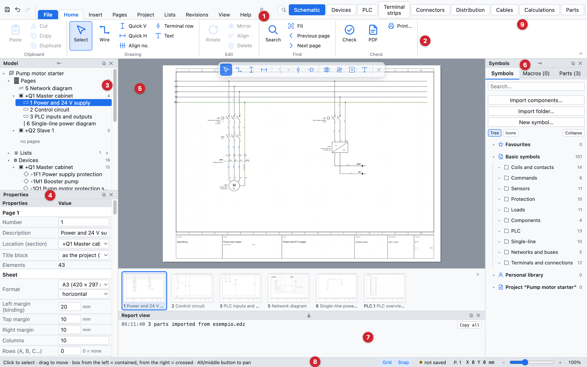
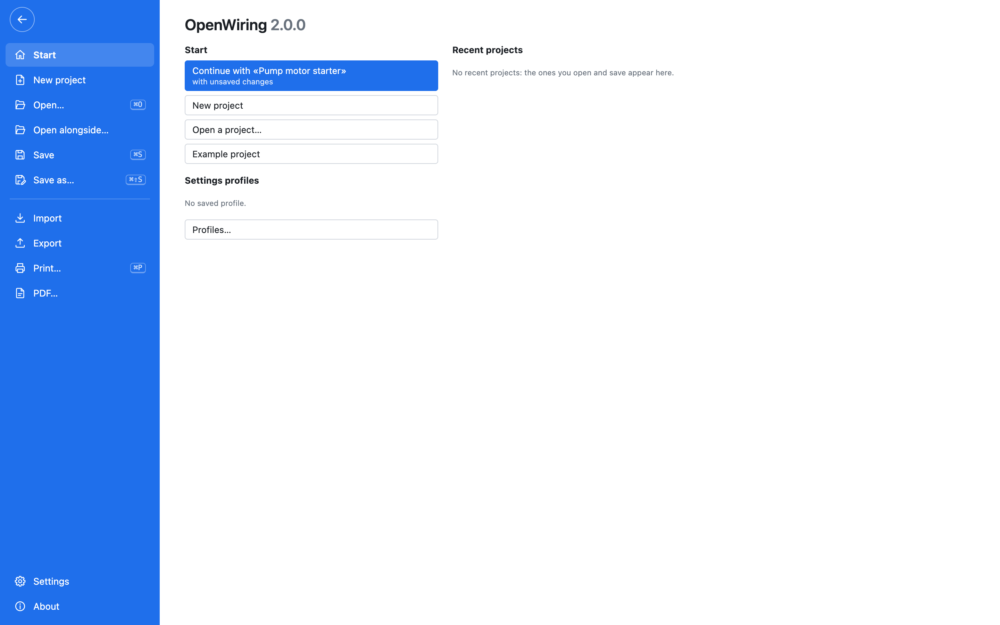
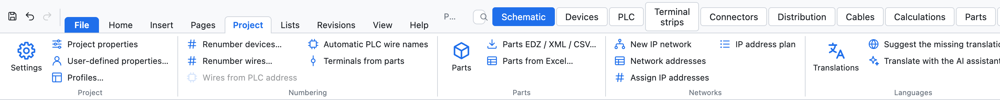
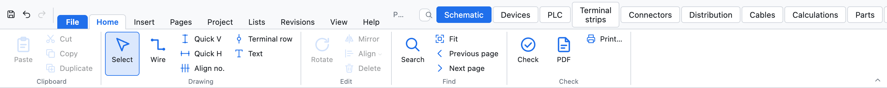
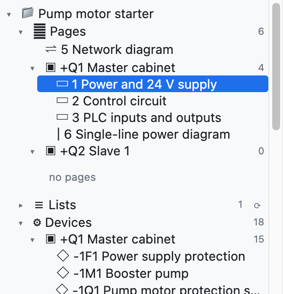
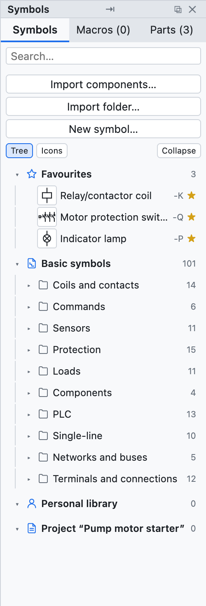
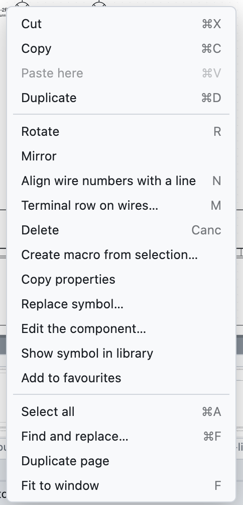

# 2. Die Oberfläche

*Das OpenWiring-Fenster mit dem Beispielprojekt.*

| Nr. | Bereich | Wozu er dient |
|---|---|---|
| 1 | Registerkarten des Menübands | *Datei* und die Registerkarten *Start, Einfügen, Seiten, Projekt, Listen, Revisionen, Ansicht, Hilfe* |
| 2 | Befehle des Menübands | die Befehle der offenen Registerkarte, in Gruppen mit dem Namen darunter |
| 3 | Modellbaum | Seiten, Geräte, Struktur =/+, Klemmleisten, Kabel, Projektartikel |
| 4 | Eigenschaften | die Daten des ausgewählten Elements, der Seite oder des Projekts |
| 5 | Zeichenbereich | die aktuelle Schaltplanseite |
| 6 | Bibliothek | Symbole, Makros und Artikel zum Einfügen |
| 7 | Meldungsansicht | Meldungen zu Import, Export und Vorgängen |
| 8 | Statusleiste | Hinweise zum aktiven Befehl, Datei, Seite, Cursorkoordinaten |
| 9 | Ansichtsregister | Schaltplan, Geräte, SPS, Klemmleisten, Artikel, Listen |

## Menüband

Die Befehle sind in **Registerkarten** zusammengefasst; jede Karte teilt sie in Gruppen, deren Name darunter steht.
Das Tastenkürzel erscheint im Tooltip jeder Schaltfläche. Ein **Doppelklick** auf eine Registerkarte reduziert das
Menüband auf die Kartennamen (ein Klick öffnet es wieder für einen Befehl); *Ansicht ▸ Befehlsleiste ▸ Stil* wählt
zwischen Menüband, kompaktem Menüband und **klassischen Menüs** für alle, die Aufklappmenüs bevorzugen.
*Befehl suchen…* (⌘K) findet jeden Befehl über seinen Namen.

*Die Registerkarte Datei: Start, zuletzt verwendete Projekte, neu, öffnen, speichern, importieren, exportieren, drucken und PDF, Einstellungen.*

| Registerkarte | Inhalt |
|---|---|
| *Datei* | neu, öffnen, daneben öffnen, speichern, **Importieren** (Artikel EDZ/XML/CSV, QElectroTech-Symbole, Schaltplan aus PDF, Makros) und **Exportieren** (PDF, DXF, Beschriftungen, PLCopen, Artikel, Wörterbuch), drucken, Einstellungen, Info |
| *Start* | Zwischenablage, Zeichnen (Auswahl, Draht, Schnelldrähte, Klemmenreihe, Text), Bearbeiten (drehen, spiegeln, ausrichten, löschen), Suchen (Suche, einpassen, vorherige und nächste Seite), Prüfung, PDF und Druck |
| *Einfügen* | Symbole und Makros, Verbindungen (Drahtbündel, Netzwerkbus, Kabel, Querschnitt), Orte, Grafik (Text, Bild, DXF-Zeichnung) |
| *Seiten* | neue Seite jeder Art, automatische Seiten (Listen, Kabelzeichnungen, Steckerbelegungen), organisieren, Blatt (Schriftfeld, Format und Rahmen) |
| *Projekt* | Einstellungen und Eigenschaften, Profile, Nummerierung von Betriebsmitteln und Drähten, Artikel, IP-Netze und Adressen, Übersetzungen, KI-Assistent |
| *Listen* | Prüfungen, Listen, SPS-E/A-Liste, eigene Listen, Ansichten (Betriebsmittel, Klemmleisten, Stecker, Kabel, Verteiler, Berechnungen), vollständiges PDF, Beschriftungen, PLCopen |
| *Revisionen* | Revisionen, Freigabe, Änderungen der Revision, Vergleich mit einem anderen Projekt, als Vorlage speichern |
| *Ansicht* | Fenster, Design, Blatt, Sprache der Oberfläche und der Schaltpläne, Raster, Miniaturen, Blattübersicht, Radialmenü, Stil des Menübands |
| *Hilfe* | Handbuch, geführte Tour, Tastenkürzel, Anleitung für KI-Agenten, Updates, Info, Projektwebsite |

*Die Registerkarte Projekt.*

## Registerkarte Start und Werkzeuge auf der Zeichnung

Die Registerkarte *Start* sammelt die ständig benutzten Befehle. Über dem Schaltplan gibt es außerdem eine kleine
schwebende Leiste mit den Zeichenwerkzeugen (Auswahl, Draht, Schnelldrähte, Unterbrechungsstellen, Klemmen, Text):
ein- und ausschalten unter *Ansicht ▸ Werkzeuge auf der Zeichnung*.

| Schaltfläche | Aktion |
|---|---|
| *Auswählen* | zurück zur Auswahl (auch mit Esc) |
| *Draht* | Drähte zeichnen (Taste **W**) |
| *Schnell V*, *Schnell H* | senkrechter oder waagerechter Draht in einem Zug |
| *Klemmenreihe* | eine Reihe Klemmen auf den gekreuzten Drähten |
| *Text* | freier Text auf der Seite |
| *Drehen, Spiegeln, Löschen* | auf die Auswahl (Tasten **R** und **Entf**) |
| *Suchen* | suchen und ersetzen (⌘F) |
| *Einpassen* | ganze Seite zeigen (Taste **F**) |
| *Prüfung* | Projektprüfungen |
| *PDF*, *Drucken…* | als PDF exportieren oder drucken |

Die Schnellzugriffsleiste oben links enthält *Speichern*, *Rückgängig* und *Wiederholen* (⌘S, ⌘Z, ⇧⌘Z).

## Modellbaum

Der Baum zeigt das Projekt und lässt sich mit den Dreiecken ▸ ▾ auf- und zuklappen:

- **Seiten**, nach Ort gruppiert (Schaltschrank, Bedienstation…): ein Klick öffnet die Seite.
- **Geräte**, nach Ort gruppiert: ein Klick springt zum Gerät und wählt es aus.
- **Struktur =Anlage +Ort**: die Geräte nach Funktion und Ort (siehe [Kapitel 7](07-dispositivi-e-articoli.md#struktur-anlage-ort)).
- **Klemmleisten** und **Kabel**: ein Klick öffnet die Klemmleiste oder wählt die Kabellinie aus.
- **Projektartikel**: die verwendeten Artikel.

Unter dem Baum stehen die Seitenschaltflächen: *+ Seite*, *+ Deckblatt*, *+ Einpolig*, *+ Netzwerk*,
*+ Aufbau*, *⧉* (Seite duplizieren), *↑ ↓* (verschieben) und *✕* (löschen).

## Eigenschaften

Das Feld zeigt die Daten des Ausgewählten:

- **nichts ausgewählt**: die aktuelle Seite und darunter die Projektdaten;
- **ein Symbol**: BMK, Gerätedaten, Bestellung, Anschlusspunkte, Position;
- **ein Draht**: Drahtnummer, Netz, Verbindungen, Querschnitt, Farbe;
- **mehrere Elemente**: die gemeinsamen Felder.

Man schreibt ins Feld und bestätigt mit der Eingabetaste oder durch Verlassen des Felds. Werte in grauer
Kursivschrift sind Vorschläge oder Werte aus dem Artikel.

## Bibliothek

Die rechte Spalte hat drei Register:

- **Symbole**: die Symbole nach IEC 60617, nach Kategorien geordnet (Spulen und Kontakte, Befehlsgeräte,
  Schutzgeräte, Verbraucher, Klemmen und Verbindungen, SPS, Netze und Busse, einpolig), dazu die von Ihnen
  importierten oder gezeichneten. Das Feld *Suchen…* filtert nach Namen.
  Oben stehen die **★ Favoriten**: der Stern ☆ eines Symbols (oder rechte Maustaste auf ein Bauteil ▸
  *Zu Favoriten hinzufügen*) legt es hier ab. Favoriten gelten für alle Projekte.
- **Makros**: zur Wiederverwendung gespeicherte Stromkreise (siehe [Kapitel 13](13-macro-simboli-cartigli.md)).
- **Artikel**: die Bibliothek der Herstellerartikel.

## Kontextmenü

Ein Rechtsklick auf ein Element öffnet die häufigsten Befehle: ausschneiden, kopieren, hier einfügen,
duplizieren, drehen, spiegeln, löschen, Makro aus Auswahl erstellen, **Eigenschaften kopieren** und **Eigenschaften von -X einfügen** (alle Gerätedaten außer dem BMK, [Kapitel 7](07-dispositivi-e-articoli.md#eigenschaften-kopieren)), Bauteil bearbeiten, zu Favoriten hinzufügen, Potenzial
hervorheben (bei Drähten), zum Hauptelement oder zu den Kontakten, Etage hinzufügen (bei Klemmen), alles
auswählen, suchen, Seite duplizieren, an Fenster anpassen.

## Ansichten

Die Register oben rechts ändern den mittleren Bereich:

| Ansicht | Inhalt |
|---|---|
| *Schaltplan* | die Zeichenseite |
| *Geräte* | der Gerätenavigator als Tabelle |
| *SPS* | Karten, Adressen und E/A-Liste |
| *Klemmleisten* | der Klemmleisten-Navigator |
| *Artikel* | die Artikelverwaltung |
| *Listen* | Prüfungen, Übersetzungen und alle Listen |

## Im Plan bewegen

| Aktion | Wie |
|---|---|
| Vergrößern und verkleinern | Mausrad, um den Cursor herum (auf dem Trackpad: Zusammenziehen) |
| Ansicht verschieben | mittlere Maustaste oder **Alt** + ziehen |
| Ganze Seite sehen | **F** oder *Einpassen* |
| Vorherige oder nächste Seite | **Bild↑** / **Bild↓** |
| Zu einem Verweis springen | auf einen Querverweis wie `/2.4` klicken |

## Design, Blatt und Sprache

*Ansicht ▸ Design* wählt eine helle, dunkle oder systemgleiche Oberfläche. *Ansicht ▸ Zeichenblatt* wählt
ein weißes oder dunkles Blatt (wie in CAD-Programmen mit schwarzem Hintergrund). PDF, DXF und Druck sind
immer auf weißem Blatt. *Ansicht ▸ Language · Lingua* wählt die Sprache der Oberfläche: Italienisch,
Englisch, Französisch, Deutsch oder Spanisch.
