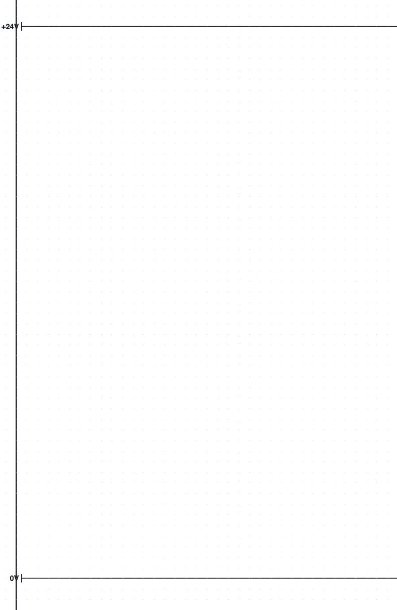
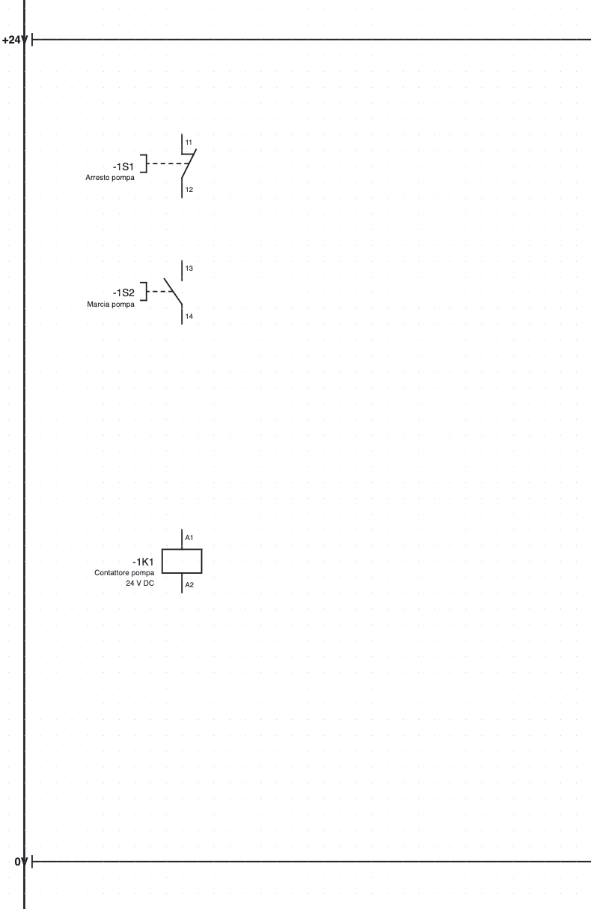
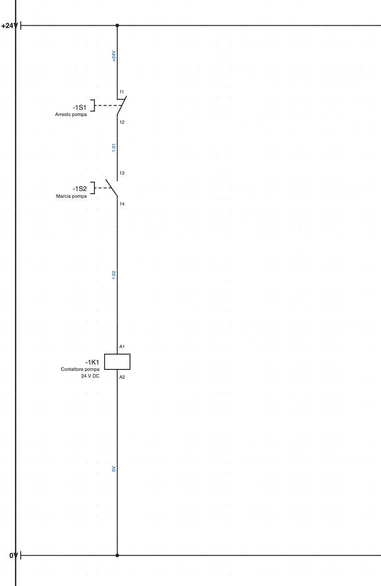
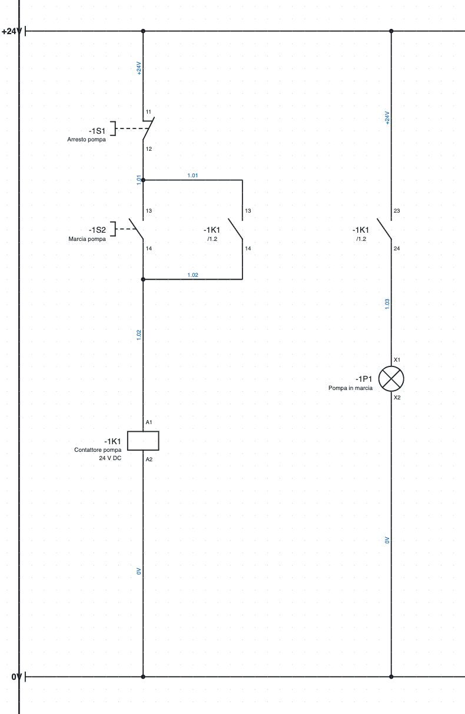
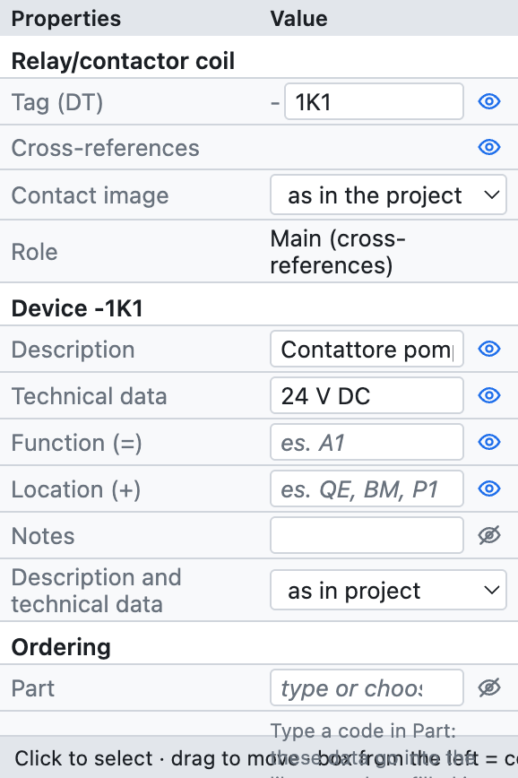
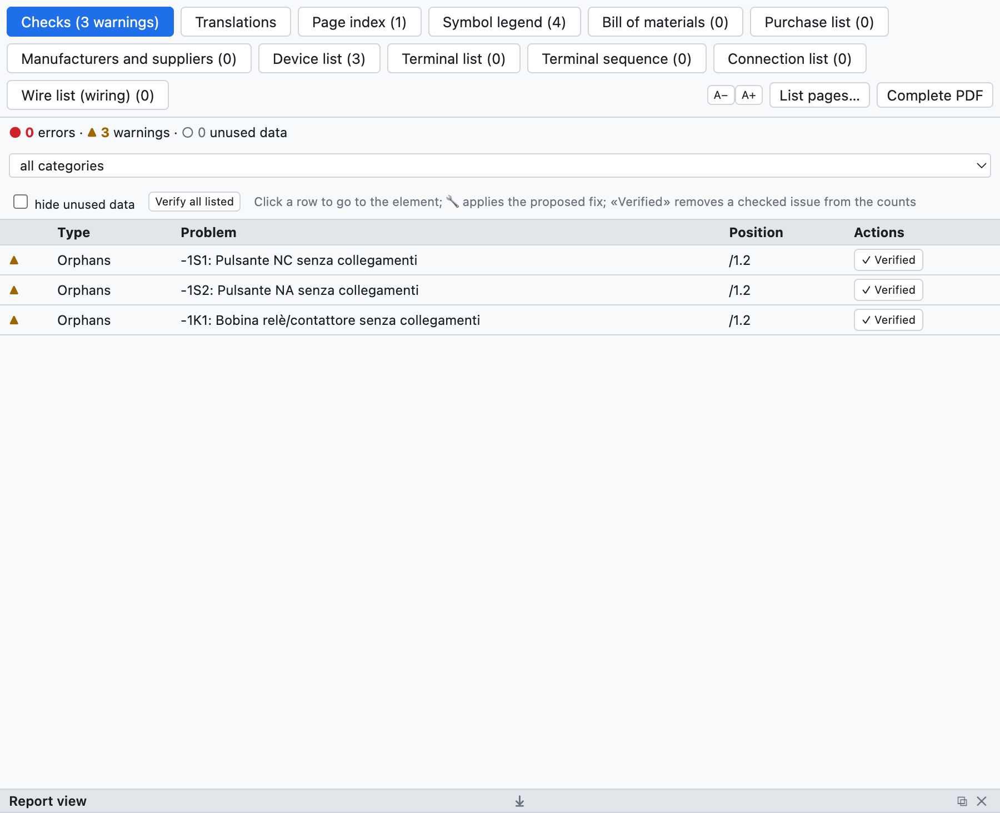
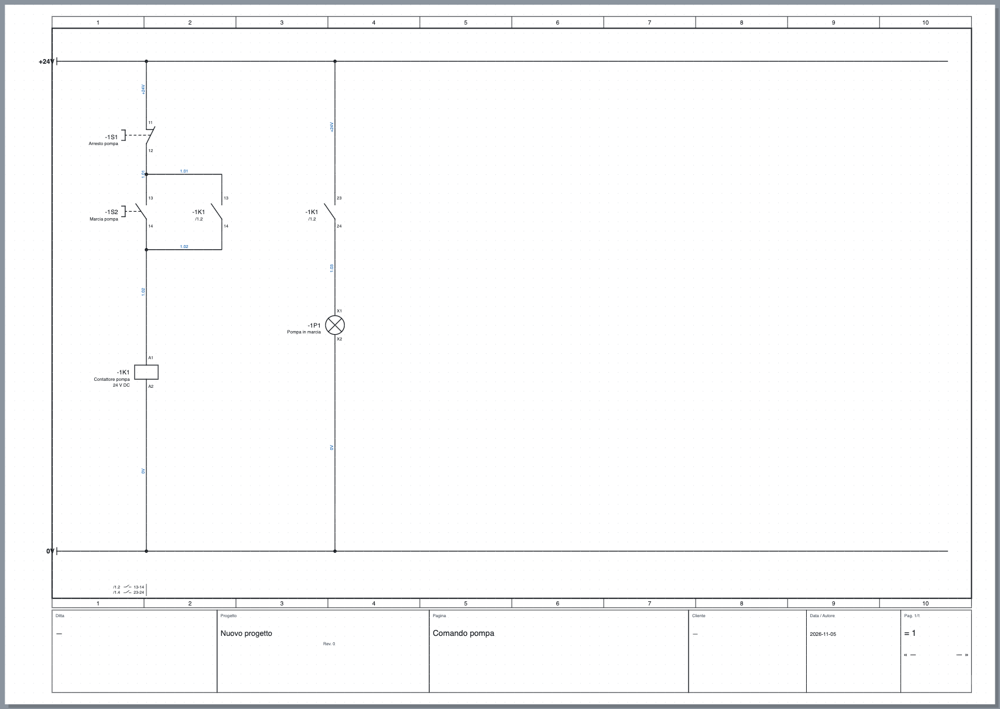

# 3. Das erste Projekt

In dieser Übung zeichnen Sie die **Steuerung einer Pumpe**: einen Aus-Taster, einen Ein-Taster, das Schütz
mit Selbsthaltung und eine Betriebsleuchte, versorgt mit 24 V. Das dauert etwa zwanzig Minuten; danach
kennen Sie die Grundbefehle: Symbole einfügen, Drähte zeichnen, Daten ausfüllen, prüfen und exportieren.

## Schritt 1 – Neues Projekt und Versorgungsschienen

1. *Datei ▸ Neues Projekt*. Eine leere Seite öffnet sich, Seite **1**.
2. Klicken Sie im Baum auf den Seitennamen und schreiben Sie unter *Eigenschaften* die **Beschreibung**:
   `Pumpensteuerung`. Der Titel erscheint im Schriftfeld.
3. Wählen Sie in der Bibliothek, Kategorie *Klemmen und Verbindungen*, den **Potenzialpunkt** und klicken
   Sie oben links auf die Seite. Der Punkt heißt `L1`: unter *Eigenschaften ▸ Name* `+24V` eingeben.
4. Fügen Sie unten einen zweiten Potenzialpunkt ein und nennen Sie ihn `0V`. Mit **Esc** beenden Sie das
   Einfügen.
5. Drücken Sie **W** (Werkzeug *Draht*), klicken Sie auf den Punkt `+24V` und dann ans rechte Seitenende;
   beenden Sie den Draht mit einem Doppelklick. Ebenso für die Schiene `0V`.

*Schritt 1: die Versorgungsschienen.*

> **Warum Potenzialpunkte?** Alle Leiter mit demselben Namen (`+24V`, `0V`, `L1`, `PE`…) sind miteinander
> verbunden, auch auf verschiedenen Seiten. Listen und Prüfung wissen das.

## Schritt 2 – Die Symbole

1. Kategorie *Befehlsgeräte*: **Drucktaster Öffner** wählen und unter der Schiene `+24V` in Spalte 1–2
   klicken. Der Taster erhält automatisch das BMK `-1S1` (Seite 1, Buchstabe S, erster auf der Seite).
2. Ebenfalls in *Befehlsgeräte*: **Drucktaster Schließer** weiter unten auf derselben Senkrechten: er wird
   zu `-1S2`.
3. Kategorie *Spulen und Kontakte*: **Relais-/Schützspule** noch weiter unten: sie wird zu `-1K1`.
4. **Esc** drücken.

Muss ein Symbol gedreht werden, vor dem Einfügen **R** drücken (Drehung um 90°); nach dem Einfügen dreht man
es mit **R** auf der Auswahl. Symbole rasten im 4-mm-Raster ein.

*Schritt 2: Taster und Spule, noch ohne Drähte.*

## Schritt 3 – Die Drähte

1. **W** drücken. Auf die Schiene `+24V` über dem Taster `-1S1` klicken: der Draht beginnt am Punkt der Schiene.
2. Auf den oberen Anschlusspunkt des Tasters (`11`) klicken: der Draht endet von selbst, wenn er einen
   Anschlusspunkt erreicht. Die verfügbaren Punkte sind durch kleine grüne Kreise markiert.
3. Ebenso `-1S1:12` mit `-1S2:13`, `-1S2:14` mit `-1K1:A1` und `-1K1:A2` mit der Schiene `0V` verbinden.

Wo ein Draht auf einen anderen trifft, erzeugt das Programm einen **Abzweig** und zeichnet ihn mit einem
Punkt. Zwei Drähte, die sich ohne Punkt kreuzen, sind nicht verbunden.

> **Automatische Verbindung.** Beim Einfügen oder Verschieben eines Symbols verbinden sich seine freien
> Anschlusspunkte von selbst mit den gegenüberliegenden Punkten auf derselben Linie: zwei Symbole
> untereinander auf derselben Senkrechten sind bereits durch einen Draht verbunden. Das ist praktisch für
> Stromkreise in Spalten; wer jeden Draht von Hand zeichnen will, schaltet sie unter
> *Projekteigenschaften ▸ Zeichnung ▸ Automatische Verbindung* aus.

*Schritt 3: der verbundene Steuerstromkreis. Die blauen Drahtnummern wurden automatisch vergeben.*

## Schritt 4 – Selbsthaltung und Leuchte

1. Kategorie *Spulen und Kontakte*: **Schließer**. Rechts neben dem Ein-Taster einfügen.
   Der Kontakt übernimmt das BMK der letzten Spule, `-1K1`, und die Anschlüsse `13-14`.
2. Ihn **parallel** zum Ein-Taster anschließen: ein Draht vom Abschnitt über `-1S2` zum Kontakt, ein Draht
   vom Kontakt zum Abschnitt unter `-1S2`. Die T-Abzweige entstehen von selbst.
3. Einen zweiten **Schließer** weiter rechts einfügen: er wird `-1K1` mit den Anschlüssen `23-24`.
4. Kategorie *Verbraucher*: **Meldeleuchte** unter dem Kontakt: sie wird zu `-1P1`.
5. Schiene `+24V` → Kontakt → Leuchte → Schiene `0V` verbinden.

*Schritt 4: Selbsthaltung `-1K1 13-14` und die von `-1K1 23-24` geschaltete Betriebsleuchte.*

Unter jedem Kontakt erscheint **`/1.2`**: die Lage der Spule (Seite 1, Spalte 2). Unten auf der Seite, unter
der Schiene `0V`, erscheint der **Kontaktspiegel** der Spule mit den Positionen der Kontakte (`/1.2 13-14`,
`/1.4 23-24`). Ein Klick auf einen Querverweis führt zum verbundenen Element.

## Schritt 5 – Die Bauteildaten

Spule `-1K1` auswählen. Im Feld *Eigenschaften* ausfüllen:

- **Beschreibung**: `Schütz Pumpe`;
- **Technische Daten**: `24 V DC`;
- wenn bekannt, den **Artikel**, sonst Hersteller, Typ und Bestellnummer.

*Die Eigenschaften der Spule `-1K1`: BMK, Gerätedaten, Bestellung, Anschlusspunkte und Position.*

Beschreibung und technische Daten erscheinen im Schaltplan unter dem BMK und gehen in die Listen ein. Sie
gehören zum **Gerät**: auf der Spule eingetragen, gelten sie auch für ihre Kontakte. Füllen Sie auch die
Taster (`Pumpe Aus`, `Pumpe Ein`) und die Leuchte (`Pumpe läuft`) aus.

## Schritt 6 – Prüfung

In der Symbolleiste auf **Prüfung** drücken. Es öffnet sich die Registerkarte *Prüfungen* mit Fehlern (●),
Warnungen (▲) und ungenutzten Daten (○). Ein Klick auf eine Zeile führt zum Element.

*Das meldet die Prüfung, wenn man sie nach Schritt 2 startet, solange die Symbole noch nicht verbunden sind.*

Beim fertigen Schaltplan findet die Prüfung keine Probleme. Löschen Sie testweise einen Draht: es erscheinen
Warnungen zu freien Anschlusspunkten.

## Schritt 7 – Speichern und exportieren

1. **Speichern** (⌘S) und den Dateinamen wählen, zum Beispiel `Pumpensteuerung.ecad`.
2. **PDF** in der Symbolleiste: *Alle* Seiten wählen und *Exportieren* drücken. Das PDF hat das
   Inhaltsverzeichnis, die Listen am Ende und anklickbare Querverweise.

*Die fertige Seite mit dem aus den Projektdaten ausgefüllten Schriftfeld.*

## Wie geht es weiter?

- Die Schriftfelddaten (Firma, Kunde, Zeichnungsnummer) trägt man in den Projekteigenschaften ein:
  [Kapitel 4](04-progetto-e-pagine.md).
- Um verschiedene Seiten zu verbinden, verwendet man Unterbrechungspunkte: [Kapitel 5](05-disegnare.md#unterbrechungspunkte-zwischen-seiten).
- Für den Hauptstromkreis (Motorschutzschalter, Schütz, Motor) Seite 1 des Beispielprojekts öffnen.
- Denselben Schaltplan kann der **KI-Assistent** nach einer Beschreibung in Worten zeichnen: [Kapitel 17](17-assistente-ia.md).
