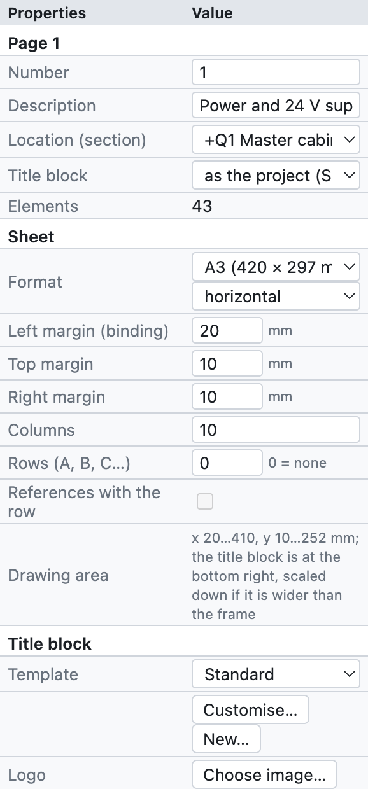
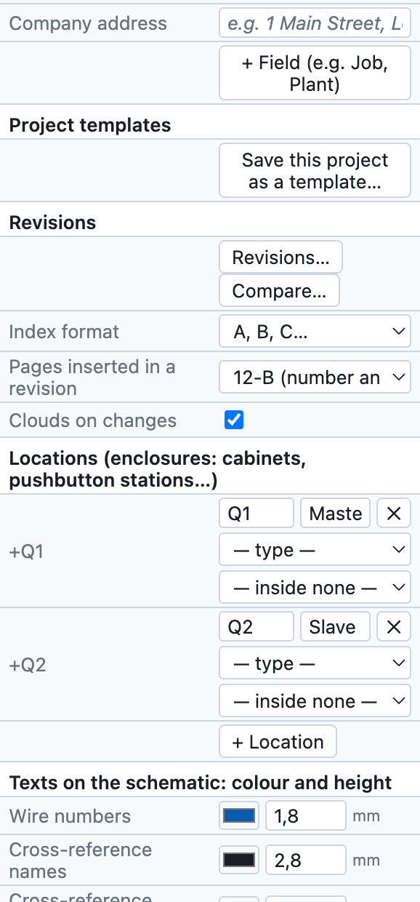
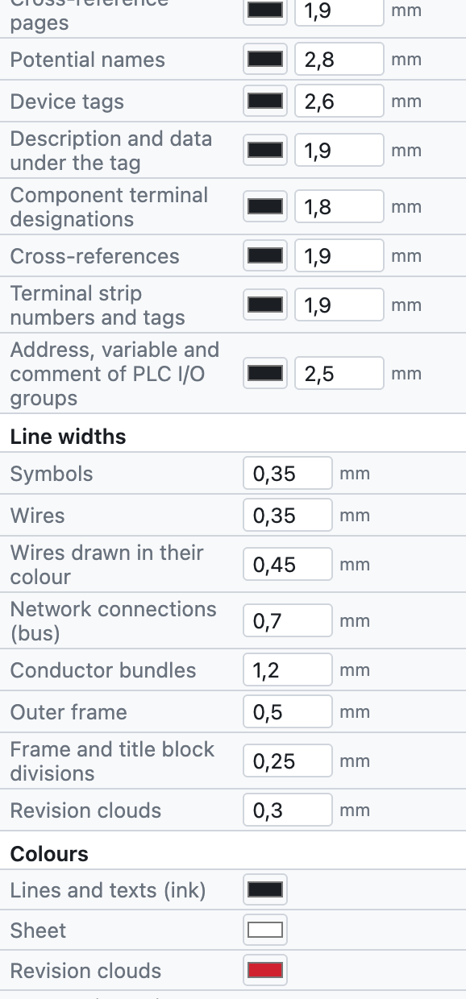
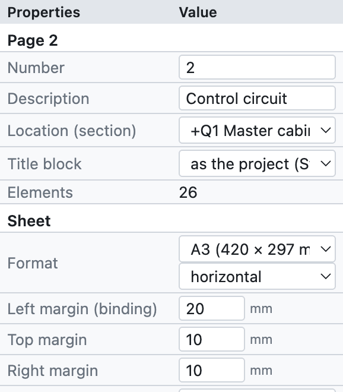
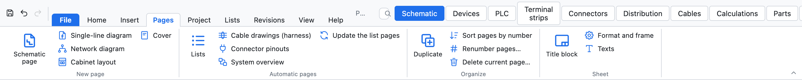
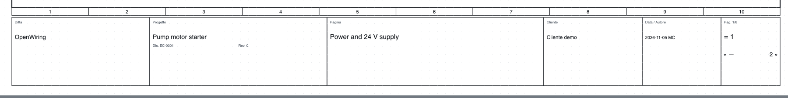
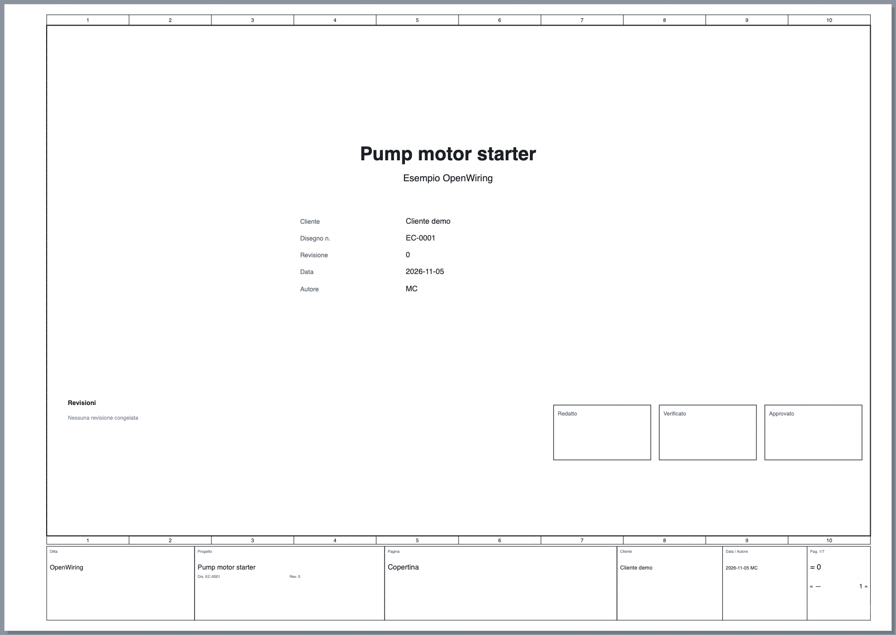

# 4. Projekt und Seiten

## Projekteigenschaften

Die Projekteinstellungen öffnen sich mit *Projekt ▸ Projekteigenschaften*, mit einem Klick auf den
Projektnamen im Baum oder indem man alles abwählt (Klick auf eine leere Stelle): das Feld *Eigenschaften*
zeigt die aktuelle Seite und darunter die Projektdaten.

*Das Feld der Projekteigenschaften von oben nach unten.*

| Gruppe | Felder | Siehe |
|---|---|---|
| *Seite* | Nummer, Beschreibung, Ort, Schriftfeld der Seite | [Seiten](#seiten) |
| *Schriftfeld* | Vorlage, Logo, Firmenadresse, Zusatzfelder | [Schriftfeld](#schriftfeld) |
| *Projektvorlagen* | Projekt als Vorlage speichern | [Projektvorlagen](#projektvorlagen) |
| *Revisionen* | neue Revision, Vergleich, Wolken | [Kapitel 15](15-verifica-ricerca-revisioni.md#revisionen) |
| *Orte* | Schaltschränke, Bedienstationen, Maschinenseite… | [Kapitel 11](11-reti-luoghi-unifilare.md#orte) |
| *Sprachen* | Sprache der Schaltpläne und zweite Sprache | [Kapitel 16](16-lingue.md) |
| *IP-Netze* | Teilnetze des Adressplans | [Kapitel 11](11-reti-luoghi-unifilare.md#ip-adressplan) |
| *Projekt (Schriftfeld)* | Name, Beschreibung, Firma, Kunde, Autor, Zeichnungsnummer, Revision, Datum | unten |
| *Betriebsmittelkennzeichen* | BMK-Vorlage, Zähler, Kontaktspiegel | [Kapitel 6](06-sigle-e-numerazione.md) |
| *Drahtnummern* | Anzeige, Querschnitt und Farbe, farbige Drähte, Nummerierung, Vorlage | [Kapitel 6](06-sigle-e-numerazione.md#drahtnummern) |
| *Zeichnung* | Beschreibungen im Schaltplan, Rasterweite | unten |

### Schriftfelddaten

Name, Beschreibung, Firma, Kunde, Autor, Zeichnungsnummer, Revision und Datum erscheinen im Schriftfeld jeder
Seite, auf dem Deckblatt und in den PDF-Eigenschaften. Man schreibt sie nur einmal.

### Zeichnung

- **Beschreibungen im Schaltplan**: schreibt Beschreibung und technische Daten unter das BMK der Geräte
  (für ein einzelnes Gerät änderbar).
- **Rasterweite**: 4 mm (empfohlen) oder 1, 2, 5 oder 8 mm.

## Seiten

Das Blatt ist ein **A3 quer** (420 × 297 mm) mit einem in **10 nummerierte Spalten** geteilten Rahmen und dem
Schriftfeld unten. Die Spalten dienen den Verweisen: `/2.4` bedeutet Seite 2, Spalte 4.

*Die Eigenschaften von Seite 2 des Beispielprojekts.*

- **Nummer**: der Name der Seite, frei wählbar (`1`, `200`, `10.1`). Er geht in die BMK (`-200K1`), die
  Drahtnummern (`200.01`) und die Querverweise (`/200.4`) ein.
- **Beschreibung**: der Seitentitel im Schriftfeld und im Inhaltsverzeichnis.
- **Ort (Abschnitt)**: der Schaltschrank oder Ort, zu dem die Seite gehört; der Baum gruppiert die Seiten
  nach Ort.
- **Schriftfeld**: das Schriftfeld der Seite, falls es vom Projekt abweicht.

### Seitenbefehle

| Befehl | Wo | Wirkung |
|---|---|---|
| Neue Seite | *+ Seite* unter dem Baum, *Einfügen ▸ Schaltplanseite* | leere Seite nach der aktuellen, mit der nächsten Nummer |
| Duplizieren | *⧉*, *Einfügen ▸ Aktuelle Seite duplizieren*, Rechtsklick | Kopie mit neuen BMK und Drahtnummern |
| Verschieben | *↑ ↓* unter dem Baum | ändert die Reihenfolge |
| Löschen | *✕* unter dem Baum | fragt nach; rückgängig mit ⌘Z |
| Seite wechseln | Klick im Baum, **Bild↑/Bild↓** | |

*Die Registerkarte Seiten: neue Seiten jeder Art, automatische Seiten, Reihenfolge und Blatt.*

### Seitentypen

| Typ | Wie er entsteht | Inhalt |
|---|---|---|
| Allpoliger Schaltplan | *+ Seite* | der eigentliche Stromlaufplan |
| Einpoliger Übersichtsplan | *+ Einpolig* | einpolige Symbole ([Kapitel 11](11-reti-luoghi-unifilare.md#einpoliger-übersichtsplan)) |
| Netzwerkplan | *+ Netzwerk* | Knoten und Busverbindungen zwischen Schaltschränken ([Kapitel 11](11-reti-luoghi-unifilare.md)) |
| Schaltschrankaufbau | *+ Aufbau* | Montageansicht der Platte ([Kapitel 12](12-layout-quadro.md)) |
| Deckblatt | *+ Deckblatt* | Titel, Daten, Revisionen, Unterschriften |
| SPS-Übersicht | Ansicht SPS ▸ *Übersichtsseiten* | erzeugt ([Kapitel 10](10-plc.md)) |
| Klemmleistenplan | Ansicht Klemmleisten ▸ *Klemmleistenpläne erzeugen* | erzeugt ([Kapitel 8](08-morsettiere.md)) |
| Listenseite | *Einfügen ▸ Automatische Seiten* | erzeugt ([Kapitel 14](14-liste-e-pagine-automatiche.md)) |

Erzeugte Seiten aktualisieren sich selbst: ihr Inhalt kommt immer aus dem Schaltplan.

## Schriftfeld

*Das Standard-Schriftfeld: Firma, Projekt mit Zeichnungsnummer und Revision, Seitentitel, Kunde, Datum und
Autor, Seitennummer.*

In der Gruppe *Schriftfeld* der Eigenschaften:

- **Vorlage**: *Standard*, *Mit Revisionstabelle* (die letzten drei Revisionen), *Kompakt*, eines der sechs
  ausführlichen Schriftfelder (*ISO 7200*, *Industrie ausführlich*, *Maschine EN 60204-1*, *Gebäudeinstallation DM 37/08*,
  *Schaltgerätekombination EN 61439*, *Automatisierung mit Unterschriften*, beschrieben in
  [Kapitel 13](13-macro-simboli-cartigli.md#mitgelieferte-schriftfelder)) oder ein eigenes
  Schriftfeld. *Anpassen…* öffnet die Vorlage im Editor, *Neu…* erstellt eine von Grund auf
  (siehe [Kapitel 13](13-macro-simboli-cartigli.md#eigene-schriftfelder)).
- **Logo**: ein Bild als PNG, JPG oder SVG.
- **Firmenadresse**: unter dem Firmennamen.
- **+ Feld**: Zusatzfelder mit Name und Wert, zum Beispiel *Auftrag* oder *Anlage*. Wählt man eine Vorlage mit eigenen Feldern (zum Beispiel
  `{campo:Matricola}`), erscheinen diese Felder von selbst in den Projekteigenschaften.

Jede Seite kann ein anderes Schriftfeld als der Rest des Projekts haben (*Seiteneigenschaften ▸ Schriftfeld*).

## Benutzerdefinierte Eigenschaften

*Projekt ▸ Benutzerdefinierte Eigenschaften…* öffnet die Liste der eigenen Eigenschaften des Projekts, zusätzlich
zu den mitgelieferten: zum Beispiel die Kundenauftragsnummer, die Bestellnummer oder ein interner Code. Für jede
Eigenschaft gibt man an:

- den **Bezeichner** mit mindestens einem Punkt (zum Beispiel `Ditta.Commessa`);
- den **angezeigten Namen**;
- wem sie zugewiesen ist: **Geräten, Seiten, Verbindungen, Projekt oder Artikeln**;
- den **Typ**, die **Einheit** und die **Kategorie**;
- eine **Auswahlliste** (Werte durch `;` getrennt) und, falls nötig, *Nicht verwenden*, um sie beiseitezulegen,
  ohne sie zu löschen.

Die Werte werden in den *Eigenschaften* der Objekte eingetragen, denen die Eigenschaft zugewiesen ist. Bei Geräten
erscheinen sie auch als Spalten im Register *Geräte* und in Excel; in Schriftfeldern verwendet man sie mit dem
Platzhalter `{prop:name}` ([Kapitel 13](13-macro-simboli-cartigli.md#platzhalter)).

Die Liste lässt sich als **XML exportieren und importieren**. Der Import ist tolerant: Er akzeptiert Namen auf
Englisch, Deutsch oder Italienisch und mehrsprachige Texte; Eigenschaften mit ungültigem Bezeichner werden
verworfen, und das Programm meldet, wie viele.

## Deckblatt

*+ Deckblatt* fügt am Projektanfang die Seite **0** ein mit Logo, Titel, Beschreibung, Projektdaten,
Revisionstabelle und den Feldern *Erstellt*, *Geprüft*, *Freigegeben*. Es aktualisiert sich selbst mit den
Projektdaten.

*Das Deckblatt des Beispielprojekts.*

## Projektvorlagen

Eine Vorlage bewahrt Einstellungen, Schriftfeld, Logo, Orte und Deckblatt, ohne die Schaltpläne.

1. Ein Projekt mit den Einstellungen Ihrer Firma vorbereiten.
2. *Projekt ▸ Als Vorlage speichern…* und einen Namen vergeben, zum Beispiel `Werkstattstandard`.
3. Ab dann zeigt *Datei* den Eintrag *Neu aus Vorlage „Werkstattstandard“*.

Vorlagen bleiben auf dem Computer und stehen allen Projekten zur Verfügung.
