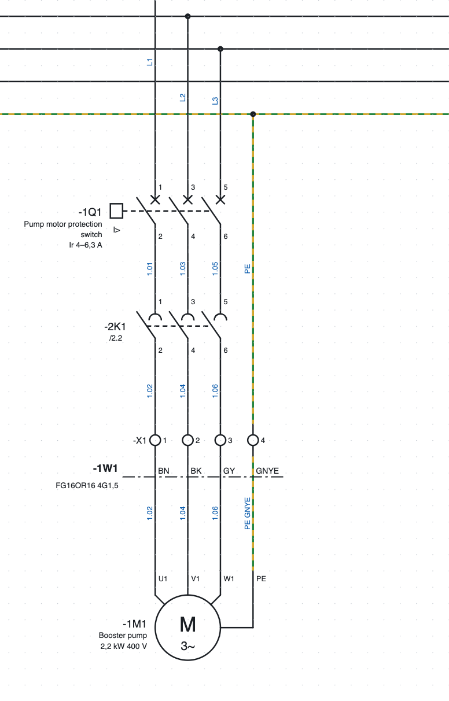
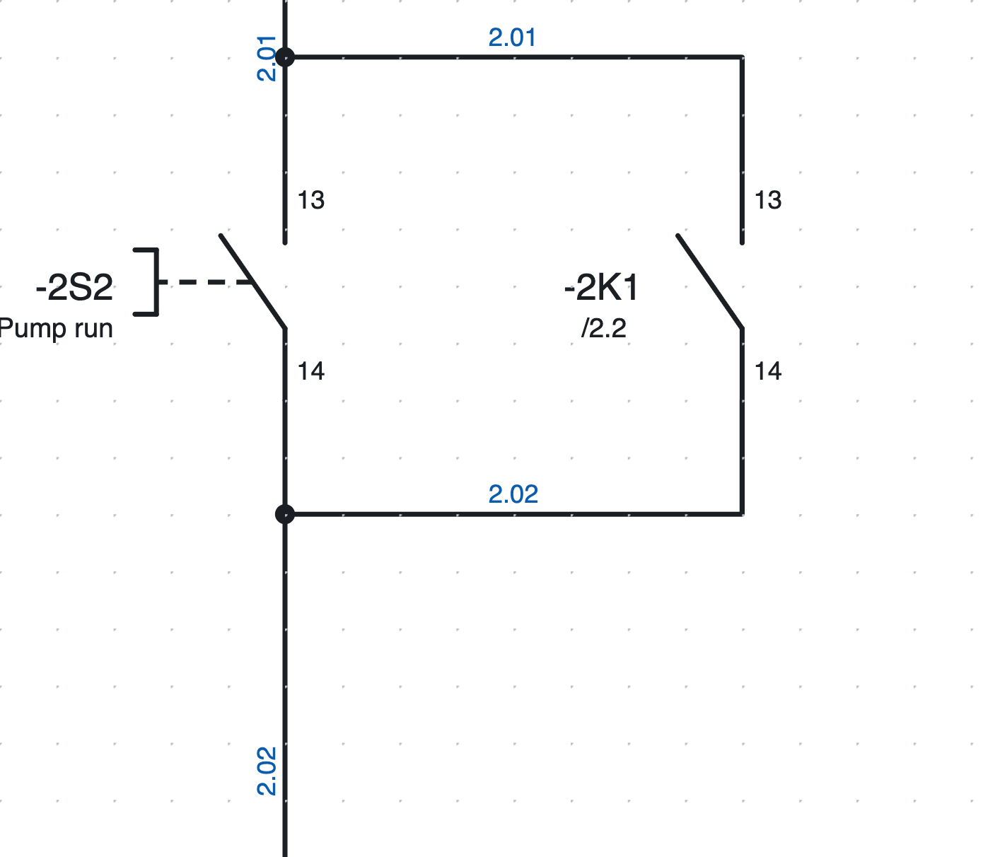
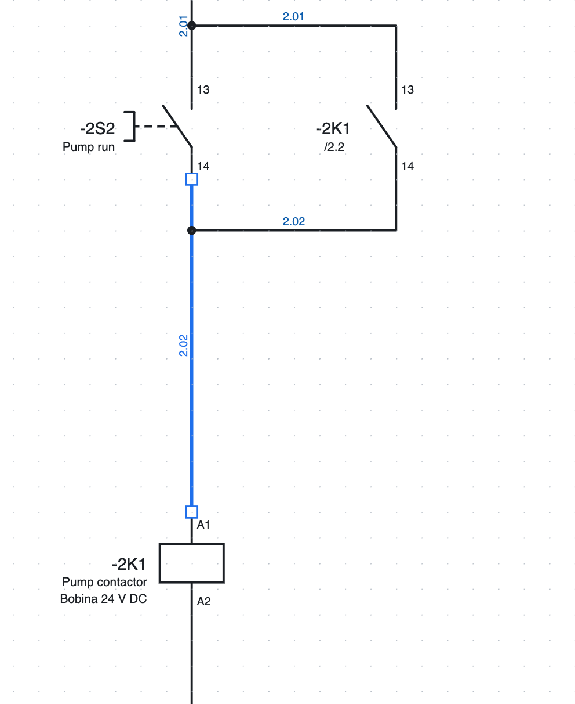
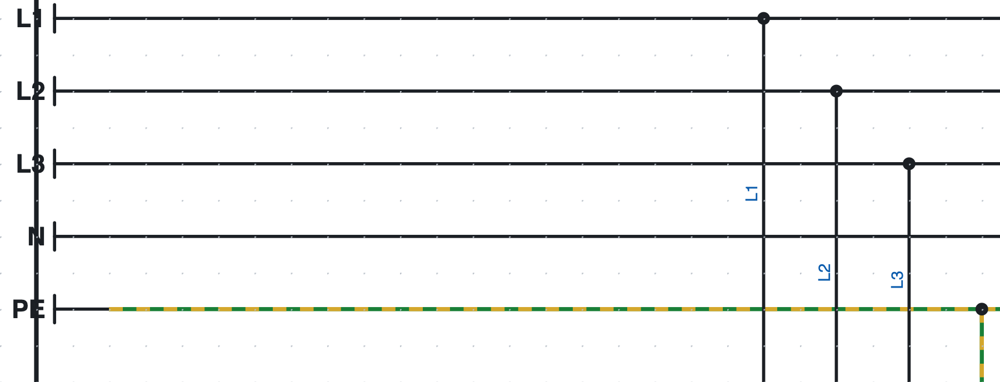
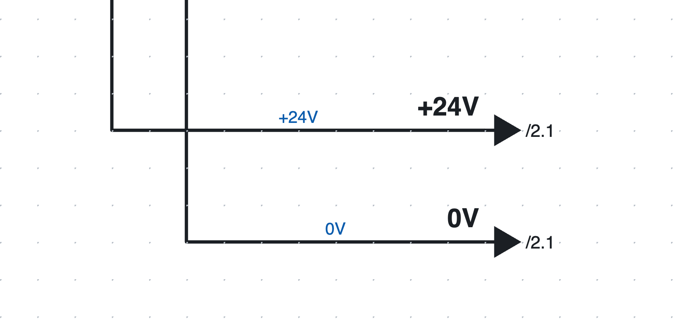

# 5. Den Schaltplan zeichnen

## Symbole einfügen

1. In der Bibliothek rechts (Register *Symbole*) auf ein Symbol klicken. Das Feld *Suchen…* filtert nach
   Namen („Kontakt“, „Motor“…).
2. Auf die Seite klicken: das Symbol wird am Raster eingefügt und **bleibt aktiv**, sodass man weitere
   gleiche einfügen kann.
3. **R** dreht das Symbol vor dem Einfügen um 90°.
4. **Esc** oder Rechtsklick beenden das Einfügen.

Jedes neue Symbol erhält ein freies **BMK** nach der Projektvorlage (zum Beispiel `-2K3`, siehe
[Kapitel 6](06-sigle-e-numerazione.md)). Für einen soeben eingefügten **Hilfskontakt** öffnet sich eine Liste der Geräte, denen er zugeordnet werden kann:
Spulen und Geräte des Projekts, zuerst die mit demselben Buchstaben, jeweils mit Beschreibung, Position und
Kontaktzahl. Die Liste filtert sich beim Schreiben; man kann auch ein neues BMK eingeben. Das Programm schlägt
das zuletzt gewählte erneut vor.

### Die mitgelieferten Symbole

| Kategorie | Symbole |
|---|---|
| Spulen und Kontakte | Relais-/Schützspule, Zeitrelaisspule, Schließer, Öffner, Wechsler, Hauptkontakte 3-polig |
| Befehlsgeräte | Drucktaster Schließer, Drucktaster Öffner, Not-Halt-Pilztaster, Wahlschalter, Positionsschalter, Näherungsschalter PNP 3-Draht |
| Schutzgeräte | Sicherung, Leitungsschutzschalter 1-, 2- und 3-polig, Motorschutzschalter 3-polig, Motorschutzrelais 3-polig |
| Verbraucher | Drehstrom- und Einphasenmotor, Meldeleuchte, Magnetventil, Netzteil 230 V AC / 24 V DC, Transformator |
| Klemmen und Verbindungen | Klemme, PE-Klemme, Trennklemme, Sicherungsklemme, Buchsenkontakt, Steckerstift und Paar Buchse+Stecker, Potenzialpunkt, Schutzleiter PE, Unterbrechungspunkte Quelle und Ziel |
| SPS | Digitaleingang und -ausgang, Analogeingang und -ausgang, Kartenversorgung L+/M |
| Netze und Busse | Knoten mit 2 Ports (IN/OUT oder P1/P2), Knoten mit 1 Port, Switch mit 5 Ports, Abschluss |
| Einpolig | Leistungsschalter, Motorschutzschalter, Trennschalter, Sicherung, Schütz, Motor, Transformator, Frequenzumrichter, Netzteil, Verbraucher |

Weitere Symbole zeichnet man mit dem Editor oder importiert sie aus QElectroTech und aus den EDZ-Dateien der
Hersteller ([Kapitel 13](13-macro-simboli-cartigli.md) und [Kapitel 7](07-dispositivi-e-articoli.md)).

*Der Motorabgang auf Seite 1: Motorschutzschalter `-1Q1`, Hauptkontakte des Schützes `-2K1`, Klemmleiste
`-X1`, Kabel `-1W1` und Motor `-1M1`.*

## Drähte zeichnen

1. **W** oder *Draht* drücken.
2. Auf den Startpunkt klicken: einen Anschlusspunkt, einen vorhandenen Draht oder einen freien Punkt.
3. Für jede Ecke klicken. Der Abschnitt ist immer waagrecht oder senkrecht; vor dem Klick zeigt die Vorschau
   den L-förmigen Verlauf.
4. Der Draht **endet von selbst**, wenn man auf einen Anschlusspunkt oder einen anderen Draht klickt.
   Sonst mit Doppelklick, Eingabetaste oder Rechtsklick abschließen.
5. **Esc** bricht den aktuellen Draht ab.

Freie Anschlusspunkte werden beim Zeichnen grün markiert. Trifft man einen Draht etwas seitlich, läuft der
Abschnitt gerade bis zum Draht weiter.

### Abzweige und Kreuzungen

*Die Abzweige der Selbsthaltung auf Seite 2: der Punkt zeigt die Verbindung.*

- Ein Draht, der auf einem anderen Draht endet, bildet einen **T-Abzweig**, gezeichnet mit einem Punkt.
- Zwei Drähte, die sich ohne Punkt **kreuzen**, sind nicht verbunden.
- Den Punkt zeichnet man nicht von Hand: das Programm setzt ihn dort, wo die Drähte wirklich verbunden sind.

### Drähte bearbeiten

*Ein ausgewählter Draht zeigt seine Eckpunkte als kleine Quadrate.*

- **Einen Abschnitt ziehen**, um ihn parallel zu verschieben: die Enden bleiben verbunden.
- **Einen Eckpunkt oder ein Ende ziehen**, um den Draht zu verlängern, zu kürzen oder neu anzuschließen.
- Der Cursor ändert seine Form und zeigt, was gezogen wird.
- Zum Löschen einen Draht auswählen und **Entf** drücken.

### Symbole mit ihren Drähten verschieben

Zieht man ein Symbol, folgen ihm die angeschlossenen Drähte schon während der Bewegung und bleiben
rechtwinklig, bei Bedarf mit einer Z-Biegung. Ein Draht zwischen zwei gemeinsam verschobenen Symbolen
bewegt sich ganz mit.

### Einen Kontakt auf einen Draht setzen

Fügt man einen Kontakt, Taster oder ein anderes Bauteil **auf einen Draht** ein (oder verschiebt es dorthin),
wird der Draht an seinen beiden Anschlusspunkten getrennt: man muss ihn nicht von Hand schneiden. Beide
Abschnitte behalten Farbe und Querschnitt.

## Potenzialpunkte

*Die Schienen L1, L2, L3, N und PE auf Seite 1.*

Der **Potenzialpunkt** gibt einem Leiter einen Namen: `L1`, `L2`, `L3`, `N`, `PE`, `+24V`, `0V`…

- Alle Leiter mit demselben Namen sind **verbunden**, auch auf verschiedenen Seiten.
- Den Namen schreibt man in die Eigenschaften (*Name*); ein neuer Punkt heißt `L1`, die Erde **PE** heißt `PE`.
- Die Leiter eines Potenzials können statt der Drahtnummer den Namen zeigen
  (*Projekteigenschaften ▸ Drahtnummern ▸ Potenziale*).
- Die Prüfung meldet zwei verschiedene Potenziale auf demselben Leiter (zum Beispiel `L1` mit `N` verbunden).

## Unterbrechungspunkte zwischen Seiten

*Die Unterbrechungspunkte `+24V` und `0V` auf Seite 1: der Name über dem Draht, die Zielseiten neben dem Pfeil.*

Setzt sich ein Leiter auf einer anderen Seite fort, verwendet man ein Paar **Unterbrechungspunkte**. Jede
Quelle ist mit **genau einem** Ziel verbunden, auch wenn sich der Name wiederholt (zum Beispiel die Drahtnummer):

1. Am Drahtende einen **Unterbrechungspunkt (Quelle)** einfügen. Der Name ist die Drahtnummer, falls
   vorhanden, sonst `R1`, `R2`…; er lässt sich unter *Eigenschaften* ändern.
2. Auf der anderen Seite am Drahtanfang einen **Unterbrechungspunkt (Ziel)** einfügen: die Liste der noch
   freien Quellen erscheint, zuerst die mit gleichem Namen. Eine wählen: das Ziel übernimmt ihren Namen und
   beide bleiben verbunden. Der erste Eintrag (*keine Quelle*) lässt das Ziel frei, wenn die Quelle noch
   nicht gezeichnet ist. Umgekehrt genauso: beim Einfügen einer Quelle wählt man unter den freien Zielen.
   Die Liste **filtert sich beim Schreiben**: jeder Eintrag zeigt Name, Position und Seite des Unterbrechungspunkts.
3. Im Feld *Name* der *Eigenschaften* sind die Vorschläge die freien Unterbrechungspunkte und die übrigen Namen
   von Unterbrechungspunkten; wählt man einen freien, werden die beiden verbunden. Die Verbindung ändert man unter
   *Eigenschaften ▸ Verbunden mit*. Wird ein Punkt umbenannt, ändert sich
   auch der Name des Gegenstücks.
4. Neben jedem Pfeil erscheint die Seite, auf der der Leiter weiterläuft (`/2.1`). Ein Klick führt zur Seite.
   An senkrechten Drähten stehen Name und Seite senkrecht, von unten nach oben.

### Wartende, gegenstücklose und sternförmige Unterbrechungsstellen

Beim Einfügen einer Unterbrechungsstelle übernimmt das Programm den Namen aus der Drahtnummer und sucht
freie Unterbrechungsstellen:

- gibt es **genau eine** freie Stelle mit demselben Namen **auf einer anderen Seite**, werden beide sofort verbunden (eine Meldung in
  der Berichtsansicht weist darauf hin);
- gibt es mehrere, öffnet sich die Liste mit der ersten bereits ausgewählt: *Enter* bestätigt sie. Der erste Eintrag, *— wartet auf das noch nicht gezeichnete Gegenstück (/…)*
  (oder ein neuer Name, oder *Esc*), lässt sie wartend: sie verbindet sich nicht selbst mit vorhandenen
  Stellen, auch nicht mit der gleichnamigen auf derselben Seite;
- gibt es keine, bleibt die Stelle **wartend**: neben dem Pfeil erscheint `/…` in Orange, bis Sie das
  Gegenstück zeichnen.

In *Eigenschaften ▸ Verbunden mit* wählt man das Gegenstück, setzt die Stelle auf *— wartet auf das
Gegenstück (/…)* zurück oder wählt *— kein Gegenstück (der Leiter endet hier)*, wenn der Leiter dort
wirklich endet: dann erscheint `//` neben dem Pfeil, und die Prüfung meldet es nur noch als Information,
nicht als Fehler.

In der Statusleiste zählt **Wartende Unterbrechungsstellen: N** die noch zu paarenden Stellen; jeder Klick
führt zur nächsten. Die Prüfung listet sie als Warnungen.

**Sternförmige Quelle.** Eine Quelle mit *Eigenschaften ▸ Sternförmig* verbindet sich mit **allen** freien
Zielen gleichen Namens (zum Beispiel ein `+24V`, das auf viele Seiten geht) und zeigt die Liste ihrer
Seiten. Die Prüfung schlägt den Stern vor (mit der Schaltfläche 🔧), wenn eine Quelle bereits verbunden ist
und weitere Ziele ihren Namen tragen.

## Leiterbusse

Laufen viele Drähte nebeneinander (zum Beispiel drei Phasen und Neutralleiter zu mehreren Verbrauchern), kann
man sie zu einem **Leiterbus** zusammenfassen, ohne alle Linien bis zum Ende zu zeichnen.

1. Das Werkzeug **Leiterbus** in der Symbolleiste wählen (oder *Einfügen ▸ Leiterbus*) und die Linie des Busses
   ziehen: eine dicke Linie. In den *Eigenschaften* gibt man dem Bus einen **Namen** (optional, zum Beispiel
   `400V AC` oder `24V DC`).
2. Die Drähte zeichnen, die zum Bus führen, und die Abzweige, die ihn verlassen, sodass sie die Linie berühren.
3. An jedem Draht, der den Bus berührt, erscheint der **Name des Leiters** (`L1`, `L2`, `PE`…) neben dem Draht.
   Er wird aus einer Liste gewählt, die sich beim Schreiben filtert.

Die Regeln sind einfach:

- Drähte mit **demselben Leiter am selben Bus** sind derselbe Draht und haben dieselbe Drahtnummer;
- Busse, die sich berühren, oder Busse mit demselben Namen auf mehreren Seiten sind **ein einziger Bus**: die
  Leiter laufen weiter;
- die Prüfung ([Kapitel 15](15-verifica-ricerca-revisioni.md)) meldet Drähte, die den Bus ohne Leitername
  berühren, und Leiter, die in den Bus eintreten, ohne irgendwo auszutreten.

Im Textformat ([Kapitel 17](17-assistente-ia.md)) ist die Buslinie ein Draht mit `busfili=name` (`busfili=_` ohne
Namen), und der Leiter an den beiden Enden eines Drahtes wird mit `cond1=` und `cond2=` geschrieben.

### Leiterbus als Kabel

Ein Kabel, das von einem Schaltschrank zum anderen geht, kann als Leiterbus gezeichnet werden: die Drähte
treten auf der Startseite in den Bus ein und verlassen auf der Zielseite einen Bus mit demselben Namen.

1. Geben Sie dem Bus **das BMK des Kabels** (`W1112S1`). Ist das Kabel noch nicht im Projekt, wählt man
   nach dem Namen den **Kabelartikel** (auch später, in *Eigenschaften ▸ Kabelartikel*).
2. Für jeden Draht schlägt das Programm die **Adern des Kabels der Reihe nach** vor (Farben oder Nummern):
   bereits verwendete sind abgeschwächt, anderswo eingetretene, die auf ihren Ausgang warten, sind
   hervorgehoben und zuerst vorgeschlagen, die übrigen sind frei.
3. Mit **Adern der Reihe nach benennen** (*Eigenschaften* des Busses) erhalten die Drähte der Seite ihre
   Ader von links nach rechts: auf der Startseite die ersten freien, auf der Zielseite die wartenden.
4. Zeichnen Sie die Kabellinie über die einzelnen Drähte, auf beiden Seiten: in der Ansicht *Kabel* nimmt
   jeder Draht die im Bus geschriebene Ader. Die dicke Buslinie zählt nicht als Ader.

Ein **Doppelklick auf den Bus** öffnet seine Eigenschaften: die Adern des Kabels mit ihrem Zustand
(belegte abgeblendet, auf den Ausgang wartende mit ⚠, freie mit grünem Balken) und die Tabelle der Drähte
des Busses, in der die Ader jedes Drahtes eingetippt oder aus der Liste gewählt wird.

Die Ansicht **Leiterbus** (*Ansicht ▸ Leiterbus* oder *Listen ▸ Leiterbus*) zeigt alle Busse und für den
gewählten jeden ein- oder austretenden Draht mit Seite, Drahtnummer und Verbindungen; die Ader wird direkt
in der Tabelle korrigiert. Drähte ohne Ader, Drähte, die eintreten ohne auszutreten, und Adern, die das
Kabel nicht hat, werden markiert. Die druckbare Liste **Leiterbus-Verbindungen** hat eine Ader je Zeile
(wie die Kabelverbindungen), mit den freien Adern des Kabels.

Ein Bus mit Kabelartikel (nummerierte oder farbige Adern) erhält wie die Kabel auch eine
**Verdrahtungsseite**: *Listen ▸ Kabelzeichnungen (Kabelbaum)* erstellt die Seite „Cablaggio bus fili …“
mit beiden Enden, den Adern und der Tabelle mit den freien Adern. Ein Bus ohne Artikel bleibt nur in der
Liste *Leiterbus-Verbindungen*.

## Texte

*Text* (oder *Einfügen ▸ Text*) und ein Klick auf die Seite fügen einen freien Text ein. Unter
*Eigenschaften* ändert man den Text und seine Höhe in mm. Texte kommen ins Übersetzungswörterbuch
([Kapitel 16](16-lingue.md)).

## Bilder

Fotos, Logos oder Zeichnungen werden als Bilder in den Schaltplan eingefügt.

- *Einfügen ▸ Bild…* und eine Datei PNG, JPG, SVG, GIF, WebP oder BMP wählen; oder ein Bild aus der
  Zwischenablage mit ⌘V (Strg+V) **einfügen**.
- Das Bild wird durch Ziehen **verschoben** und durch Ziehen der Ecke unten rechts **skaliert**: das
  Seitenverhältnis bleibt fest, mit gedrückter **Umschalttaste** ist es frei.
- In den *Eigenschaften* ändert man Position und Maße, stellt das ursprüngliche Seitenverhältnis wieder her,
  schaltet den Rahmen ein, wählt, ob das Bild **unter** oder **über** dem Schaltplan liegt, und ersetzt es mit
  *Bild ersetzen…*.
- Die Bilder erscheinen im **PDF**. Im DXF bleibt nur ein Rahmen mit dem Namen des Bildes.
- Sehr große Bilder werden verkleinert (auf 1600 Punkte an der langen Seite), damit die Datei leicht bleibt.

## Auswählen, kopieren, verschieben

| Aktion | Wie |
|---|---|
| Auswählen | Klick auf das Element |
| Zur Auswahl hinzufügen oder entfernen | **Umschalt** + Klick |
| Rahmenauswahl | auf einer leeren Stelle ziehen: **von links nach rechts** nimmt die enthaltenen Elemente, **von rechts nach links** auch die berührten |
| Alles auswählen | ⌘A |
| Verschieben | ziehen oder Pfeiltasten (4 mm; mit Umschalt 16 mm) |
| Drehen, spiegeln | **R**, *Bearbeiten ▸ Spiegeln* |
| Duplizieren | ⌘D |
| Kopieren, ausschneiden, einfügen | ⌘C, ⌘X, ⌘V; *Hier einfügen* im Kontextmenü fügt an der angeklickten Stelle ein |
| Löschen | **Entf** oder Rücktaste |

Kopien erhalten **neue BMK und Drahtnummern**; zusammen kopierte Spule und Kontakte bleiben verbunden. Man
kann auch in ein anderes Projekt einfügen: verwendete Symbole und Artikel werden mitkopiert.

Mit **Ausschneiden und Einfügen** werden die Elemente **verschoben**: auf einer anderen Seite behalten sie
Kennzeichen, Klemmennummern, Drahtnummern und die Verbindung der Verweise. Mit **Kopieren und Einfügen**
schlägt jede kopierte Klemme die erste freie Nummer der Klemmleiste vor, von der niedrigsten an und mit
derselben Etage (A, B…), und man wählt die Nummer; kopierte Drähte erhalten eine neue Nummer.

Ein häufig verwendeter Stromkreis lässt sich als **Makro** speichern ([Kapitel 13](13-macro-simboli-cartigli.md#makros)).

## Symboltexte immer lesbar

Beim Drehen oder Spiegeln eines Symbols stehen seine inneren Texte (zum Beispiel „M 3~“ beim Motor) nie auf
dem Kopf und nie spiegelverkehrt: sie sind immer von unten oder von rechts lesbar, wie es die Norm verlangt.
Das gilt am Bildschirm, im PDF und im DXF.
