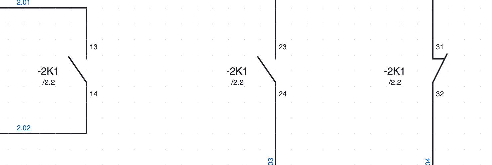
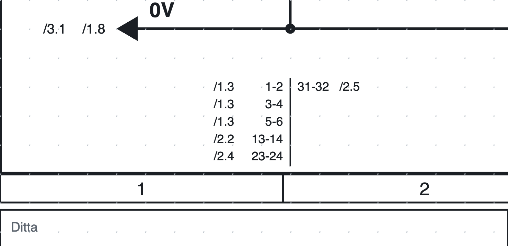
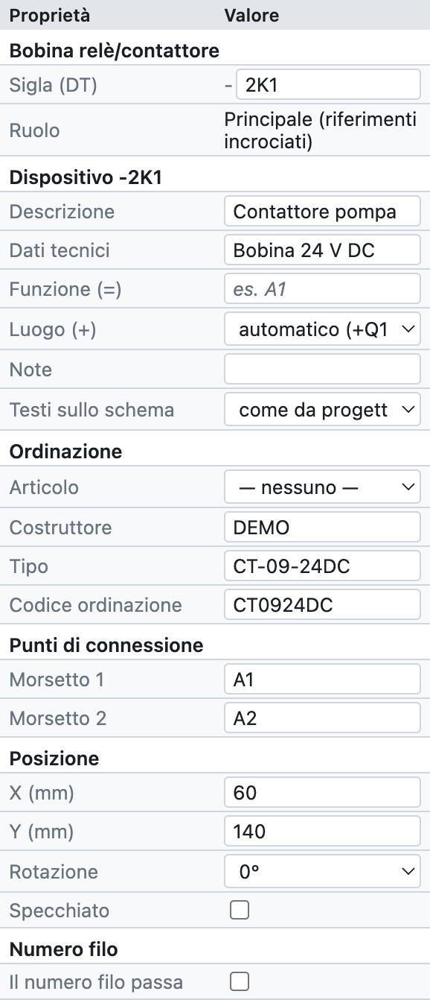
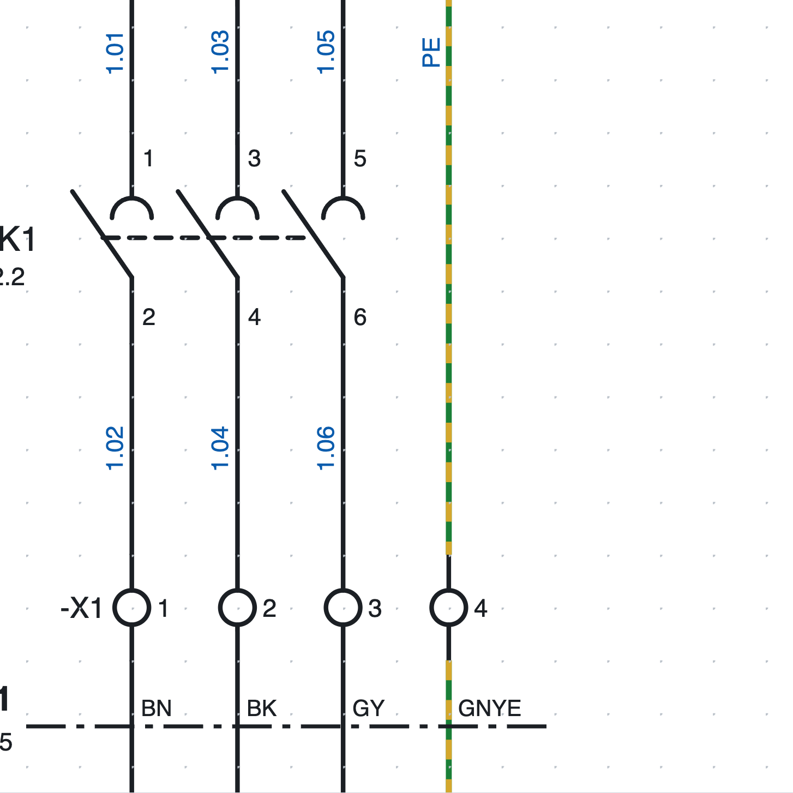
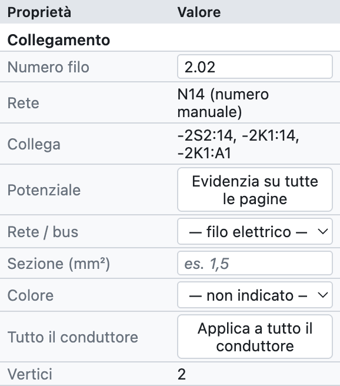
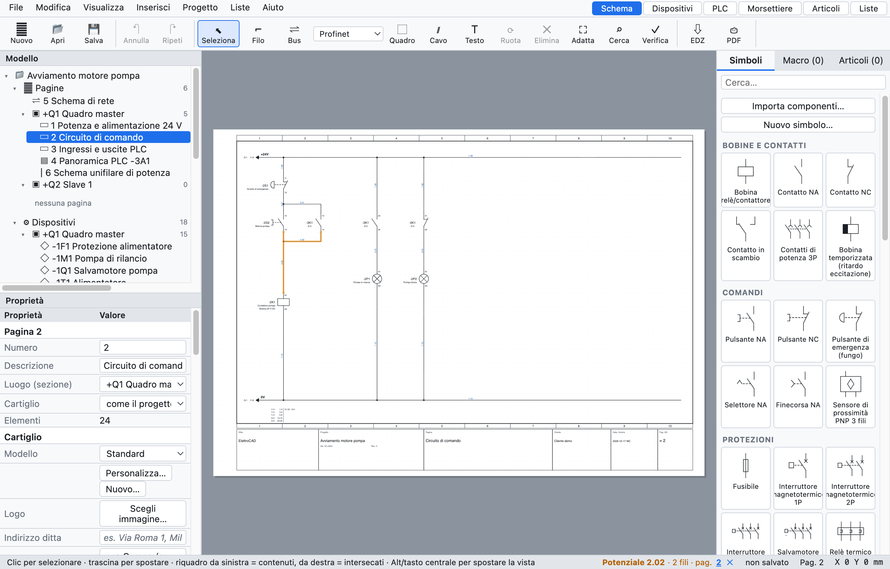

# 6. BMK, Querverweise und Drahtnummern

## Betriebsmittelkennzeichen

Jedes Gerät hat ein **Betriebsmittelkennzeichen** (BMK) nach IEC 81346: einen Bindestrich, die Seitennummer,
den **Kennbuchstaben** der Geräteart und eine laufende Nummer. `-2K1` ist das erste Schütz auf Seite 2.

| Buchstabe | Geräte |
|---|---|
| K | Relais, Schütze, Zeitrelaisspulen |
| Q | dreipolige Leistungsschalter, Motorschutzschalter, Trennschalter |
| F | Sicherungen, Leitungsschutzschalter 1- und 2-polig, Motorschutzrelais |
| S | Taster, Not-Halt, Wahlschalter |
| B | Sensoren, Positionsschalter |
| P | Meldeleuchten |
| M | Motoren, Magnetventile |
| T | Transformatoren, Netzteile |
| A | SPS, Karten, Netzwerkknoten, komplexe Geräte |
| U | Frequenzumrichter |
| E | allgemeine Verbraucher (einpolig) |
| X | Klemmleisten und Steckverbinder |
| W | Kabel |

Der Buchstabe hängt vom Symbol ab; das BMK lässt sich in den Eigenschaften jederzeit von Hand ändern.

### Die BMK-Vorlage

Unter *Projekteigenschaften ▸ Betriebsmittelkennzeichen* legt man fest, wie das BMK gebildet wird:

| Platzhalter | Bedeutung | Beispiel |
|---|---|---|
| `{pagina}` | Seitennummer | `200` |
| `{colonna}` | Spalte (1–10) des Geräts | `4` |
| `{lettera}` | Kennbuchstabe nach IEC 81346 | `K` |
| `{n}` | laufende Nummer | `1` |
| `{n:2}` | zweistellige laufende Nummer | `01` |

| Vorlage | Ergebnis auf Seite 200 |
|---|---|
| `{pagina}{lettera}{n}` (Standard) | `-200K1` |
| `{lettera}{n}` | `-K1` |
| `{pagina}{lettera}{n:2}` | `-200K01` |
| `{pagina}.{colonna}{lettera}` | `-200.4K` |

- **Zähler**: beginnt auf jeder Seite neu oder ist im ganzen Projekt eindeutig.
- **Stabile BMK**: ein neues Gerät erhält die Nummer nach der höchsten der Seite (`-2K3` nach `-2K2`), die
  anderen ändern sich nicht.
- **Geräte neu nummerieren** (*Projekt ▸ Geräte neu nummerieren…*) nummeriert alles nach Seite, Spalte und
  Zeile neu. Kontakte folgen ihrer Spule; Klemmen haben eine eigene Nummerierung.

### Vollständiges BMK: Funktion und Ort

Sind **Funktion** (`=`, Anlage oder Maschinenteil) und **Ort** (`+`, Schaltschrank oder Bedienstation)
ausgefüllt, wird das BMK vollständig: `=A1+Q1-2K1`. Man trägt sie in den Geräteeigenschaften ein oder, für
viele Geräte zugleich, im Navigator ([Kapitel 7](07-dispositivi-e-articoli.md)).

## Spulen und Kontakte

Das **Hauptelement** (die Spule eines Relais oder Schützes) und seine **Kontakte** haben dasselbe BMK. Das
Programm verbindet sie selbst:

1. Spule einfügen: sie erhält zum Beispiel `-2K1`.
2. Kontakte einfügen: sie übernehmen das BMK der zuletzt eingefügten Spule.
3. Um einen Kontakt einer anderen Spule zuzuordnen, das BMK in den Kontakteigenschaften eintragen: die
   Liste schlägt vorhandene BMK mit demselben Buchstaben vor.

### Kontaktnummerierung (EN 50005)

Hilfskontakte werden automatisch mit Ordnungs- und Funktionsziffer nummeriert: der erste Schließer ist
`13-14`, der zweite `23-24`, der erste Öffner `31-32` usw. Das lässt sich für einen einzelnen Kontakt
abschalten und die Anschlüsse von Hand eintragen (*Eigenschaften ▸ Anschlusspunkte*). Hauptkontakte sind
`1-2`, `3-4`, `5-6`.

### Querverweise

*Unter jedem Kontakt `-2K1` steht `/2.2`: die Spule liegt auf Seite 2, Spalte 2.*

*Der Kontaktspiegel von `-2K1` unten auf Seite 2: links der Linie die Haupt- und Schließerkontakte, rechts
die Öffner, jeweils mit Position.*

- Unter jedem **Kontakt** erscheint die Position der Spule (`/2.2`).
- Unter der **Spule** erscheint der **Kontaktspiegel**: alle ihre Kontakte mit Anschlüssen und Position. Er
  steht **unten auf der Seite**, unter der unteren Schiene, senkrecht unter der Spule; alternativ
  unter dem Symbol (*Projekteigenschaften ▸ Betriebsmittelkennzeichen ▸ Kontakte der Spulen*).
- Jeder Querverweis ist **anklickbar**: er führt zur Seite und wählt das Element aus. Im PDF wird er zum Link.
- Rechtsklick auf eine Spule bietet *Zum Kontakt…*, auf einen Kontakt *Zum Hauptelement*.

Die Prüfung meldet Kontakte ohne Spule und mehr Kontakte als der Artikel hat (zum Beispiel einen fünften
Kontakt an einem Schütz mit 4 Hilfskontakten).

### Paarquerverweise

Ein Kontakt lässt sich auch **auf einer anderen Seite zeigen**, ohne ihn zu duplizieren, zum Beispiel ein
Hilfskontakt des Leistungsschalters auf der Übersichtsseite: Rechtsklick auf den Kontakt ▸ *Darstellung
zeichnen (Paarquerverweis)…*, dann ein Klick an die Stelle, an der sie gezeichnet werden soll.

- Die Darstellung ist **nur Zeichnung**: Sie zählt nicht als Kontakt, verbindet sich nicht mit Drähten und
  erscheint weder in den Listen noch in der Stückliste. Kennzeichen und Anschlüsse folgen immer dem echten
  Kontakt.
- Echter Kontakt und Darstellung verweisen mit Querverweisen aufeinander, in beide Richtungen.
- *Eigenschaften ▸ Darstellung von* zeigt den echten Kontakt (ein Klick führt dorthin); *Zum echten Kontakt
  machen* verwandelt sie in einen Kontakt mit eigenen Verbindungen.
- Wird der echte Kontakt gelöscht, meldet die Prüfung die verwaiste Darstellung und bietet an, sie zu
  löschen.

## Geräteeigenschaften

*Die Eigenschaften der Spule `-2K1` im Beispielprojekt.*

| Gruppe | Felder |
|---|---|
| *(Symbolname)* | BMK, Rolle (Hauptelement, Kontakt, Gerät, Klemme…) |
| *Gerät* | Beschreibung, technische Daten, Funktion (=), Ort (+), Notizen, Texte im Schaltplan |
| *Bestellung* | Artikel, Hersteller, Typ, Bestellnummer |
| *Anschlusspunkte* | der Name jedes Anschlusses (A1, A2, 13, 14…) |
| *Position* | X und Y in mm, Drehung, gespiegelt |
| *Drahtnummer* | ob die Drahtnummer durch das Element läuft |

Die Daten der Gruppen *Gerät* und *Bestellung* gelten für **das ganze Gerät**: auf der Spule eingetragen,
gelten sie auch für die Kontakte. Ist ein Artikel zugewiesen, zeigen leere Felder seine Daten in Grau.

## Drahtnummern

*Drahtnummern auf Seite 1: `1.01`, `1.03`… über dem Schütz, dieselben Nummern darunter, weil die Klemmen
`-X1` die Nummer nicht ändern.*

Jeder **Leiter** (alle miteinander verbundenen Drähte bis zu den Anschlusspunkten der Bauteile) hat eine
Nummer, die auf jedem seiner Abschnitte steht. Die Standardvorlage ist `{pagina}.{n:2}`: `200.01`, `200.02`…

### Fixierte oder neu berechnete Nummerierung

Unter *Projekteigenschaften ▸ Drahtnummern ▸ Nummerierung*:

- **fixiert** (Standard): ein nummerierter Leiter behält seine Nummer; ein neuer Leiter erhält die erste
  freie Nummer der Seite, auch wenn er in der Mitte gezeichnet wird; verbindet man zwei nummerierte Leiter,
  bleibt eine Nummer, teilt man einen, erhält der neue Teil eine neue Nummer. *Drähte neu nummerieren*
  berechnet alles in Spaltenreihenfolge neu.
- **neu berechnet**: die Nummern werden bei jeder Änderung neu berechnet, immer in Reihenfolge.

### Manuelle Nummer

Einen Draht auswählen und die Nummer unter *Eigenschaften ▸ Drahtnummer* eintragen: sie gilt für den ganzen
Leiter. Löscht man sie, gilt wieder die automatische Nummer.

### Wo sie steht

Die Nummer steht an einer **freien Stelle** des Drahts: liegt in der Abschnittsmitte eine Kreuzung, ein
Bauteil, ein BMK oder eine andere Nummer, rückt sie am Draht entlang oder auf die andere Seite. Das gilt am
Bildschirm, im PDF und im DXF. *Anzeigen* (Projekteigenschaften) blendet sie ganz aus.

### Nummer verschieben oder wiederholen

Die Nummer lässt sich beliebig **ziehen**, auch weg vom Draht: danach bleibt sie dort und folgt dem Draht,
wenn man ihn verschiebt. Rechtsklick auf den Draht:

- **Drahtnummer hier hinzufügen**: eine weitere Nummer auf demselben Draht, neben dem angeklickten Abschnitt;
- **Diese Drahtnummer entfernen** (Klick auf eine Nummer, wenn es mehrere gibt);
- **Drahtnummer in automatischer Position**: zurück zur vom Programm gewählten Position.

### Die Nummer läuft durch Klemmen

Eine Klemme ist nur ein Durchgangspunkt: die Drähte auf ihren beiden Seiten haben **dieselbe Nummer**. Jedes
Element mit zwei oder mehr Anschlusspunkten hat unter *Eigenschaften ▸ Drahtnummer* das Kästchen
**Drahtnummer läuft durch**:

- bei Klemmen standardmäßig aktiviert, bei anderen Bauteilen deaktiviert;
- für ein einzelnes Element änderbar, zum Beispiel damit die Nummer durch einen Trennschalter läuft.

Für Klemmenliste und Verbindungsliste bleiben die beiden Seiten getrennte Leiter.

### Erweiterter Zähler

In *Projekteigenschaften ▸ Drahtnummern*:

- **Muster**: Neben `{pagina}` (Seite), `{colonna}` (Spalte) und `{n}` lassen sich `{quadro}` (Kennung des
  Schaltschranks der Seite), `{n:2}` (mindestens 2 Ziffern: `01`) und `{n:A}` oder `{n:a}` (Zähler in
  Buchstaben: `A`, `B`… `Z`, `AA`) verwenden. Beispiel: `{quadro}.{n:A}` ergibt `Q1.A`, `Q1.B`… Auch
  Betriebsmittelkennzeichen akzeptieren `{quadro}`.
- **Zähler**: beginnt auf jeder Seite neu, beginnt in jedem Schaltschrank neu oder eindeutig im Projekt.
- **Reserve je Seite**: Nummern, die nach jeder Seite frei bleiben. Mit 3 Reservenummern verwendet Seite 1
  die 1 und 2, Seite 2 beginnt bei 6: Ein später auf Seite 1 hinzugefügter Draht erhält die 3, und die
  folgenden Seiten behalten ihre Nummern. Ist die Reserve aufgebraucht, überspringt der Zähler die Nummern,
  die die folgenden Seiten bereits verwenden.
- **Reihenfolge auf der Seite**: nach Spalten (von links nach rechts) oder nach Zeilen (von oben nach unten).

Von Hand geschriebene Nummern, die der Unterbrechungsstellen und die Namen der SPS-Kanäle sind fest: Der
Zähler überspringt sie, auch wenn sie auf einer anderen Seite stehen.

## Querschnitt und Farbe der Drähte

*Die Eigenschaften eines Drahts: Nummer, Netz, Verbindungen, Potenzial, Querschnitt und Farbe.*

- **Querschnitt** in mm² (`1,5`, `2,5`, `6`…) und **Farbe** mit den Kürzeln nach IEC 60757: `BK` schwarz,
  `BN` braun, `GY` grau, `BU` blau, `DBU` dunkelblau, `RD` rot, `WH` weiß, `GNYE` grün-gelb…
- Die auf einem Abschnitt gewählte **Farbe** gilt für den ganzen Leiter, auch nach einem
  Unterbrechungspunkt oder einer Klemme.
- Mit *Farbige Drähte* (Projekteigenschaften) wird der Draht in seiner Farbe gezeichnet; PE grün-gelb gestrichelt.
- Der Querschnitt kann sich entlang des Leiters ändern (Einspeisung 6 mm², Abzweig 1,5 mm²);
  *Auf den ganzen Leiter anwenden* kopiert Querschnitt und Farbe auf alle Abschnitte.
- Mit *Querschnitt und Farbe* eingeschaltet stehen sie neben der Nummer (`200.01  1,5 mm² BU`).

## Ein Potenzial hervorheben

Um einen Leiter durch das ganze Projekt zu verfolgen: einen Draht auswählen und in den Eigenschaften
**Auf allen Seiten hervorheben** drücken (oder Rechtsklick ▸ *Potenzial hervorheben*).

*Der Leiter `2.02` orange hervorgehoben; die Statusleiste unten listet die Seiten auf, auf denen er vorkommt.*

- Alle verbundenen Leiter werden **orange** gefärbt, auch über Unterbrechungspunkte, Potenziale und Klemmen hinweg.
- Die Statusleiste zeigt den Namen, die Anzahl der Drähte und die **Seiten**, anklickbar.
- ✕ in der Statusleiste oder *Hervorhebung entfernen* schaltet sie aus.
