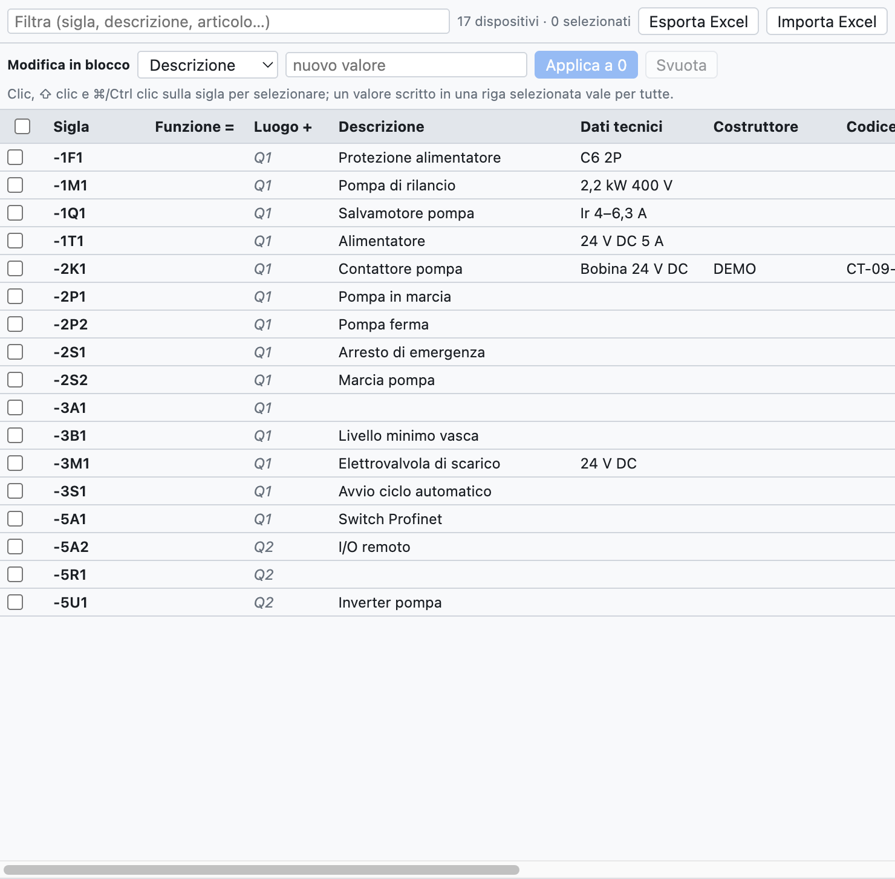
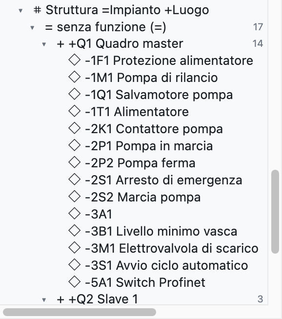
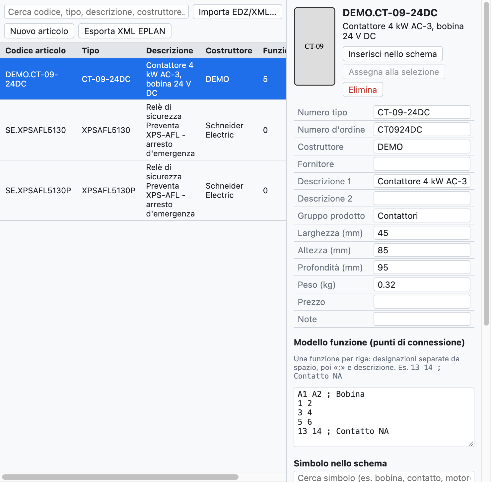

# 7. Geräte und Artikel

Ein **Gerät** ist ein reales Bauteil mit einem BMK: das Schütz `-2K1` ist ein Gerät, auch wenn es im
Schaltplan als Spule, drei Hauptkontakte und zwei Hilfskontakte auf verschiedenen Seiten erscheint. Ein
**Artikel** ist das Produkt aus dem Katalog eines Herstellers (Nummer, Beschreibung, Maße, Klemmen), das den
Geräten zugewiesen wird.

## Gerätedaten

| Feld | Beispiel | Wo es erscheint |
|---|---|---|
| Beschreibung | `Contattore pompa` | Schaltplan (unter dem BMK), Listen, Etiketten |
| Technische Daten | `Bobina 24 V DC`, `2,2 kW 400 V` | Schaltplan, Listen |
| Hersteller | `Schneider Electric` | Stückliste, Einkaufsliste |
| Typ | `LC1D09BD` | Stückliste |
| Bestellnummer | `LC1D09BD` | Stückliste, Einkaufsliste |
| Notizen | freier Text | Geräteliste |
| Funktion (=) | `A1` | vollständiges BMK `=A1+Q1-2K1` |
| Ort (+) | `Q1` | vollständiges BMK, Gruppierungen, Aufbau |
| Artikel | `DEMO.CT-09-24DC` | füllt die leeren Felder mit den Katalogdaten |

Die Daten gehören zum Gerät: Sie werden an einem beliebigen Element (Spule oder Kontakt) eingegeben und
gelten für alle. Von Hand eingegebene Werte haben Vorrang vor denen des Artikels.

**Zusätzliche Artikel**: Ein Gerät kann mehrere Artikel haben (zum Beispiel ein Schütz und sein Hilfskontaktblock).
Im Navigator wird die Spalte *Zusätzliche Artikel* als Text geschrieben, mit Nummer und Menge nach ×:
`LADN22 ×2; LA4DA2U`. Sie lässt sich auch per Sammelbearbeitung und in Excel ändern.

**Beschreibungen im Schaltplan**: Ist *Projekteigenschaften ▸ Zeichnung ▸ Beschreibungen im Schaltplan*
eingeschaltet, erscheinen Beschreibung und technische Daten unter dem BMK des Hauptelements. Das Gerätefeld
*Texte im Schaltplan* erzwingt oder verbirgt sie nur für dieses Gerät.

## Geräte-Navigator

Der Reiter **Geräte** (oben rechts) zeigt alle Geräte des Projekts in einer Tabelle, die wie eine
Tabellenkalkulation bearbeitet wird.

*Der Navigator mit den 17 Geräten des Beispielprojekts. Die Werte in grauer Kursivschrift stammen vom
Artikel oder vom Ort der Seite.*

- **Wert ändern**: in die Zelle klicken, schreiben und Enter drücken.
- **Umbenennen**: das BMK in der ersten Spalte ändern; Kontakte und die anderen Darstellungen ändern sich
  mit. Ist das BMK schon vergeben, meldet das Programm es und ändert nichts.
- **Filtern**: das Feld oben sucht in BMK, Beschreibung, Artikel und den anderen Feldern.
- **Mehrere Zeilen auswählen**: Klick auf das BMK, ⇧-Klick für einen Bereich, ⌘/Strg-Klick zum Hinzufügen,
  oder die Kästchen links.
- **Zum Gerät springen**: Klick auf die Position `/2.2` in der letzten Spalte.

### Sammelbearbeitung

Um vielen Geräten denselben Wert zu geben:

1. Die Zeilen auswählen (zum Beispiel alle Geräte des Schaltschranks `+Q2`, mit dem Filter `Q2`).
2. In der Zeile *Sammelbearbeitung* das Feld wählen (*Funktion =*, *Hersteller*…) und den Wert schreiben.
3. **Anwenden auf N** drücken. *Leeren* löscht dieses Feld bei allen ausgewählten Geräten.

Alternativ den Wert direkt in eine Zelle einer ausgewählten Zeile schreiben: Er gilt für alle ausgewählten
Zeilen. Die ganze Änderung wird mit einem einzigen ⌘Z rückgängig gemacht.

### Excel

- **Excel exportieren** speichert die Gerätetabelle (BMK, Felder, Position).
- In Excel ausfüllen, auch von einer anderen Person, und **Excel importieren** verwenden: Die Geräte werden
  an der Spalte *BMK* erkannt, und nur die geänderten Felder werden aktualisiert. BMK, die es im Projekt
  nicht gibt, werden in der Berichtsansicht gemeldet.

### Eigenschaften kopieren

Der Rechtsklick auf ein Gerät bietet **Eigenschaften kopieren**: kopiert alle Daten des Geräts (Beschreibung,
technische Daten, Hersteller, Typ, Nummern, Artikel, zusätzliche Artikel, Notizen, Funktion, Ort,
benutzerdefinierte Eigenschaften) außer dem BMK. Bei einem anderen Gerät oder einer Auswahl mehrerer Geräte bietet
der Rechtsklick **Eigenschaften von -X einfügen**: die kopierten Daten ersetzen die des Geräts.

Das dient auch dazu, ein **Symbol zu ersetzen**: Eigenschaften des alten kopieren, das neue Symbol einfügen,
die Eigenschaften einfügen und das alte löschen.

## Struktur =Anlage +Ort

Im Baum gruppiert der Knoten **Struktur =Anlage +Ort** die Geräte zuerst nach **Funktion** (`=A1`, `=A2`…)
und dann nach **Ort** (`+Q1`, `+P1`…), wie es IEC 81346 vorsieht. Geräte ohne Funktion oder ohne Ort stehen
unten, in *ohne Funktion (=)* und *ohne Ort (+)*. Ein Klick auf ein Gerät öffnet es im Schaltplan.

*Im Beispielprojekt haben die Geräte keine Funktion: Sie stehen alle unter «ohne Funktion», aufgeteilt auf
die Schaltschränke `+Q1` und `+Q2`.*

Der Ort eines Geräts ist der in seinen Eigenschaften eingetragene; fehlt er, gilt der des Rahmens, in dem es
im Netzwerkplan gezeichnet ist, oder der seiner Seite.

## Artikel

Der Reiter **Artikel** ist die persönliche Artikelbibliothek, auf dem Computer gespeichert und in allen
Projekten verfügbar.

*Ein aus einer EDZ importiertes Schütz: Daten, Bild, Funktionsschablone und Symbol.*

### Herstellerdaten importieren (EDZ)

1. Die **EDZ**-Datei vom Eplan Data Portal oder von der Website des Herstellers herunterladen (Schneider,
   Siemens, Phoenix Contact…). Die EDZ ist ein Archiv im Format des Eplan Data Portal mit den Artikeldaten.
2. *Datei ▸ Importieren ▸ Artikel EDZ / XML / CSV…* (oder die Schaltfläche *EDZ*) und eine oder mehrere
   Dateien wählen.
3. Die Artikel kommen in die Bibliothek mit Nummer, Typ, Bestellnummer, Hersteller, Beschreibungen (auf
   Italienisch, wenn vorhanden, sonst Englisch oder Deutsch), Maßen, Gewicht, Bild und
   **Funktionsschablone** (den Klemmen).

Enthält die EDZ die Zeichnung des Herstellers in einem lesbaren Makro im EPLAN-Format, wird diese Zeichnung zum Symbol
des Artikels (Kategorie *Macro EPLAN / costruttore* in der Bibliothek). Sonst wird der Artikel als
automatische **Blackbox** gezeichnet: Eingänge oben, Ausgänge unten, Kontakte und Pole innen.

Auch **XML**-Dateien im EPLAN-Format lassen sich importieren; *XML exportieren (EPLAN-Format)* schreibt die
Artikel in eine Datei desselben Formats.

Die **CSV-Dateien der Handelsdaten** (`commercial_data.csv` des Eplan Data Portal) werden mit demselben Befehl
importiert, auch mehrere Dateien zusammen: sie liefern je Artikel Hersteller, Typ, Bestellnummer, Gruppe,
Beschreibungen und Langbeschreibung. Bereits aus EDZ importierte Artikel werden ergänzt, ohne Symbol und Klemmen
zu verlieren. Die Links zu Datenblättern und Anleitungen erscheinen im Artikelblatt im Abschnitt **Dokumente**.

### Das Artikelblatt

Wählt man einen Artikel aus, sieht und ändert man:

- die Hauptdaten (Nummer, Typ, Bestellung, Hersteller, Lieferant, Beschreibungen, Gruppe, Maße, Gewicht,
  Preis, Notizen);
- die **Funktionsschablone**: eine Zeile je Funktion, mit den Klemmen durch Leerzeichen getrennt und der
  Beschreibung nach `;` (zum Beispiel `13 14 ; Contatto NA`);
- das **Symbol im Schaltplan**: eines der Grundsymbole, ein importiertes Bauteil oder die Zeichnung des
  Herstellers.

### Artikel verwenden

- **In den Schaltplan einfügen**: fügt das Symbol des Artikels ein, bereits zugewiesen.
- **Der Auswahl zuweisen**: ein Gerät im Schaltplan auswählen und ihm den Artikel zuweisen. Alternativ den
  Artikel im Feld *Artikel* der Geräteeigenschaften wählen.
- Die verwendeten Artikel werden ins Projekt kopiert (*Projektartikel* im Baum), so bleibt die `.ecad`-Datei
  auch auf einem anderen Computer vollständig.

### Die Artikeldatenbank

Die persönliche Bibliothek ist eine Datenbank, die von Anlage zu Anlage mitgeht: einmal eingegebene Daten müssen
nicht erneut eingetragen werden.

- Im Feld **Artikel** (in den *Eigenschaften*, im Navigator *Geräte* und im Register *Steckverbinder*) schreibt
  oder wählt man eine Nummer. Ist die Nummer **neu**, wird sie zu einem Artikel der Bibliothek, mit Hersteller,
  Typ, Bestellnummer und technischen Daten des Geräts. Bei der nächsten Verwendung der Nummer füllen sich die
  Daten von selbst.
- Existiert der Artikel schon und weichen die Gerätedaten ab, schreibt **Diese Daten im Artikel speichern** sie in
  den bestehenden Artikel.
- Beschreibung und Hersteller der zusätzlichen Artikel kommen ebenfalls in die Bibliothek.

### Neuer Artikel

*Neuer Artikel* legt einen leeren Artikel an, der von Hand ausgefüllt wird: nützlich für Bauteile ohne EDZ.
