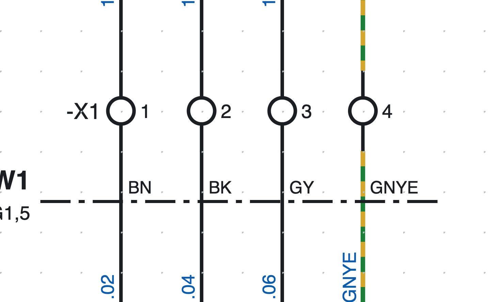
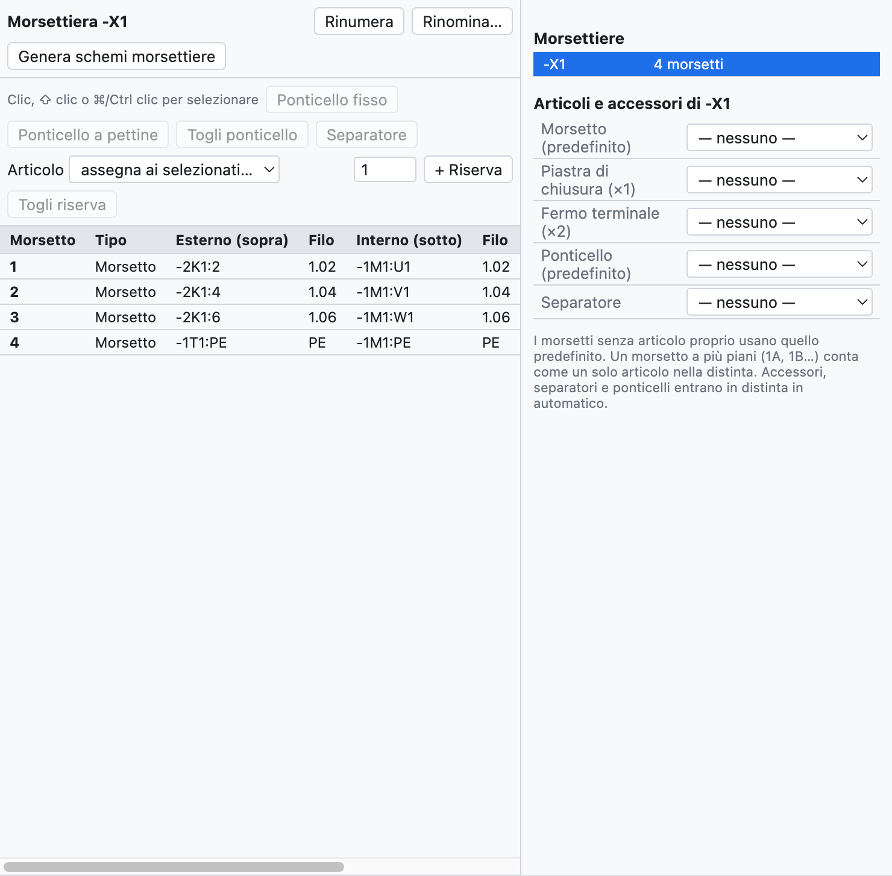
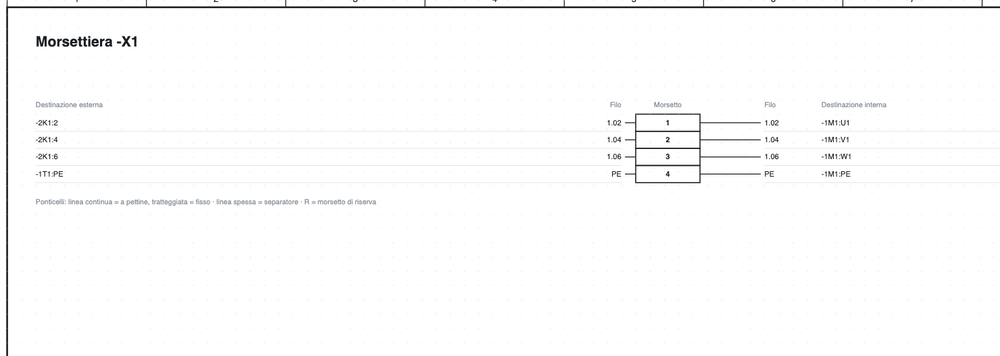

# 8. Klemmleisten

## Klemmen im Schaltplan

*Die Klemmen `-X1:1…4` auf Seite 1: das BMK der Klemmleiste erscheint nur an der ersten der Reihe.*

1. In der Bibliothek, Kategorie *Klemmen und Verbindungen*, **Klemme** wählen (oder *PE-Klemme*,
   *Trennklemme*, *Sicherungsklemme*).
2. Sie **auf den Draht** setzen: der Draht wird auf beiden Seiten der Klemme unterbrochen.
3. Die Klemme erhält das BMK `-X1:1`, die folgenden `-X1:2`, `-X1:3`…

Das BMK einer Klemme ist `<Klemmleiste>:<Nummer><Etage>`:

- die **Klemmleiste** hat einen freien Namen, auch hierarchisch wie `X1.1.2`;
- die **Nummer** folgt dem Doppelpunkt (`X1.1.2:3`);
- die **Etage** ist ein Buchstabe für Mehrstockklemmen (`X1:1A`, `X1:1B`).

An einem senkrechten Draht steht das BMK der Klemmleiste links und die Nummer rechts; an einem waagrechten
Draht (gedrehtes Symbol) steht die Nummer oben und das BMK unten.

> Die **Drahtnummer** läuft unverändert durch die Klemme: die Drähte auf beiden Seiten haben dieselbe
> Nummer (siehe [Kapitel 6](06-sigle-e-numerazione.md#die-nummer-läuft-durch-klemmen)).

## Der Klemmleisten-Navigator

Der Reiter **Klemmleisten** zeigt die Klemmleisten des Projekts und ihre Klemmen in einer Tabelle.

*Die Klemmleiste `-X1` des Beispielprojekts: externe und interne Ziele, Drahtnummern, Artikel und Zubehör.*

- Rechts die Liste der **Klemmleisten** des Projekts; ein Klick öffnet eine.
- In der Mitte die **Klemmentabelle**: Nummer, Typ, externes (oben) und internes (unten) Ziel,
  Drahtnummern, Brücken, Artikel, anklickbare Position.
- Klemmen werden mit Klick, ⇧-Klick (Bereich) und ⌘/Strg-Klick (Hinzufügen) ausgewählt.

## Mehrstockklemmen

Eine Klemme mit zwei oder drei Etagen hat dieselbe Nummer und einen Buchstaben je Etage.

1. Die Klemme im Schaltplan auswählen, zum Beispiel `-X1:1`.
2. In den Eigenschaften **Etage hinzufügen** drücken (auch über die rechte Maustaste): die Klemme wird zu
   `-X1:1A`, und das Programm lässt `-X1:1B` mit einem Klick einfügen, auch auf einer anderen Seite.
3. Weitere Klicks fügen `1C`, `1D`… ein.

In der Stückliste zählt eine Mehrstockklemme als **ein einziger Artikel** (`-X1:1A/B`).

## Nummerieren und umbenennen

- Eine neue Klemme erhält die Nummer nach der höchsten der Klemmleiste; die anderen ändern sich nicht.
- **Neu nummerieren** nummeriert ab 1 in der Reihenfolge des Schaltplans (Seite, dann von links nach rechts
  und von oben nach unten): Etagen bleiben mit ihrem Buchstaben zusammen, Reserven kommen ans Ende, Klemmen
  mit nicht numerischem Namen (zum Beispiel `PE`) bleiben, wie sie waren.
- **Umbenennen…** ändert den Namen der Klemmleiste an allen ihren Klemmen (`X1` → `X2.1`).

## Brücken

1. Zwei oder mehr Klemmen in der Tabelle auswählen.
2. **Steckbrücke** oder **Kammbrücke** drücken.

Brücken erscheinen in der Tabelle, in der Klemmenliste, in der Verbindungsliste und im Klemmleistenplan;
jede kann ihren eigenen Artikel haben. *Brücke entfernen* entfernt sie.

## Reserven und Trennplatten

- **+ Reserve** fügt am Ende nicht gezeichnete Klemmen hinzu: sie kommen in die Liste und die Stückliste.
  *Reserve entfernen* entfernt sie.
- **Trennplatte** nach einer Klemme: eine Trennplatte, im Klemmleistenplan als dicke Linie gezeichnet.

## Artikel und Zubehör

Im Bereich *Artikel und Zubehör* der Klemmleiste wählt man:

| Feld | Menge in der Stückliste |
|---|---|
| Klemme (Standard) | eine je physische Klemme ohne eigenen Artikel |
| Abschlussplatte | 1 |
| Endhalter | 2 |
| Brücke (Standard) | eine je Brücke ohne eigenen Artikel |
| Trennplatte | eine je Trennplatte |

*Artikel ▸ den ausgewählten zuweisen* gibt einzelnen Klemmen einen anderen Artikel (zum Beispiel den
Trennklemmen). Alles kommt automatisch in die Stückliste und die Einkaufsliste.

## Klemmleistenplan

**Klemmleistenpläne erzeugen** legt eine Seite je Klemmleiste an (mehrere Blätter ab 40 Klemmen) mit Zielen,
Drahtnummern, Brücken, Trennplatten, Reserven und anklickbaren Positionen, auch im PDF.

*Der obere Teil des Klemmleistenplans von `-X1`.*

Die Seite aktualisiert sich selbst, wenn Sie den Schaltplan ändern; beim erneuten Erzeugen kommen die Seiten
neuer Klemmleisten hinzu und die Seiten verschwundener werden entfernt.

## Prüfungen

Die Prüfung meldet doppelte Klemmen, Klemmen mit einer freien Seite und Daten von Klemmleisten, die es nicht
mehr gibt.
