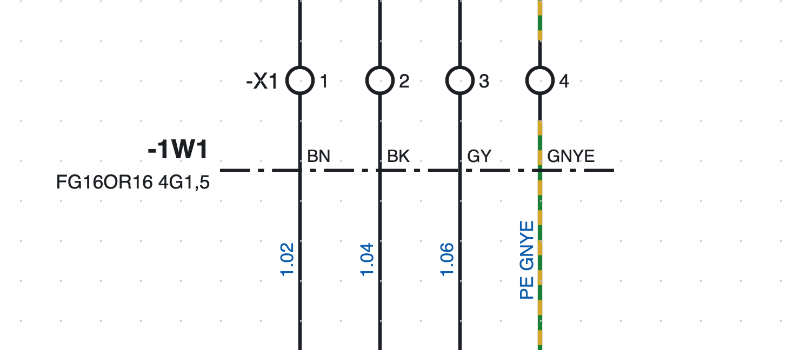
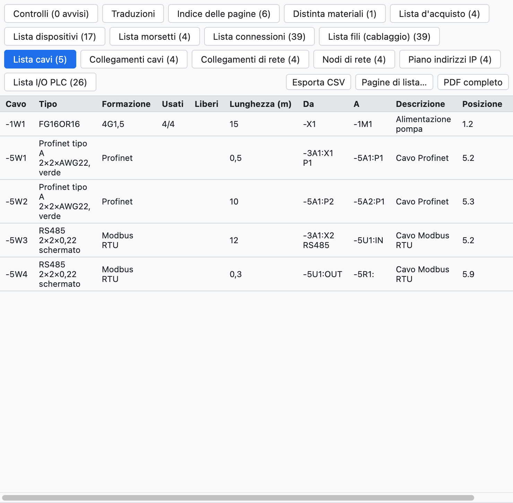

# 9. Kabel und Steckverbinder

## Kabel

Ein Kabel wird mit einer **Definitionslinie** definiert, die die Drähte kreuzt.

*Das Kabel `-1W1 FG16OR16 4G1,5` auf Seite 1: die Strich-Punkt-Linie kreuzt die vier Drähte zum Motor,
jeder in der Farbe seiner Ader.*

1. **Kabel** in der Werkzeugleiste drücken (oder *Einfügen ▸ Kabeldefinitionslinie*).
2. Auf eine Seite der Drähte klicken und dann auf die andere Seite.
3. Die gekreuzten Drähte werden zu **Adern** des Kabels `-1W1` (BMK nach der Vorlage des Projekts).

### Adern

Das Programm schlägt die Adern je nach Anzahl der Drähte vor:

- bis 5 Drähte farbig: `BN BK GY BU GNYE`;
- darüber nummeriert, mit Grün-Gelb;
- der PE-Draht (oder grün-gelbe Draht) erhält die grün-gelbe Ader.

In den Kabeleigenschaften ändert man **Aufbau** (`5G1,5`, `7x0,75`…), **Typ** (`FG16OR16`), **Länge** in
Metern, **Enden** (von, nach), **Schirm**, Beschreibung und **Artikel**; in den Eigenschaften der Linie wählt
man die Ader jedes Drahts.

Mehrere Linien, auch auf verschiedenen Seiten, können sich auf dasselbe Kabel beziehen: eine zweimal
gekreuzte Ader zählt nur einmal.

### Kabellisten

*Die Kabelliste des Beispielprojekts: das Motorkabel und die Netzwerkkabel.*

- **Kabelliste**: ein Kabel je Zeile mit Typ, Aufbau, belegten und freien Adern, Länge, Enden, Position,
  Artikel.
- **Kabelverbindungen**: eine Ader je Zeile mit den beiden Enden und der Drahtnummer.
- Die **Verbindungsliste** hat die Spalte *Kabel*; in der Stückliste ist die Menge eines Kabels mit Artikel
  seine Länge in Metern; in der Einkaufsliste werden Kabel ohne Artikel nach Typ summiert.

### Prüfungen

Die Prüfung meldet erschöpfte Adern (mehr Drähte als Adern) oder doppelte, Kabel ohne Definitionslinie und
doppelte Kabel-BMK.

## Steckverbinder und Stecker

Für Stecker und Buchsen mehrpoliger Steckverbinder verwendet man die Symbole der Kategorie
*Klemmen und Verbindungen*:

| Symbol | Verwendung |
|---|---|
| Buchsenkontakt (weiblich) | die Buchsenseite |
| Steckerstift (männlich) | die Steckerseite |
| Buchse + Stecker | das gesteckte Paar in einem Symbol |

- Das BMK ist wie bei Klemmen: `-X10:3` ist Pin 3 des Steckverbinders `-X10`; die Pins nummerieren sich
  selbst.
- Die Gesamtzahl der Pins wird in den Eigenschaften des Steckverbinders eingetragen oder aus dem Artikel
  gelesen.
- Das **Gegenstück** (zum Beispiel der Kabelstecker für eine Schrankbuchse) wird mit seinem Artikel
  angegeben und kommt in die Stückliste.
- Die **Steckverbinderliste** führt jeden Pin mit Seite, Drähten, Position und den belegten Pins auf.
- Im Register **Steckverbinder** hat die Pin-Tabelle die Spalten **Beschreibung** und **Notizen**, die direkt in
  der Zelle geschrieben werden. Beschreibung, technische Daten und Notizen sind **für jeden Pin eigen** (in den
  *Eigenschaften* des Pins gelten sie nur für diesen Pin); Hersteller, Typ, Artikel und die übrigen Daten gelten
  für den ganzen Steckverbinder. Die **Notizen des Steckverbinders** stehen in den Daten des Steckverbinders,
  rechts neben der Tabelle.
- Die Prüfung meldet Pins über der Pinzahl des Steckverbinders.
