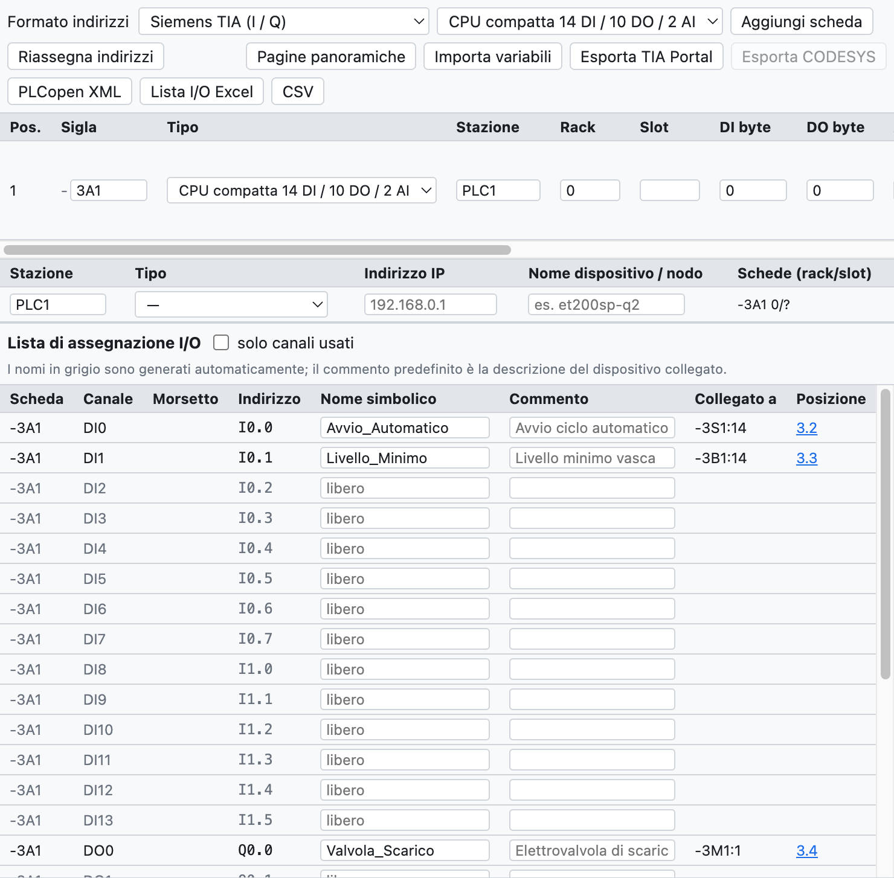
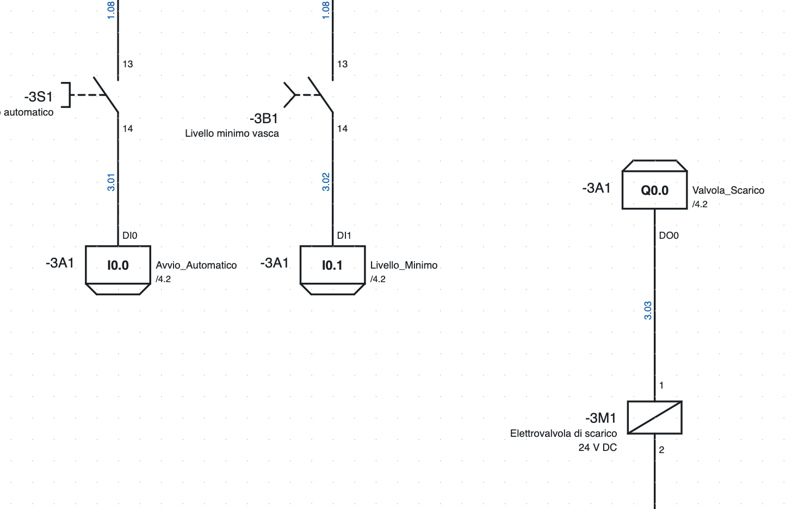
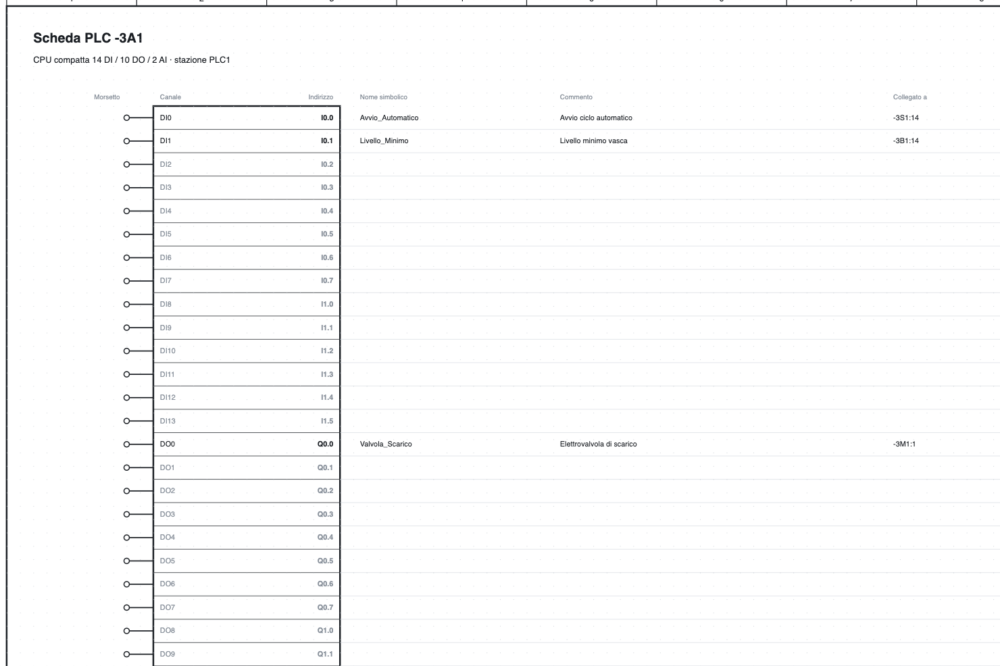

# 10. SPS

OpenWiring hält den Stromlaufplan und die E/A-Zuordnung der SPS zusammen: jeder gezeichnete Ein- und Ausgang
erhält einen Kanal und eine Adresse, erscheint in der E/A-Liste und in der Kartenübersicht und wird nach TIA
Portal, CODESYS oder PLCopen exportiert.

## Die SPS-Ansicht

*Die SPS-Ansicht des Beispielprojekts: die CPU `-3A1`, die Station `PLC1` und die E/A-Zuordnungsliste.*

Der Reiter **SPS** oben rechts enthält:

- die Leiste mit Adressformat, hinzuzufügendem Kartentyp und Export;
- die Liste der **Karten** mit BMK, Typ, Station, Rack, Steckplatz und Startadressen;
- die Liste der **Stationen** mit Typ, IP-Adresse und Gerätename;
- die **E/A-Zuordnungsliste**.

## Karten

**Karte hinzufügen** fügt den in der Liste gewählten Typ hinzu:

- Kompakt-CPUs 14 DI / 10 DO / 2 AI und 8 DI / 6 DO;
- Digitalmodule 8 DI, 16 DI, 8 DO, 16 DO, 8 DI / 8 DO;
- Analogmodule 4 AI, 8 AI, 2 AO, 4 AO;
- **IO-Link**-Master mit 4 oder 8 Ports.

Für jede Karte gibt man BMK (`-3A1`), Station (`PLC1`: Adressen werden je Station vergeben), Rack,
Steckplatz (automatisch vergeben), Startadressen, Beschreibung und Bestellnummer an. Die Karte kommt in die
Stückliste.

**Karte aus Artikel…** legt eine Karte aus einem Artikel der Bibliothek an, zum Beispiel einem aus einer EDZ
importierten E/A-Modul: die Kanalzahl wird aus der Funktionsschablone ermittelt und kann vor dem Anlegen
korrigiert werden. Die Anschlusspunkte des Artikels werden zu den Klemmen der Kanäle.

**Stabile Adressen**: eine neue Karte erhält die ersten freien Adressen ihrer Station, die der vorhandenen
Karten ändern sich nicht. **Adressen neu vergeben** berechnet sie in der Reihenfolge der Liste neu
(Pfeile ↑ ↓).

### Stationen

Jede Station hat einen Typ (lokale CPU, Profinet, EtherCAT, Profibus DP, EtherNet/IP, Modbus TCP), eine
IP-Adresse und einen Gerätenamen. Die Prüfung meldet doppelte Steckplätze sowie wiederholte IPs und Namen.

### Format und Bereichsreihenfolge je Station

In der Tabelle **Stationen** hat jede Station zwei zusätzliche Spalten:

- **Format**: Eine Station kann ein anderes Format als das oben gewählte haben, zum Beispiel ein
  CODESYS-Knoten neben einer Siemens-CPU. Das Format oben gilt für Stationen ohne eigenes Format. Ändert man
  das Format einer Station, werden nur ihre Adressen neu vergeben.
- **Bereichsreihenfolge** (Formate IEC und TwinCAT, bei denen digital und analog denselben Bereich teilen):
  *Karten der Reihe nach* (Standard) oder *zuerst analog (WAGO)*, wie es WAGO-Knoten und andere
  CODESYS-Koppler tun. Fügt man einer Station mit „zuerst analog“ eine Karte hinzu, werden die Adressen
  automatisch neu vergeben.

**TwinCAT (Beckhoff).** Mit dem Format TwinCAT lauten die Adressen `%I*` und `%Q*`: TwinCAT verknüpft sie.
In der exportierten GVL haben die Variablen `AT %I*` / `AT %Q*`; Drähte an einem Kanal erhalten ihren Namen
aus Karte und Kanal (`400A1.DI3`), weil `%I*` für alle gleich ist.

Die Exporte arbeiten je Station: *TIA Portal exportieren* nimmt nur Siemens-Stationen, *CODESYS
exportieren* die IEC- und TwinCAT-Stationen.

### IO-Link

Für jeden Port eines IO-Link-Masters gibt man Gerät, Beschreibung und Prozessdaten-Bytes an; das Programm
berechnet die Adressen (`IB4…IB5`, `%IB4`, `EB4`).

## E/A-Punkte im Schaltplan

*Zwei Eingänge und ein Ausgang auf Seite 3: im Kasten die Adresse, rechts der symbolische Name und der
Verweis auf die Übersicht `/4.2`, links das BMK der Karte.*

1. In der Bibliothek, Kategorie *SPS*, Eingang oder Ausgang wählen, digital oder analog.
2. Ihn in den Schaltplan einfügen und mit dem Gerät verbinden (Taster, Sensor, Magnetventil…).
3. Der Punkt erhält automatisch den **ersten freien Kanal** des richtigen Typs; hat keine Karte einen, legt
   das Programm eine neue an (die erste ist eine Kompakt-CPU).

In den Eigenschaften des Punkts ändert man Karte, Kanal (belegte sind gekennzeichnet), **symbolischen
Namen** und **Kommentar**. Die Klemme trägt den Kanalnamen (`DI0`, `DO3`).

Die **Versorgung L+ / M** der Karte ist ein eigenes Symbol mit dem BMK der Karte: sie wird im
Versorgungsstromkreis gezeichnet, und ihre Position erscheint in der Übersicht.

## Adressen

Das Format wird oben in der SPS-Ansicht gewählt:

| Format | Digitaleingang | Digitalausgang | Analogeingang | Analogausgang |
|---|---|---|---|---|
| Siemens TIA | `I0.0` | `Q0.0` | `IW64` | `QW64` |
| Siemens deutsch | `E0.0` | `A0.0` | `EW64` | `AW64` |
| IEC 61131 / CODESYS | `%IX0.0` | `%QX0.0` | `%IW0` | `%QW0` |
| Omron CJ/CP | `0.00` | `100.00` | `2000` | `2100` |
| Beckhoff TwinCAT | `%I*` | `%Q*` | `%I*` | `%Q*` |

Analoge Adressen beginnen in den Siemens-Formaten bei 64 und in IEC bei 0; beim Formatwechsel werden sie
angepasst. Omron verwendet 16-Bit-Worte, daher werden beim Wechsel von oder zu Omron die Adressen neu
vergeben.

## Übersichtsseiten

**Übersichtsseiten** legt eine Seite je Karte am Ende des Projekts an und entfernt die Seiten gelöschter
Karten.

*Die Übersicht der CPU `-3A1`: für jeden Kanal Klemme, Adresse, symbolischer Name, Kommentar,
angeschlossenes Gerät und Seite.*

Die Übersicht ist immer auf dem Stand des Schaltplans und muss nicht neu erzeugt werden, wenn Sie etwas
ändern. Jeder E/A-Punkt im Schaltplan verweist auf seine Zeile der Übersicht (`/4.2`) und umgekehrt.

## E/A-Zuordnungsliste

Die Liste enthält alle Kanäle aller Karten, belegt oder frei, mit Adresse, symbolischem Namen, Kommentar,
**angeschlossenem Gerät** (`-3S1:14`, aus den Drähten ermittelt) und Position.

- Name und Kommentar werden direkt in der Tabelle bearbeitet.
- Fehlt der Name, wird er erzeugt (`DI2_3A1`); der Standardkommentar ist die Beschreibung des
  angeschlossenen Geräts.
- *nur belegte Kanäle* blendet die freien aus.
- Die Liste erscheint auch im Reiter *Listen* und im PDF.
- Die Prüfung meldet doppelt belegte Kanäle, doppelte Namen, Punkte ohne Karte oder mit einem Kanal des
  falschen Typs.

## Austausch mit der SPS-Software

### Export

| Schaltfläche | Datei | Verwendung |
|---|---|---|
| *TIA Portal exportieren* | Excel mit dem Blatt `PLC Tags` | in TIA: *PLC-Variablen ▸ Importieren*; die Variablen landen in der Tabelle `OpenWiring` (Siemens-Formate) |
| *CODESYS exportieren* | Text `VAR_GLOBAL … END_VAR` | zum Einfügen in eine globale Variablenliste (IEC-Format) |
| *PLCopen XML* | XML TC6 | globale Variablen mit IEC-Adresse, auch für IO-Link-Daten; für CODESYS und kompatible Umgebungen |
| *E/A-Liste Excel*, *CSV* | Tabelle | Dokumentation |

Beispiel einer CODESYS-Zeile: `Avvio_Automatico AT %IX0.0 : BOOL; (* Avvio ciclo automatico - -3S1:14 *)`.

> Der Export für TIA Portal folgt dem Format der TIA-Variablentabelle, wurde aber noch nicht an einer realen
> Installation getestet: meldet der Import Fehler, exportieren Sie aus TIA eine leere Tabelle und
> vergleichen Sie die Spalten.

### Import der Variablen

**Variablen importieren** liest Namen und Kommentare aus der SPS-Software und überträgt sie in den
Schaltplan:

- **TIA Portal**: die Excel-Datei aus *PLC-Variablen ▸ Exportieren*;
- **CODESYS**: eine GVL (`Nome AT %IX0.0 : BOOL; (* commento *)`);
- **CSV** mit den Spalten Name, Adresse, Kommentar.

Die Zuordnung erfolgt über die **Adresse** (`%E0.0` und `I0.0` sind gleichwertig). Bereits gezeichnete
Kanäle erhalten Name und Kommentar; noch nicht gezeichnete behalten sie auf der Karte und zeigen sie, sobald
sie gezeichnet werden. Variablen ohne Kanal werden in der Berichtsansicht aufgeführt.
