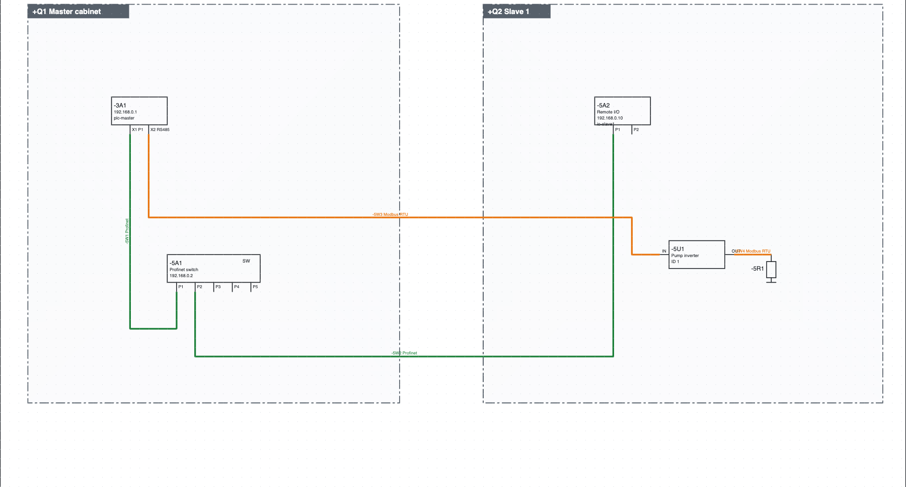
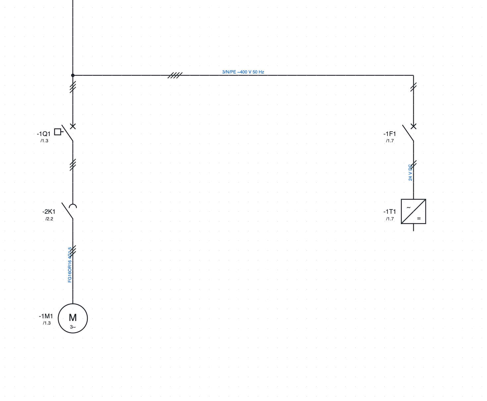

# 11. Netze, Orte und einpoliger Plan

## Orte

Ein **Ort** ist ein physischer Behälter: Schaltschrank, Bedienstelle, Maschine, Abzweigdose, Feld. Sein Code
ist der `+`-Teil des BMK (`+Q1-2K1`).

1. *Projekt ▸ Neuer Ort…* oder *+ Ort* in den Projekteigenschaften.
2. **Code** (`Q1`, `BM`, `P1`), **Name** (`Quadro master`) und **Typ** eingeben.
3. Die Seiten dem Ort zuweisen mit *Seiteneigenschaften ▸ Ort (Abschnitt)*: eine neue Seite bleibt im Ort
   der Seite, von der sie ausgeht.

Jedes Gerät liegt in einem Ort: dem in seinen Eigenschaften eingetragenen, sonst dem Rahmen, in dem es im
Netzwerkplan gezeichnet ist, sonst dem Ort seiner Seite.

Wo man die Orte sieht:

- der **Baum** gruppiert Seiten und Geräte nach Ort;
- die **Geräteliste** zeigt das vollständige BMK (`+BM-1M1`);
- die **Etiketten** der Geräte sind nach Ort gruppiert;
- eine einem Ort zugewiesene **Aufbauseite** schlägt nur dessen Geräte vor.

### Ein Bauteil eines Schaltschranks, verbunden mit einem anderen Schaltschrank

Typischer Fall: Ein im **+Q2** montierter Sensor geht auf einen SPS-Eingang des **+Q1**. Zeichnen Sie
ihn auf der Eingangsseite von +Q1 mit dem Ortskasten +Q2, ist das Kennzeichen richtig (`+Q2-B1`) und
der Sensor erscheint in den Listen von +Q2. Der Schaltplan liegt aber auf den Seiten von +Q1: Wer +Q2
verdrahtet und nur dessen Seiten erhält, sieht ihn nicht.

Empfohlen wird, **den Stromkreis an der Schrankgrenze zu trennen**, an den Klemmen:

1. auf der Seite von +Q1: SPS-Eingang → Klemme `-X1:5` → Kabel `-W12` → Unterbrechungspunkt zur Seite von +Q2;
2. auf einer Seite von +Q2: Unterbrechungspunkt von +Q1 → Kabel `-W12` → Klemme `-X2:5` → Sensor `-B1`.

Jedes Bauteil wird auf den Seiten des Schranks gezeichnet, in dem es montiert ist; die Verbindung
zwischen den Schränken ist das Kabel, das in den Kabelplänen beider erscheint; die Verweise sind im
PDF anklickbar. Jeder Schrank hat seinen Klemmeneingang, und jeder Verdrahter arbeitet bis zur Klemme.

Die **Prüfungen** warnen, wenn ein Gerät eines Schaltschranks, Bedienpults oder Abzweigkastens auf
den Seiten eines anderen Schranks gezeichnet ist: *+Q2-B1 ist auf Seite 310 des Schranks +Q1
gezeichnet: druckt man nur +Q2, fehlt es*. Maschine und Feld zählen nicht, da sie meist auf den
Schrankseiten gezeichnet werden; ebenso wenig ein Unterort desselben Schranks (z. B. die Tür).

Wenn Sie das Bauteil lieber neben dem SPS-Eingang lassen, haken Sie beim Druck nur einiger Schränke
im PDF *Seiten anderer Schränke mit Geräten der gewählten Schränke hinzufügen* an (Kapitel 18).

## Netzwerkplan

Der Netzwerkplan zeigt auf einer einzigen Seite alle Knoten der Anlage und die Busverbindungen zwischen den
Schaltschränken.

*Der Netzwerkplan des Beispielprojekts: die CPU `-3A1` und der Switch `-5A1` im Schaltschrank `+Q1`, die
dezentrale Peripherie `-5A2` und der Umrichter `-5U1` im Schaltschrank `+Q2`, verbunden über Profinet (grün)
und Modbus RTU (orange).*

1. **+ Netzwerk** unter dem Baum legt die Seite an.
2. **Schaltschrank** in der Werkzeugleiste: auf zwei Ecken klicken, um den Rahmen eines Schaltschranks zu
   zeichnen und seinen Ort zu wählen. Die Knoten im Rahmen gehören zu diesem Schaltschrank.
3. Aus der Kategorie *Netze und Busse* die **Knoten** einfügen: Knoten mit zwei Ports (IN/OUT oder P1/P2),
   Knoten mit einem Port, Switch mit 5 Ports, Abschluss. Ein Knoten übernimmt das BMK eines vorhandenen
   Geräts (die CPU, ein Umrichter…) und wird zu einer seiner Darstellungen.
4. Das Protokoll neben der Schaltfläche **Bus** wählen und die Ports wie einen Draht verbinden.

### Protokolle

Profinet, EtherCAT, Modbus TCP, Modbus RTU, Profibus DP, EtherNet/IP, CANopen, IO-Link, RS485, Ethernet.
Jedes Protokoll hat seine Farbe und seinen Namen auf der Linie. Busse erhalten keine Drahtnummer und zählen
nicht zu den elektrischen Verbindungen. Ein vorhandener Draht wird in seinen Eigenschaften zum Bus
(*Netz / Bus*).

### Netzwerkkabel

Jede Busverbindung ist ein **Kabel**: sie erhält selbst ein BMK (`-5W1`, auf der Linie neben dem Protokoll).
In den Eigenschaften der Verbindung gibt man Typ (je Protokoll vorgeschlagen, zum Beispiel
*Profinet tipo A 2×2×AWG22*), Länge und Artikel an. Netzwerkkabel erscheinen in der Kabelliste mit den Ports
an den Enden (`-3A1:X1 P1` → `-5A1:P1`), in den Etiketten und, mit Artikel, in der Stückliste in Metern.

### Listen und Prüfungen

- **Netzwerkverbindungen**: Protokoll, Ports, Schaltschränke, Verbindungen zwischen verschiedenen
  Schaltschränken.
- **Netzwerkknoten**: Adresse, Protokolle, Schaltschrank.
- Die Prüfung meldet wiederholte Adressen im selben Netz (auch über Switches) und Ethernet-Ports mit mehr
  als einer Verbindung (ein Switch ist nötig). Mehrpunkt-Busse (Modbus RTU, Profibus, CANopen, RS485)
  erlauben mehrere Knoten am selben Abschnitt.

## IP-Adressplan

1. *Projekt ▸ Neues IP-Netz*: Name, Adresse und Präfix (`192.168.0.0/24`), Gateway, Protokoll, das es
   nutzt, und erste zu vergebende Adresse.
2. In den Eigenschaften jedes Knotens gibt es das Feld **IP-Adresse**, getrennt von der Busadresse
   (Profinet-Name, Modbus-ID…). Die IP steht im Rahmen des Knotens.
3. *Projekt ▸ IP-Adressen zuweisen* vergibt die erste freie Adresse an Knoten mit Profinet, Modbus TCP,
   EtherNet/IP oder Ethernet, die noch keine haben (nicht EtherCAT und die seriellen Busse).
4. *Projekt ▸ IP-Adressplan* öffnet die Liste: IP, Maske, Gateway, Netz, Gerät, Name, Protokolle, Ort,
   einschließlich der SPS-Stationen.

Die Prüfung meldet wiederholte, ungültige, außerhalb der Netze liegende oder mit Netz- bzw.
Broadcast-Adresse identische IPs sowie Gateways außerhalb des Netzes.

## Netzwerkadressen

*Projekt ▸ Netzwerkadressen…* (auch über die Gruppe *Netze* der Registerkarte *Projekt* des Menübands) öffnet eine Tabelle mit
**allen** Geräten, die einen Netzwerkanschluss haben, auch solchen ohne Adresse, und den SPS-Stationen.

**Wie die Anschlüsse gefunden werden.** Ein Anschluss ist jeder Pin, den ein Busdraht berührt (Profinet,
Ethernet, Modbus, EtherCAT…), und jeder Netzwerkknoten. Die Symbole brauchen keine besonderen Pins.

- Die IP-Anschlüsse eines Geräts (Profinet, Ethernet, Modbus TCP, EtherNet/IP) bilden **eine einzige
  Schnittstelle**, wie ein integrierter Switch: eine IP und ein Name.
- Jeder Nicht-IP-Bus (Modbus RTU, CAN, EtherCAT…) hat seine eigene Schnittstelle mit eigener Adresse.
- **Trennen…** gibt einigen Anschlüssen eine eigene Schnittstelle mit anderer IP und anderem Namen (zum
  Beispiel X2 außerhalb des Switches von X1). **Zusammenführen** holt sie in die Hauptschnittstelle zurück.

In die Spalten *IP-Adresse* und *Profinet-Name / Adresse* schreibt man direkt; *Enter* bestätigt. Bei einer
SPS-Station bleiben die Werte mit der Stationstabelle abgeglichen. Unten:

- **IP zuweisen**: eine freie IP des richtigen Netzes für IP-Schnittstellen ohne Adresse (zuerst braucht es
  ein IP-Netz);
- **Automatische Profinet-Namen**: ein Name aus Kennzeichen und Ort (`+Q1 -2A1` → `q1-2a1`, mit `pn-`
  davor, wenn der Name mit einer Ziffer beginnen würde) für Profinet-Geräte ohne Namen; bereits
  geschriebene Namen bleiben;
- **Liste und Export**: dieselbe Tabelle unter den Listen, zum Drucken oder Exportieren als PDF, CSV und
  Excel.

Die letzte Spalte zeigt die Probleme: doppelte IPs oder IPs außerhalb des Netzes, ungültige oder doppelte
Profinet-Namen.

## Einpoliger Übersichtsplan

Der einpolige Übersichtsplan stellt die Energieverteilung mit einer einzigen Linie je Abgang dar.

*Der einpolige Plan des Beispielprojekts: dieselben BMK wie im mehrpoligen Plan, mit dem Verweis auf ihre
Position.*

1. **+ Einpolig** unter dem Baum legt die Seite an.
2. Aus der Kategorie *Einpolig* Leistungsschalter, Motorschutzschalter, Trennschalter, Sicherung, Schütz,
   Motor, Transformator, Umrichter, Netzteil, Verbraucher einfügen.
3. Jedem Symbol **dasselbe BMK** wie dem Gerät im mehrpoligen Plan geben: der anklickbare Verweis auf seine
   Position erscheint (`/1.3`).
4. Die Linien haben die Leiterzahl (*Leiter (Striche)*) und einen Text (`3/N/PE ~400 V 50 Hz`).

Die Linien des einpoligen Plans zählen nicht zu Adern, Drahtnummern und Listen: der eigentliche
Stromlaufplan bleibt der mehrpolige.
