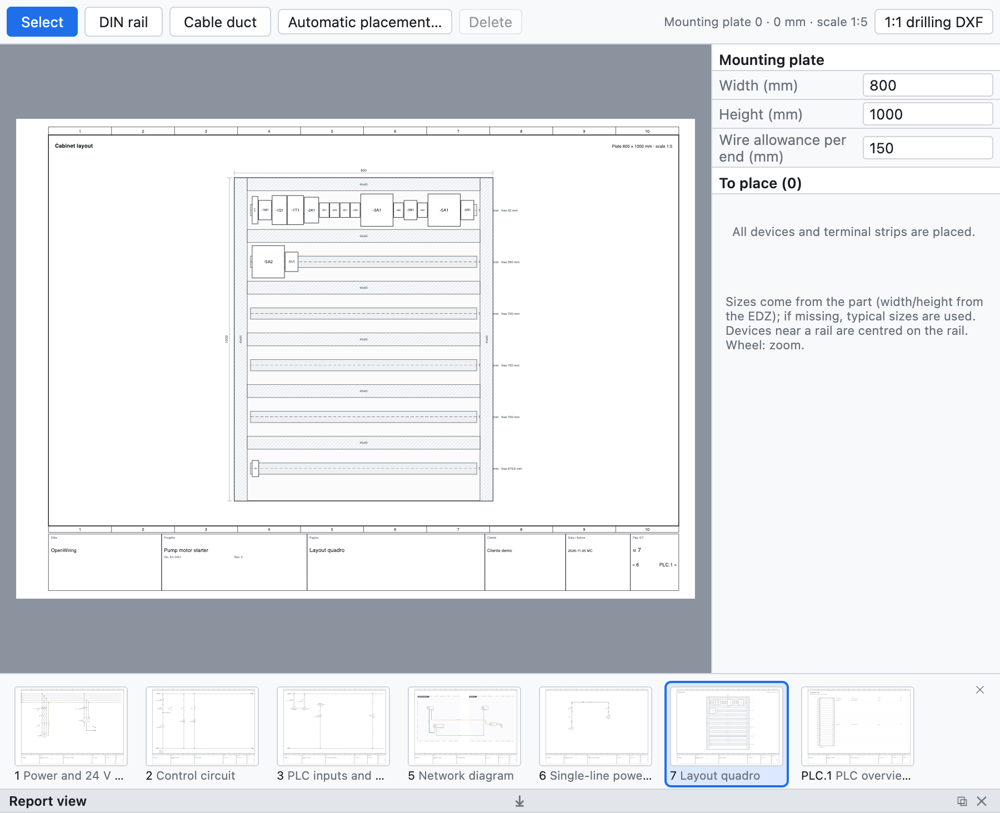

# 12. Schaltschrankaufbau

Die Aufbauseite ist die **Montageansicht** der Montageplatte des Schaltschranks: Hutschienen, Kabelkanäle
und Geräte maßstäblich, mit Bemaßung. Sie dient dazu, zu prüfen, ob alles passt, für das Bohrbild und zum
Abschätzen der Drahtlängen.

*Ein mit automatischem Platzieren erstellter Aufbau: zwei Reihen Hutschienen mit Kabelkanälen und die Geräte
des Beispielprojekts.*

## Den Aufbau anlegen

1. **+ Aufbau** unter dem Baum legt eine Aufbauseite mit der Platte in genormtem Maßstab (1:5, 1:10…) an,
   bemaßt.
2. Im Bereich rechts **Breite** und **Höhe** der Platte in mm sowie die Draht-**Reserve** je Ende einstellen.
3. Die Seite einem **Ort** zuweisen, um nur die Geräte dieses Schaltschranks zu sehen.

## Hutschienen und Kabelkanäle

Mit **Hutschiene** und **Kabelkanal** in der Leiste der Ansicht auf der Platte ziehen, um sie zu zeichnen.
Jede Hutschiene zeigt die freien Millimeter.

## Geräte platzieren

- Die Liste *Zu platzieren* zeigt die noch nicht platzierten Geräte und Klemmleisten: sie auf die Platte
  ziehen.
- Geräte nahe einer Hutschiene werden **auf der Hutschiene zentriert**.
- Die **Maße** stammen vom Artikel (Breite und Höhe aus der EDZ), sonst sind es typische Werte; eine
  Klemmleiste ist so breit wie ihre Klemmen (eine Mehrstockklemme belegt ein Rastermaß).
- **Automatisch platzieren** legt fehlende Reihen von Kabelkanälen und Hutschienen an und setzt alle noch
  nicht platzierten Geräte auf die Hutschienen.

## Prüfungen

Die Prüfung meldet Geräte außerhalb der Platte, überlappende Geräte und volle Hutschienen.

## Bohrbild

**Bohr-DXF 1:1** exportiert Platte, Hutschienen, Kabelkanäle, Geräteumrisse und Befestigungslöcher Ø 5,5 im
Maßstab 1:1, bereit für die Bearbeitung.

## Stückliste und Drahtlängen

- Hutschienen und Kabelkanäle mit Artikel kommen in die **Stückliste in Metern**.
- Die **Drahtliste (Verdrahtung)** gibt für jeden Draht Querschnitt, Farbe, **Aderendhülsen** (DIN 46228)
  und die aus dem Aufbau **geschätzte Länge** an: Weg zwischen den Geräten plus die Reserve an den Enden.
- Die **Einkaufsliste** summiert den losen Draht nach Querschnitt und Farbe mit 10 % Zuschlag
  ([Kapitel 14](14-liste-e-pagine-automatiche.md#einkaufsliste)).
