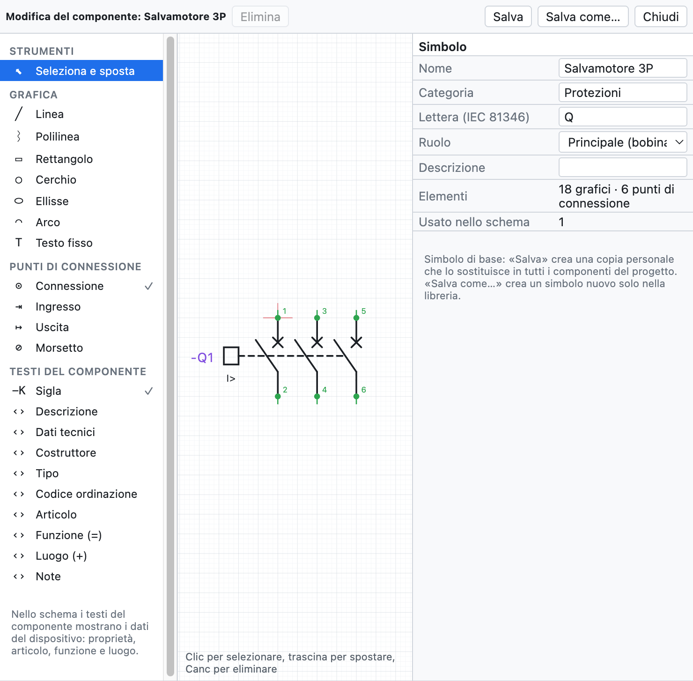
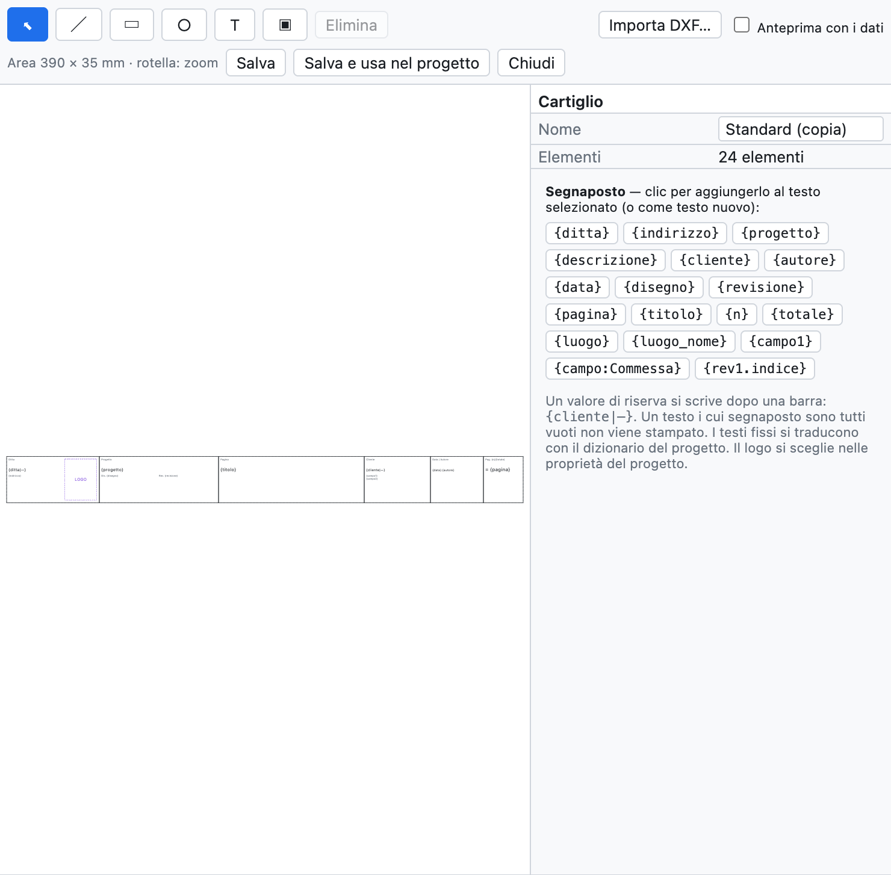

# 13. Makros, Symbole und Schriftfelder

## Makros

Ein **Makro** ist ein wiederverwendbares Stück Schaltplan: ein Motorstarter, ein Not-Halt-Kreis, ein Abgang
mit Umrichter.

### Ein Makro erstellen

1. Den Stromkreis im Schaltplan auswählen (Fensterauswahl).
2. Rechte Maustaste ▸ **Makro aus Auswahl erstellen…** (oder im Reiter *Makros* der Bibliothek).
3. Name, Kategorie und Beschreibung eingeben.

### Ein Makro einfügen

1. Im Reiter **Makros** der Bibliothek auf das Makro klicken.
2. In die Seite klicken: der angeklickte Punkt ist die linke obere Ecke des Stromkreises.

Beim Einfügen **werden BMK, Drahtnummern, Klemmen, SPS-Kanäle und Kabel neu nummeriert**; zusammen kopierte
Spule und Kontakte bleiben verknüpft. Makros liegen in der persönlichen Bibliothek, sind in allen Projekten
verfügbar und werden als `.ecmacro`-Dateien ausgetauscht (*Datei ▸ Importieren ▸ Makros…* und die
Export-Schaltfläche im Reiter *Makros*).

## Bauteileditor

Der Editor zeichnet ein Bauteil von Grund auf oder ändert ein vorhandenes: Grundsymbole, persönliche
Symbole, aus QElectroTech oder EPLAN importierte Bauteile, auch die Blackboxen von EDZ-Artikeln.

*Der Motorschutzschalter 3P im Editor: links die hinzufügbaren Objekte, in der Mitte die Zeichnung mit den
Anschlusspunkten, rechts die Eigenschaften.*

- Im Schaltplan: rechte Maustaste auf das Bauteil ▸ **Bauteil bearbeiten…**. In der Bibliothek:
  **Neues Symbol…** oder rechte Maustaste auf ein Symbol.
- Ein Objekt im linken Bereich wählen und in die Zeichnung klicken (oder ziehen):

| Gruppe | Objekte |
|---|---|
| *Grafik* | Linie, Polylinie (Klick auf jeden Eckpunkt, Doppelklick oder Enter zum Beenden), Rechteck, Kreis, Ellipse, Bogen, fester Text |
| *Anschlusspunkte* | Anschluss, Eingang, Ausgang, Klemme: im 4-mm-Raster, mit Bezeichnung (`13`, `A1`) und Drahtrichtung |
| *Bauteiltexte* | BMK, Beschreibung, technische Daten, Hersteller, Typ, Bestellnummer, Artikel, Funktion (=), Ort (+), Notizen |

- Die **Bauteiltexte** zeigen im Schaltplan die Gerätedaten (Eigenschaften, Artikel, Funktion und Ort).
  Hier platzierte Beschreibung und technische Daten werden unter dem BMK nicht wiederholt.
- *Auswählen und verschieben*: Klick zum Auswählen, ziehen zum Verschieben, **Entf** zum Löschen. Maße und
  Winkel werden im rechten Bereich korrigiert.
- Rechts außerdem Name, Kategorie, **Kennbuchstabe** nach IEC 81346, **Rolle** (Gerät, Spule mit
  Querverweisen, Schließer/Öffner/Wechsler, Klemme) und Beschreibung.
- Das Mausrad zoomt.

### Speichern

| Befehl | Wirkung |
|---|---|
| **Speichern** | gleicher Name: das Symbol ändert sich in der persönlichen Bibliothek und in **allen Bauteilen des Schaltplans**, die es verwenden |
| **Speichern unter…** | neuer Name: ein weiteres Symbol in der persönlichen Bibliothek; der Schaltplan ändert sich nicht |

Grundsymbole werden nicht überschrieben: *Speichern* legt eine persönliche Kopie mit demselben Namen an, die
sie in den Bauteilen des Projekts und auch in der Bibliothek ersetzt, an derselben Stelle: aus der
Bibliothek erhält man dann die geänderte Version. *Zurück zum Grundsymbol* (im Editor) stellt das Original
in der Bibliothek wieder her. Die geänderte Blackbox eines EPLAN-Artikels bleibt das Symbol
dieses Artikels. Wird es in einem Projekt verwendet, wird das Symbol in die `.ecad`-Datei kopiert.

## Bauteile aus QElectroTech

*Datei ▸ Importieren ▸ QElectroTech-Symbole…* (oder *Bauteile importieren…* in der Bibliothek) liest die
Bauteile von [QElectroTech](https://qelectrotech.org): `.elmt`-Dateien, `.qet`-Projekte mit ihren Elementen
oder `.zip`- bzw. `.7z`-Archive ganzer Ordner, wie die von GitHub heruntergeladene offizielle Sammlung.

- Die Grafik wird umgewandelt (Linien, Rechtecke, Kreise, Ellipsen, Bögen, Polygone, Texte), mit den
  Anschlüssen und ihren Namen.
- Der Typ wird zur Rolle: Spule mit Querverweisen, Schließer/Öffner mit automatischer Nummerierung, Klemme,
  Unterbrechungspunkt.
- Der Kennbuchstabe kommt aus Typ und Name: Leistungs- und Trennschalter **Q**, Sicherungen und thermische
  Überlastrelais **F**, Spulen **K**.
- Der Maßstab ist 10 px = 4 mm; Anschlüsse außerhalb des Rasters werden mit einem kurzen Verbindungsstück
  ins Raster gebracht, damit die Drähte einrasten.
- Die Bauteile bleiben in der persönlichen Bibliothek; wenn Sie eines einfügen, wird es ins Projekt kopiert.

> **Achtung**: Laden Sie auf GitHub die echte Datei mit *Raw* oder *Download raw file* herunter. Wer die
> Webseite speichert, erhält eine HTML-Datei, die das Bauteil nicht enthält.

Die Sammlung von QElectroTech ist © The QElectroTech team, Lizenz CC-BY 3.0: die Verwendung in Schaltplänen
ist frei; OpenWiring enthält ihre Symbole nicht, Sie importieren sie selbst.

## Mitgelieferte Schriftfelder

Neben *Standard*, *Mit Revisionstabelle* und *Kompakt* enthält das Programm sechs vollständige Schriftfelder für
verschiedene Arbeitsarten:

| Schriftfeld | Für |
|---|---|
| *ISO 7200 (Norm)* | das Schriftfeld technischer Zeichnungen nach ISO 7200 |
| *Industrie ausführlich* | Industrieschaltpläne, mit Revisionstabelle und Feldern für Datum, Zeichner, Prüfung |
| *Maschine (EN 60204-1)* | elektrische Ausrüstung von Maschinen |
| *Gebäudeinstallation (DM 37/08)* | elektrische Anlagen in Gebäuden, mit den für die Konformitätserklärung nötigen Angaben |
| *Schaltgerätekombination (EN 61439)* | Niederspannungs-Schaltgerätekombinationen |
| *Automatisierung mit Unterschriften* | Automatisierungsanlagen, mit Unterschriftenfeldern |

Man wählt sie in den Projekteigenschaften (*Schriftfeld ▸ Vorlage*) oder in denen einer Seite. Die besonderen
Felder jeder Vorlage (zum Beispiel `{campo:Matricola}`) erscheinen in den *Projekteigenschaften*, bereit zum
Ausfüllen. Bei jedem mitgelieferten Schriftfeld kann man *Anpassen…* wählen und von dieser Zeichnung ausgehen.

## Eigene Schriftfelder

Man kann auch das Schriftfeld der eigenen Firma zeichnen.

*Das Standard-Schriftfeld im Editor, mit der Liste der Platzhalter rechts.*

1. *Projekt ▸ Schriftfeld: anpassen oder zeichnen…* oder *Anpassen…* / *Neu…* in den Projekteigenschaften.
2. Mit Linien, Rechtecken, Kreisen, Texten und dem **Logobereich** zeichnen. Der Schriftfeldbereich misst
   390 × 35 mm.
3. In den Texten die **Platzhalter** verwenden: ein Klick auf einen Platzhalter der Liste fügt ihn dem
   ausgewählten Text hinzu.
4. *Vorschau mit Daten* zeigt das mit den Projektdaten gefüllte Schriftfeld.
5. **Speichern und im Projekt verwenden**.

### Platzhalter

| Platzhalter | Wert |
|---|---|
| `{ditta}`, `{indirizzo}` | Firma und Adresse |
| `{progetto}`, `{descrizione}`, `{cliente}`, `{autore}`, `{data}`, `{disegno}`, `{revisione}` | Projektdaten |
| `{pagina}`, `{titolo}` | Nummer und Titel der Seite |
| `{n}`, `{totale}` | Position der Seite und Seitenzahl (`{n}/{totale}`) |
| `{luogo}`, `{luogo_nome}` | Ort der Seite |
| `{campo1}`, `{campo:Commessa}` | Zusatzfelder |
| `{prop:Ditta.Commessa}` | benutzerdefinierte Eigenschaft des Projekts oder der Seite ([Kapitel 4](04-progetto-e-pagine.md#benutzerdefinierte-eigenschaften)) |
| `{rev1.indice}`, `{rev1.descrizione}`… | letzte Revisionen |

Ein Ersatzwert wird nach einem senkrechten Strich geschrieben: `{cliente|—}`. Der Ersatzwert kann selbst einen
Platzhalter enthalten: `{campo:Macchina|{progetto}}` schreibt das Feld *Macchina* und, wenn es leer ist, den Projektnamen. Ein Text, dessen Platzhalter
alle leer sind, wird nicht gedruckt.

### Schriftfeld aus DXF importieren

**DXF importieren…** im Editor übernimmt ein in AutoCAD oder einem anderen CAD gezeichnetes Schriftfeld in
die Vorlage: Linien, Polylinien, Kreise, Bögen, Texte und Blöcke. Attribute werden zu Platzhaltern
(PROGETTO → `{progetto}`, DATA → `{data}`, FOGLIO → `{pagina}`…). Ist es größer als der Schriftfeldbereich,
wird es verkleinert.

Gespeicherte Schriftfelder bleiben in der persönlichen Bibliothek für alle Projekte und werden in die
Projektdatei kopiert. Jede Seite kann ein anderes Schriftfeld verwenden; das Schriftfeld gilt am Bildschirm,
im PDF und im DXF.
