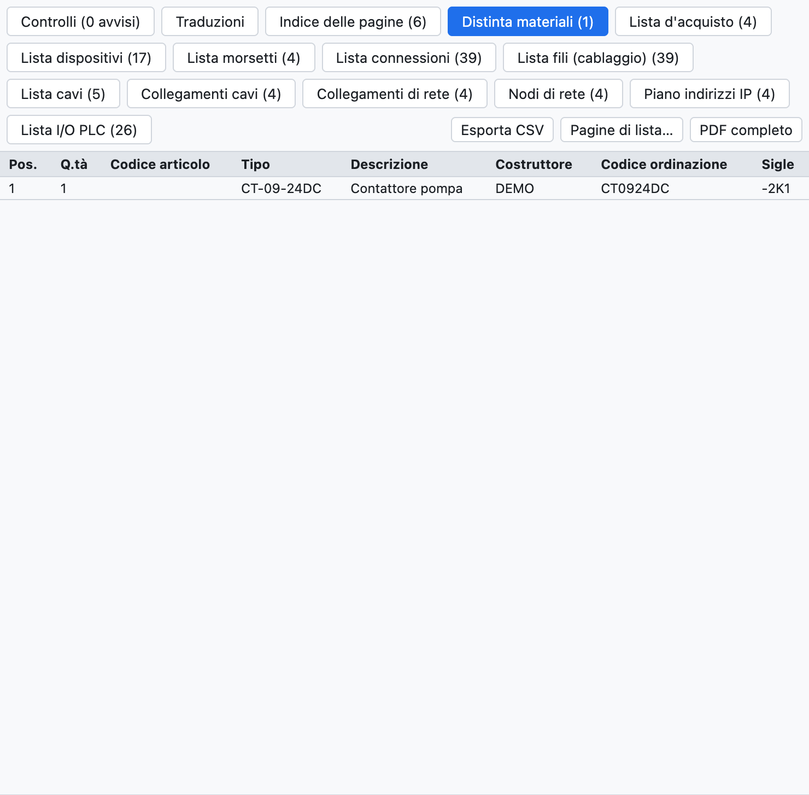
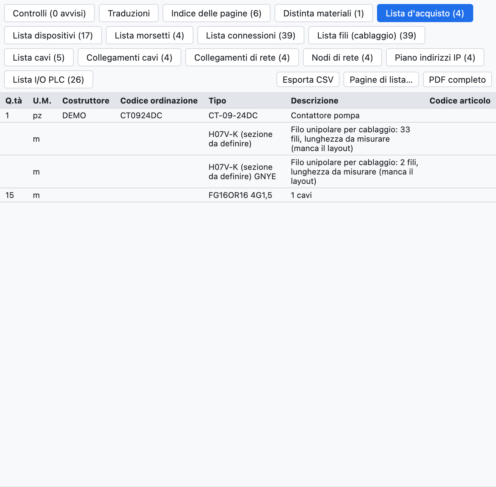
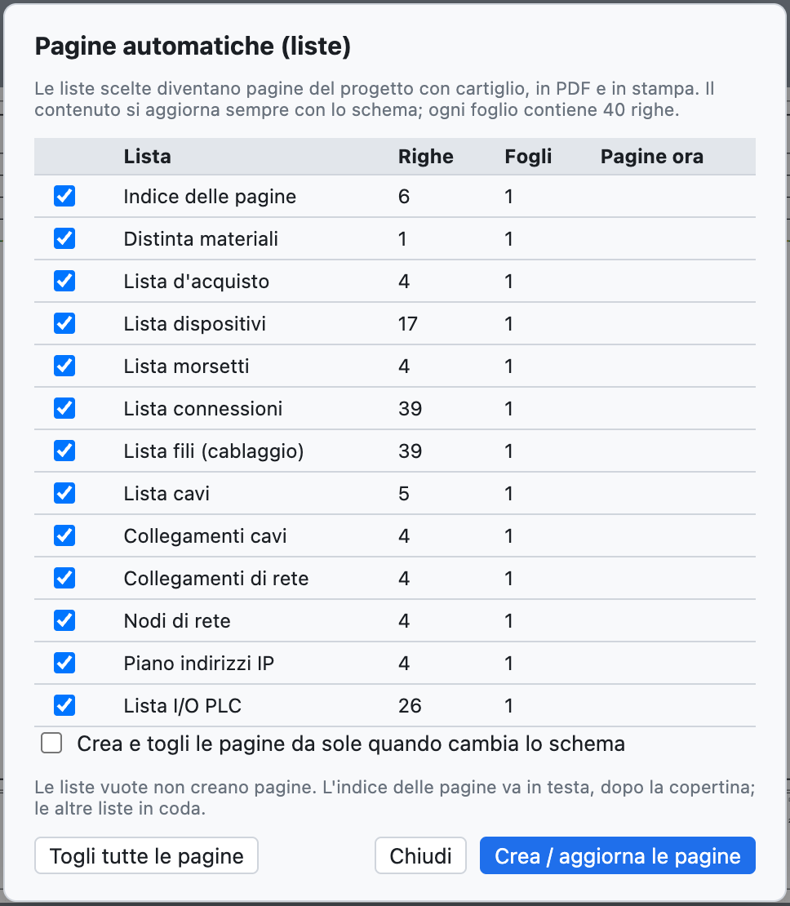
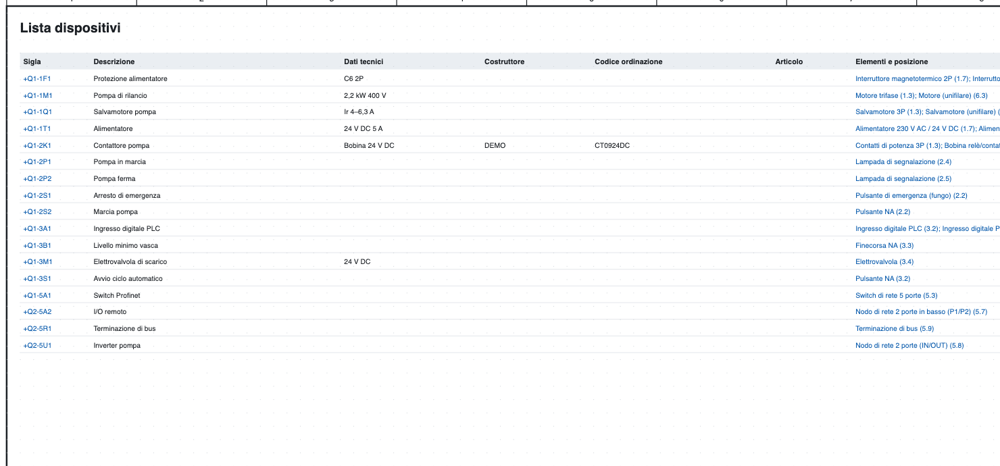
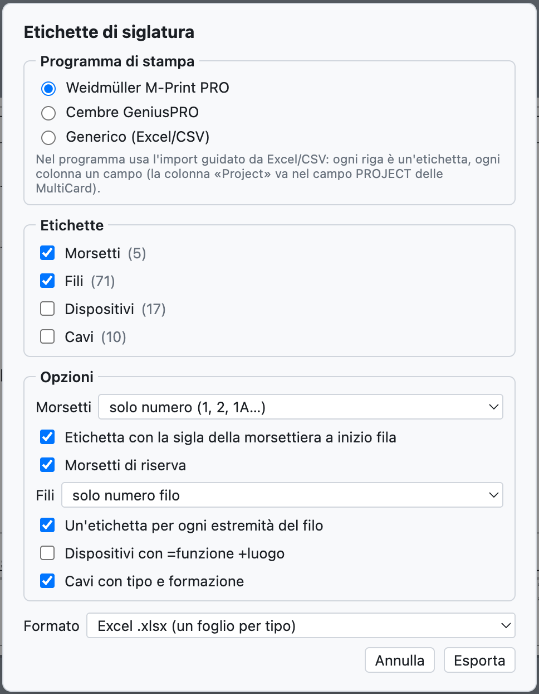

# 14. Listen und automatische Seiten

Alle Listen werden **aus dem Schaltplan berechnet**: sie werden nicht von Hand ausgefüllt und sind immer
aktuell.

## Die Ansicht Listen

*Der Reiter Listen mit der Stückliste des Beispielprojekts.*

Der Reiter **Listen** hat für jede Liste einen eigenen Unterreiter; *CSV exportieren* speichert die geöffnete
Liste (Trennzeichen `;`, öffnet sich in Excel), *Vollständiges PDF* exportiert das Projekt mit allen Listen
am Ende.

| Liste | Inhalt |
|---|---|
| Seitenverzeichnis | Nummer, Titel, Typ und Ort jeder Seite |
| Stückliste | Artikel gruppiert nach Nummer (oder nach Hersteller + Bestellnummer), Menge, BMK |
| Einkaufsliste | Artikel nach Hersteller mit Mengeneinheit, loser Draht, Kabel |
| Geräteliste | vollständiges BMK, Beschreibung, technische Daten, Hersteller, Nummern, Elemente und Positionen |
| Klemmenliste | Klemmen mit externen und internen Zielen, Drahtnummern, Brücken |
| Verbindungsliste | jede Verbindung: Drahtnummer, von, nach, Seiten, Querschnitt, Farbe, Kabel |
| Drahtliste (Verdrahtung) | jeder Draht mit Querschnitt, Farbe, Aderendhülsen und geschätzter Länge |
| Kabelliste, Kabelverbindungen | siehe [Kapitel 9](09-cavi-e-connettori.md) |
| Steckverbinderliste | Pins, Seiten, Drähte |
| Netzwerkverbindungen, Netzwerkknoten, IP-Adressplan | siehe [Kapitel 11](11-reti-luoghi-unifilare.md) |
| SPS-E/A-Liste | siehe [Kapitel 10](10-plc.md) |

Leere Listen erscheinen nicht. Ein Klick auf eine Position (`/2.4`) führt zum Element.

## Einkaufsliste

*Die Einkaufsliste des Beispielprojekts.*

Die Einkaufsliste dient zum Bestellen des Materials:

- die Artikel der Stückliste sind **nach Hersteller gruppiert**, so ist jede Gruppe eine Bestellung bei
  einem Lieferanten;
- jede Zeile hat die **Mengeneinheit**: Stück, oder Meter für Kabel, Hutschienen und Kabelkanäle;
- der **lose Draht** wird nach Querschnitt und Farbe summiert (`H07V-K 1,5 mm² BU`), in Metern aus dem
  Schaltschrankaufbau geschätzt, mit 10 % Zuschlag; ohne Aufbau nennt die Zeile die Anzahl der Drähte und
  dass die Länge zu messen ist;
- **Kabel ohne Artikel** werden nach Typ und Aufbau summiert.

## Automatische Seiten

Die Listen werden zu **Projektseiten** mit Schriftfeld, zum Drucken und für das PDF.

*Das Fenster der automatischen Seiten: für jede Liste die Zeilen, die nötigen Blätter und die vorhandenen
Seiten.*

1. *Einfügen ▸ Automatische Seiten (Listen)…* oder *Listenseiten…* in der Ansicht Listen.
2. Die Listen anhaken, die Sie als Seiten wollen.
3. **Seiten erstellen / aktualisieren** drücken.

- Jedes Blatt enthält 40 Zeilen; eine längere Liste belegt mehrere Blätter.
- Das **Seitenverzeichnis** steht vorne nach dem Deckblatt, die übrigen Listen am Ende.
- Der **Inhalt** der Seiten folgt immer dem Schaltplan.
- Mit **Seiten automatisch erstellen und entfernen, wenn sich der Schaltplan ändert** passt sich auch die
  Zahl der Blätter selbst an: wächst die Klemmenliste von 40 auf 41 Zeilen, erscheint das zweite Blatt.
- *Alle Seiten entfernen* entfernt die Listenseiten.
- *Einfügen ▸ Listenseiten aktualisieren* gleicht die Seiten an die gewählten Listen an.

*Die Geräteliste als Projektseite.*

## Beschriftungsetiketten

*Datei ▸ Exportieren ▸ Etiketten M-Print PRO / GeniusPRO…* bereitet die Etiketten für die
Beschriftungsdrucker vor.

*Das Fenster der Etiketten.*

- **Programm**: Weidmüller M-Print PRO (Spalten `Project`, `Text 1`, `Text 2`…; die Spalte `Project` kommt in
  das Feld PROJECT der MultiCards), Cembre GeniusPRO (Spalten `Riga 1`, `Riga 2`…, `Gruppo`) oder allgemein.
- **Etiketten**: Klemmen, Drähte, Geräte, Kabel.
- **Optionen**: Klemmen nur mit Nummer oder mit vollständigem BMK, Etikett der Klemmleiste am Reihenanfang,
  Reserven; Drähte nur mit Nummer oder mit Ziel, ein Etikett je Ende; Geräte mit =Funktion +Ort; Kabel mit
  Typ und Aufbau.
- **Format**: Excel (ein Blatt je Typ) oder CSV.

Beide Programme importieren Excel und CSV mit einem Assistenten, in dem man jede Spalte einem Feld zuordnet.
