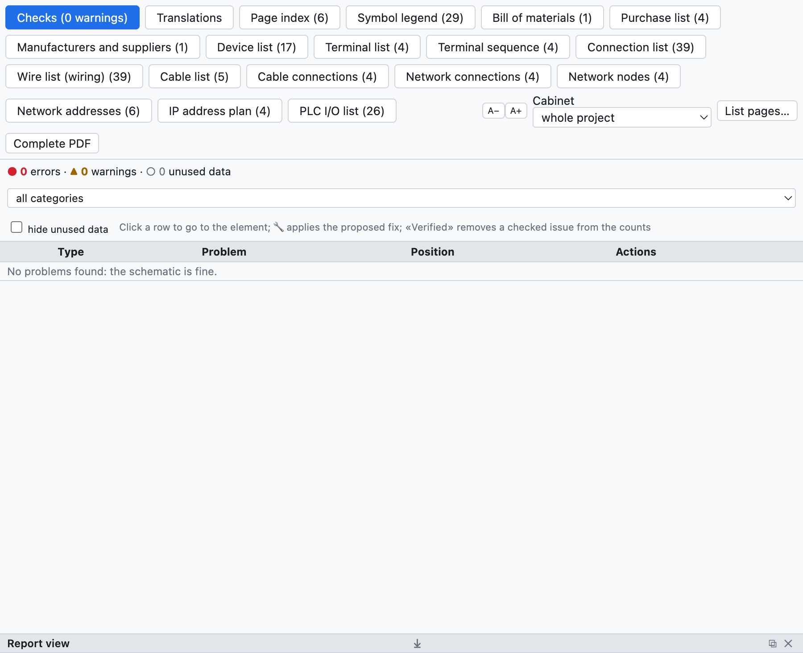
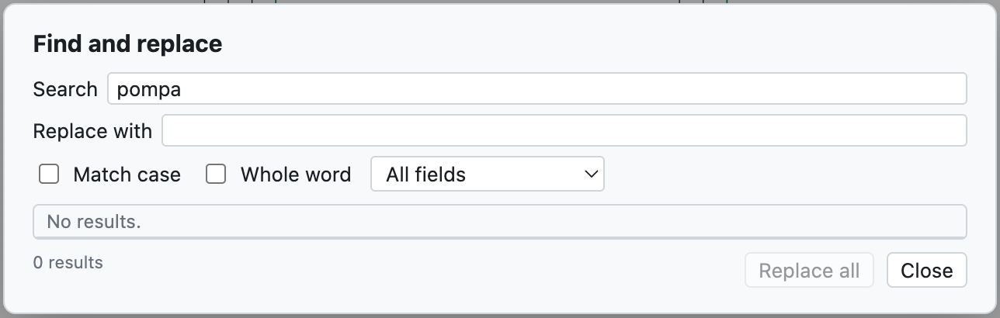

# 15. Prüfung, Suche und Revisionen

## Projektprüfung

**Prüfung** in der Werkzeugleiste (oder *Projekt ▸ Prüfung*) prüft das ganze Projekt und öffnet den Reiter
*Prüfungen* der Ansicht Listen.

*Das Beispielprojekt hat keine Probleme. Ein Beispiel mit Warnungen zeigt [Kapitel 3](03-primo-progetto.md#schritt-6--prüfung).*

Die Probleme sind eingeteilt in:

- **Fehler** (●): zu korrigieren, zum Beispiel ein Kurzschluss;
- **Warnungen** (▲): wahrscheinliche Fehler, zum Beispiel ein freier Anschlusspunkt;
- **ungenutzte Daten** (○): aufzuräumende Daten, zum Beispiel ein ins Projekt kopierter, aber nicht
  verwendeter Artikel.

Sie werden nach Kategorie gefiltert, und *ungenutzte Daten ausblenden* entfernt die ○. **Ein Klick auf eine
Zeile** führt zum Element und wählt es aus.

### Was geprüft wird

| Kategorie | Beispiele |
|---|---|
| Kurzschlüsse | verschiedene Potenziale an derselben Leitung (`L1` mit `N`, `+24V` mit `0V`), verbundene Unterbrechungspunkte mit verschiedenen Namen, Bauteile mit beiden Anschlüssen an derselben Leitung |
| Nur scheinbare Verbindungen | ein Draht, der über einen Anschlusspunkt läuft, ohne dort zu enden: er sieht verbunden aus, ist es aber nicht |
| Verwaiste Elemente | Bauteile, Potenziale, Unterbrechungspunkte und Knoten ohne Verbindungen, isolierte Drähte, Kontakte ohne Spule |
| Unvollständige Verbindungen | freie Anschlüsse von Spulen, Kontakten, Leuchten, Tastern, E/A-Punkten; Drähte mit einem freien Ende (Schienen bis zum Rand sind zulässig) |
| Zeichnung | nicht vorhandene oder überlappende Symbole, überlappende Drähte, Elemente außerhalb des Blatts, wiederholte Drahtnummern, leere Seiten |
| Leiterbusse | Drähte, die den Bus ohne Leitername berühren, Leiter, die in den Bus eintreten und nicht austreten |
| BMK und Daten | doppelte oder fehlende BMK, mehr Kontakte als der Artikel hat, wiederholte Klemmen |
| Kabel, Steckverbinder, Netze, SPS, Aufbau | siehe die jeweiligen Kapitel |
| Ungenutzte Daten | nicht mehr verwendete Artikel, Symbole, Klemmleisten- und Steckverbinderdaten, leere Orte |

> **Tipp**: Starten Sie die Prüfung vor jeder Auslieferung und vor dem PDF-Export.

## Suchen und ersetzen

**⌘F** (oder *Suchen*) öffnet die Suche im ganzen Projekt.

*Die Suche nach «pompa» findet sieben Beschreibungen.*

- Gesucht wird in BMK, Beschreibungen, Texten, Drahtnummern, SPS-Namen, Nummern; die Liste *Alle Felder*
  schränkt die Suche auf ein Feld ein.
- *Groß-/Kleinschreibung* und *Ganzes Wort* verfeinern die Suche.
- Ein Klick auf ein Ergebnis führt zum Element.
- *Ersetzen durch* und **Alle ersetzen** ändern den Text in allen Ergebnissen, in einem Schritt, der sich
  rückgängig machen lässt.

## Revisionen

Eine **Revision** hält den Stand des ausgelieferten Projekts fest, zum Beispiel «Rev. A – prima emissione».

1. *Projekt ▸ Neue Revision…* (oder *Neue Revision…* in den Projekteigenschaften).
2. Index, Datum, Autor und Beschreibung eingeben.

Ab diesem Moment:

- spätere Änderungen werden mit roten **Wolken** am Bildschirm und im PDF markiert (abschaltbar mit
  *Wolken an Änderungen* in den Eigenschaften);
- das Schriftfeld jeder Seite zeigt den Index der letzten Revision, die sie geändert hat;
- das PDF-Verzeichnis, das Deckblatt und das Schriftfeld *Mit Revisionstabelle* führen die Revisionen auf.

## Zwei Projekte vergleichen

*Datei ▸ Importieren ▸ Mit einer .ecad-Datei vergleichen…* (oder *Vergleichen…* in den Eigenschaften)
vergleicht das geöffnete Projekt mit einer anderen Datei, zum Beispiel der an den Kunden ausgelieferten
Version. Der Reiter *Vergleich* der Ansicht Listen führt hinzugefügte, entfernte oder geänderte Seiten,
Geräte und Projektdaten auf.
