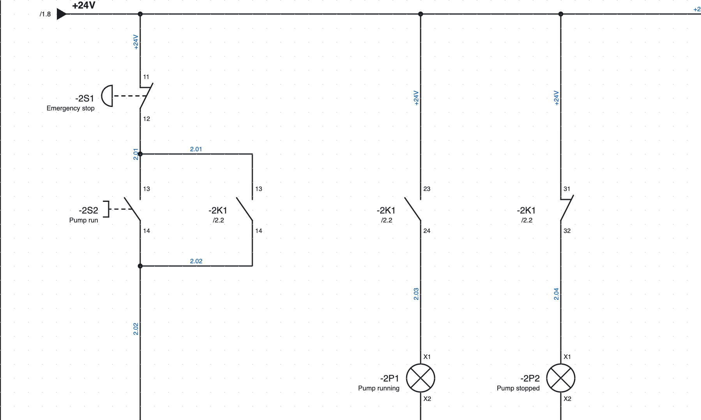
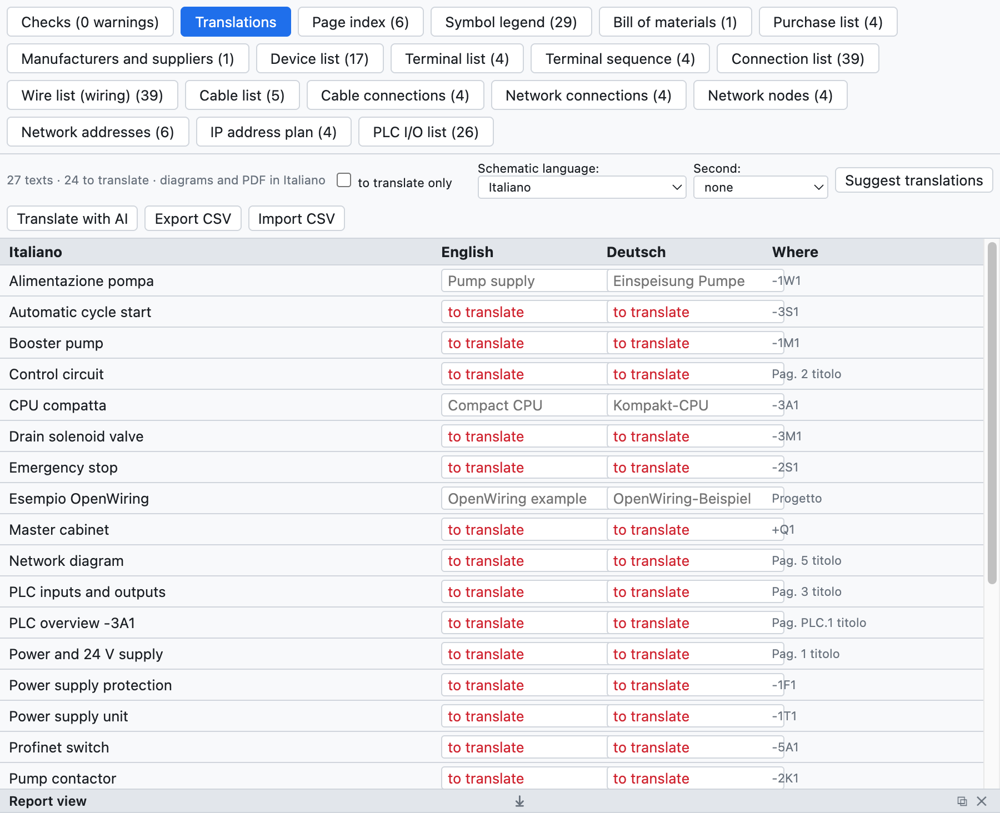

# 16. Sprachen der Schaltpläne

Schaltpläne werden auf Italienisch gezeichnet und lassen sich auch auf **Englisch** oder **Deutsch** drucken,
oder in zwei Sprachen zugleich. Die Sprache der Programmoberfläche ist eine eigene Einstellung
([Kapitel 1](01-introduzione.md#sprache-der-oberfläche)).

*Seite 2 auf Englisch mit dem Italienischen darunter: «Emergency stop / Arresto di emergenza».*

## Das Projektwörterbuch

Der Reiter *Übersetzungen* der Ansicht Listen (oder *Projekt ▸ Übersetzungen…*) führt alle übersetzbaren
Texte des Projekts auf: Seitentitel, freie Texte, Gerätebeschreibungen, Orte, SPS-Kommentare,
Schriftfeldfelder. Zu jedem gibt es die englische und die deutsche Übersetzung und die Stelle, an der er
erscheint.

*Das Wörterbuch des Beispielprojekts.*

- Die Übersetzung in die Zelle schreiben; *nur zu übersetzende* zeigt die Texte, denen eine fehlt.
- Das Programm enthält bereits die festen Texte (Schriftfeld, Titel und Spalten der Listen) und rund 250
  gängige Begriffe der Elektrotechnik.

## Automatisch übersetzen

| Befehl | Wie er übersetzt |
|---|---|
| *Übersetzungen vorschlagen* | ganzer Satz, wenn er im mitgelieferten Wörterbuch steht, sonst Wort für Wort («Lampada guasto» → «Fault lamp») |
| *Mit KI übersetzen* | mit dem gewählten KI-Assistenten (Claude, ChatGPT, Gemini), mit der Fachterminologie ([Kapitel 17](17-assistente-ia.md#das-wörterbuch-übersetzen)) |

Automatische Übersetzungen sind als zu prüfen **hervorgehoben**: man bestätigt sie mit ✓ oder indem man sie
bearbeitet.

## Die Sprache wählen

- **Sprache der Schaltpläne**: *Ansicht ▸ Sprache der Schaltpläne*, die Projekteigenschaften (*Sprachen*)
  oder der Reiter Übersetzungen. Sie ändert Schaltpläne, Schriftfeld, Deckblatt, Listenseiten,
  SPS-Übersichten und Klemmleistenpläne.
- **Zweite Sprache**: schreibt die Texte in zwei Sprachen («Contattore pompa / Pump contactor»).
- **PDF** und **Druck** lassen sich in einer anderen Sprache erstellen, ohne die des Projekts zu ändern
  (Auswahl *Sprache* im Exportfenster).

## Mit einem Übersetzer

*CSV exportieren* speichert das Wörterbuch als Tabelle `Italiano;English;Deutsch`: der Übersetzer ergänzt sie
in Excel, und *CSV importieren* liest sie wieder ein.
