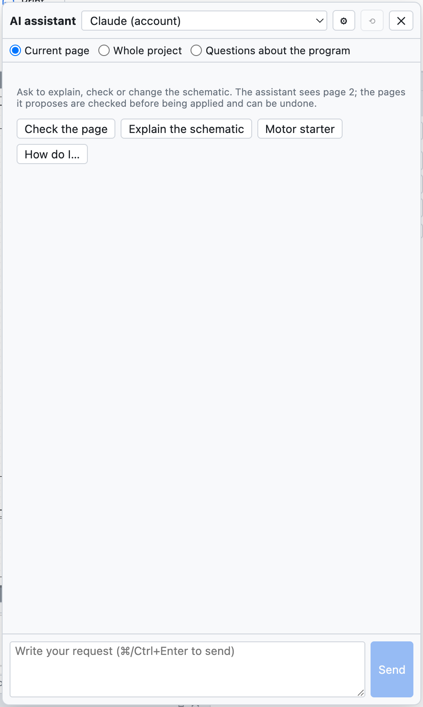
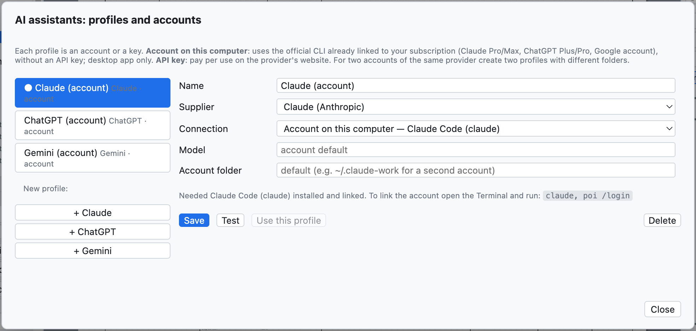
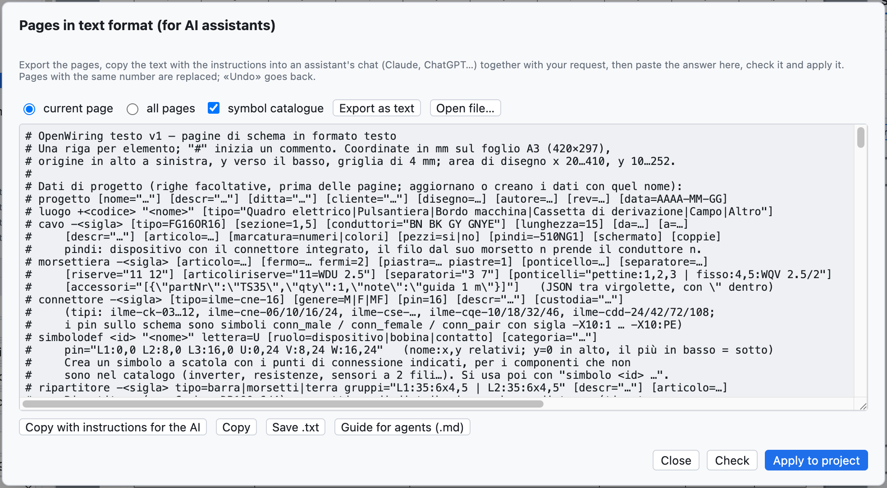

# 17. KI-Assistent

Der KI-Assistent ist ein Kollege, den Sie in Ihrer Sprache bitten können, Teile des Schaltplans zu
**erklären**, zu **prüfen** oder zu **zeichnen**. Er arbeitet mit **Claude** (Anthropic), **ChatGPT**
(OpenAI) und **Gemini** (Google) und nutzt Ihre Konten. Er antwortet in der Sprache der Oberfläche.



*Der Bereich des Assistenten mit den Schnellschaltflächen.*

## Den Assistenten öffnen

*Projekt ▸ KI-Assistent…* oder **⌘I** öffnet den Bereich rechts; der Schaltplan bleibt sichtbar, und man kann
weiterarbeiten, während der Assistent antwortet.

Oben wählt man:

- das **Profil**: welcher Assistent und welches Konto;
- den **Kontext**: was der Assistent sieht.

| Kontext | Der Assistent erhält |
|---|---|
| *Aktuelle Seite* | die Seite im Textformat, den Formatleitfaden mit dem Symbolkatalog, die Prüfungsprobleme der Seite |
| *Gesamtes Projekt* | alle Seiten, die Projektdaten (Orte, Kabel, SPS-Karten) und alle Prüfungsprobleme |
| *Fragen zum Programm* | das Handbuch von OpenWiring, für Fragen zu Menüs und Befehlen |

## Was man fragen kann

| Anfrage | Beispiel |
|---|---|
| Erklären | «Erkläre, wie der Stromkreis auf dieser Seite funktioniert» |
| Prüfen | «Prüfe diese Seite: Verbindungen, BMK, Schutzeinrichtungen, Norm DIN EN 60204-1» |
| Zeichnen | «Füge eine Seite 7 mit einem Stern-Dreieck-Anlauf für einen 15-kW-Motor hinzu» |
| Ändern | «Füge eine Störungsleuchte hinzu, angesteuert über den Kontakt 95-96 des Überlastrelais» |
| Das Programm bedienen | «Wie lege ich eine Klemmleiste mit zwei Etagen an?» |

Die Schnellschaltflächen *Seite prüfen*, *Schaltplan erklären*, *Motorstarter*, *Wie geht…* senden fertige
Anfragen. **⌘Enter** sendet, *Abbrechen* unterbricht eine lange Antwort, ⟲ beginnt ein neues Gespräch.

## Wenn der Assistent zeichnet

Enthält die Antwort Seiten im Textformat, **prüft** der Bereich sie **sofort**:

- *Bereit: fügt Seite 7 hinzu · keine Probleme* → **Ins Projekt übernehmen** drücken;
- gibt es Fehler oder Prüfungsprobleme, erscheinen sie unter der Antwort: **Korrektur anfordern** schickt
  Fehler und Probleme an den Assistenten zurück, und er korrigiert.

Die Übernahme wird mit **⌘Z** rückgängig gemacht. Eine Seite mit derselben Nummer wie eine vorhandene ersetzt
diese; eine neue Nummer fügt eine Seite hinzu.

> **Echtes Beispiel.** Auf die Bitte «Füge eine neue Seite (Nummer 7) mit einem Direktanlauf für einen
> 4-kW-Drehstrommotor hinzu: Motorschutzschalter, Schütz, Klemmleiste und Motor» antwortete Claude in etwa
> 30 Sekunden mit der vollständigen Seite (Motorschutzschalter `-7Q1`, Schütz `-7K1`, Klemmen `-X2`, Motor
> `-7M1`, Kabel `-7W1`) und wies von selbst darauf hin, dass die Schützspule im Steuerstromkreis fehlte.

## Profile und Konten

*Projekt ▸ KI-Assistenten: Profile und Konten…* (oder ⚙ im Bereich).



*Ein Profil je Assistent: beim ersten Start gibt es je eines für Claude, ChatGPT und Gemini.*

Jedes Profil hat einen Namen, einen Anbieter, eine Verbindungsart und ein Modell. Man kann mehrere Profile
desselben Anbieters haben, zum Beispiel das private und das Firmenkonto.

### Konto auf diesem Computer (Abonnement)

In der Desktop-App kann das Profil die **offizielle CLI** des Anbieters nutzen, die bereits mit Ihrem
Abonnement verbunden ist: kein API-Schlüssel, es wird das Kontingent des Abonnements verwendet.

| Anbieter | Zu installierendes Programm | Abonnement | Befehl zum Verbinden des Kontos |
|---|---|---|---|
| Claude | Claude Code (`claude`) | Claude Pro oder Max | `claude`, dann `/login` |
| ChatGPT | Codex CLI (`codex`) | ChatGPT Plus oder Pro | `codex login` |
| Gemini | Gemini CLI (`gemini`) | Google-Konto | `gemini`, dann *Login with Google* |

Der Befehl wird einmal im Terminal ausgeführt. Für ein **zweites Konto** desselben Anbieters geben Sie im
Profil einen anderen **Kontoordner** an (zum Beispiel `~/.claude-lavoro`): das Fenster zeigt den genauen
Befehl, zum Beispiel `CLAUDE_CONFIG_DIR=~/.claude-lavoro claude`.

Läuft die Anmeldung ab, antwortet der Assistent mit dem auszuführenden Befehl (zum Beispiel `codex login`).

### API-Schlüssel

Mit der Verbindung *API-Schlüssel* bezahlt man nach Verbrauch auf der Website des Anbieters:

| Anbieter | Wo der Schlüssel erstellt wird |
|---|---|
| Claude | console.anthropic.com |
| ChatGPT | platform.openai.com |
| Gemini | aistudio.google.com |

Den Schlüssel ins Profil einfügen; *Auflisten* zeigt die mit diesem Schlüssel verfügbaren Modelle. In der
Desktop-App wird der Schlüssel vom Betriebssystem **verschlüsselt** und bleibt nur auf diesem Computer.

**Testen** prüft die Verbindung mit einer kurzen Frage; **Dieses Profil verwenden** macht es zum aktiven.

## Das Wörterbuch übersetzen

*Projekt ▸ Mit dem KI-Assistenten übersetzen* (oder *Mit KI übersetzen* im Reiter Übersetzungen) schickt dem
aktiven Assistenten die Projekttexte ohne Übersetzung sowie die Wort für Wort übersetzten und bittet um
Englisch und Deutsch mit der Fachterminologie. Die Übersetzungen kommen als **zu prüfen** ins Wörterbuch
(siehe [Kapitel 16](16-lingue.md)).

## Das Textformat mit einem externen Assistenten

Man kann auch mit einem Assistenten in einem Browser-Chat arbeiten, ohne Profile:



*Das Fenster der Seiten im Textformat.*

1. *Datei ▸ Seiten als Text (KI-Assistenten)…*: *aktuelle Seite* oder *alle Seiten* wählen und
   **Als Text exportieren** drücken.
2. **Mit Anweisungen für die KI kopieren** und in den Chat einfügen, die eigene Anfrage am Ende anfügen.
3. Die Antwort ins Fenster einfügen (auch mit dem Text drumherum), **Prüfen** und dann
   **Ins Projekt übernehmen** drücken.

Das Format ist eine Zeile je Element:

```text
luogo +Q1 "Quadro elettrico"
pagina 7 "Ventilazione quadro" luogo=Q1
  simbolo potential +24V @28,24
  filo 28,24 400,24
  simbolo potential 0V @28,232
  filo 28,232 400,232
  simbolo pb_no -? @100,60 descr="Marcia ventilatore"     # "-?" = automatisches BMK
  simbolo coil -7K1 @100,140 descr="Contattore ventilatore"
  collega -7S1:13 100,24                                  # zur Schiene +24V
  collega -7S1:14 -7K1:A1                                 # über BMK und Anschlusspunkt
  collega -7K1:A2 100,232
```

Die vollständige Syntax steht im **Leitfaden für Agenten** (*Hilfe ▸ Leitfaden für KI-Agenten (.md)…*),
siehe [Kapitel 19](19-riga-di-comando.md).

## Datenschutz

Der an den Assistenten gesendete Schaltplan verlässt den Computer und gelangt zum gewählten Anbieter, zu
dessen Nutzungsbedingungen. Mit *Aktuelle Seite* wird nur die geöffnete Seite gesendet.
