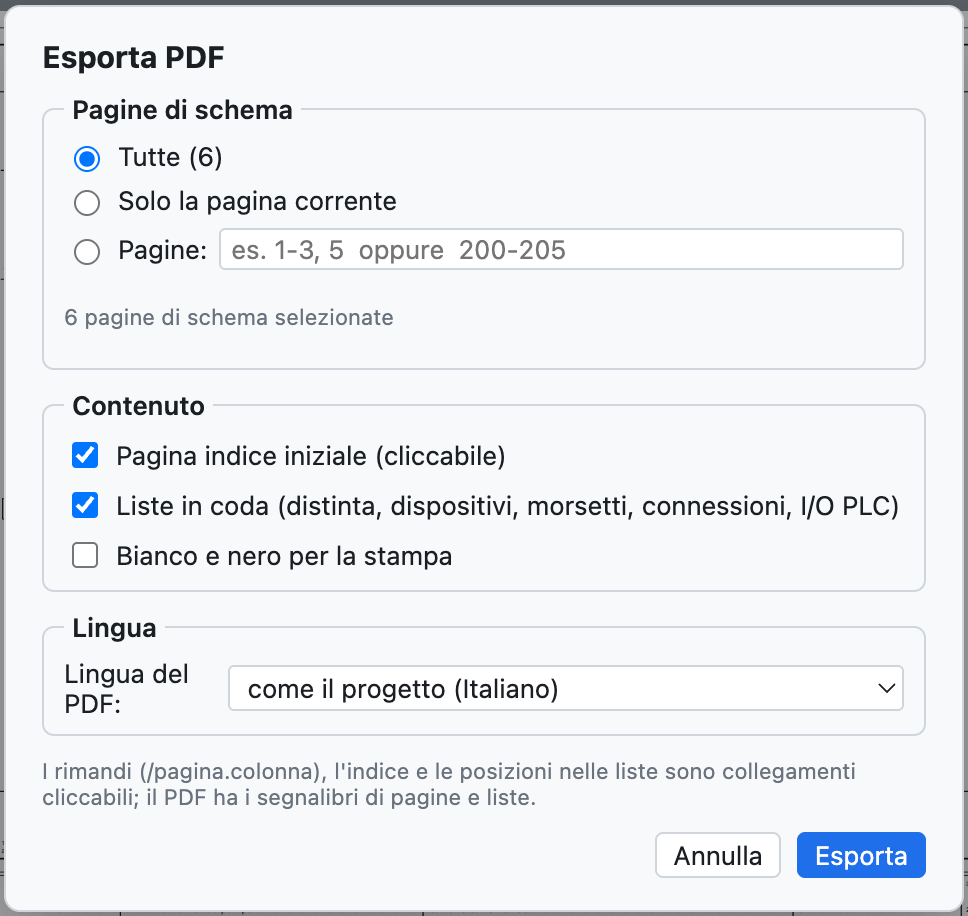
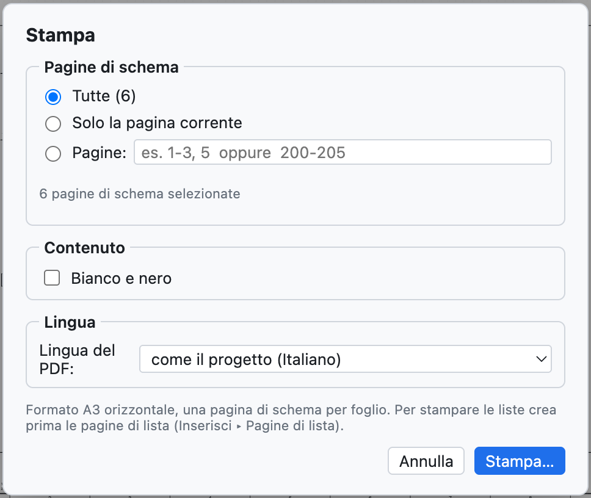

# 18. Import und Export

## PDF

**PDF** in der Werkzeugleiste (oder *Datei ▸ Exportieren ▸ PDF…*) erzeugt ein Vektor-PDF in A3.

*Die PDF-Optionen.*

| Option | Wirkung |
|---|---|
| *Alle*, *Nur die aktuelle Seite*, *Seiten* | welche Seiten; der Bereich wird mit den Projektnummern angegeben (`1-3, 5` oder `200-205`) |
| *Inhaltsverzeichnis am Anfang* | anklickbares Verzeichnis der Seiten und Listen |
| *Listen am Ende* | Stückliste, Geräte, Klemmen, Verbindungen, SPS-E/A nach den Schaltplänen |
| *Schwarzweiß für den Druck* | Drähte und Drahtnummern in Schwarz |
| *Sprache des PDF*, *Zweite Sprache* | das PDF in einer anderen Sprache, ohne das Projekt zu ändern |

Im PDF sind die **Verweise anklickbar** (Kontakte ↔ Spule, Unterbrechungspunkte zwischen Seiten, SPS,
Übersichten), ebenso die Positionen in den Listen und das Verzeichnis; das PDF hat **Lesezeichen** für
Seiten und Listen.

## Drucken

*Datei ▸ Drucken…* (⌘P) schickt die Seiten im **A3-Querformat** an den Drucker, eine Seite je Blatt.

*Die Druckoptionen: Seiten, Schwarzweiß, Sprache.*

Um auch die Listen zu drucken, zuerst die Listenseiten anlegen ([Kapitel 14](14-liste-e-pagine-automatiche.md#automatische-seiten)).

## DXF

| Befehl | Ergebnis |
|---|---|
| *Datei ▸ Exportieren ▸ DXF der aktuellen Seite* | ein DXF R12 im Maßstab 1:1, in mm |
| *Datei ▸ Exportieren ▸ DXF des gesamten Projekts (ZIP)* | ein DXF je Seite, in einem ZIP-Archiv |
| auf der Aufbauseite | das Bohr-DXF der Platte ([Kapitel 12](12-layout-quadro.md#bohrbild)) |

Die DXF-Dateien haben die Layer CORNICE, CARTIGLIO, SIMBOLI, FILI, TESTI, SIGLE, NUMERI_FILO (plus CAVI und
QUADRI, wo nötig) und öffnen sich in AutoCAD, DraftSight, LibreCAD und anderen CAD-Programmen. Das
DWG-Format ist nicht verfügbar: man öffnet das DXF und speichert es im CAD als DWG.

## Excel und CSV

- Jede Liste wird in der Ansicht Listen als **CSV** (Trennzeichen `;`) exportiert.
- Der **Geräte-Navigator** exportiert und reimportiert Excel ([Kapitel 7](07-dispositivi-e-articoli.md#excel)).
- Die **SPS**-Ansicht exportiert für TIA Portal, CODESYS, PLCopen und die E/A-Liste ([Kapitel 10](10-plc.md)).
- Die **Etiketten** werden als Excel oder CSV ausgegeben ([Kapitel 14](14-liste-e-pagine-automatiche.md#beschriftungsetiketten)).
- Das **Wörterbuch** der Übersetzungen wird als CSV ausgegeben ([Kapitel 16](16-lingue.md)).

## Schaltpläne aus PDF importieren (SEE Electrical und andere)

*Datei ▸ Importieren ▸ Schaltplan aus PDF (SEE Electrical…)…* legt ein **neues Projekt** aus einem
Schaltplan an, der aus einem anderen CAD als **Vektor-PDF** exportiert wurde. Getestet wurde mit einem realen
SEE-Electrical-Projekt von 207 Seiten, importiert in wenigen Sekunden.

Was wiederhergestellt wird:

- **Blätter**: eines je Schaltplanblatt, mit Nummer und Titel aus dem Schriftfeld; das Titelpräfix
  (`Q1.1 Ingresso linea`) wird zum Ort `+Q1.1`; Deckblatt und Listen des Quell-CAD werden übersprungen;
- **echte Drähte**, mit der Farbe der Zeichnung (blau → BU, grün-gelb → PE, rot → RD…) und dem daneben
  geschriebenen Namen (`L1-1.1`, `200.01`) als Drahtnummer;
- **Bauteile** mit dem nächstliegenden **BMK**, den **Anschlüssen**, an denen die Drähte ankommen, und deren
  Namen (`1/L1`, `A1`, `95`);
- **Klemmleistenklemmen**, auch mehrstöckig (`X1.1.12:1A`);
- **Unterbrechungspunkte** zwischen Seiten, gepaart über den Namen oder die Verweise `Blatt.Spalte`;
- freie **Texte** und Texte der Bauteile.

Nachzuprüfen: die Bauteile werden an der Grafik erkannt und wissen nicht, ob sie Spulen oder Kontakte sind
(also kein Kontaktspiegel); einige Elemente bleiben Grafik ohne BMK. *Projekt ▸ Prüfung* meldet
unterbrochene Leitungen und Unterbrechungspunkte ohne Gegenstück. Ein gescanntes PDF (ein Bild) lässt sich
nicht importieren.

## Weitere Importe

| Befehl | Was er importiert | Siehe |
|---|---|---|
| *Artikel EDZ / XML / CSV…* | Herstellerartikel, mit Bildern, Anschlüssen, Zeichnung und Handelsdaten (CSV) | [Kapitel 7](07-dispositivi-e-articoli.md#herstellerdaten-importieren-edz) |
| *QElectroTech-Symbole…* | Bauteile `.elmt`, `.qet`, Archive | [Kapitel 13](13-macro-simboli-cartigli.md#bauteile-aus-qelectrotech) |
| *Makros…* | `.ecmacro`-Dateien | [Kapitel 13](13-macro-simboli-cartigli.md#makros) |
| *Mit einer .ecad-Datei vergleichen…* | Unterschiede zu einem anderen Projekt | [Kapitel 15](15-verifica-ricerca-revisioni.md#zwei-projekte-vergleichen) |
| *DXF importieren…* im Schriftfeldeditor | in einem anderen CAD gezeichnetes Schriftfeld | [Kapitel 13](13-macro-simboli-cartigli.md#schriftfeld-aus-dxf-importieren) |
| *Variablen importieren* (SPS-Ansicht) | Variablentabelle aus TIA Portal, CODESYS, CSV | [Kapitel 10](10-plc.md#import-der-variablen) |
| *Seiten als Text* | von einem KI-Assistenten oder einem Skript geschriebene Seiten | [Kapitel 17](17-assistente-ia.md#das-textformat-mit-einem-externen-assistenten) |

## Weitere Exporte

| Befehl | Ergebnis |
|---|---|
| *PLCopen XML (SPS-Variablen)* | globale Variablen für CODESYS und kompatible Umgebungen |
| *Artikel als XML (EPLAN-Format)* | Bibliotheksartikel in einer XML-Datei im EPLAN-Format |
| *Übersetzungswörterbuch (CSV)* | Tabelle `Italiano;English;Deutsch` |
