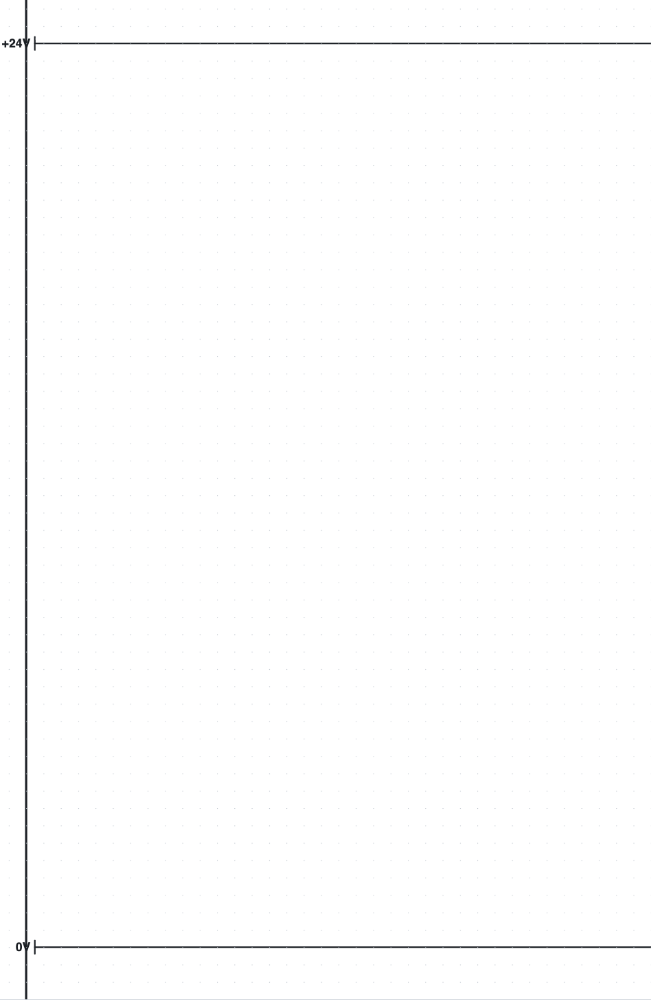
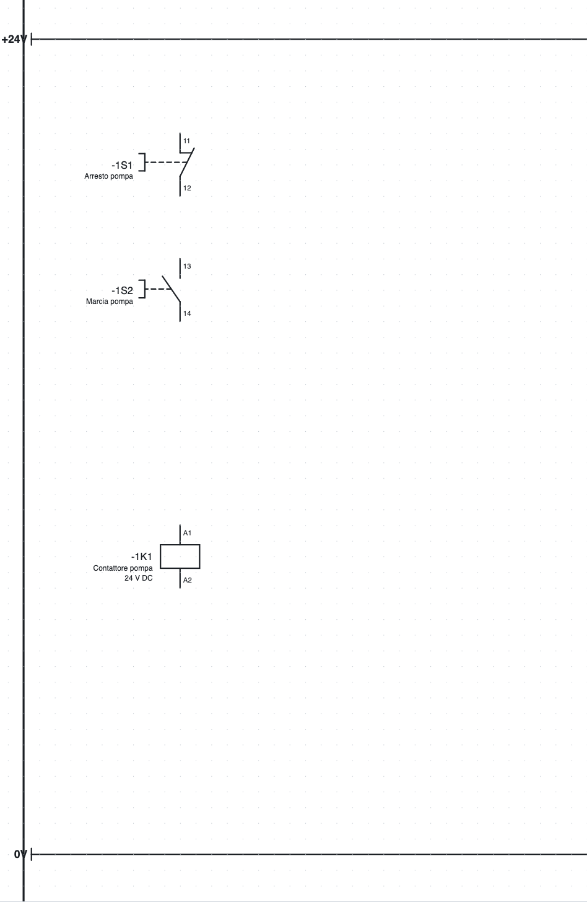
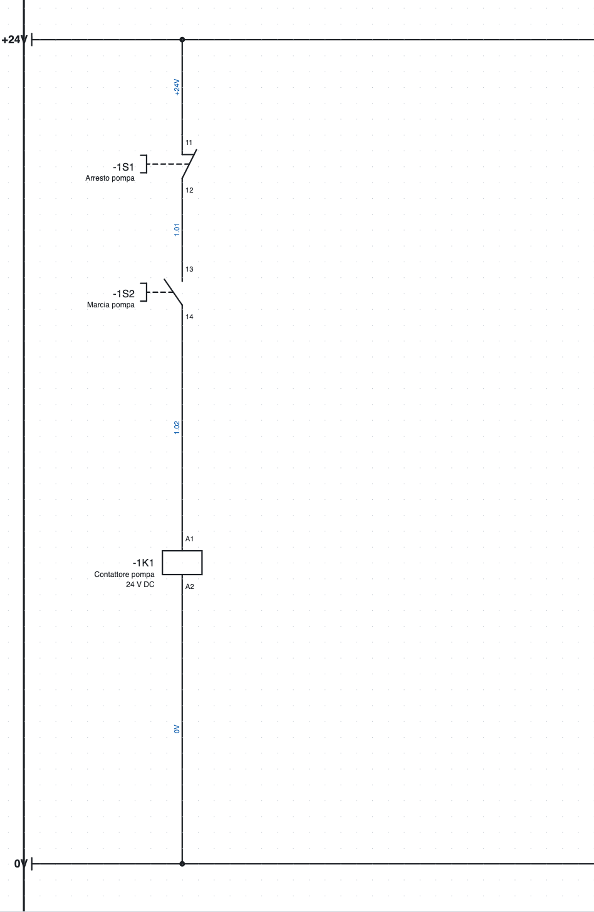
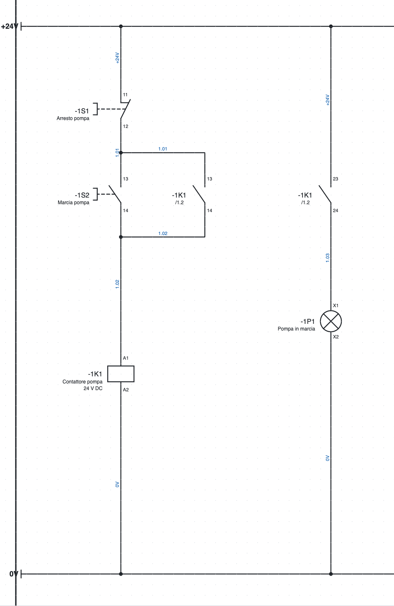
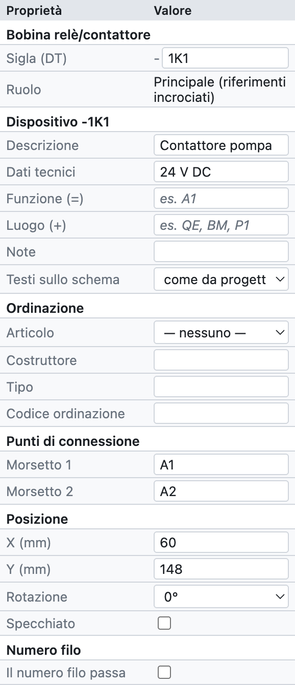
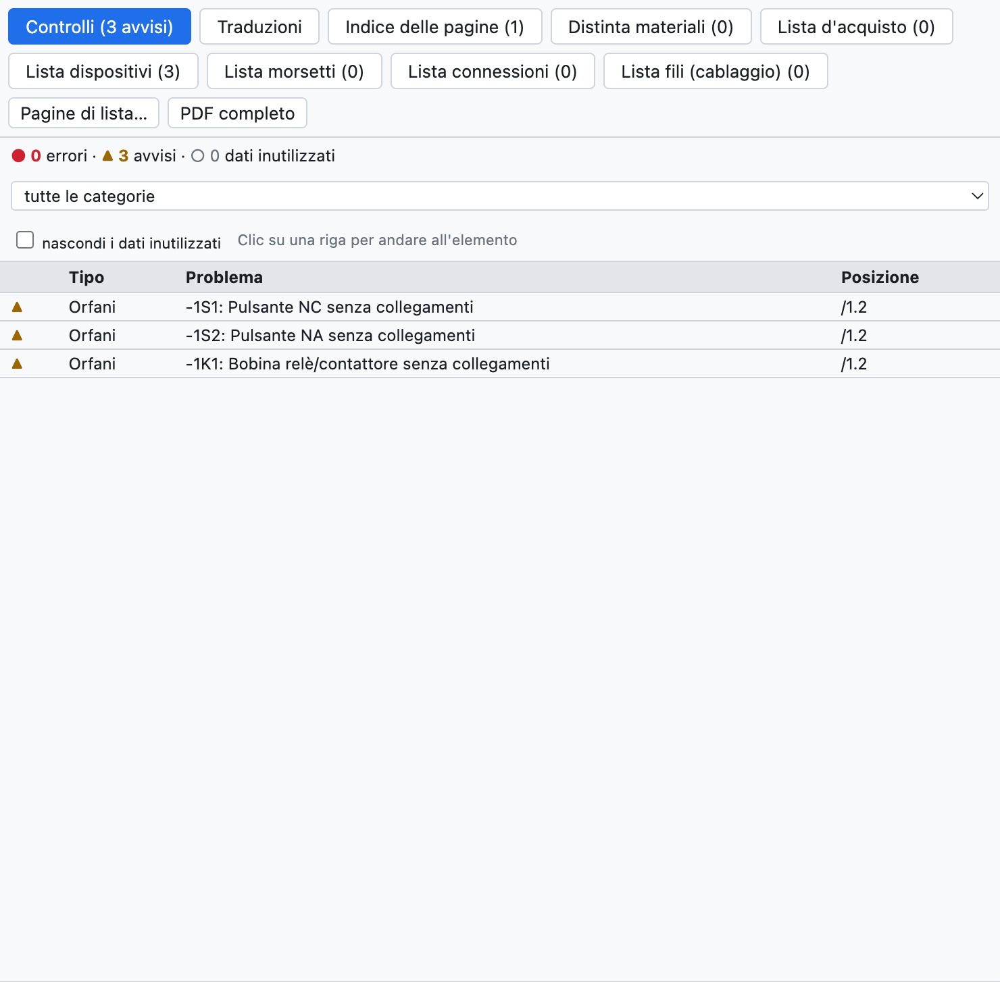
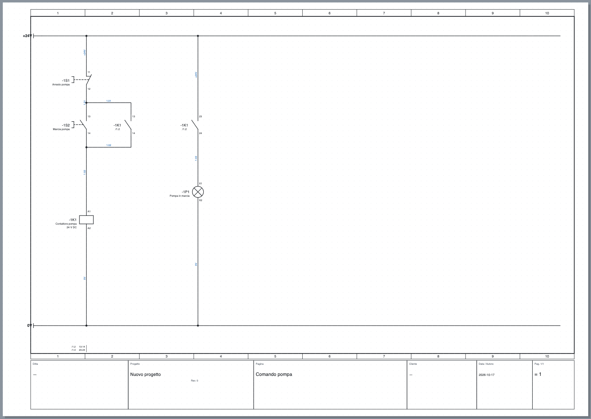

# 3. Your first project

In this exercise you draw the **control circuit of a pump**: a stop pushbutton, a start pushbutton, the
contactor with self-holding and a running lamp, supplied at 24 V. It takes about twenty minutes and at the
end you know the basic commands: inserting symbols, drawing wires, filling in data, checking and exporting.

## Step 1 – New project and supply rails

1. *File ▸ New project*. An empty page opens, page **1**.
2. Click the page name in the tree and, in *Properties*, type the **Description**: `Pump control`.
   The title appears in the title block.
3. In the library, category *Terminals and connections*, choose **Potential point** and click at the top
   left of the page. The point is named `L1`: in *Properties ▸ Name* type `+24V`.
4. Insert a second potential point at the bottom and name it `0V`. Press **Esc** to finish inserting.
5. Press **W** (*Wire* tool), click the `+24V` point and then the right-hand end of the page; finish the
   wire with a double click. Do the same for the `0V` rail.

*Step 1: the supply rails.*

> **Why potential points?** All conductors with the same name (`+24V`, `0V`, `L1`, `PE`…) are connected
> to each other, even on different pages. The lists and the check know this.

## Step 2 – The symbols

1. Category *Commands*: choose **NC pushbutton** and click below the `+24V` rail, in column 1–2.
   The pushbutton automatically gets the tag `-1S1` (page 1, letter S, first on the page).
2. Still in *Commands*, **NO pushbutton**, lower on the same vertical: it becomes `-1S2`.
3. Category *Coils and contacts*: **Relay/contactor coil**, lower still: it becomes `-1K1`.
4. Press **Esc**.

If a symbol must be turned, press **R** (rotate by 90°) before inserting it; after inserting, rotate it with
**R** on the selection. Symbols snap to the 4 mm grid.

*Step 2: pushbuttons and coil, still without wires.*

## Step 3 – The wires

1. Press **W**. Click the `+24V` rail above pushbutton `-1S1`: the wire starts from the point on the rail.
2. Click the upper connection point of the pushbutton (`11`): the wire ends by itself when it reaches a
   connection point. The available points are highlighted by small green circles.
3. In the same way connect `-1S1:12` to `-1S2:13`, `-1S2:14` to `-1K1:A1`, and `-1K1:A2` to the `0V` rail.

Where a wire reaches another wire, the program creates a **junction** and draws it with a dot.
Two wires that cross without a dot are not connected.

*Step 3: the connected control circuit. The blue wire numbers were assigned automatically.*

## Step 4 – Self-holding and lamp

1. Category *Coils and contacts*: **NO contact**. Insert it to the right of the start pushbutton.
   The contact takes the tag of the last coil, `-1K1`, and the terminals `13-14`.
2. Connect it **in parallel** with the start pushbutton: one wire from the segment above `-1S2` to the
   contact, one wire from the contact to the segment below `-1S2`. The T-junctions form by themselves.
3. Insert a second **NO contact** further right: it becomes `-1K1` with terminals `23-24`.
4. Category *Loads*: **Indicator lamp** below the contact: it becomes `-1P1`.
5. Connect `+24V` rail → contact → lamp → `0V` rail.

*Step 4: self-holding `-1K1 13-14` and the running lamp controlled by `-1K1 23-24`.*

Below each contact appears **`/1.2`**: the position of the coil (page 1, column 2). At the bottom of the
page, below the `0V` rail, the **contact image** of the coil appears with the positions of the contacts
(`/1.2 13-14`, `/1.4 23-24`). Clicking a cross-reference takes you to the connected element.

## Step 5 – The component data

Select coil `-1K1`. In the *Properties* panel fill in:

- **Description**: `Pump contactor`;
- **Technical data**: `24 V DC`;
- if you know it, the **part**, or else manufacturer, type and order number.

*The properties of coil `-1K1`: tag, device data, ordering, connection points and position.*

Description and technical data appear on the schematic below the tag and go into the lists. They belong to
the **device**: written on the coil, they also apply to its contacts. Fill in the pushbuttons too
(`Pump stop`, `Pump start`) and the lamp (`Pump running`).

## Step 6 – Check

Press **Check** in the toolbar. The *Checks* tab opens with errors (●), warnings (▲) and unused data (○).
Clicking a row takes you to the element.

*This is what the check reports if you run it after step 2, when the symbols are not yet connected.*

With the finished schematic the check finds no problems. Try deleting a wire: warnings about free
connection points appear.

## Step 7 – Saving and exporting

1. **Save** (⌘S) and choose the file name, for example `Pump control.ecad`.
2. **PDF** in the toolbar: choose *All* pages and press *Export*. The PDF has the index, the lists at the end
   and clickable cross-references.

*The finished page, with the title block filled in from the project data.*

## What next?

- The title block data (company, customer, drawing number) are filled in the project properties:
  [chapter 4](04-progetto-e-pagine.md).
- To connect different pages use interruption points: [chapter 5](05-disegnare.md#interruption-points-between-pages).
- For the power circuit (motor protection switch, contactor, motor) open page 1 of the example project.
- The same schematic can be drawn by the **AI assistant** from a description in words: [chapter 17](17-assistente-ia.md).
