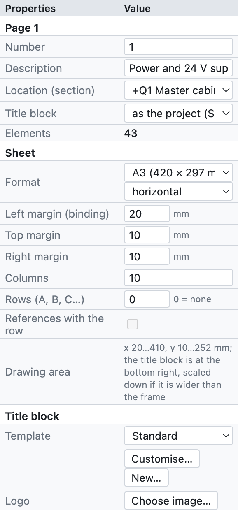
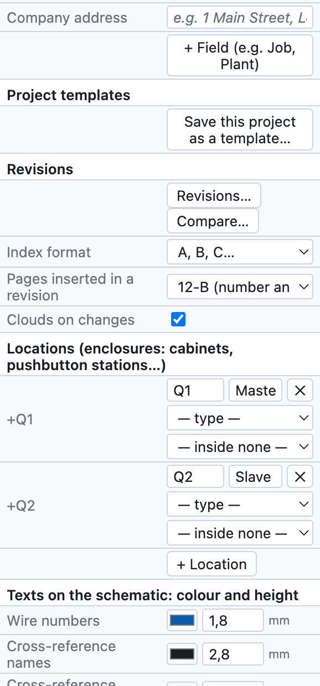
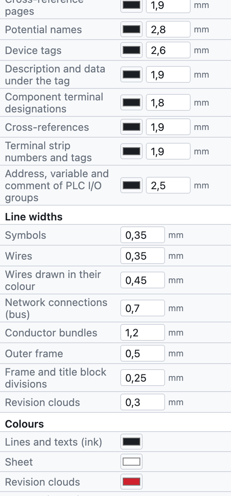
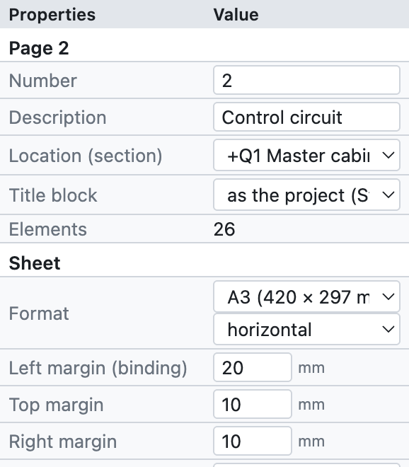
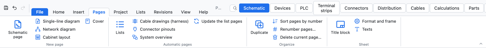
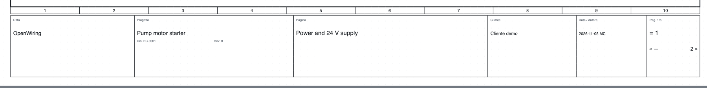
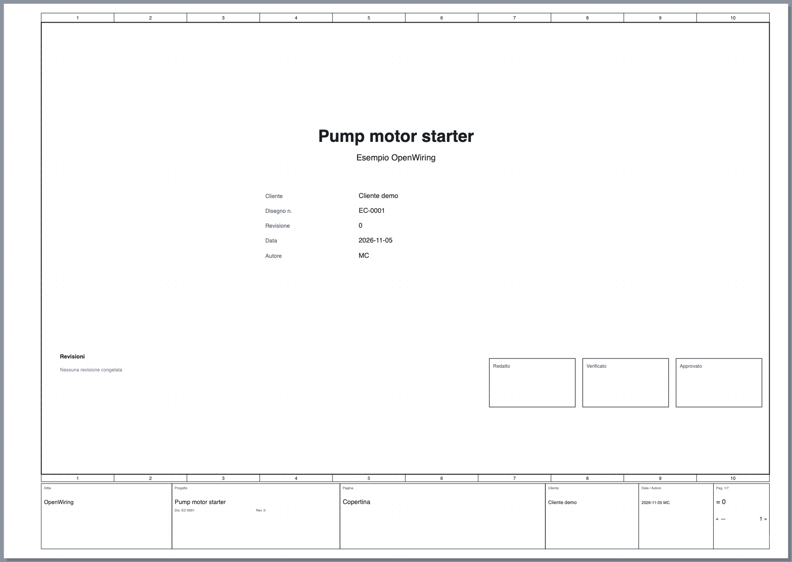

# 4. Project and pages

## Project properties

The project settings open with *Project ▸ Project properties*, by clicking the project name in the tree,
or by deselecting everything (click an empty area): the *Properties* panel shows the current page and,
below it, the project data.

*The project properties panel, from top to bottom.*

| Group | Fields | See |
|---|---|---|
| *Page* | number, description, location, title block of the page | [Pages](#pages) |
| *Title block* | template, logo, company address, additional fields | [Title block](#title-block) |
| *Project templates* | save the project as a template | [Project templates](#project-templates) |
| *Revisions* | new revision, comparison, clouds | [chapter 15](15-verifica-ricerca-revisioni.md#revisions) |
| *Locations* | cabinets, pushbutton stations, machine side… | [chapter 11](11-reti-luoghi-unifilare.md#locations) |
| *Languages* | schematic language and second language | [chapter 16](16-lingue.md) |
| *IP networks* | subnets of the address plan | [chapter 11](11-reti-luoghi-unifilare.md#ip-address-plan) |
| *Project (title block)* | name, description, company, customer, author, drawing number, revision, date | below |
| *Device tags* | tag template, counter, contact image | [chapter 6](06-sigle-e-numerazione.md) |
| *Wire numbers* | visibility, cross-section and colour, coloured wires, numbering, template | [chapter 6](06-sigle-e-numerazione.md#wire-numbers) |
| *Drawing* | descriptions on the schematic, grid step | below |

### Title block data

Name, description, company, customer, author, drawing number, revision and date appear in the title block
of every page, on the cover and in the PDF properties. They are written only once.

### Drawing

- **Descriptions on the schematic**: writes the description and technical data under the device tags
  (can be changed for a single device).
- **Grid step**: 4 mm (recommended), or 1, 2, 5 or 8 mm.

## Pages

The sheet is **A3 landscape** (420 × 297 mm) with the frame divided into **10 numbered columns** and the
title block at the bottom. The columns are used for references: `/2.4` means page 2, column 4.

*The properties of page 2 of the example project.*

- **Number**: the name of the page, free (`1`, `200`, `10.1`). It goes into the tags (`-200K1`), the wire
  numbers (`200.01`) and the cross-references (`/200.4`).
- **Description**: the title of the page, in the title block and in the index.
- **Location (section)**: the cabinet or location the page belongs to; the tree groups pages by location.
- **Title block**: the title block of the page, if different from the project one.

### Page commands

| Command | Where | Effect |
|---|---|---|
| New page | *+ Page* below the tree, *Insert ▸ Schematic page* | empty page after the current one, with the next number |
| Duplicate | *⧉*, *Insert ▸ Duplicate the current page*, right click | copy with new tags and wire numbers |
| Move | *↑ ↓* below the tree | changes the order |
| Delete | *✕* below the tree | asks for confirmation; undo with ⌘Z |
| Change page | click in the tree, **PgUp/PgDn** | |

*The Pages tab: new pages of every type, automatic pages, page order and sheet.*

### Page types

| Type | How to create it | Content |
|---|---|---|
| Multi-line schematic | *+ Page* | the actual electrical schematic |
| Single-line diagram | *+ Single-line* | one-line symbols ([chapter 11](11-reti-luoghi-unifilare.md#single-line-diagram)) |
| Network diagram | *+ Network* | nodes and bus connections between cabinets ([chapter 11](11-reti-luoghi-unifilare.md)) |
| Cabinet layout | *+ Layout* | mounting view of the plate ([chapter 12](12-layout-quadro.md)) |
| Cover | *+ Cover* | title, data, revisions, signatures |
| PLC overview | PLC view ▸ *Overview pages* | generated ([chapter 10](10-plc.md)) |
| Terminal strip diagram | Terminal strips view ▸ *Generate terminal strip diagrams* | generated ([chapter 8](08-morsettiere.md)) |
| List page | *Insert ▸ Automatic pages* | generated ([chapter 14](14-liste-e-pagine-automatiche.md)) |

Generated pages update by themselves: their content always comes from the schematic.

## Title block

*The standard title block: company, project with drawing number and revision, page title, customer, date
and author, page number.*

In the *Title block* group of the properties:

- **Template**: *Standard*, *With revision table* (the last three revisions), *Compact*, the six detailed title blocks
  (*ISO 7200*, *Detailed industrial*, *Machine EN 60204-1*, *Building installation DM 37/08*, *Switchboard EN 61439*,
  *Automation with signatures*, described in [chapter 13](13-macro-simboli-cartigli.md#included-title-blocks)),
  or a custom title block. *Customise…* opens the template in the editor, *New…* creates one from scratch
  (see [chapter 13](13-macro-simboli-cartigli.md#custom-title-blocks)).
- **Logo**: a PNG, JPG or SVG image.
- **Company address**: below the company name.
- **+ Field**: additional fields with a name and a value, for example *Job* or *Plant*.
  Choosing a template that uses its own fields (for example `{campo:Matricola}`) makes those fields appear by
  themselves in the project properties.

Each page can have a different title block from the rest of the project (*Page properties ▸ Title block*).

## User-defined properties

*Project ▸ User-defined properties…* opens the list of the project's own properties, in addition to the included
ones: for example the customer's job number, an order number or an internal code. For each property you give:

- the **identifying name**, with at least one dot (for example `Ditta.Commessa`);
- the **displayed name**;
- what it is assigned to: **devices, pages, connections, project or parts**;
- the **type**, the **unit** and the **category**;
- a **selection list** (values separated by `;`) and, if needed, *Do not use* to set it aside without deleting it.

The values are written in the *Properties* of the objects the property is assigned to. For devices they also
appear as columns in the *Devices* tab and in Excel; in title blocks they are used with the `{prop:name}`
placeholder ([chapter 13](13-macro-simboli-cartigli.md#placeholders)).

The list can be **exported and imported as XML**. The import is tolerant: it accepts names in English, German or
Italian and texts in several languages; properties with an invalid identifying name are discarded and the
program says how many.

## Cover

*+ Cover* adds page **0** at the beginning of the project with logo, title, description, project data,
revision table and *Drawn*, *Checked*, *Approved* boxes. It updates by itself with the project data.

*The cover of the example project.*

## Project templates

A template keeps settings, title block, logo, locations and cover, without the schematics.

1. Prepare a project with your company's settings.
2. *Project ▸ Save as template…* and give it a name, for example `Workshop standard`.
3. From then on *File* shows *New from template «Workshop standard»*.

Templates stay on the computer, available for all projects.
