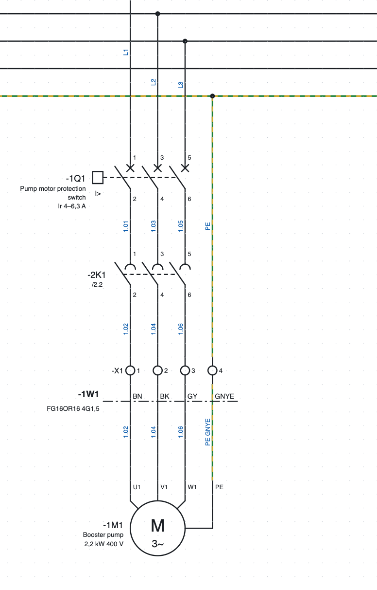
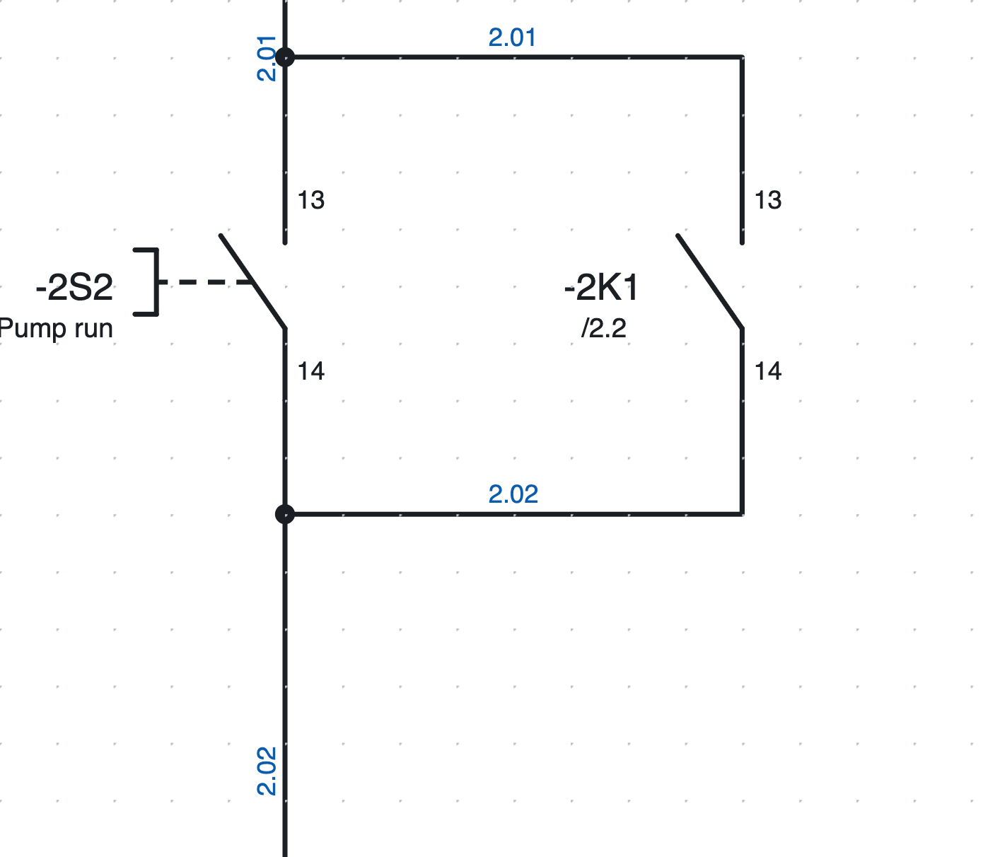
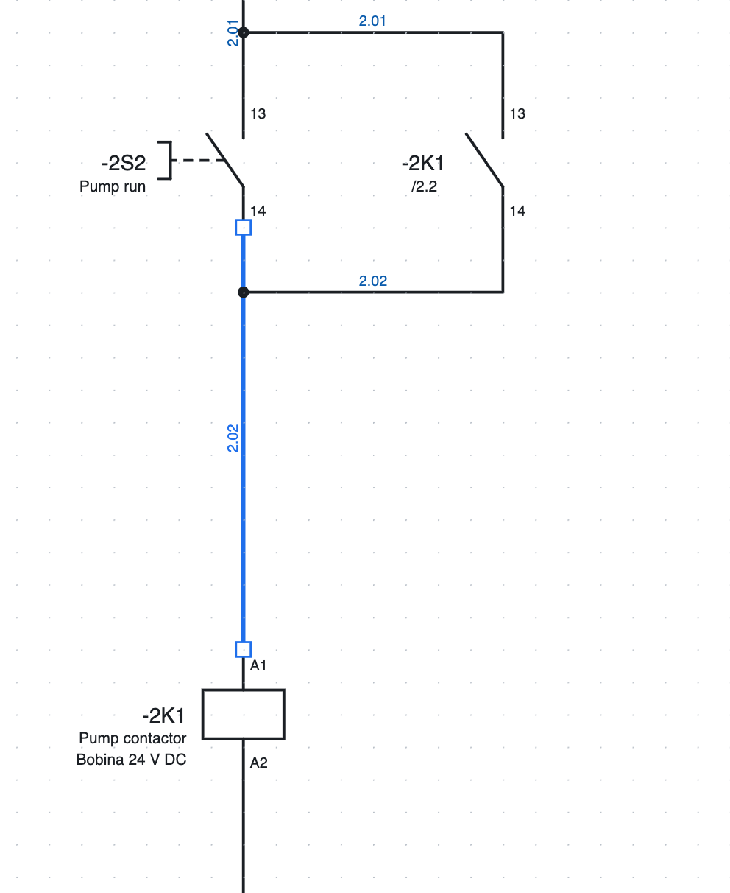
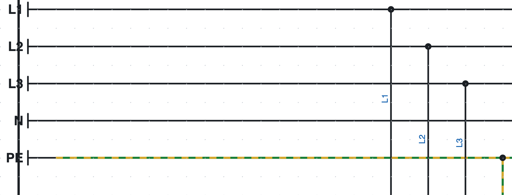
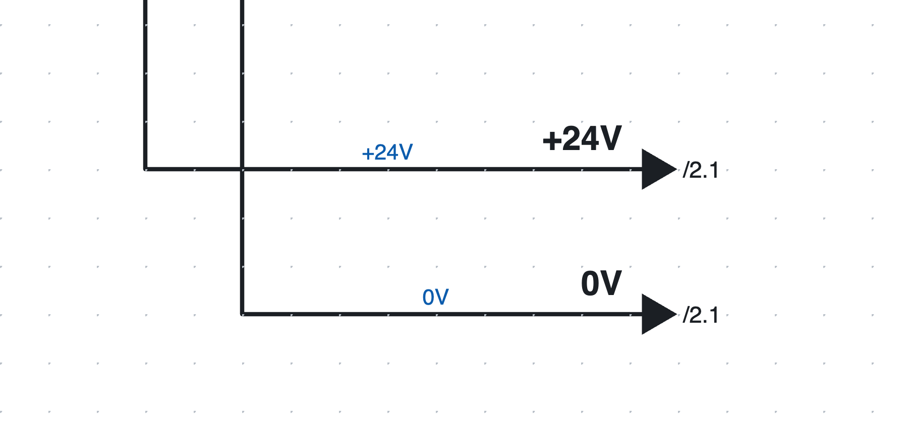

# 5. Drawing the schematic

## Inserting symbols

1. In the library on the right (*Symbols* tab) click a symbol. The *Search…* field filters by name
   («contact», «motor»…).
2. Click on the page: the symbol is inserted snapped to the grid and **stays active**, so you can insert
   more of the same.
3. **R** rotates the symbol by 90° before inserting it.
4. **Esc** or a right click ends the insertion.

Each new symbol gets a free **tag** according to the project template (for example `-2K3`, see
[chapter 6](06-sigle-e-numerazione.md)). For an auxiliary **contact** just inserted, a list of the devices to pair it with opens: coils and apparatus
of the project, first those with the same letter, each with description, position and number of contacts.
The list is filtered as you type; you can also type a new tag. The program offers the last one chosen again.

### The included symbols

| Category | Symbols |
|---|---|
| Coils and contacts | relay/contactor coil, timed coil, NO contact, NC contact, changeover contact, 3-pole power contacts |
| Commands | NO pushbutton, NC pushbutton, mushroom emergency stop, selector switch, limit switch, 3-wire PNP proximity sensor |
| Protection | fuse, 1P, 2P and 3P miniature circuit breakers, 3P motor protection switch, 3P thermal overload relay |
| Loads | three-phase and single-phase motor, indicator lamp, solenoid valve, 230 V AC / 24 V DC power supply, transformer |
| Terminals and connections | terminal, PE terminal, disconnect terminal, fuse terminal, socket pin, plug pin and socket+plug pair, potential point, protective earth PE, outgoing and incoming interruption points |
| PLC | digital input and output, analog input and output, L+/M card supply |
| Networks and buses | 2-port node (IN/OUT or P1/P2), 1-port node, 5-port switch, termination |
| Single-line | circuit breaker, motor protection switch, disconnector, fuse, contactor, motor, transformer, inverter, power supply, load |

Other symbols can be drawn with the editor or imported from QElectroTech and from the manufacturers' EDZ
files ([chapter 13](13-macro-simboli-cartigli.md) and [chapter 7](07-dispositivi-e-articoli.md)).

*The motor feeder on page 1: motor protection switch `-1Q1`, power contacts of contactor `-2K1`, terminal
strip `-X1`, cable `-1W1` and motor `-1M1`.*

## Drawing wires

1. Press **W** or *Wire*.
2. Click the start point: a connection point, an existing wire or a free point.
3. Click for each corner. Each segment is always horizontal or vertical; before the click the preview shows
   the L-shaped path.
4. The wire **ends by itself** when you click a connection point or another wire. Otherwise finish it with a
   double click, Enter or a right click.
5. **Esc** cancels the wire being drawn.

Free connection points are highlighted in green while drawing. When arriving at a wire slightly off to the
side, the segment continues straight up to the wire.

### Junctions and crossings

*The self-holding junctions on page 2: the dot shows the connection.*

- A wire that ends on another wire forms a **T-junction**, drawn with a dot.
- Two wires that **cross** without a dot are not connected.
- The dot is not drawn by hand: the program places it where the wires are really connected.

### Editing wires

*A selected wire shows its vertices as small squares.*

- **Drag a segment** to move it in parallel: its ends stay connected.
- **Drag a vertex or an end** to lengthen, shorten or reconnect the wire.
- The cursor changes shape to show what you are dragging.
- To delete a wire select it and press **Del**.

### Moving symbols with their wires

When you drag a symbol, the connected wires follow it while you move it and stay orthogonal, bending into a
Z if needed. A wire between two symbols moved together moves as a whole.

### Inserting a contact on a wire

If you insert (or move) a contact, a pushbutton or another component **on top of a wire**, the wire is split
at its two connection points: there is no need to cut it by hand. The two pieces keep their colour and
cross-section.

## Potential points

*The L1, L2, L3, N and PE rails on page 1.*

The **potential point** gives a name to a conductor: `L1`, `L2`, `L3`, `N`, `PE`, `+24V`, `0V`…

- All conductors with the same name are **connected**, even on different pages.
- The name is written in the properties (*Name*); a new point is called `L1`, the **PE** earth is called `PE`.
- The conductors of a potential can show the name instead of the wire number
  (*Project properties ▸ Wire numbers ▸ Potentials*).
- The check reports two different potentials on the same conductor (for example `L1` connected to `N`).

## Interruption points between pages

*The `+24V` and `0V` interruption points on page 1: the name above the wire, the destination pages next to
the arrow.*

When a conductor continues on another page, a pair of **interruption points** is used. Each outgoing point
is connected to **one** incoming point only, even when the name repeats (for example it is the wire number):

1. At the end of the wire insert an **Interruption point (outgoing)**. Its name is the wire number, if there
   is one, otherwise `R1`, `R2`…, and you can change it in *Properties*.
2. On the other page, at the start of the wire, insert an **Interruption point (incoming)**: the list of the
   outgoing points still free appears, those with the same name first. Choose one: the incoming point takes
   its name and the two stay connected. The first entry (*no outgoing point*) leaves it free, when the
   outgoing point is not drawn yet. The same works the other way round: inserting an outgoing point you
   choose among the free incoming ones.
   The list is **filtered as you type**: each entry shows name, position and page of the point.
3. In the *Name* field of the *Properties* the suggestions are the free interruption points and the other
   interruption point names; choosing a free one connects the two. The connection is changed in
   *Properties ▸ Connected to*. Renaming a point also renames its counterpart.
4. Next to each arrow the page where the conductor continues appears (`/2.1`). A click takes you to the page.
   On vertical wires name and page are written vertically, from bottom to top.

### Waiting, unpaired and star interruption points

When you insert an interruption point, the program takes its name from the wire number and looks for free
interruption points:

- if there is **exactly one** free point with the same name, the two are connected straight away (a message
  in the report view says so);
- if there are several, the list opens with the first one already chosen: *Enter* confirms it;
- if there is none, the point stays **waiting**: `/…` appears in orange next to the arrow until you draw
  its counterpart.

In *Properties ▸ Connected to* you choose the counterpart, put the point back to *— waiting for the
counterpart (/…)*, or choose *— no counterpart (the conductor ends here)* when the conductor really ends
there: `//` then appears next to the arrow and the check reports it only as information, not as an error.

In the status bar, **Waiting interruption points: N** counts the points still to be paired; each click
takes you to the next one. The check lists them as warnings.

**Star source.** A source with *Properties ▸ Star* connects to **all** free targets with the same name (for
example a `+24V` that goes to many pages) and shows the list of their pages. The check proposes the star
(with the 🔧 button) when a source is already paired and other targets carry its name.

## Conductor buses

When many wires run side by side (for example the three phases and the neutral feeding several loads) they can
be grouped in a **conductor bus**, without drawing every line all the way.

1. Choose the **Wire bus** tool in the toolbar (or *Insert ▸ Conductor bus*) and draw the line of the bus: it is
   a thick line. In the *Properties* give the bus a **name** (optional, for example `400V AC` or `24V DC`).
2. Draw the wires that reach the bus and the branches that leave it, so that they touch the line.
3. On every wire touching the bus the **conductor name** (`L1`, `L2`, `PE`…) appears, written next to the wire.
   It is chosen from a list that is filtered as you type.

The rules are simple:

- wires with the **same conductor on the same bus** are the same wire and have the same wire number;
- buses that touch, or buses with the same name on several pages, are **a single bus**: the conductors continue;
- the check ([chapter 15](15-verifica-ricerca-revisioni.md)) reports the wires that touch the bus without the
  conductor name and the conductors that enter the bus without leaving anywhere.

In the text format ([chapter 17](17-assistente-ia.md)) the line of the bus is a wire with `busfili=name`
(`busfili=_` if unnamed) and the conductor at the two ends of a wire is written with `cond1=` and `cond2=`.

### Wire bus used as a cable

A cable that goes from one cabinet to another can be drawn as a wire bus: the wires enter the bus on the
starting page and leave a bus with the same name on the arrival page.

1. Give the bus **the cable tag** (`W1112S1`). If the cable is not yet in the project, after the name you
   choose the **cable part** (also later, in *Properties ▸ Cable part*).
2. For each wire the program proposes the **cable conductors in order** (colours or numbers): those
   already used are dimmed, those that entered elsewhere and wait for their exit are highlighted and
   proposed first, the others are free.
3. With **Name the conductors in order** (bus *Properties*) the wires of the page get their conductor from
   left to right: on the starting page the first free ones, on the arrival page those waiting for their exit.
4. Draw the cable line across the single wires, on both pages: in the *Cables* view each wire takes the
   conductor written in the bus. The thick bus line does not count as a conductor.

The **Wire bus** view (*View ▸ Wire bus*, or *Lists ▸ Wire bus*) shows all buses and, for the chosen one,
every wire entering or leaving with page, wire number and connections; the conductor is corrected directly
in the table. Wires without a conductor, wires that enter without leaving and conductors the cable does
not have are marked. The printable list **Wire bus connections** has one conductor per row (like *Cable
connections*), with the free conductors of the cable.

## Texts

*Text* (or *Insert ▸ Text*) and a click on the page insert a free text. In *Properties* you change the text
and its height in mm. Texts go into the translation dictionary ([chapter 16](16-lingue.md)).

## Images

Photos, logos or drawings are inserted in the schematic as images.

- *Insert ▸ Image…* and choose a PNG, JPG, SVG, GIF, WebP or BMP file; or **paste** an image from the clipboard
  with ⌘V (Ctrl+V).
- The image is **moved** by dragging it and **resized** by dragging the bottom-right corner: the proportions stay
  fixed, with **Shift** held down they are free.
- In the *Properties* you change position and size, restore the original proportions, turn on the border, choose
  whether the image sits **below** or **above** the schematic and replace it with *Replace image…*.
- Images go into the **PDF**. In the DXF only a frame with the image name remains.
- Very large images are shrunk (to 1600 points on the long side) to keep the file light.

## Selecting, copying, moving

| Action | How |
|---|---|
| Select | click the element |
| Add to or remove from the selection | **Shift** + click |
| Box selection | drag on an empty area: **left to right** takes the contained elements, **right to left** also the ones touched |
| Select all | ⌘A |
| Move | drag, or arrow keys (4 mm; with Shift 16 mm) |
| Rotate, mirror | **R**, *Edit ▸ Mirror* |
| Duplicate | ⌘D |
| Copy, cut, paste | ⌘C, ⌘X, ⌘V; *Paste here* from the right-click menu pastes at the clicked point |
| Delete | **Del** or Backspace |

Copies get **new tags and wire numbers**; a coil and its contacts copied together stay connected. You can
also paste into another project: the symbols and parts used are copied with the elements.

A circuit used often can be saved as a **macro** ([chapter 13](13-macro-simboli-cartigli.md#macros)).

## Symbol texts always readable

When a symbol is rotated or mirrored, its internal texts (for example «M 3~» on the motor) are never upside
down or mirrored: they always read from below or from the right, as the standard requires. This applies on
screen, in the PDF and in the DXF.
