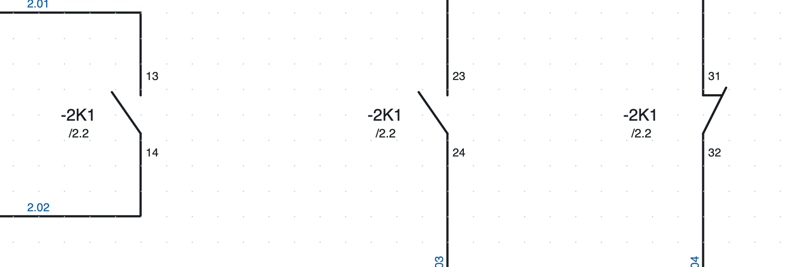
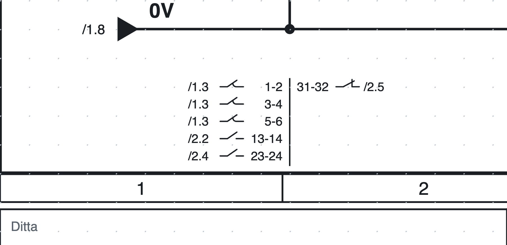
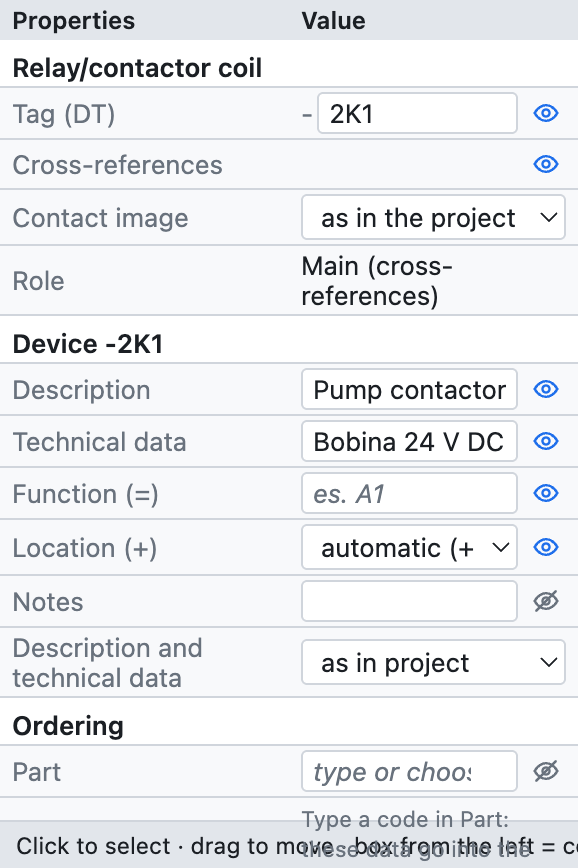
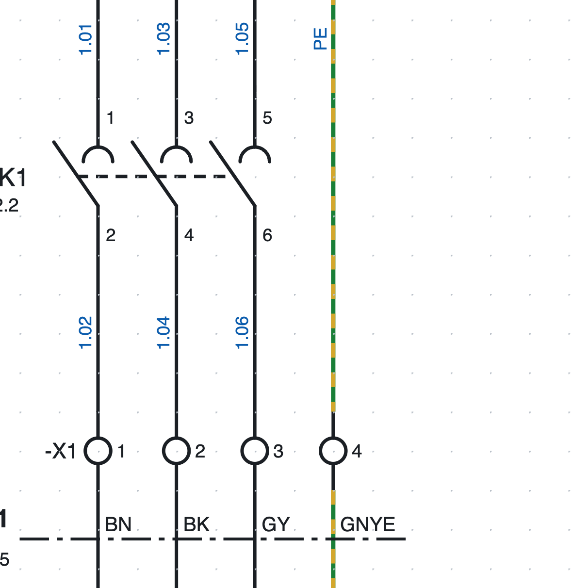
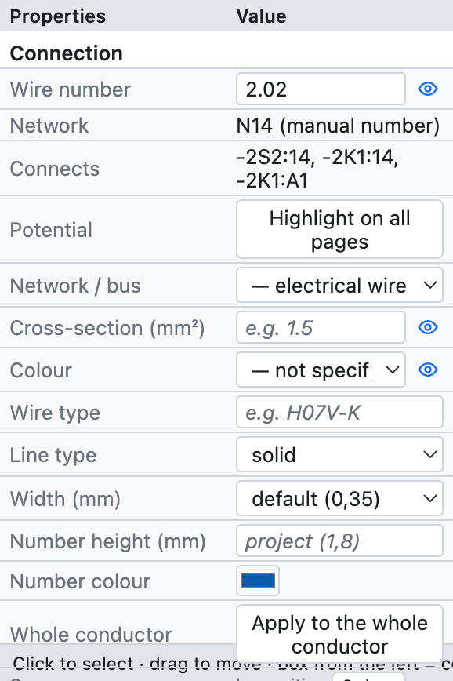
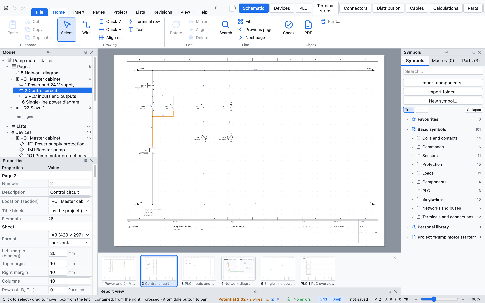

# 6. Tags, cross-references and wire numbers

## Device tags

Every device has a **tag** according to IEC 81346: a hyphen, the page number, the **letter** of the device
type and a sequential number. `-2K1` is the first contactor on page 2.

| Letter | Devices |
|---|---|
| K | relays, contactors, timed coils |
| Q | three-pole circuit breakers, motor protection switches, disconnectors |
| F | fuses, 1P and 2P circuit breakers, thermal overload relays |
| S | pushbuttons, emergency stops, selector switches |
| B | sensors, limit switches |
| P | indicator lamps |
| M | motors, solenoid valves |
| T | transformers, power supplies |
| A | PLCs, cards, network nodes, complex devices |
| U | inverters |
| E | generic loads (single-line) |
| X | terminal strips and connectors |
| W | cables |

The letter depends on the symbol; the tag can always be changed by hand in the properties.

### The tag template

In *Project properties ▸ Device tags* you choose how the tag is built:

| Placeholder | Meaning | Example |
|---|---|---|
| `{pagina}` | page number | `200` |
| `{colonna}` | column (1–10) of the device | `4` |
| `{lettera}` | IEC 81346 letter | `K` |
| `{n}` | sequential number | `1` |
| `{n:2}` | two-digit sequential number | `01` |

| Template | Result on page 200 |
|---|---|
| `{pagina}{lettera}{n}` (default) | `-200K1` |
| `{lettera}{n}` | `-K1` |
| `{pagina}{lettera}{n:2}` | `-200K01` |
| `{pagina}.{colonna}{lettera}` | `-200.4K` |

- **Counter**: restarts on every page or is unique in the whole project.
- **Stable tags**: a new device takes the number after the highest on the page (`-2K3` after `-2K2`) and the
  others do not change.
- **Renumber devices** (*Project ▸ Renumber devices…*) renumbers everything in page, column and row order.
  Contacts follow their coil; terminals have their own numbering.

### Full tag: function and location

With the **function** (`=`, the plant or machine section) and the **location** (`+`, the cabinet or
pushbutton station) filled in, the tag becomes complete: `=A1+Q1-2K1`. They are filled in the device
properties or, for many devices at once, in the navigator ([chapter 7](07-dispositivi-e-articoli.md)).

## Coils and contacts

The **main device** (the coil of a relay or contactor) and its **contacts** have the same tag. The program
links them by itself:

1. Insert the coil: it gets, for example, `-2K1`.
2. Insert the contacts: a window asks *which device?* and lists the project's coils and devices, those with
   the same letter first. Choose from the list or type a new tag; from the next contact on, the window
   suggests the last coil chosen.
3. To assign a contact to another coil, type the tag in the contact properties: the list suggests the
   existing tags with the same letter.

### Contact numbering (EN 50005)

Auxiliary contacts are numbered automatically with the sequence digit and the function digit: the first NO
is `13-14`, the second `23-24`, the first NC `31-32` and so on. It can be turned off for a single contact and
the terminals typed by hand (*Properties ▸ Connection points*). Power contacts are `1-2`, `3-4`, `5-6`.

### Cross-references

*Below each `-2K1` contact there is `/2.2`: the coil is on page 2, column 2.*

*The contact image of `-2K1` at the bottom of page 2: each contact is its own symbol drawn horizontally, with
the terminals above the lines and the position on the left.*

- Below each **contact** appears the position of the coil (`/2.2`).
- Below the **coil** appears the **contact image**: all its contacts with their terminals and position. It is
  placed **at the bottom of the page**, below the lower rail, on the vertical of the coil; or else
  below the symbol (*Project properties ▸ Device tags ▸ Coil contacts*).
- Each contact is drawn with **its own symbol** turned horizontal: NO, NC, changeover (with both output
  terminals, e.g. `12` above and `14` below) and power poles one per row with the semicircle. Terminals sit
  above the lines (`2` on the left, `1` on the right), the `/page.column` position on the left, and the dashed
  actuator line runs through all the blades.
- If the device has an **article** with functions, its **spare** contacts (not yet used in the schematic,
  e.g. the fourth pole `7-8`) are drawn too, without a position.
- *Device tags ▸ Contact drawing ▸ compact text* goes back to the text list with the small drawing.
- Every cross-reference is **clickable**: it takes you to the page and selects the element. In the PDF it
  becomes a link.
- Right-clicking a coil offers *Go to contact…*, on a contact *Go to the main element*.

The check reports contacts without a coil and more contacts than the part has (for example a fifth contact
on a contactor with 4 auxiliaries).

### Paired cross-references

A contact can also be **shown on another page** without duplicating it, for example an auxiliary contact of
a circuit breaker on the overview page: right-click the contact ▸ *Draw a representation (paired
cross-reference)…*, then click where it should be drawn.

You can also start from the **main element**: right-click the coil or the motor protector ▸ *Draw a
representation of a contact…* (or *Representation…* on the *Symbol* tab) lists its contacts already placed
in the schematic, auxiliaries first: choose the one to draw and click where it goes.

- The representation is **drawing only**: it does not count as a contact, does not connect to wires and
  does not appear in the reports or in the bill of materials. Tag and terminals always follow the real
  contact.
- The real contact and the representation point to each other with cross-references, in both directions.
- *Properties ▸ Representation of* shows the real contact (one click takes you there); *Make it a real
  contact* turns it into a contact with its own connections.
- The drawing is **compact**: the real contact symbol, smaller, without tag (it already sits next to the
  main element), with the terminals and the real contact's position written below, turned like the symbol.
  It is vertical like the contact; **R** (before or after the click) makes it horizontal and the position
  moves to the left. Text height and colour are those of *Cross-references* (Appearance ▸ Texts);
  *Properties ▸ Text height* also changes the size of the drawing. *Properties ▸ Drawing ▸ full symbol with
  tag* goes back to the complete symbol.
- Drawn next to the device, at the height of its symbol, the **dashed actuator line** continues from the
  device to the representation.
- A contact is shown **in one way only**: with the representation next to the device it no longer appears in
  the contact image at the bottom of the page, and a new representation of the same contact replaces the old one.
- The place is chosen in *Properties ▸ Contact representation*, on the contact or on its representation:
  **at the bottom of the page** (default, in the contact image), **next to the main symbol** (beside the
  device on the actuator line, one after the other, following the device when it moves), **free,
  vertical** or **free, horizontal** (drag it wherever you like).
- If the real contact is deleted, the check reports the orphaned representation and offers to delete it.

## Device properties

*The properties of coil `-2K1` in the example project.*

| Group | Fields |
|---|---|
| *(symbol name)* | tag, role (main, contact, device, terminal…) |
| *Device* | description, technical data, function (=), location (+), notes, texts on the schematic |
| *Ordering* | part, manufacturer, type, order number |
| *Connection points* | the name of each terminal (A1, A2, 13, 14…) |
| *Position* | X and Y in mm, rotation, mirrored |
| *Wire number* | whether the wire number passes through the element |

The data of the *Device* and *Ordering* groups apply to **the whole device**: written on the coil, they also
apply to the contacts. If a part is assigned, empty fields show its data in grey.

## Wire numbers

*Wire numbers on page 1: `1.01`, `1.03`… above the contactor, the same numbers below, because terminals `-X1`
do not change the number.*

Every **conductor** (all the wires connected to each other up to the connection points of the components)
has a number, written on each of its segments. The default template is `{pagina}.{n:2}`: `200.01`, `200.02`…

### Locked or recalculated numbering

In *Project properties ▸ Wire numbers ▸ Numbering*:

- **locked** (default): a numbered conductor keeps its number; a new conductor takes the first free number
  of the page, even if you draw it in the middle; when you join two numbered conductors one number remains,
  when you split one the new part gets a new number. *Renumber wires* recalculates everything in column order.
- **recalculated**: numbers are recalculated at every change, always in order.

### Manual number

Select a wire and type the number in *Properties ▸ Wire number*: it applies to the whole conductor.
Deleting it returns to the automatic number.

### Where it is written

The number is written at a **free spot** on the wire: if there is a crossing, a component, a tag or another
number in the middle of the segment, it moves along the wire or to the other side. This applies on screen,
in the PDF and in the DXF. *Show* (project properties) hides them completely.

### Moving or repeating the number

**Drag** the number wherever you want, even away from the wire: from then on it stays there and follows the
wire when you move it. Right-click on the wire:

- **Add the wire number here**: another number on the same wire, next to the clicked segment;
- **Remove this wire number** (clicking on a number, when there is more than one);
- **Wire number in automatic position**: back to the position chosen by the program.

### The wire number passes through terminals

A terminal is only a feed-through point: the wires on its two sides have **the same number**. Every element
with two or more connection points has the checkbox **The wire number passes through** in *Properties ▸ Wire
number*:

- checked by default on terminals, unchecked on the other components;
- it can be changed on a single element, for example to let the number pass through a disconnector.

The two sides remain separate conductors for the terminal list and the connection list.

### Advanced counter

In *Project properties ▸ Wire numbers*:

- **Pattern**: besides `{pagina}` (page), `{colonna}` (column) and `{n}` you can use `{quadro}` (code of the
  page's cabinet), `{n:2}` (at least 2 digits: `01`) and `{n:A}` or `{n:a}` (counter in letters: `A`,
  `B`… `Z`, `AA`). Example: `{quadro}.{n:A}` gives `Q1.A`, `Q1.B`… Device tags accept `{quadro}` too.
- **Counter**: restarts on each page, restarts for each cabinet, or unique in the project.
- **Reserve per page**: numbers left free after each page. With a reserve of 3, page 1 uses 1 and 2 and
  page 2 starts at 6: a wire added later to page 1 gets 3 and the following pages keep their numbers. When
  the reserve runs out, the counter skips the numbers already used by the following pages.
- **Order on the page**: by columns (left to right) or by rows (top to bottom).

Numbers written by hand, those of interruption points and PLC channel names are fixed: the counter skips
them even when they are written on another page.

## Wire cross-section and colour

*The properties of a wire: number, network, connections, potential, cross-section and colour.*

- **Cross-section** in mm² (`1,5`, `2,5`, `6`…) and **colour** with the IEC 60757 codes: `BK` black, `BN`
  brown, `GY` grey, `BU` blue, `DBU` dark blue, `RD` red, `WH` white, `GNYE` green-yellow…
- The **colour** chosen on one segment applies to the whole conductor, also after an interruption point or a terminal.
- With *Coloured wires* (project properties) the wire is drawn in its colour; PE is dashed green-yellow.
- The cross-section can change along the conductor (feed at 6 mm², branch at 1.5 mm²);
  *Apply to the whole conductor* copies cross-section and colour to all segments.
- With *Cross-section and colour* turned on, they are written on an **oblique tick** crossing the wire, with
  the text next to it (`BU 1,5`): on vertical wires to the right, reading upwards, on horizontal ones below
  the wire. The wire number stays alone on the other side.
- **Drag** the tick along the wire wherever you like; it follows the wire when it moves. Right-click ▸
  *Cross-section tick in automatic position* puts it back. Text height and colour are in *Appearance ▸
  Texts ▸ Wire cross-section and colour*.
- To align several ticks: **Shift+N** (or *Align sect.*), then two clicks to draw a line across the wires;
  their ticks go where the line crosses them. Like **N** for wire numbers.
- *Wire numbers ▸ Cross-section and colour written ▸ next to the wire number* goes back to the text attached
  to the number (`200.01  1,5 mm² BU`).

### Spare conductors

A cable conductor taken to **spare terminals** (for example between two panels) is drawn like the others
and then marked *Wire properties ▸ Spare*. It applies to the whole conductor:

- it gets no **wire number**: on the schematic it is dashed and carries the word `spare`;
- it still gets its **cable conductor**; in the cable drawing the row is dashed in orange with `spare`
  instead of the number, and in the *Cable connections* list the note is `spare`;
- the **terminals** it reaches (spare conductors only) stay **spare** in the terminal lists and in the
  terminal strip diagram, with their destinations.

In the text format it is `scorta=si` on the wire.

## Highlighting a potential

To follow a conductor through the whole project: select a wire and press **Highlight on all pages** in the
properties (or right click ▸ *Highlight potential*).

*Conductor `2.02` highlighted in orange; the status bar at the bottom lists the pages where it appears.*

- All connected conductors are coloured **orange**, also across interruption points, potentials and terminals.
- The status bar shows the name, the number of wires and the **pages**, which can be clicked.
- ✕ in the status bar, or *Remove highlight*, turns the highlight off.
