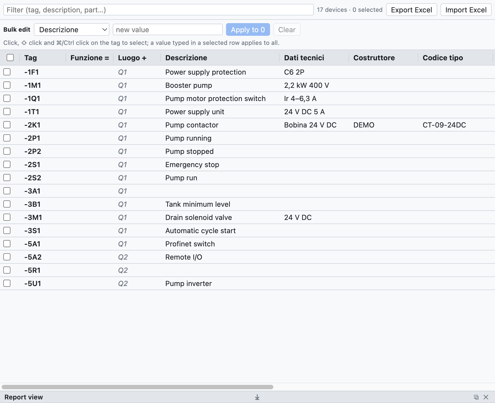
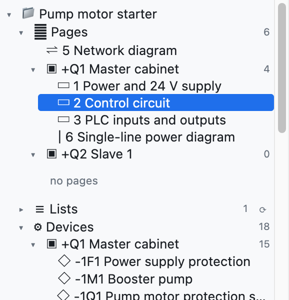
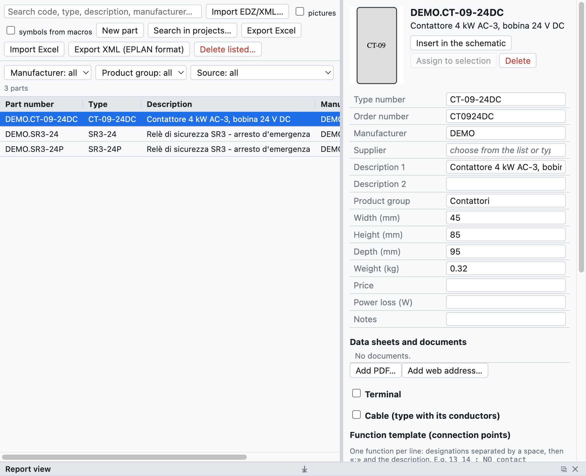

# 7. Devices and parts

A **device** is a real component with a tag: the contactor `-2K1` is a device, even if in the schematic it
appears as a coil, three power contacts and two auxiliary contacts on different pages. A **part** is a
product from a manufacturer's catalogue (code, description, dimensions, terminals) to be assigned to devices.

## Device data

| Field | Example | Where it appears |
|---|---|---|
| Description | `Contattore pompa` | schematic (under the tag), lists, labels |
| Technical data | `Bobina 24 V DC`, `2,2 kW 400 V` | schematic, lists |
| Manufacturer | `Schneider Electric` | bill of materials, purchase list |
| Type | `LC1D09BD` | bill of materials |
| Order number | `LC1D09BD` | bill of materials, purchase list |
| Notes | free text | device list |
| Function (=) | `A1` | full tag `=A1+Q1-2K1` |
| Location (+) | `Q1` | full tag, grouping, layout |
| Part | `DEMO.CT-09-24DC` | fills the empty fields with the catalogue data |

The data belong to the device: they are written on any element (coil or contact) and apply to all of
them. Values typed by hand take precedence over those of the part.

**Additional parts**: a device can have several parts (for example a contactor and its auxiliary contact block).
In the navigator the *Additional parts* column is written as text, with the code and the quantity after ×:
`LADN22 ×2; LA4DA2U`. It can also be edited in bulk and in Excel.

**Descriptions on the schematic**: with *Project properties ▸ Drawing ▸ Descriptions on the schematic*
turned on, description and technical data appear under the tag of the main element. The device field
*Texts on the schematic* forces or hides them for that device only.

## Device navigator

The **Devices** tab (top right) shows all the devices of the project in a table that is edited like a
spreadsheet.

*The navigator with the 17 devices of the example project. Values in grey italics come from the part or
from the location of the page.*

- **Change a value**: click in the cell, type and press Enter.
- **Rename**: change the tag in the first column; the contacts and the other representations change too.
  If the tag is already in use, the program says so and changes nothing.
- **Filter**: the field at the top searches in tag, description, part and the other fields.
- **Select several rows**: click on the tag, ⇧ click for a range, ⌘/Ctrl click to add, or the check boxes
  on the left.
- **Go to the device**: click on the position `/2.2` in the last column.

### Bulk edit

To give the same value to many devices:

1. Select the rows (for example all the devices of cabinet `+Q2`, filtering for `Q2`).
2. In the *Bulk edit* row choose the field (*Function =*, *Manufacturer*…) and type the value.
3. Press **Apply to N**. *Clear* deletes that field on all the selected devices.

Alternatively type the value directly in a cell of a selected row: it applies to all the selected rows.
The whole change is undone with a single ⌘Z.

### Excel

- **Export Excel** saves the device table (tag, fields, position).
- Fill it in with Excel, even by another person, and use **Import Excel**: devices are recognised by the
  *Tag* column and only the changed fields are updated. Tags that do not exist in the project are
  reported in the report view.

### Copying properties

Right-clicking a device offers **Copy properties**: it copies all the data of the device (description, technical
data, manufacturer, type, codes, part, additional parts, notes, function, location, user-defined properties)
except the tag. On another device, or on a selection of several devices, the right-click menu offers
**Paste properties of -X**: the copied data replace those of the device.

It is also how you **replace a symbol** with another: copy the properties of the old one, insert the new symbol,
paste the properties and delete the old one.

## Structure =Plant +Location

In the tree, the **Structure =Plant +Location** node groups the devices first by **function** (`=A1`,
`=A2`…) and then by **location** (`+Q1`, `+P1`…), as IEC 81346 prescribes. Devices without a function or
without a location are at the bottom, in *without function (=)* and *without location (+)*. A click on a
device opens it in the schematic.

*In the example project the devices have no function: they are all in «without function», divided between
cabinets `+Q1` and `+Q2`.*

The location of a device is the one written in its properties; if missing, the one of the frame it is
drawn in on the network diagram, or the one of its page.

## Parts

The **Parts** tab is the personal parts library, saved on the computer and available in all projects.

*A contactor imported from an EDZ: data, picture, function template and symbol.*

### Importing manufacturer data (EDZ)

1. Download the **EDZ** file from the Eplan Data Portal or from the manufacturer's website (Schneider,
   Siemens, Phoenix Contact…). The EDZ is an archive in the Eplan Data Portal format with the part data.
2. *File ▸ Import ▸ Parts EDZ / XML / CSV…* (or the *EDZ* button) and choose one or more files.
3. The parts enter the library with code, type, order number, manufacturer, descriptions (in Italian if
   present, otherwise English or German), dimensions, weight, picture and **function template** (the
   terminals).

If the EDZ contains the manufacturer's drawing in a readable macro in EPLAN format, that drawing becomes the symbol of
the part (category *Macro EPLAN / costruttore* in the library). Otherwise the part is drawn as an automatic
**black box**: inputs at the top, outputs at the bottom, contacts and poles drawn inside.

**XML** files in the EPLAN format can be imported too; *Export XML (EPLAN format)* writes the parts to a file of
the same format.

The **commercial data CSV** files (`commercial_data.csv` from the Eplan Data Portal) are imported with the same
command, also several files together: for each part they carry manufacturer, type, order code, group,
descriptions and long description. Parts already imported from EDZ are completed without losing symbol and
terminals. The links to data sheets and instructions appear in the part sheet, in the **Documents** section.

### The part sheet

Selecting a part you can see and change:

- the main data (code, type, order number, manufacturer, supplier, descriptions, group, dimensions, weight,
  price, notes);
- the **function template**: one line per function, with the terminals separated by spaces and the
  description after `;` (for example `13 14 ; Contatto NA`);
- the **symbol in the schematic**: one of the basic symbols, an imported component or the manufacturer's
  drawing.

### Using parts

- **Insert in the schematic**: inserts the symbol of the part, already assigned.
- **Assign to selection**: select a device in the schematic and assign the part to it. Alternatively choose
  the part in the *Part* field of the device properties.
- The parts used are copied into the project (*Project parts* in the tree), so the `.ecad` file stays
  complete on another computer too.

### The parts database

The personal library is a database that travels from one plant to the next: data written once is not retyped.

- In the **Part** field (in the *Properties*, in the *Devices* navigator and in the *Connectors* tab) you write
  or choose a code. If the code is **new**, it becomes a part of the library, with the manufacturer, type,
  order code and technical data of the device. The next time the code is used, the data fill in by themselves.
- If the part already exists and the data of the device differ, **Save these data in the part** writes them
  into the existing part.
- Description and manufacturer of additional parts also go into the library.

### New part

*New part* creates an empty part to be filled in by hand: useful for components without an EDZ.
