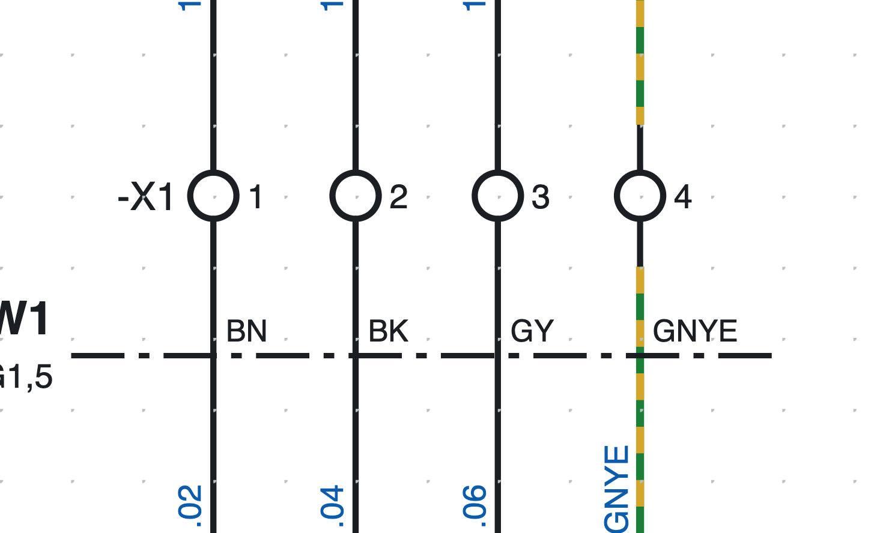
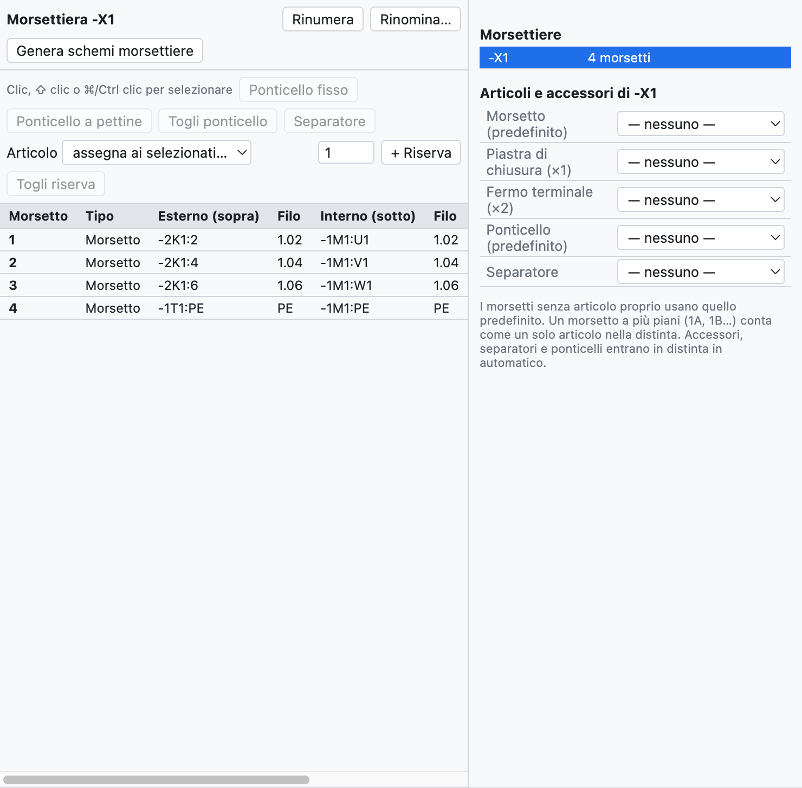
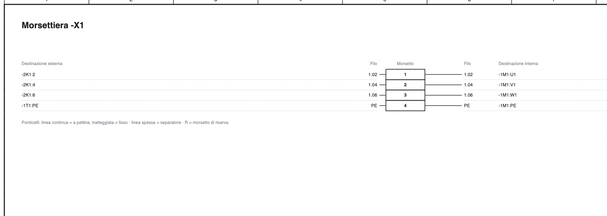

# 8. Terminal strips

## Terminals in the schematic

*Terminals `-X1:1…4` on page 1: the terminal strip tag appears only on the first of the row.*

1. In the library, category *Terminals and connections*, choose **Terminal** (or *PE terminal*,
   *Disconnect terminal*, *Fuse terminal*).
2. Insert it **on the wire**: the wire is interrupted on both sides of the terminal.
3. The terminal takes the tag `-X1:1`; the next ones `-X1:2`, `-X1:3`…

The tag of a terminal is `<terminal strip>:<number><level>`:

- the **terminal strip** has a free name, even hierarchical like `X1.1.2`;
- the **number** follows the colon (`X1.1.2:3`);
- the **level** is a letter for multi-level terminals (`X1:1A`, `X1:1B`).

On a vertical wire the terminal strip tag is on the left and the number on the right; on a horizontal wire
(rotated symbol) the number is above and the tag below.

> The **wire number** passes through the terminal without changing: the wires on both sides have the same
> number (see [chapter 6](06-sigle-e-numerazione.md#the-wire-number-passes-through-terminals)).

## The terminal strip navigator

The **Terminal strips** tab shows the terminal strips of the project and their terminals in a table.

*Terminal strip `-X1` of the example project: external and internal destinations, wire numbers, parts and
accessories.*

- On the right the list of the **terminal strips** of the project; a click opens one.
- In the centre the **terminal table**: number, type, external (top) and internal (bottom) destination,
  wire numbers, jumpers, part, clickable position.
- Terminals are selected with click, ⇧ click (range) and ⌘/Ctrl click (add).

## Multi-level terminals

A two- or three-level terminal has the same number and one letter per level.

1. Select the terminal in the schematic, for example `-X1:1`.
2. In the properties press **Add level** (also from the right-click menu): the terminal becomes `-X1:1A`
   and the program lets you insert `-X1:1B` with a click, even on another page.
3. The next clicks insert `1C`, `1D`…

In the bill of materials a multi-level terminal counts as **a single part** (`-X1:1A/B`).

## Numbering and renaming

- A new terminal takes the number after the highest of the terminal strip; the others do not change.
- **Renumber** numbers from 1 in schematic order (page, then left to right and top to bottom): levels stay
  together with their letter, spares go to the end, terminals with a non-numeric name (for example `PE`)
  stay as they were.
- **Rename…** changes the name of the terminal strip on all its terminals (`X1` → `X2.1`).

## Jumpers

1. Select two or more terminals in the table.
2. Press **Fixed jumper** or **Comb jumper**.

Jumpers appear in the table, in the terminal list, in the connection list and in the terminal strip
diagram; each one can have its own part. *Remove jumper* removes them.

## Spares and separators

- **+ Spare** adds undrawn terminals at the end: they go into the list and the bill of materials.
  *Remove spare* removes them.
- **Separator** after a terminal: a separating plate, drawn as a thick line in the terminal strip diagram.

## Parts and accessories

In the *Parts and accessories* box of the terminal strip you choose:

| Field | Quantity in the bill of materials |
|---|---|
| Terminal (default) | one per physical terminal without its own part |
| End plate | 1 |
| End stop | 2 |
| Jumper (default) | one per jumper without its own part |
| Separator | one per separator |

*Part ▸ assign to selected* gives a different part to single terminals (for example the disconnect
terminals). Everything goes into the bill of materials and the purchase list automatically.

## Terminal strip diagram

**Generate terminal strip diagrams** creates one page per terminal strip (more sheets beyond 40 terminals)
with destinations, wire numbers, jumpers, separators, spares and clickable positions, also in the PDF.

*The top part of the terminal strip diagram of `-X1`.*

The page updates by itself when you change the schematic; generating it again adds the pages of new
terminal strips and removes those that have disappeared.

## Checks

The check reports duplicate terminals, terminals with a free side and data of terminal strips that no
longer exist.
