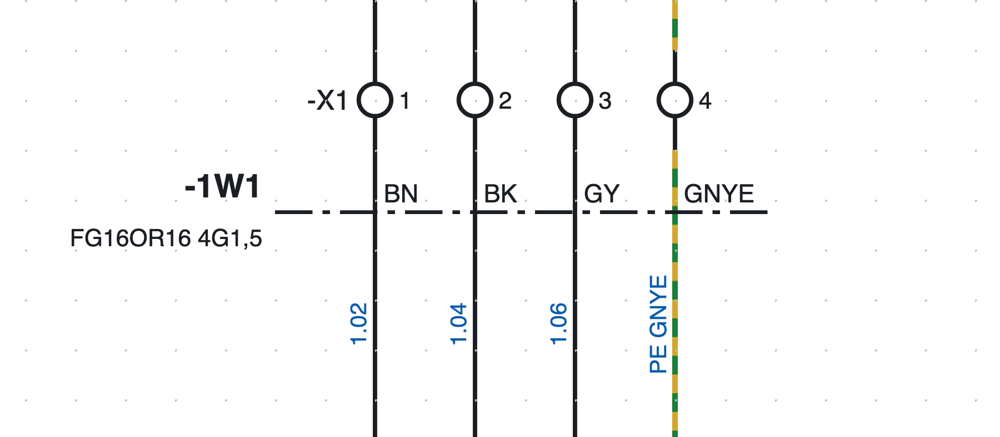
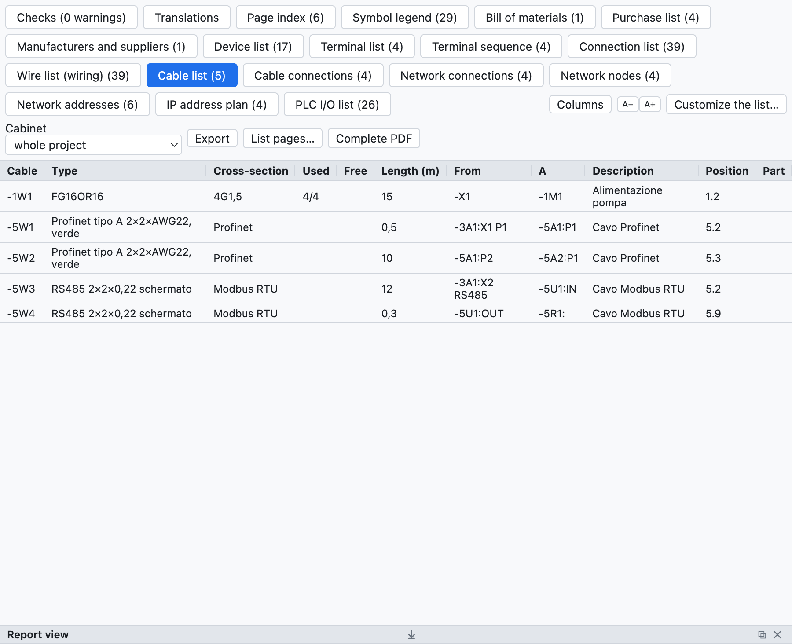

# 9. Cables and connectors

## Cables

A cable is defined with a **definition line** that crosses the wires.

*Cable `-1W1 FG16OR16 4G1,5` on page 1: the dash-dot line crosses the four wires towards the motor, each
with the colour of its conductor.*

1. Press **Cable** in the toolbar (or *Insert ▸ Cable definition line*).
2. Click on one side of the wires and then on the other side.
3. The crossed wires become **conductors** of cable `-1W1` (tag according to the project template).

### Conductors

The program proposes the conductors according to the number of wires:

- up to 5 wires, coloured: `BN BK GY BU GNYE`;
- beyond that, numbered with the green-yellow;
- the PE wire (or green-yellow) takes the green-yellow conductor.

In the cable properties you change **cross-section** (`5G1,5`, `7x0,75`…), **type** (`FG16OR16`),
**length** in metres, **ends** (from, to), **shield**, description and **part**; in the line properties you
choose the conductor of each wire.

Several lines, even on different pages, can refer to the same cable: a conductor crossed twice counts only
once.

### Cable lists

*The cable list of the example project: the motor cable and the network cables.*

- **Cable list**: one cable per row with type, cross-section, used and free conductors, length, ends,
  position, part.
- **Cable connections**: one conductor per row with the two ends and the wire number.
- The **connection list** has the *Cable* column; in the bill of materials the quantity of a cable with a
  part is its length in metres; in the purchase list cables without a part are summed by type.

### Checks

The check reports exhausted conductors (more wires than conductors) or duplicate ones, cables without a
definition line and duplicate cable tags.

## Connectors and plugs

For the plugs and sockets of multi-pole connectors use the symbols of the *Terminals and connections*
category:

| Symbol | Use |
|---|---|
| Socket pin (female) | the socket side |
| Plug pin (male) | the plug side |
| Socket + plug pin | the mated pair in a single symbol |

- The tag is like that of terminals: `-X10:3` is pin 3 of connector `-X10`; pins are numbered by themselves.
- The total number of pins is written in the connector properties or read from the part.
- The **mating part** (for example the free plug for a panel socket) is given with its part and goes into
  the bill of materials.
- The **connector list** lists every pin with its side, wires, position and the pins used.
- In the **Connectors** tab the pin table has the **Description** and **Notes** columns, written directly in the
  cell. Description, technical data and notes are **specific to each pin** (in the pin's *Properties* they apply
  only to that pin); manufacturer, type, part and the other data apply to the whole connector. The **connector
  notes** are written in the connector data, to the right of the table.
- The check reports pins beyond the number of the connector.
