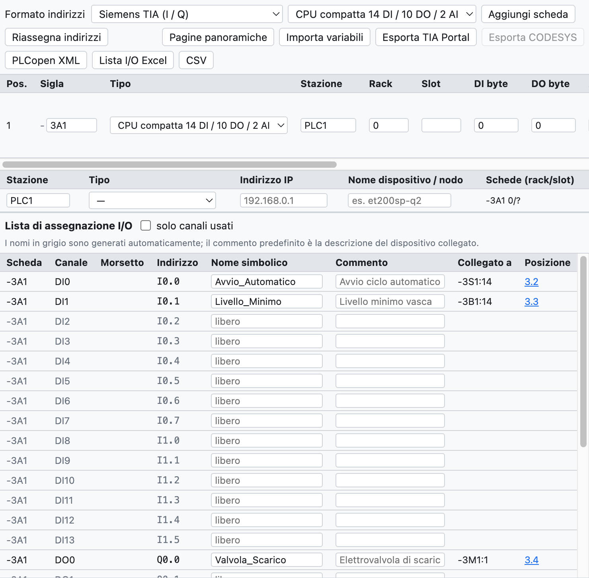
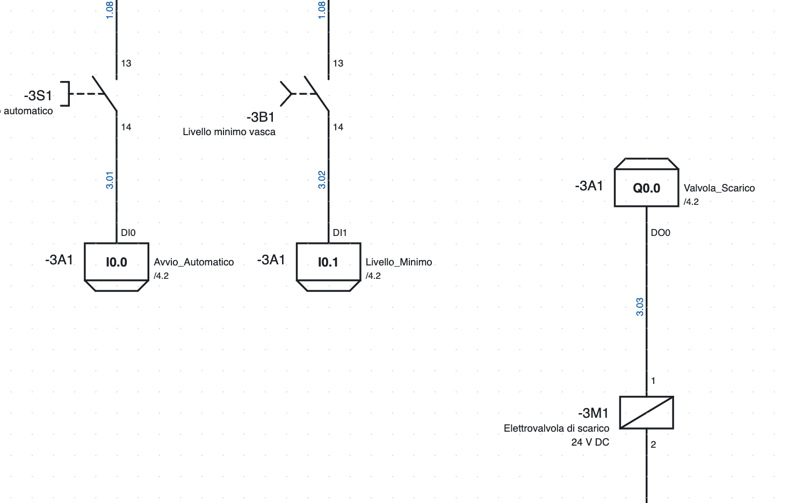
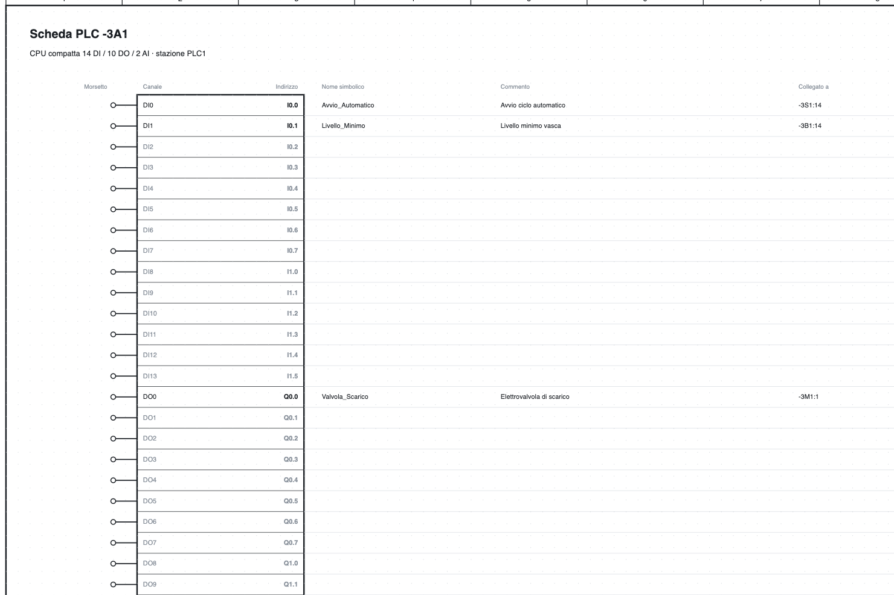

# 10. PLC

OpenWiring keeps the electrical schematic and the PLC I/O assignment together: every input and output drawn
takes a channel and an address, appears in the I/O list and in the card overview, and is exported to TIA
Portal, CODESYS or PLCopen.

## The PLC view

*The PLC view of the example project: CPU `-3A1`, station `PLC1` and the I/O assignment list.*

The **PLC** tab at the top right contains:

- the bar with address format, type of card to add and export;
- the list of **cards** with tag, type, station, rack, slot and start addresses;
- the list of **stations** with type, IP address and device name;
- the **I/O assignment list**.

## Cards

**Add card** adds the type chosen in the list:

- compact CPUs 14 DI / 10 DO / 2 AI and 8 DI / 6 DO;
- digital modules 8 DI, 16 DI, 8 DO, 16 DO, 8 DI / 8 DO;
- analog modules 4 AI, 8 AI, 2 AO, 4 AO;
- **IO-Link** masters with 4 or 8 ports.

For each card you give tag (`-3A1`), station (`PLC1`: addresses are assigned per station), rack, slot
(assigned automatically), start addresses, description and order number. The card goes into the bill of
materials.

**Card from part…** creates a card from a part of the library, for example an I/O module imported from an
EDZ: the number of channels is taken from the function template and can be corrected before creating the
card. The connection points of the part become the terminals of the channels.

**Stable addresses**: a new card takes the first free addresses of its station, those of the existing cards
do not change. **Reassign addresses** recalculates them in the order of the list (arrows ↑ ↓).

### Stations

Each station has a type (local CPU, Profinet, EtherCAT, Profibus DP, EtherNet/IP, Modbus TCP), an IP address
and a device name. The check reports duplicate slots and repeated IPs and names.

### Format and area order per station

In the **Stations** table each station has two extra columns:

- **Format**: a station can use a format different from the one at the top, for example a CODESYS node
  next to a Siemens CPU. The format at the top applies to stations without their own format. Changing the
  format of a station reassigns only its addresses.
- **Area order** (IEC and TwinCAT formats, where digital and analog share the same area): *cards in a row*
  (default) or *analogs first (WAGO)*, as WAGO nodes and other CODESYS couplers do. Adding a card to an
  "analogs first" station reassigns the addresses automatically.

**TwinCAT (Beckhoff).** With the TwinCAT format the addresses are `%I*` and `%Q*`: TwinCAT links them. In
the exported GVL the variables have `AT %I*` / `AT %Q*`; wires connected to a channel take their name from
card and channel (`400A1.DI3`), because `%I*` is the same for all.

Exports work per station: *Export TIA Portal* takes only Siemens stations, *Export CODESYS* the IEC and
TwinCAT ones.

### IO-Link

For each port of an IO-Link master you give device, description and process data bytes; the program
calculates the addresses (`IB4…IB5`, `%IB4`, `EB4`).

## I/O points in the schematic

*Two inputs and one output on page 3: in the box the address, on the right the symbolic name and the
reference to overview `/4.2`, on the left the card tag.*

1. In the library, category *PLC*, choose input or output, digital or analog.
2. Insert it in the schematic and connect it to the device (pushbutton, sensor, solenoid valve…).
3. The point automatically takes the **first free channel** of the right type; if no card has one, the
   program creates a new card (the first is a compact CPU).

In the point properties you change card, channel (those in use are marked), **symbolic name** and
**comment**. The terminal carries the channel name (`DI0`, `DO3`).

The **L+ / M supply** of the card is a separate symbol with the card tag: it is drawn on the supply circuit
and its position appears in the overview.

## Addresses

The format is chosen at the top of the PLC view:

| Format | Digital input | Digital output | Analog input | Analog output |
|---|---|---|---|---|
| Siemens TIA | `I0.0` | `Q0.0` | `IW64` | `QW64` |
| Siemens German | `E0.0` | `A0.0` | `EW64` | `AW64` |
| IEC 61131 / CODESYS | `%IX0.0` | `%QX0.0` | `%IW0` | `%QW0` |
| Omron CJ/CP | `0.00` | `100.00` | `2000` | `2100` |
| Beckhoff TwinCAT | `%I*` | `%Q*` | `%I*` | `%Q*` |

Analog addresses start from 64 in the Siemens formats and from 0 in IEC; changing format adapts them. Omron
uses 16-bit words, so switching from or to Omron reassigns the addresses.

## Overview pages

**Overview pages** creates one page per card, at the end of the project, and removes those of deleted cards.

*The overview of CPU `-3A1`: for each channel terminal, address, symbolic name, comment, connected device
and page.*

The overview is always in line with the schematic, it does not need to be regenerated when you change
something. Every I/O point of the schematic refers to its row of the overview (`/4.2`) and vice versa.

## I/O assignment list

The list contains all the channels of all the cards, used or free, with address, symbolic name, comment,
**connected device** (`-3S1:14`, derived from the wires) and position.

- Name and comment are edited directly in the table.
- If the name is missing it is generated (`DI2_3A1`); the default comment is the description of the
  connected device.
- *used channels only* hides the free ones.
- The list also appears in the *Lists* tab and in the PDF.
- The check reports channels used twice, duplicate names, points without a card or with a channel of the
  wrong type.

## Exchange with the PLC software

### Export

| Button | File | Use |
|---|---|---|
| *Export TIA Portal* | Excel with the `PLC Tags` sheet | in TIA: *PLC tags ▸ Import*; the tags end up in the `OpenWiring` table (Siemens formats) |
| *Export CODESYS* | text `VAR_GLOBAL … END_VAR` | to paste into a global variable list (IEC format) |
| *PLCopen XML* | XML TC6 | global variables with IEC address, including IO-Link data; for CODESYS and compatible environments |
| *I/O list Excel*, *CSV* | table | documentation |

Example of a CODESYS line: `Avvio_Automatico AT %IX0.0 : BOOL; (* Avvio ciclo automatico - -3S1:14 *)`.

> The TIA Portal export follows the format of the TIA tag table but has not yet been tested on a real
> installation: if the import reports errors, export an empty table from TIA and compare the columns.

### Importing variables

**Import variables** reads names and comments from the PLC software and brings them into the schematic:

- **TIA Portal**: the Excel file from *PLC tags ▸ Export*;
- **CODESYS**: a GVL (`Nome AT %IX0.0 : BOOL; (* commento *)`);
- **CSV** with the columns Name, Address, Comment.

Matching is by **address** (`%E0.0` and `I0.0` are equivalent). Channels already drawn receive name and
comment; those not yet drawn keep them on the card and show them as soon as they are drawn. Variables
without a channel are listed in the report view.
