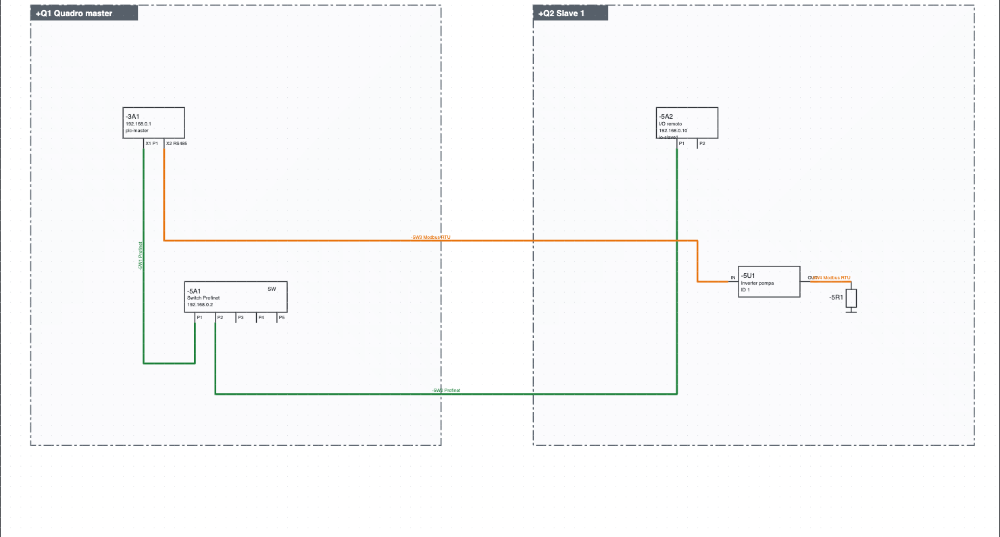
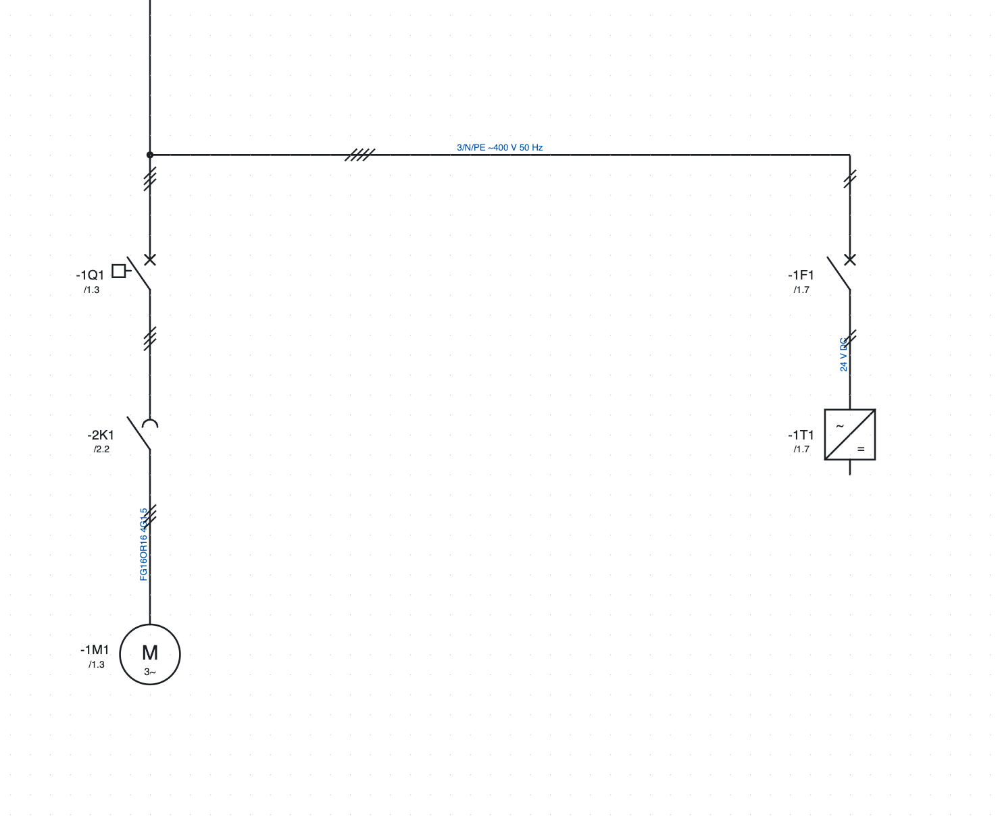

# 11. Networks, locations and single-line diagram

## Locations

A **location** is a physical container: electrical cabinet, pushbutton station, machine side, junction box,
field. Its code is the `+` part of the tag (`+Q1-2K1`).

1. *Project ▸ New location…*, or *+ Location* in the project properties.
2. Type the **code** (`Q1`, `BM`, `P1`), the **name** (`Quadro master`) and the **type**.
3. Assign the pages to the location with *Page properties ▸ Location (section)*: a new page stays in the
   location of the page it starts from.

Every device is in a location: the one written in its properties, otherwise the frame it is drawn in on the
network diagram, otherwise the location of its page.

Where the locations are seen:

- the **tree** groups pages and devices by location;
- the **device list** shows the full tag (`+BM-1M1`);
- the device **labels** are grouped by location;
- a **layout page** assigned to a location proposes only its own devices.

## Network diagram

The network diagram shows on a single page all the nodes of the plant and the bus connections between the
cabinets.

*The network diagram of the example project: CPU `-3A1` and switch `-5A1` in cabinet `+Q1`, remote I/O
`-5A2` and inverter `-5U1` in cabinet `+Q2`, connected with Profinet (green) and Modbus RTU (orange).*

1. **+ Network** under the tree creates the page.
2. **Cabinet** in the toolbar: click on two corners to draw the frame of a cabinet and choose its location.
   The nodes inside the frame belong to that cabinet.
3. From the *Networks and buses* category insert the **nodes**: two-port node (IN/OUT or P1/P2), one-port
   node, 5-port switch, termination. A node takes the tag of an existing device (the CPU, an inverter…) and
   becomes one of its representations.
4. Choose the protocol next to the **Bus** button and connect the ports like a wire.

### Protocols

Profinet, EtherCAT, Modbus TCP, Modbus RTU, Profibus DP, EtherNet/IP, CANopen, IO-Link, RS485, Ethernet.
Each protocol has its own colour and its name written on the line. Buses get no wire number and are not
among the electrical connections. An existing wire is turned into a bus from its properties
(*Network / bus*).

### Network cables

Every bus connection is a **cable**: it takes a tag by itself (`-5W1`, written on the line next to the
protocol). In the connection properties you give type (proposed per protocol, for example
*Profinet tipo A 2×2×AWG22*), length and part. Network cables appear in the cable list with the ports at the
ends (`-3A1:X1 P1` → `-5A1:P1`), in the labels and, with the part, in the bill of materials in metres.

### Lists and checks

- **Network connections**: protocol, ports, cabinets, connections between different cabinets.
- **Network nodes**: address, protocols, cabinet.
- The check reports repeated addresses on the same network (also through switches) and Ethernet ports with
  more than one connection (a switch is needed). Multi-drop buses (Modbus RTU, Profibus, CANopen, RS485)
  allow several nodes on the same segment.

## IP address plan

1. *Project ▸ New IP network*: name, address and prefix (`192.168.0.0/24`), gateway, protocol that uses it
   and first address to assign.
2. In the properties of each node there is the **IP address** field, separate from the bus address
   (Profinet name, Modbus ID…). The IP is written in the frame of the node.
3. *Project ▸ Assign IP addresses* gives the first free address to the nodes connected with Profinet, Modbus
   TCP, EtherNet/IP or Ethernet that have none (not EtherCAT and the serial buses).
4. *Project ▸ IP address plan* opens the list: IP, mask, gateway, network, device, name, protocols,
   location, including the PLC stations.

The check reports repeated IPs, invalid ones, ones outside the networks or equal to the network or broadcast
address, and gateways outside the network.

## Network addresses

*Project ▸ Network addresses…* (also from the *Networks* group of the *Project* ribbon tab) opens a table with **all**
devices that have a network port, including those without an address yet, and the PLC stations.

**How ports are found.** A port is any pin touched by a bus wire (Profinet, Ethernet, Modbus, EtherCAT…)
and any network node. Symbols need no special pins.

- The IP ports of a device (Profinet, Ethernet, Modbus TCP, EtherNet/IP) form **a single interface**, like
  an integrated switch: one IP and one name.
- Each non-IP bus (Modbus RTU, CAN, EtherCAT…) has its own interface with its own address.
- **Separate…** gives some ports an interface of their own, with a different IP and name (for example X2
  outside the switch of X1). **Merge** puts them back into the main interface.

You type directly in the *IP address* and *Profinet name / address* columns; *Enter* confirms. For a PLC
station the values stay in sync with the stations table. At the bottom:

- **Assign IP**: a free IP of the right network to IP interfaces that have none (an IP network is needed
  first);
- **Automatic Profinet names**: a name from tag and location (`+Q1 -2A1` → `q1-2a1`, with `pn-` in front if
  the name would start with a digit) for Profinet devices without a name; names already written stay;
- **List and export**: the same table among the reports, to print or export to PDF, CSV and Excel.

The last column shows the problems: duplicate IPs or IPs outside the network, invalid or duplicate Profinet
names.

## Single-line diagram

The single-line diagram represents the power distribution with a single line for each outgoing feeder.

*The single-line diagram of the example project: the same tags as the multi-line one, with the reference to
their position.*

1. **+ Single-line** under the tree creates the page.
2. From the *Single-line* category insert circuit breaker, motor protection switch, disconnector, fuse,
   contactor, motor, transformer, inverter, power supply, load.
3. Give each symbol **the same tag** as the device in the multi-line diagram: the clickable reference to its
   position appears (`/1.3`).
4. The lines have the number of conductors (*Conductors (ticks)*) and a text (`3/N/PE ~400 V 50 Hz`).

The lines of the single-line diagram do not count as conductors, wire numbers or list entries: the real
electrical schematic remains the multi-line one.
