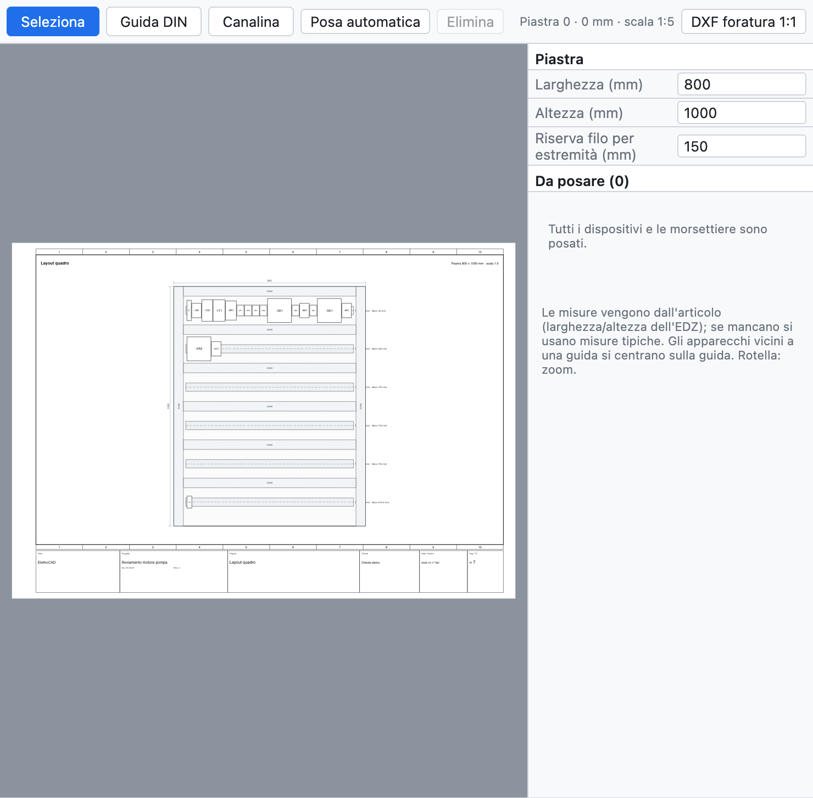

# 12. Cabinet layout

The layout page is the **mounting view** of the cabinet plate: DIN rails, cable ducts and devices to scale,
with dimensions. It is used to check that everything fits, for drilling and to estimate the length of the
wires.

*A layout created with automatic placement: two rows of rails with cable ducts and the devices of the
example project.*

## Creating the layout

1. **+ Layout** under the tree creates a layout page with the plate at a standard scale (1:5, 1:10…),
   dimensioned.
2. In the panel on the right set **width** and **height** of the plate in mm and the wire **spare** per end.
3. Assign the page to a **location** to see only the devices of that cabinet.

## DIN rails and cable ducts

With **DIN rail** and **Cable duct** in the view bar, drag on the plate to draw them. Each rail shows the
free millimetres.

## Placing the devices

- The *To place* list shows the devices and terminal strips not yet placed: drag them onto the plate.
- Devices near a rail are **centred on the rail**.
- The **dimensions** come from the part (width and height of the EDZ), otherwise they are typical values;
  a terminal strip is as wide as its terminals (a multi-level terminal takes one pitch).
- **Automatic placement** creates rows of cable ducts and rails if missing and places on the rails all the
  devices not yet placed.

## Checks

The check reports devices outside the plate, overlapping devices and full rails.

## Drilling

**1:1 drilling DXF** exports plate, rails, cable ducts, device outlines and Ø 5.5 fixing holes at real scale,
ready for machining.

## Bill of materials and wire lengths

- Rails and cable ducts with a part go into the **bill of materials in metres**.
- The **wire list (wiring)** gives for each wire cross-section, colour, **ferrules** (DIN 46228) and the
  **length estimated** from the layout: route between the devices plus the spare at the ends.
- The **purchase list** sums the loose wire by cross-section and colour with 10% extra
  ([chapter 14](14-liste-e-pagine-automatiche.md#purchase-list)).
