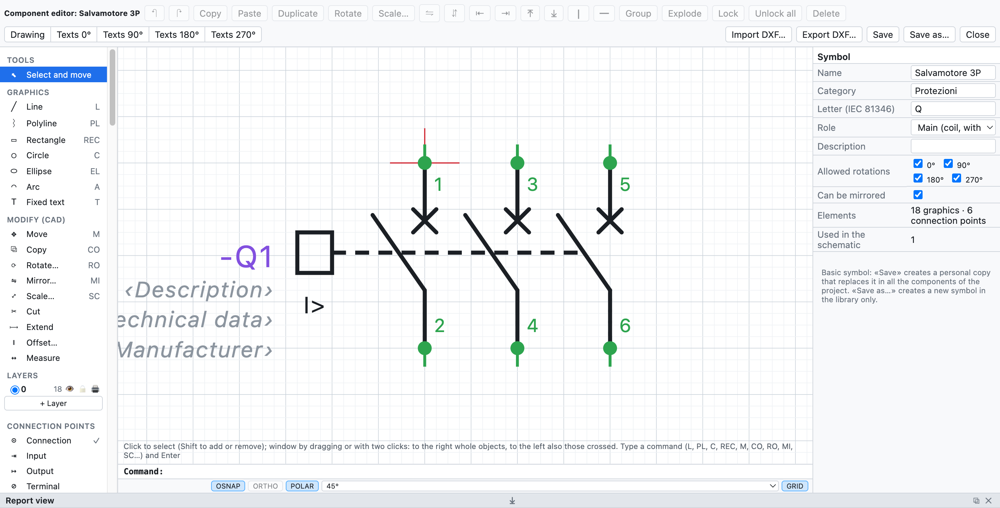
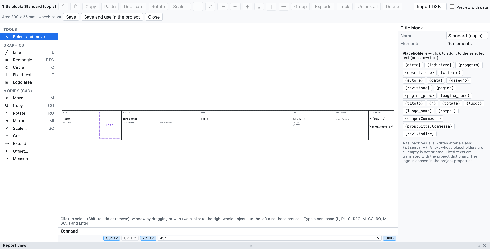

# 13. Macros, symbols and title blocks

## Macros

A **macro** is a piece of schematic to reuse: a motor starter, an emergency stop circuit, an outgoing feeder
with inverter.

### Creating a macro

1. Select the circuit in the schematic (window selection).
2. Right click ▸ **Create macro from selection…** (or from the *Macros* tab of the library).
3. Type name, category and description.

### Inserting a macro

1. In the **Macros** tab of the library click on the macro.
2. Click in the page: the point clicked is the top left corner of the circuit.

On insertion **tags, wire numbers, terminals, PLC channels and cables are renumbered**; coil and contacts
copied together stay linked. Macros are in the personal library, available in all projects, and are
exchanged as `.ecmacro` files (*File ▸ Import ▸ Macros…* and the export button in the *Macros* tab).

## Component editor

The editor draws a component from scratch or modifies an existing one: basic symbols, personal symbols,
components imported from QElectroTech or EPLAN, including the black boxes of EDZ parts.

*The 3P motor protection switch open in the editor: on the left the objects to add, in the centre the
drawing with the connection points, on the right the properties.*

- In the schematic: right click on the component ▸ **Edit the component…**. In the library:
  **New symbol…**, or right click on a symbol.
- Choose an object in the panel on the left and click (or drag) in the drawing:

| Group | Objects |
|---|---|
| *Graphics* | line, polyline (click on each vertex, double-click or Enter to finish), rectangle, circle, ellipse, arc, fixed text |
| *Connection points* | connection, input, output, terminal: on the 4 mm grid, with designation (`13`, `A1`) and wire direction |
| *Component texts* | tag, description, technical data, manufacturer, type, order number, part, function (=), location (+), notes |

- The **component texts** show the device data in the schematic (properties, part, function and
  location). Description and technical data placed here are not repeated under the tag.
- *Select and move*: click to select, drag to move, **Del** to delete. Dimensions and angles are corrected
  in the panel on the right.
- On the right also name, category, IEC 81346 **letter**, **role** (device, coil with cross-references,
  NO/NC/changeover contact, terminal) and description.
- The mouse wheel zooms.

### Saving

| Command | Effect |
|---|---|
| **Save** | same name: the symbol changes in the personal library and in **all the components of the schematic** that use it |
| **Save as…** | new name: one more symbol in the personal library; the schematic does not change |

Basic symbols are not overwritten: *Save* creates a personal copy with the same name, which replaces them
in the components of the project and also in the library, in the same tile: taking it again from the
library gives the modified version. *Back to the basic symbol* (in the editor) puts the original back in
the library. The modified black box of an EPLAN part remains the symbol of that part.
When used in a project, the symbol is copied into the `.ecad` file.

## QElectroTech components

*File ▸ Import ▸ QElectroTech symbols…* (or *Import components…* in the library) reads the components of
[QElectroTech](https://qelectrotech.org): `.elmt` files, `.qet` projects with their elements, or `.zip` or
`.7z` archives of whole folders, like the official collection downloaded from GitHub.

- The graphics are converted (lines, rectangles, circles, ellipses, arcs, polygons, texts) with the
  terminals and their names.
- The type becomes the role: coil with cross-references, NO/NC contact with automatic numbering, terminal,
  interruption point.
- The tag letter comes from type and name: circuit breakers and disconnectors **Q**, fuses and thermal
  overload relays **F**, coils **K**.
- The scale is 10 px = 4 mm; terminals off the grid are brought onto the grid with a short connecting
  segment, so wires snap to them.
- The components stay in the personal library; when you insert one it is copied into the project.

> **Caution**: on GitHub download the real file with *Raw* or *Download raw file*. Saving the web page gives
> an HTML file that does not contain the component.

The QElectroTech collection is © The QElectroTech team, licence CC-BY 3.0: use in schematics is free;
OpenWiring does not include their symbols, you import them yourself.

## Included title blocks

Besides *Standard*, *With revision table* and *Compact*, the program includes six complete title blocks,
designed for different kinds of work:

| Title block | For |
|---|---|
| *ISO 7200 (standard)* | the title block of technical drawings according to ISO 7200 |
| *Detailed industrial* | industrial schematics, with revision table and boxes for date, drawn by, checked by |
| *Machine (EN 60204-1)* | electrical equipment of machines |
| *Building installation (DM 37/08)* | civil electrical installations, with the data required for the declaration of conformity |
| *Switchboard (EN 61439)* | low-voltage switchboards |
| *Automation with signatures* | automation plants, with the signature boxes |

They are chosen in the project properties (*Title block ▸ Template*) or in those of a page. The particular fields
of each template (for example `{campo:Matricola}`) appear in the *Project properties*, ready to be filled in. For
each included title block you can choose *Customise…* and start from that drawing.

## Custom title blocks

You can also draw your own company's title block.

*The standard title block open in the editor, with the list of placeholders on the right.*

1. *Project ▸ Title block: customise or draw…*, or *Customise…* / *New…* in the project properties.
2. Draw with lines, rectangles, circles, texts and the **logo area**. The title block area is 390 × 35 mm.
3. In the texts use the **placeholders**: a click on a placeholder of the list adds it to the selected text.
4. *Preview with data* shows the title block filled with the project data.
5. **Save and use in the project**.

### Placeholders

| Placeholder | Value |
|---|---|
| `{ditta}`, `{indirizzo}` | company and address |
| `{progetto}`, `{descrizione}`, `{cliente}`, `{autore}`, `{data}`, `{disegno}`, `{revisione}` | project data |
| `{pagina}`, `{titolo}` | page number and title |
| `{n}`, `{totale}` | page position and number of pages (`{n}/{totale}`) |
| `{luogo}`, `{luogo_nome}` | location of the page |
| `{campo1}`, `{campo:Commessa}` | additional fields |
| `{prop:Ditta.Commessa}` | user-defined property of the project or page ([chapter 4](04-progetto-e-pagine.md#user-defined-properties)) |
| `{rev1.indice}`, `{rev1.descrizione}`… | latest revisions |

A fallback value is written after a bar: `{cliente|—}`. The fallback value can itself contain a placeholder:
`{campo:Macchina|{progetto}}` writes the *Macchina* field and, if it is empty, the project name. A text with all placeholders empty is not printed.

### Importing a title block from DXF

**Import DXF…** in the editor brings into the template a title block drawn in AutoCAD or another CAD: lines,
polylines, circles, arcs, texts and blocks. Attributes become placeholders (PROGETTO → `{progetto}`,
DATA → `{data}`, FOGLIO → `{pagina}`…). If it is larger than the title block area it is scaled down.

Saved title blocks stay in the personal library for all projects and are copied into the project file. Each
page can use a different title block; the title block applies on screen, in the PDF and in the DXF.
