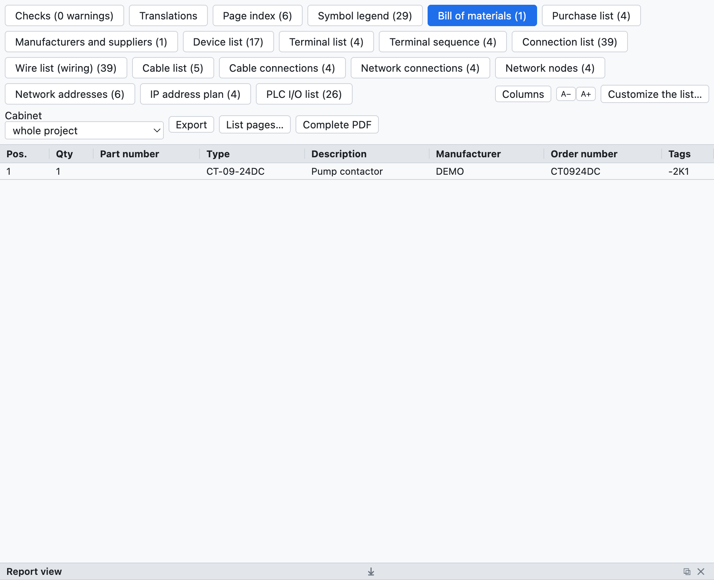
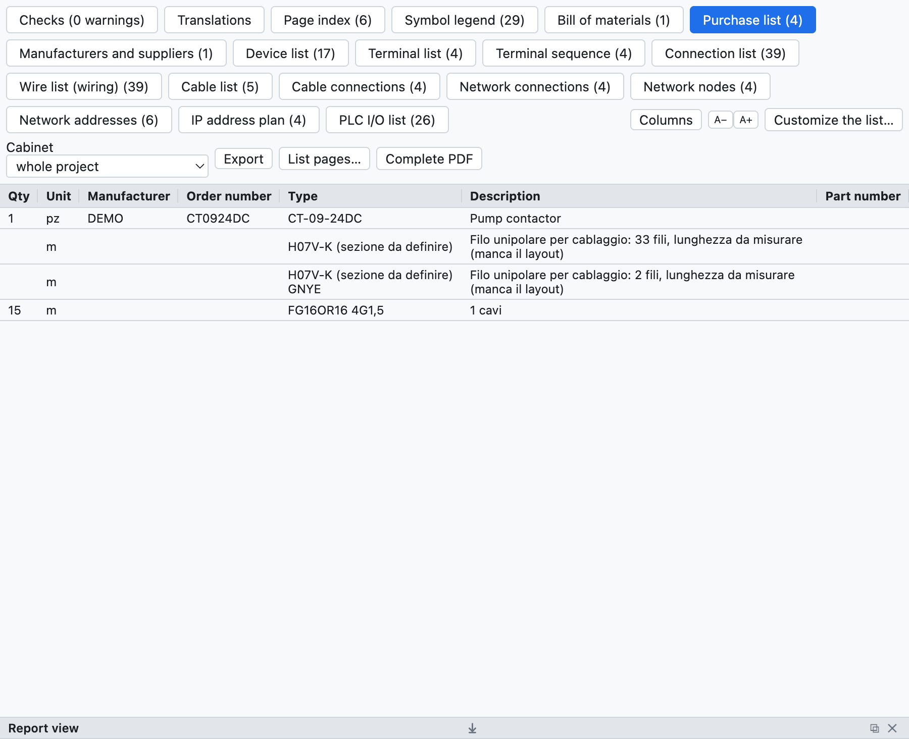
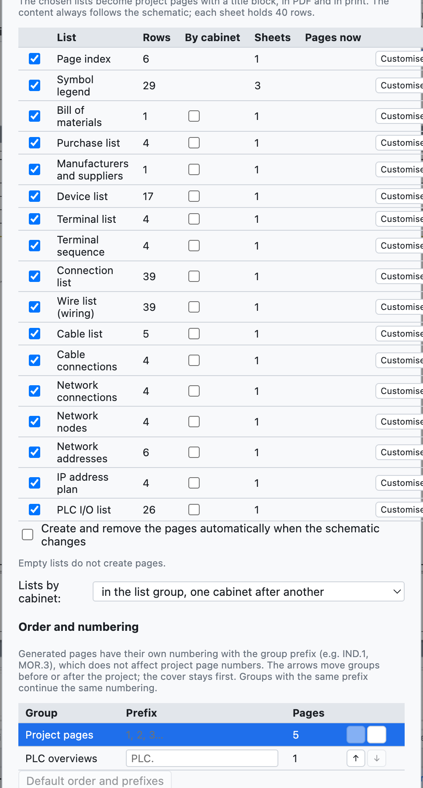
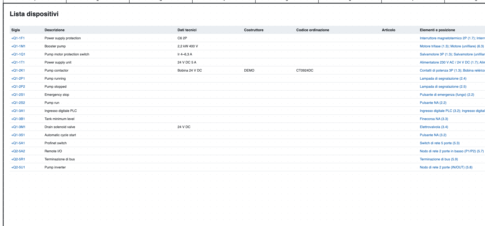
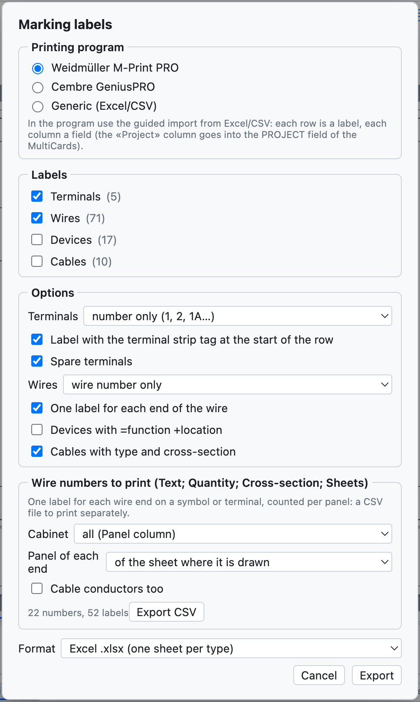

# 14. Lists and automatic pages

All lists are **calculated from the schematic**: they are not filled in by hand and are always up to date.

## The Lists view

*The Lists tab with the bill of materials of the example project.*

The **Lists** tab has one sub-tab for each list; *Export CSV* saves the open list (separator `;`, opens in
Excel), *Complete PDF* exports the project with all the lists at the end.

| List | Content |
|---|---|
| Page index | number, title, type and location of each page |
| Bill of materials | parts grouped by code (or by manufacturer + order number), quantity, tags |
| Purchase list | parts by manufacturer with the unit of measure, loose wire, cables |
| Device list | full tag, description, technical data, manufacturer, codes, elements and positions |
| Terminal list | terminals with external and internal destinations, wire numbers, jumpers |
| Connection list | every connection: wire number, from, to, pages, cross-section, colour, cable |
| Wire list (wiring) | every wire with cross-section, colour, ferrules and estimated length |
| Cable list, Cable connections | see [chapter 9](09-cavi-e-connettori.md) |
| Connector list | pins, sides, wires |
| Network connections, Network nodes, IP address plan | see [chapter 11](11-reti-luoghi-unifilare.md) |
| PLC I/O list | see [chapter 10](10-plc.md) |

Empty lists do not appear. A click on a position (`/2.4`) takes you to the element.

## Purchase list

*The purchase list of the example project.*

The purchase list is used to order the material:

- the parts of the bill of materials are **grouped by manufacturer**, so each group is an order to one
  supplier;
- each row has the **unit of measure**: pieces, or metres for cables, rails and cable ducts;
- the **loose wire** is summed by cross-section and colour (`H07V-K 1,5 mm² BU`), in metres estimated from
  the cabinet layout with 10% extra; without a layout the row gives how many wires and that the length is
  to be measured;
- **cables without a part** are summed by type and cross-section.

## Automatic pages

Lists become **project pages** with a title block, to be printed and included in the PDF.

*The automatic pages window: for each list the rows, the sheets needed and the pages already present.*

1. *Insert ▸ Automatic pages (lists)…*, or *List pages…* in the Lists view.
2. Tick the lists you want as pages.
3. Press **Create / update the pages**.

- Each sheet holds 40 rows; a longer list takes several sheets.
- The **page index** goes at the front, after the cover; the other lists at the end.
- The **content** of the pages always follows the schematic.
- With **Create and remove the pages automatically when the schematic changes** the number of sheets also
  adapts by itself: if the terminal list goes from 40 to 41 rows the second sheet appears.
- *Remove all pages* removes the list pages.
- *Insert ▸ Update the list pages* realigns the pages to the chosen lists.

*The device list as a project page.*

## Marking labels

*File ▸ Export ▸ M-Print PRO / GeniusPRO labels…* prepares the labels for marking printers.

*The labels window.*

- **Program**: Weidmüller M-Print PRO (columns `Project`, `Text 1`, `Text 2`…; the `Project` column goes into
  the PROJECT field of the MultiCards), Cembre GeniusPRO (columns `Riga 1`, `Riga 2`…, `Gruppo`) or generic.
- **Labels**: terminals, wires, devices, cables.
- **Options**: terminals with the number only or the full tag, terminal strip label at the start of the
  row, spares; wires with the number only or with the destination, one label per end; devices with
  =function +location; cables with type and cross-section.
- **Format**: Excel (one sheet per type) or CSV.

Both programs import Excel and CSV with a wizard in which each column is assigned to a field.
