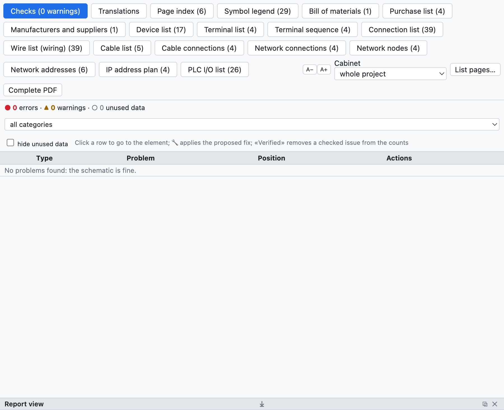
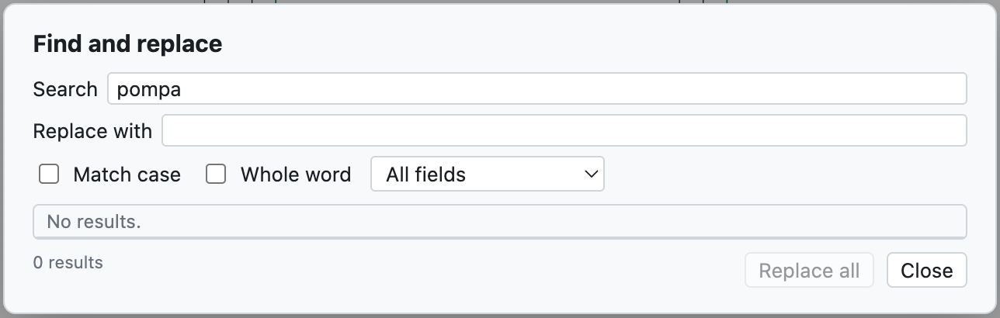

# 15. Check, search and revisions

## Project check

**Check** in the toolbar (or *Project ▸ Check*) checks the whole project and opens the *Checks* tab of the
Lists view.

*The example project has no problems. For an example with warnings see [chapter 3](03-primo-progetto.md#step-6--check).*

Problems are divided into:

- **errors** (●): to be corrected, for example a short circuit;
- **warnings** (▲): probable errors, for example a free connection point;
- **unused data** (○): data to tidy up, for example a part copied into the project but not used.

They are filtered by category and *hide unused data* removes the ○. **A click on a row** takes you to the
element and selects it.

### What is checked

| Category | Examples |
|---|---|
| Short circuits | different potentials on the same conductor (`L1` with `N`, `+24V` with `0V`), interruption points with different names connected, components with both terminals on the same conductor |
| Apparent connections only | a wire passing over a connection point without ending there: it looks connected but it is not |
| Orphans | components, potentials, interruption points and nodes without connections, isolated wires, contacts without a coil |
| Incomplete connections | free terminals of coils, contacts, lamps, pushbuttons, I/O points; wires with a free end (bars reaching the border are allowed) |
| Drawing | non-existent or overlapping symbols, overlapping wires, elements outside the sheet, repeated wire numbers, empty pages, rotations not allowed by the symbol (fixed by allowing the rotation in the symbol) |
| Conductor buses | wires touching the bus without the conductor name, conductors entering the bus and not leaving |
| Tags and data | duplicate or missing tags, more contacts than the part has, repeated terminals |
| Cables, connectors, networks, PLC, layout | see the relevant chapters |
| Unused data | parts, symbols, terminal strip and connector data no longer used, empty locations |

> **Tip**: run the check before every delivery and before exporting the PDF.

## Find and replace

**⌘F** (or *Search*) opens the search in the whole project.

*The search for «pompa» finds seven descriptions.*

- It searches in tags, descriptions, texts, wire numbers, PLC names, codes; the *All fields* list narrows the
  search to one field.
- *Match case* and *Whole word* refine the search.
- A click on a result takes you to the element.
- *Replace with* and **Replace all** change the text in all the results, in one step that can be undone.

## Revisions

A **revision** records the state of the delivered project, for example «Rev. A – prima emissione».

1. *Project ▸ New revision…* (or *New revision…* in the project properties).
2. Type index, date, author and description.

From that moment:

- later changes are marked with red **clouds** on screen and in the PDF (they are turned off with
  *Clouds on changes* in the properties);
- the title block of each page shows the index of the last revision that changed it;
- the PDF index, the cover and the *With revision table* title block list the revisions.

## Comparing two projects

*File ▸ Import ▸ Compare with an .ecad file…* (or *Compare…* in the properties) compares the open project
with another file, for example the version delivered to the customer. The *Comparison* tab of the Lists view
lists pages, devices and project data added, removed or changed.
