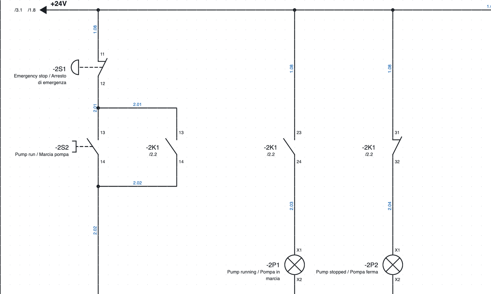
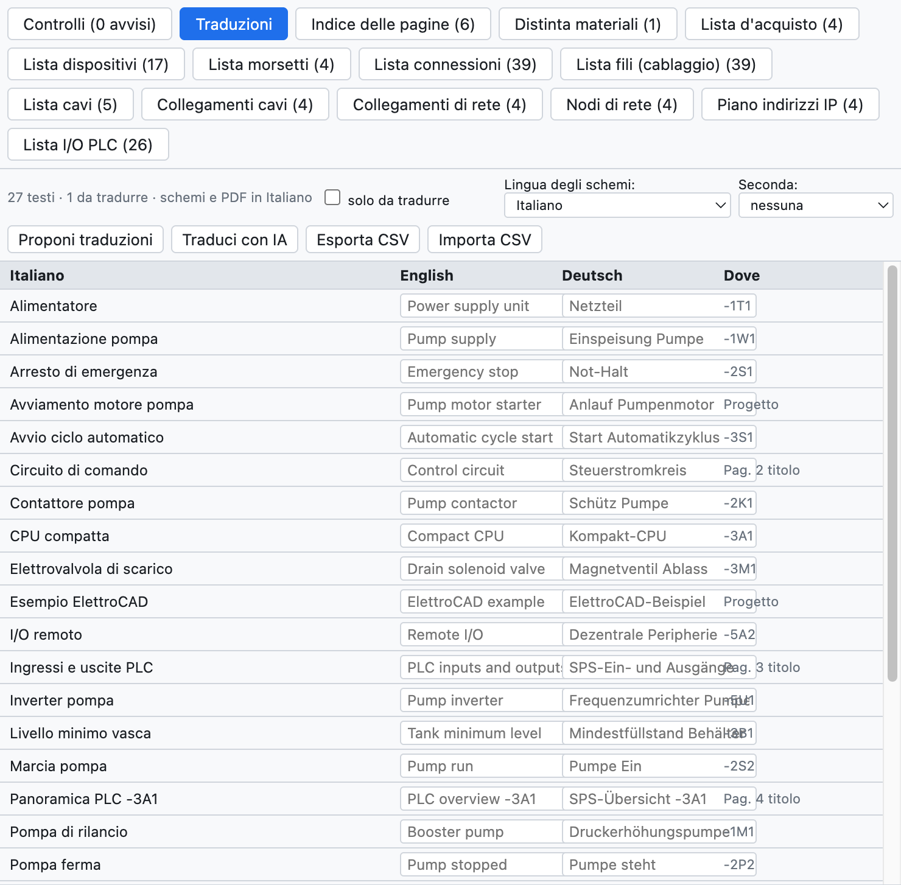

# 16. Schematic languages

Schematics are drawn in Italian and can also be printed in **English** or **German**, or in two languages
together. The language of the program interface is a separate setting
([chapter 1](01-introduzione.md#interface-language)).

*Page 2 in English with the Italian below: «Emergency stop / Arresto di emergenza».*

## The project dictionary

The *Translations* tab of the Lists view (or *Project ▸ Translations…*) lists all the translatable texts of
the project: page titles, free texts, device descriptions, locations, PLC comments, title block fields. For
each one there are the English translation, the German one and where it appears.

*The dictionary of the example project.*

- Type the translation in the cell; *to translate only* shows the texts that lack one.
- The program already contains the fixed texts (title block, list titles and columns) and about 250 common
  electrical terms.

## Translating automatically

| Command | How it translates |
|---|---|
| *Suggest translations* | whole sentence if it is in the included dictionary, otherwise word by word («Lampada guasto» → «Fault lamp») |
| *Translate with AI* | with the chosen AI assistant (Claude, ChatGPT, Gemini), with the industry terminology ([chapter 17](17-assistente-ia.md#translating-the-dictionary)) |

Automatic translations are **highlighted** as to be checked: they are confirmed with ✓ or by editing them.

## Choosing the language

- **Schematic language**: *View ▸ Schematic language*, the project properties (*Languages*) or the
  Translations tab. It changes schematics, title block, cover, list pages, PLC overviews and terminal strip
  diagrams.
- **Second language**: writes the texts in two languages («Contattore pompa / Pump contactor»).
- The **PDF** and **printing** can be done in another language without changing the project one (*Language*
  choice in the export window).

## With a translator

*Export CSV* saves the dictionary as a table `Italiano;English;Deutsch`: the translator completes it in Excel
and *Import CSV* reads it back.
