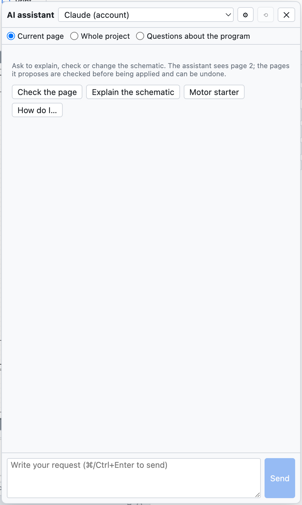
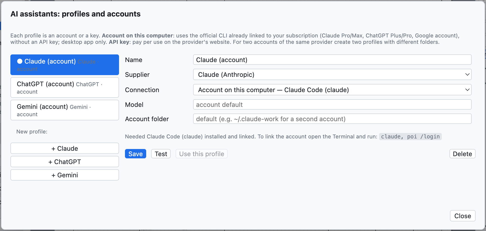
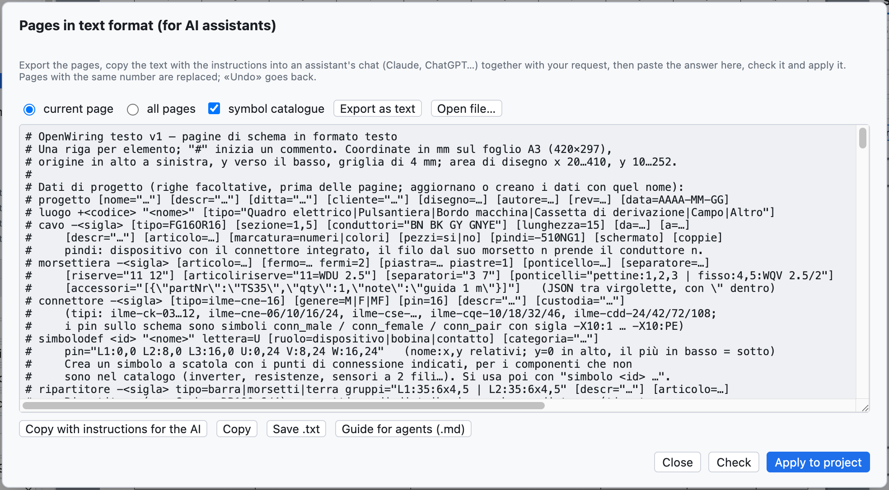

# 17. AI assistant

The AI assistant is a colleague you can ask, in your own language, to **explain**, **check** or **draw**
parts of the schematic. It works with **Claude** (Anthropic), **ChatGPT** (OpenAI) and **Gemini** (Google),
using your accounts. It answers in the language of the interface.



*The assistant panel, with the quick buttons.*

## Opening the assistant

*Project ▸ AI assistant…* or **⌘I** opens the panel on the right; the schematic stays visible and you can
work while the assistant answers.

At the top you choose:

- the **profile**: which assistant and which account;
- the **context**: what the assistant sees.

| Context | The assistant receives |
|---|---|
| *Current page* | the page in text format, the format guide with the symbol catalogue, the check problems on the page |
| *Whole project* | all the pages, the project data (locations, cables, PLC cards) and all the check problems |
| *Questions about the program* | the OpenWiring manual, for questions about menus and commands |

## What to ask

| Request | Example |
|---|---|
| Explain | «Explain how the circuit on this page works» |
| Check | «Check this page: connections, tags, protection, IEC 60204-1» |
| Draw | «Add a page 7 with a star-delta starter for a 15 kW motor» |
| Modify | «Add a fault lamp controlled by contact 95-96 of the overload relay» |
| Use the program | «How do I create a two-level terminal strip?» |

The quick buttons *Check the page*, *Explain the schematic*, *Motor starter*, *How do I…* send ready-made
requests. **⌘Enter** sends, *Cancel* stops a long answer, ⟲ starts a new conversation.

## When the assistant draws

If the answer contains pages in text format, the panel **checks them at once**:

- *Ready: adds page 7 · no problems* → press **Apply to project**;
- if there are errors or check problems, they appear under the answer: **Ask for a fix** sends errors and
  problems back to the assistant, and it corrects them.

Applying is undone with **⌘Z**. A page with the same number as an existing one replaces it; a new number adds
a page.

> **Real example.** Asked «Add a new page (number 7) with a direct-on-line starter for a 4 kW three-phase
> motor: motor protection switch, contactor, terminal strip and motor», Claude answered in about 30 seconds
> with the complete page (motor protection switch `-7Q1`, contactor `-7K1`, terminals `-X2`, motor `-7M1`,
> cable `-7W1`), pointing out by itself that the contactor coil was missing in the control circuit.

## Profiles and accounts

*Project ▸ AI assistants: profiles and accounts…* (or ⚙ in the panel).



*One profile per assistant: on first use there is one for Claude, ChatGPT and Gemini.*

Each profile has a name, a provider, a connection method and a model. You can have several profiles of the
same provider, for example the personal account and the company one.

### Account on this computer (subscription)

In the desktop app the profile can use the provider's **official CLI**, already linked to your subscription:
no API key, the subscription quota is used.

| Provider | Program to install | Subscription | Command to link the account |
|---|---|---|---|
| Claude | Claude Code (`claude`) | Claude Pro or Max | `claude`, then `/login` |
| ChatGPT | Codex CLI (`codex`) | ChatGPT Plus or Pro | `codex login` |
| Gemini | Gemini CLI (`gemini`) | Google account | `gemini`, then *Login with Google* |

The command is run once in the Terminal. For a **second account** of the same provider give a different
**account folder** in the profile (for example `~/.claude-lavoro`): the window shows the exact command, for
example `CLAUDE_CONFIG_DIR=~/.claude-lavoro claude`.

If the login expires, the assistant answers with the command to run (for example `codex login`).

### API key

With the *API key* connection you pay per use on the provider's website:

| Provider | Where the key is created |
|---|---|
| Claude | console.anthropic.com |
| ChatGPT | platform.openai.com |
| Gemini | aistudio.google.com |

Paste the key into the profile; *List* shows the models available with that key. In the desktop app the key
is **encrypted** by the operating system and stays only on that computer.

**Test** checks the connection with a short question; **Use this profile** makes it the active one.

## Translating the dictionary

*Project ▸ Translate with the AI assistant* (or *Translate with AI* in the Translations tab) sends to the
active assistant the project texts without a translation, and those translated word by word, and asks for
English and German with the industry terminology. The translations enter the dictionary as **to be checked**
(see [chapter 16](16-lingue.md)).

## The text format with an external assistant

You can also work with an assistant in a browser chat, without profiles:



*The window of pages in text format.*

1. *File ▸ Pages as text (AI assistants)…*: choose *current page* or *all pages* and press
   **Export as text**.
2. **Copy with instructions for the AI** and paste into the chat, adding your request at the end.
3. Paste the answer into the window (even with the text around it), press **Check** and then
   **Apply to project**.

The format is one line per element:

```text
luogo +Q1 "Quadro elettrico"
pagina 7 "Ventilazione quadro" luogo=Q1
  simbolo potential +24V @28,24
  filo 28,24 400,24
  simbolo potential 0V @28,232
  filo 28,232 400,232
  simbolo pb_no -? @100,60 descr="Marcia ventilatore"     # "-?" = automatic tag
  simbolo coil -7K1 @100,140 descr="Contattore ventilatore"
  collega -7S1:13 100,24                                  # to the +24V bar
  collega -7S1:14 -7K1:A1                                 # by tag and connection point
  collega -7K1:A2 100,232
```

The complete syntax is in the **agent guide** (*Help ▸ Guide for AI agents (.md)…*), see
[chapter 19](19-riga-di-comando.md).

## Privacy

The schematic sent to the assistant leaves the computer and reaches the chosen provider, under its terms of
use. With *Current page* only the open page is sent.
