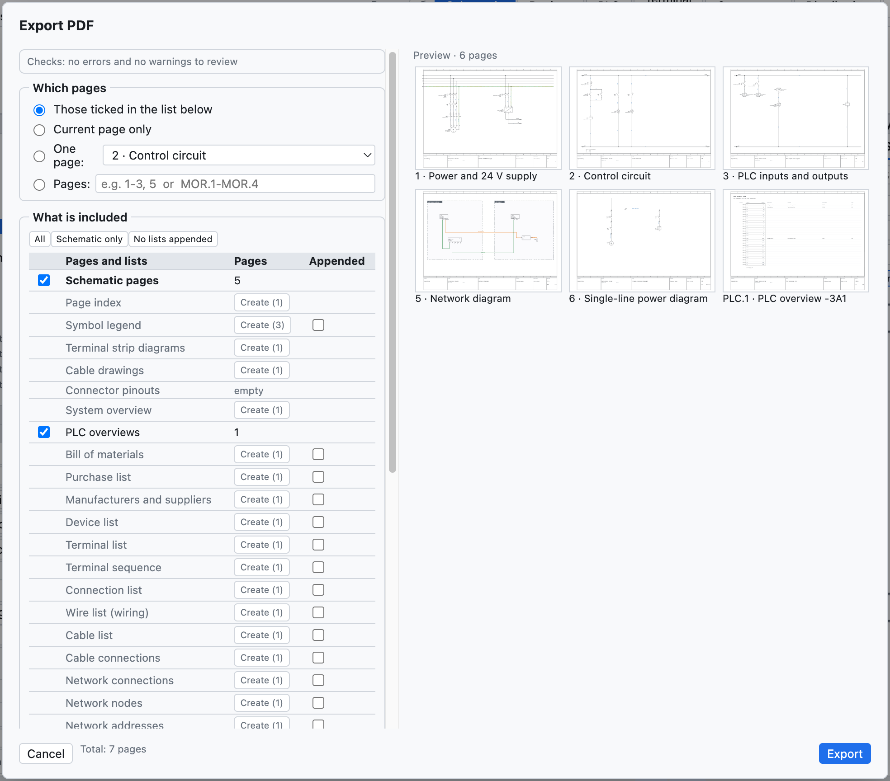
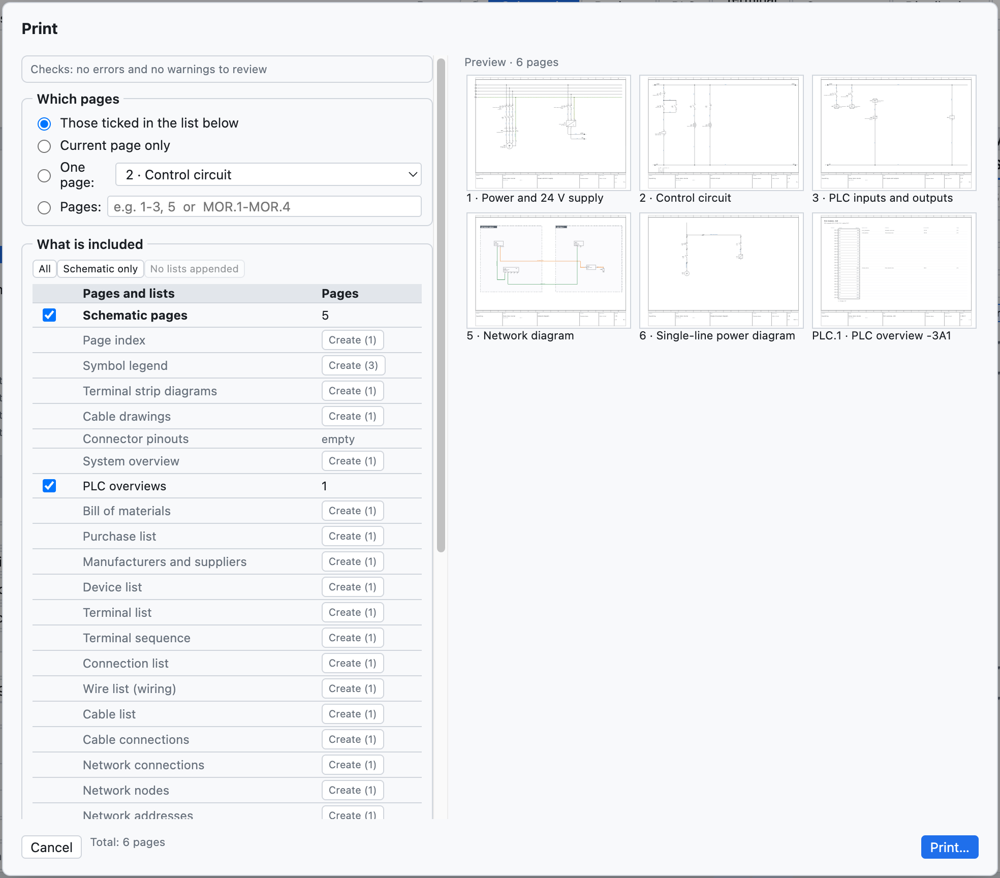

# 18. Import and export

## PDF

**PDF** in the toolbar (or *File ▸ Export ▸ PDF…*) creates a vector PDF in A3.

*The PDF options.*

| Option | Effect |
|---|---|
| *Those ticked in the list below*, *Current page only*, *One page*, *Pages* | which pages; the range is written with the project numbers (`1-3, 5` or `200-205`) |
| *Initial index page* | clickable index of pages and lists |
| *Lists at the end* | bill of materials, devices, terminals, connections, PLC I/O after the schematics |
| *Black and white for printing* | wires and wire numbers in black |
| *PDF language*, *Second language* | the PDF in another language, without changing the project |

In the PDF the **references are clickable** (contacts ↔ coil, interruption points between pages, PLC,
overviews), as are the positions in the lists and the index; the PDF has **bookmarks** for pages and lists.

## Printing

*File ▸ Print…* (⌘P) sends the pages to the printer in **A3 landscape**, one page per sheet.

*The print options: pages, black and white, language.*

To print the lists too, first create the list pages ([chapter 14](14-liste-e-pagine-automatiche.md#automatic-pages)).

## DXF

| Command | Result |
|---|---|
| *File ▸ Export ▸ DXF of the current page* | a DXF R12 at 1:1 scale, in mm |
| *File ▸ Export ▸ DXF of the whole project (ZIP)* | one DXF per page, collected in a ZIP archive |
| on the layout page | the drilling DXF of the plate ([chapter 12](12-layout-quadro.md#drilling)) |

The DXF files have the layers CORNICE, CARTIGLIO, SIMBOLI, FILI, TESTI, SIGLE, NUMERI_FILO (plus CAVI and
QUADRI where needed) and open in AutoCAD, DraftSight, LibreCAD and other CAD programs. The DWG format is not
available: open the DXF and save it as DWG from the CAD.

## Excel and CSV

- Every list is exported as **CSV** (separator `;`) from the Lists view.
- The **device navigator** exports and re-imports Excel ([chapter 7](07-dispositivi-e-articoli.md#excel)).
- The **PLC** view exports for TIA Portal, CODESYS, PLCopen and the I/O list ([chapter 10](10-plc.md)).
- The **labels** come out in Excel or CSV ([chapter 14](14-liste-e-pagine-automatiche.md#marking-labels)).
- The translation **dictionary** comes out in CSV ([chapter 16](16-lingue.md)).

## Importing schematics from PDF (SEE Electrical and others)

*File ▸ Import ▸ Schematic from PDF (SEE Electrical…)…* creates a **new project** from a schematic exported
as a **vector PDF** from another CAD. It was tested with a real SEE Electrical project of 207 pages, imported
in a few seconds.

What is rebuilt:

- **sheets**: one for each schematic sheet, with number and title from the title block; the title prefix
  (`Q1.1 Ingresso linea`) becomes the location `+Q1.1`; cover and lists of the source CAD are skipped;
- **real wires**, with the colour of the drawing (blue → BU, green-yellow → PE, red → RD…) and the name
  written next to them (`L1-1.1`, `200.01`) as wire number;
- **components** with the nearest **tag**, the **terminals** where the wires arrive and their names
  (`1/L1`, `A1`, `95`);
- **terminal strip terminals**, multi-level too (`X1.1.12:1A`);
- **interruption points** between pages, paired by name or from the `sheet.column` references;
- free **texts** and component texts.

To be rechecked: components are recognised from the graphics and do not know whether they are coils or
contacts (so no contact image); some elements remain graphics without a tag. *Project ▸ Check* reports
interrupted conductors and interruption points without a counterpart. A scanned PDF (an image) cannot be
imported.

## Other imports

| Command | What it imports | See |
|---|---|---|
| *Parts EDZ / XML / CSV…* | manufacturer parts, with pictures, terminals, drawing and commercial data (CSV) | [chapter 7](07-dispositivi-e-articoli.md#importing-manufacturer-data-edz) |
| *QElectroTech symbols…* | `.elmt`, `.qet` components, archives | [chapter 13](13-macro-simboli-cartigli.md#qelectrotech-components) |
| *Macros…* | `.ecmacro` files | [chapter 13](13-macro-simboli-cartigli.md#macros) |
| *Compare with an .ecad file…* | differences with another project | [chapter 15](15-verifica-ricerca-revisioni.md#comparing-two-projects) |
| *Import DXF…* in the title block editor | title block drawn in another CAD | [chapter 13](13-macro-simboli-cartigli.md#importing-a-title-block-from-dxf) |
| *Import variables* (PLC view) | tag table from TIA Portal, CODESYS, CSV | [chapter 10](10-plc.md#importing-variables) |
| *Pages as text* | pages written by an AI assistant or a script | [chapter 17](17-assistente-ia.md#the-text-format-with-an-external-assistant) |

## Other exports

| Command | Result |
|---|---|
| *PLCopen XML (PLC variables)* | global variables for CODESYS and compatible environments |
| *Parts as XML (EPLAN format)* | library parts in an XML file in the EPLAN format |
| *Translation dictionary (CSV)* | table `Italiano;English;Deutsch` |
