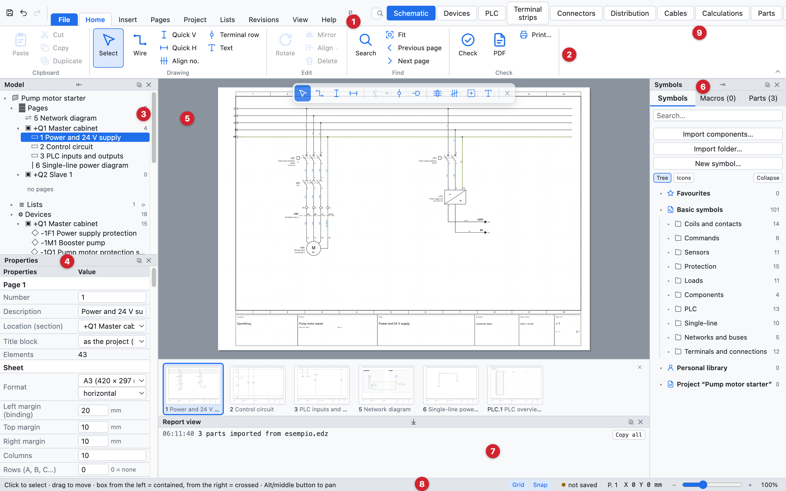
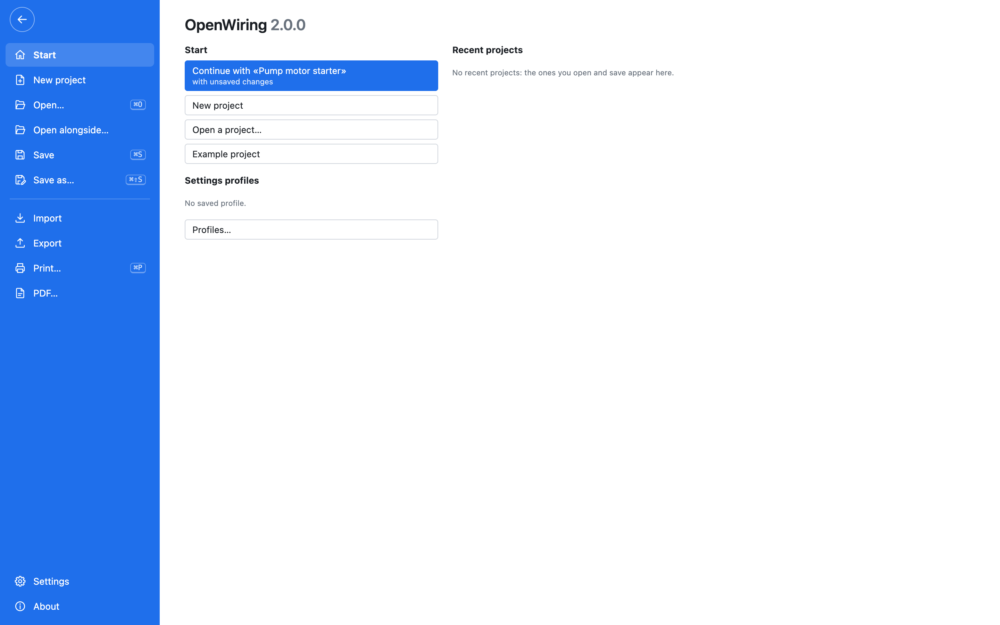
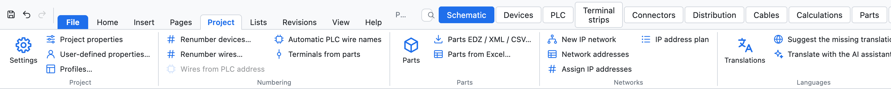
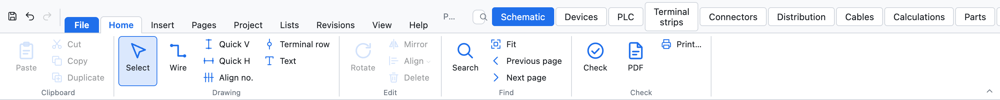
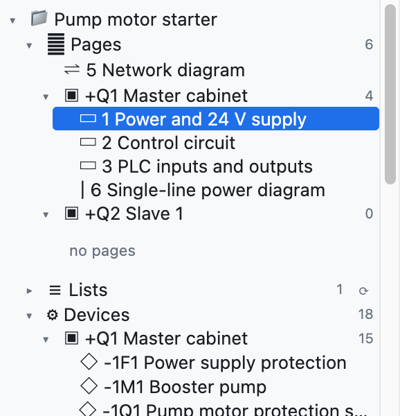
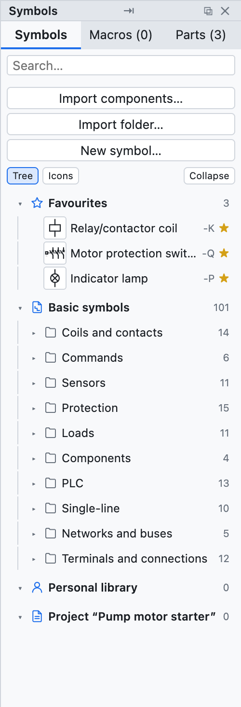
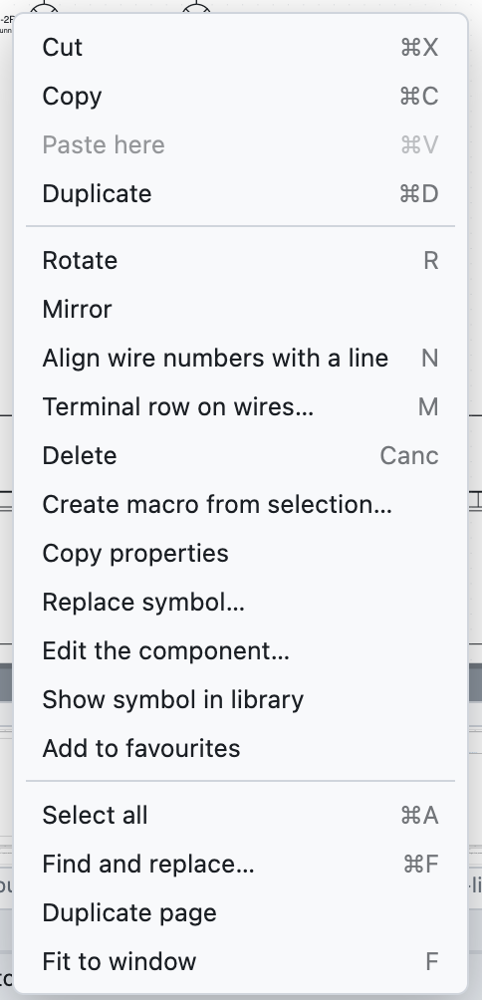

# 2. La interfaz

*La ventana de OpenWiring con el proyecto de ejemplo.*

| N.º | Parte | Para qué sirve |
|---|---|---|
| 1 | Pestañas de la cinta | *Archivo* y las pestañas *Inicio, Insertar, Páginas, Proyecto, Listas, Revisiones, Ver, Ayuda* |
| 2 | Comandos de la cinta | los comandos de la pestaña abierta, en grupos con su nombre debajo |
| 3 | Árbol del modelo | páginas, dispositivos, estructura =/+, regletas, cables, artículos del proyecto |
| 4 | Propiedades | los datos del elemento seleccionado, de la página o del proyecto |
| 5 | Área de dibujo | la página de esquema actual |
| 6 | Biblioteca | símbolos, macros y artículos para insertar |
| 7 | Vista de informe | mensajes de importación, exportación y operaciones |
| 8 | Barra de estado | indicaciones sobre el comando activo, archivo, página, coordenadas del cursor |
| 9 | Vistas | *Esquema* siempre visible; Dispositivos, PLC, Regletas, Cables, Bus hilos, Artículos, Listas y las demás en el botón desplegable *Otras vistas* |

## Cinta de opciones

Los comandos se reúnen en **pestañas**; cada pestaña los divide en grupos con el nombre escrito debajo. El atajo de
teclado aparece en la información de cada botón. Un **doble clic** en una pestaña reduce la cinta a los nombres de
las pestañas (un clic la vuelve a abrir para un comando); *Ver ▸ Barra de comandos ▸ Estilo* elige entre cinta,
cinta compacta y **menús clásicos**, para quien prefiere los menús desplegables. *Buscar un comando…* (⌘K)
encuentra cualquier comando escribiendo su nombre.

*La pestaña Archivo: inicio, proyectos recientes, nuevo, abrir, guardar, importar, exportar, imprimir y PDF, ajustes.*

| Pestaña | Contiene |
|---|---|
| *Archivo* | nuevo, abrir, abrir al lado, guardar, **Importar** (artículos EDZ/XML/CSV, símbolos QElectroTech, esquema desde PDF, macros) y **Exportar** (PDF, DXF, etiquetas, PLCopen, artículos, diccionario), imprimir, ajustes, información |
| *Inicio* | portapapeles, dibujo (seleccionar, cable, cables rápidos, fila de bornes, texto), edición (girar, simetría, alinear, eliminar), buscar (búsqueda, ajustar, página anterior y siguiente), verificación, PDF e impresión |
| *Insertar* | símbolos y macros, conexiones (haz de cables, bus de red, manguera, sección), ubicaciones, gráficos (texto, imagen, dibujo DXF) |
| *Páginas* | nueva página de cada tipo, páginas automáticas (listas, dibujos de mangueras, asignación de pines), organizar, hoja (cajetín, formato y marco) |
| *Proyecto* | ajustes y propiedades, perfiles, numeración de dispositivos y cables, artículos, redes IP y direcciones, traducciones, asistente IA |
| *Listas* | verificaciones, listas, lista E/S PLC, listas personalizadas, vistas (dispositivos, regleteros, conectores, mangueras, distribuidores, cálculos), PDF completo, etiquetas, PLCopen |
| *Revisiones* | revisiones, publicación, cambios de la revisión, comparación con otro proyecto, guardar como plantilla |
| *Ver* | paneles, tema, hoja, idioma de la interfaz y de los esquemas, cuadrícula, miniaturas, mapa de la hoja, menú radial, estilo de la cinta |
| *Ayuda* | manual, recorrido guiado, atajos, guía para agentes IA, actualizaciones, información, sitio del proyecto |

*La pestaña Proyecto.*

## Pestaña Inicio y herramientas en el dibujo

La pestaña *Inicio* reúne los comandos que se usan continuamente. Encima del esquema hay también una pequeña barra
flotante con las herramientas de dibujo (selección, cable, cables rápidos, remisiones, bornes, texto): se activa y
desactiva en *Ver ▸ Herramientas en el dibujo*.

| Botón | Acción |
|---|---|
| *Seleccionar* | volver a la selección (también con Esc) |
| *Hilo* | dibujar hilos (tecla **W**) |
| *Rápido V*, *Rápido H* | hilo vertical u horizontal de una vez |
| *Bornes en fila* | una fila de bornes sobre los hilos atravesados |
| *Texto* | texto libre en la página |
| *Girar, Reflejar, Eliminar* | sobre la selección (teclas **R** y **Supr**) |
| *Buscar* | buscar y reemplazar (⌘F) |
| *Ajustar* | mostrar toda la página (tecla **F**) |
| *Verificación* | verificaciones del proyecto |
| *PDF*, *Imprimir…* | exportar a PDF o imprimir |

La barra de acceso rápido arriba a la izquierda contiene *Guardar*, *Deshacer* y *Rehacer* (⌘S, ⌘Z, ⇧⌘Z).

## Árbol del modelo

El árbol muestra el proyecto y se abre o se cierra con los triángulos ▸ ▾:

- **Páginas**, agrupadas por ubicación (cuadro, botonera…): un clic abre la página.
- **Dispositivos**, agrupados por ubicación: un clic va al dispositivo y lo selecciona.
- **Estructura =Instalación +Ubicación**: los dispositivos por función y ubicación (consulta el [capítulo 7](07-dispositivi-e-articoli.md#estructura-instalación-ubicación)).
- **Regletas** y **Cables**: un clic abre la regleta o selecciona la línea del cable.
- **Artículos del proyecto**: los artículos usados.

Debajo del árbol están los botones de las páginas: *+ Página*, *+ Portada*, *+ Unifilar*, *+ Red*,
*+ Disposición*, *⧉* (duplicar la página), *↑ ↓* (mover) y *✕* (eliminar).

## Propiedades

El panel muestra los datos de lo que está seleccionado:

- **nada seleccionado**: la página actual y, debajo, los datos del proyecto;
- **un símbolo**: sigla, datos del dispositivo, pedido, puntos de conexión, posición;
- **un hilo**: número de hilo, red, conexiones, sección, color;
- **varios elementos**: los campos comunes.

Se escribe en el campo y se confirma con Intro o saliendo del campo. Los valores en gris cursiva son
sugerencias o valores tomados del artículo.

## Biblioteca

La columna derecha tiene tres pestañas:

- **Símbolos**: los símbolos IEC 60617 divididos por categoría (bobinas y contactos, mandos, protecciones,
  receptores, bornes y conexiones, PLC, redes y buses, unifilar), más los que importes o dibujes. El campo
  *Buscar…* filtra por nombre.
  Arriba están los **★ Favoritos**: la estrella ☆ de un símbolo (o el botón derecho en un componente ▸
  *Añadir a favoritos*) lo pone aquí. Los favoritos valen para todos los proyectos.
- **Macros**: los circuitos guardados para reutilizarlos (consulta el [capítulo 13](13-macro-simboli-cartigli.md)).
- **Artículos**: la biblioteca de artículos de los fabricantes.

## Menú del botón derecho

El clic derecho sobre un elemento abre los comandos más usados: cortar, copiar, pegar aquí, duplicar,
girar, reflejar, eliminar, crear macro a partir de la selección, **copiar propiedades** y **pegar propiedades de -X** (todos los datos del dispositivo salvo la sigla, [capítulo 7](07-dispositivi-e-articoli.md#copiar-las-propiedades)), modificar el componente, añadir a favoritos, resaltar potencial (en
los hilos), ir al elemento principal o a los contactos, añadir nivel (en los bornes), seleccionar todo,
buscar, duplicar página, ajustar a la ventana.

## Vistas

Las pestañas de arriba a la derecha cambian la parte central:

| Vista | Contenido |
|---|---|
| *Esquema* | la página de dibujo |
| *Dispositivos* | el navegador de dispositivos en forma de tabla |
| *PLC* | tarjetas, direcciones y lista de E/S |
| *Regletas* | el navegador de regletas |
| *Artículos* | la gestión de artículos |
| *Listas* | comprobaciones, traducciones y todas las listas |

## Moverse por el dibujo

| Acción | Cómo |
|---|---|
| Acercar y alejar | rueda del ratón, alrededor del cursor (en el trackpad: pellizco) |
| Desplazar la vista | botón central del ratón, o **Alt** + arrastrar |
| Ver toda la página | **F** o *Ajustar* |
| Página anterior o siguiente | **RePág** / **AvPág** |
| Ir a una referencia | clic en una referencia como `/2.4` |

## Tema, hoja e idioma

*Ver ▸ Tema* elige una interfaz clara, oscura o como el sistema. *Ver ▸ Hoja de dibujo* elige una hoja
blanca u oscura (como en los CAD con fondo negro). PDF, DXF e impresión son siempre sobre hoja blanca.
*Ver ▸ Language · Lingua* elige el idioma de la interfaz: italiano, inglés, francés, alemán o español.
