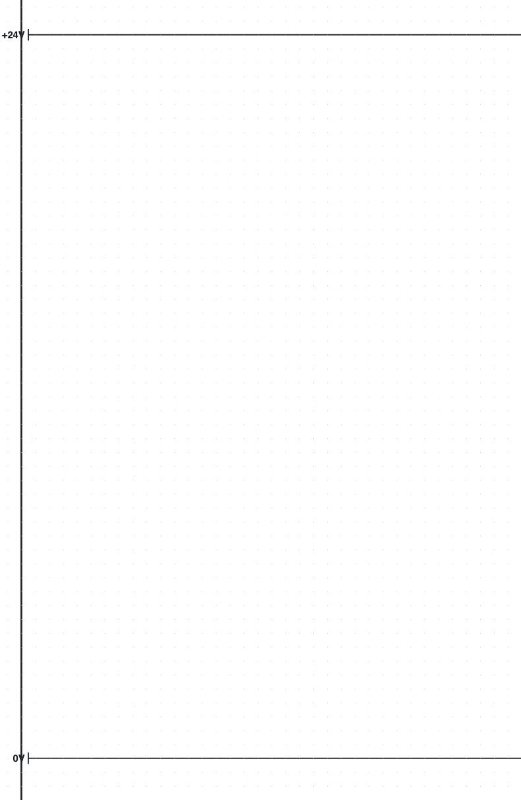
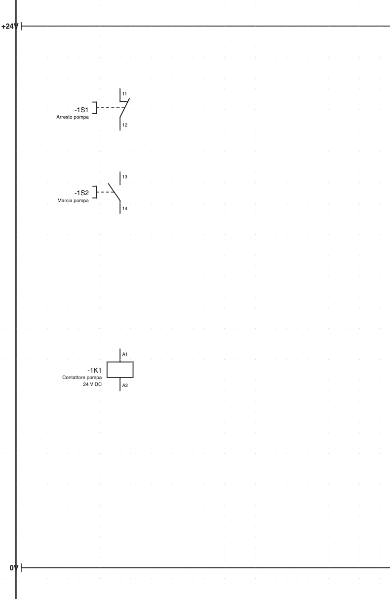
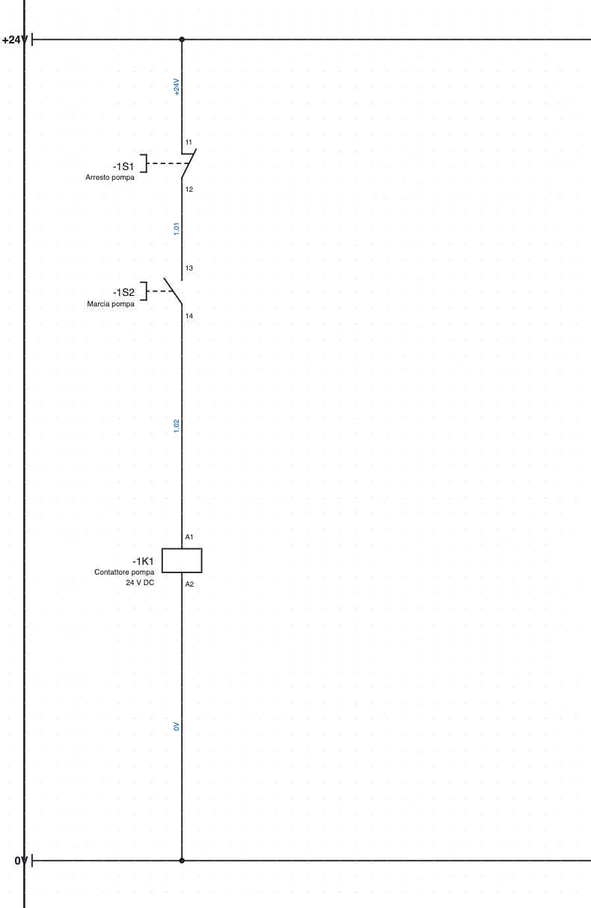
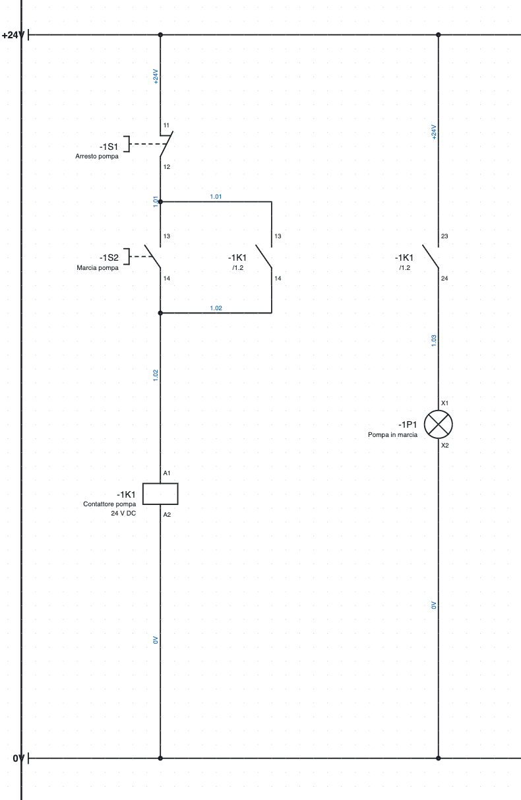
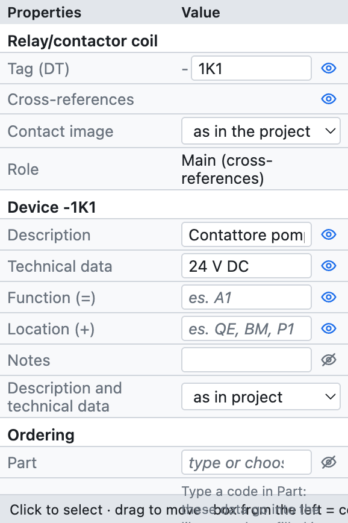
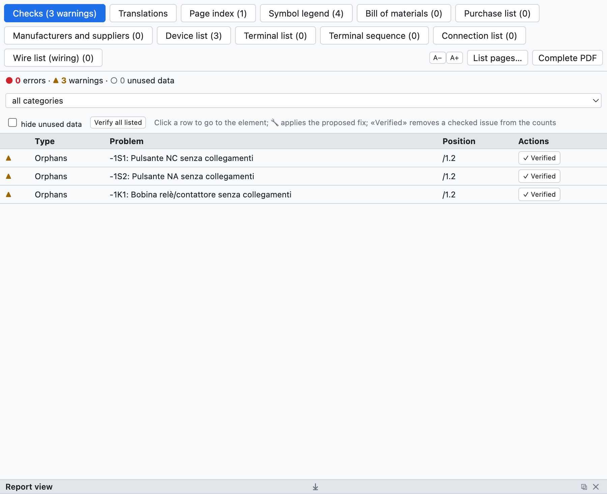
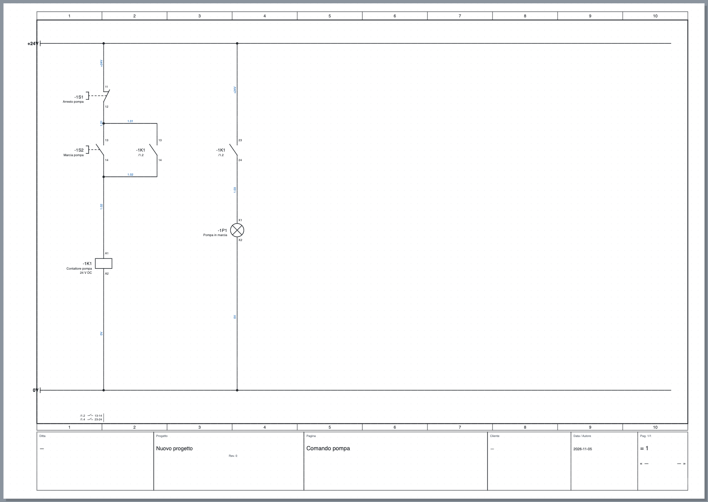

# 3. El primer proyecto

En este ejercicio se dibuja el **mando de una bomba**: un pulsador de paro, un pulsador de marcha, el
contactor con autorretención y un piloto de marcha, alimentados a 24 V. Lleva unos veinte minutos y al
final se conocen los comandos básicos: insertar símbolos, dibujar hilos, rellenar datos, verificar y exportar.

## Paso 1 – Nuevo proyecto y barras de alimentación

1. *Archivo ▸ Nuevo proyecto*. Se abre una página vacía, la página **1**.
2. Haz clic en el nombre de la página en el árbol y, en *Propiedades*, escribe la **Descripción**:
   `Mando bomba`. El título aparece en el cajetín.
3. En la biblioteca, categoría *Bornes y conexiones*, elige **Punto de potencial** y haz clic arriba a la
   izquierda de la página. El punto se llama `L1`: en *Propiedades ▸ Nombre* escribe `+24V`.
4. Inserta un segundo punto de potencial abajo y llámalo `0V`. Pulsa **Esc** para terminar la inserción.
5. Pulsa **W** (herramienta *Hilo*), haz clic en el punto `+24V` y luego en el extremo derecho de la página;
   termina el hilo con un doble clic. Haz lo mismo para la barra `0V`.

*Paso 1: las barras de alimentación.*

> **¿Por qué puntos de potencial?** Todos los conductores con el mismo nombre (`+24V`, `0V`, `L1`, `PE`…)
> están conectados entre sí, también en páginas distintas. Las listas y la verificación lo saben.

## Paso 2 – Los símbolos

1. Categoría *Mandos*: elige **Pulsador NC** y haz clic bajo la barra `+24V`, en la columna 1–2.
   El pulsador recibe solo la sigla `-1S1` (página 1, letra S, primero de la página).
2. También en *Mandos*, **Pulsador NA**, más abajo en la misma vertical: pasa a ser `-1S2`.
3. Categoría *Bobinas y contactos*: **Bobina de relé/contactor**, todavía más abajo: pasa a ser `-1K1`.
4. Pulsa **Esc**.

Si hay que girar un símbolo, pulsa **R** (giro de 90°) antes de insertarlo; después de insertarlo se gira
con **R** sobre la selección. Los símbolos se ajustan a la rejilla de 4 mm.

*Paso 2: pulsadores y bobina, todavía sin hilos.*

## Paso 3 – Los hilos

1. Pulsa **W**. Haz clic en la barra `+24V` encima del pulsador `-1S1`: el hilo sale del punto de la barra.
2. Haz clic en el punto de conexión superior del pulsador (`11`): el hilo termina solo cuando llega a un
   punto de conexión. Los puntos disponibles se señalan con pequeños círculos verdes.
3. Conecta del mismo modo `-1S1:12` con `-1S2:13`, `-1S2:14` con `-1K1:A1`, y `-1K1:A2` con la barra `0V`.

Donde un hilo llega a otro hilo, el programa crea una **unión** y la dibuja con un punto.
Dos hilos que se cruzan sin punto no están conectados.

> **Conexión automática.** Al insertar o mover un símbolo, sus puntos de conexión libres se conectan solos
> con los puntos enfrentados en la misma línea: dos símbolos colocados uno debajo del otro en la misma vertical
> quedan ya unidos por un hilo. Es cómodo para los circuitos en columna; si prefieres dibujar cada hilo a mano,
> desactívala en *Propiedades del proyecto ▸ Dibujo ▸ Conexión automática*.

*Paso 3: el circuito de mando conectado. Los números de hilo azules se asignaron automáticamente.*

## Paso 4 – Autorretención y piloto

1. Categoría *Bobinas y contactos*: **Contacto NA**. Insértalo a la derecha del pulsador de marcha.
   El contacto toma la sigla de la última bobina, `-1K1`, y los bornes `13-14`.
2. Conéctalo **en paralelo** con el pulsador de marcha: un hilo del tramo encima de `-1S2` al contacto,
   un hilo del contacto al tramo debajo de `-1S2`. Las uniones en T se forman solas.
3. Inserta un segundo **Contacto NA** más a la derecha: pasa a ser `-1K1` con los bornes `23-24`.
4. Categoría *Receptores*: **Piloto de señalización** bajo el contacto: pasa a ser `-1P1`.
5. Conecta barra `+24V` → contacto → piloto → barra `0V`.

*Paso 4: la autorretención `-1K1 13-14` y el piloto de marcha mandado por `-1K1 23-24`.*

Debajo de cada contacto aparece **`/1.2`**: la posición de la bobina (página 1, columna 2). Al pie de la
página, bajo la barra `0V`, aparece la **imagen de contactos** de la bobina con las posiciones de los
contactos (`/1.2 13-14`, `/1.4 23-24`). Un clic en una referencia lleva al elemento conectado.

## Paso 5 – Los datos del componente

Selecciona la bobina `-1K1`. En el panel *Propiedades* rellena:

- **Descripción**: `Contactor bomba`;
- **Datos técnicos**: `24 V CC`;
- si lo conoces, el **artículo**, o si no fabricante, tipo y código de pedido.

*Las propiedades de la bobina `-1K1`: sigla, datos del dispositivo, pedido, puntos de conexión y posición.*

La descripción y los datos técnicos aparecen en el esquema bajo la sigla y pasan a las listas. Pertenecen
al **dispositivo**: escritos en la bobina, valen también para sus contactos. Rellena también los
pulsadores (`Paro bomba`, `Marcha bomba`) y el piloto (`Bomba en marcha`).

## Paso 6 – Verificación

Pulsa **Verificación** en la barra de herramientas. Se abre la pestaña *Comprobaciones* con los errores (●),
los avisos (▲) y los datos sin usar (○). Un clic en una fila lleva al elemento.

*Esto es lo que señala la verificación si se lanza después del paso 2, cuando los símbolos aún no están
conectados.*

Con el esquema terminado, la verificación no encuentra ningún problema. Prueba a borrar un hilo: aparecen
avisos sobre puntos de conexión libres.

## Paso 7 – Guardar y exportar

1. **Guardar** (⌘S) y elige el nombre del archivo, por ejemplo `Mando bomba.ecad`.
2. **PDF** en la barra de herramientas: elige *Todas* las páginas y pulsa *Exportar*. El PDF tiene el
   índice, las listas al final y referencias con enlace.

*La página terminada, con el cajetín rellenado con los datos del proyecto.*

## ¿Y ahora?

- Los datos del cajetín (empresa, cliente, número de plano) se rellenan en las propiedades del proyecto:
  [capítulo 4](04-progetto-e-pagine.md).
- Para conectar páginas distintas se usan los puntos de interrupción: [capítulo 5](05-disegnare.md#puntos-de-interrupción-entre-páginas).
- Para la potencia (guardamotor, contactor, motor) abre la página 1 del proyecto de ejemplo.
- El mismo esquema lo puede dibujar el **asistente IA** a partir de una descripción: [capítulo 17](17-assistente-ia.md).
