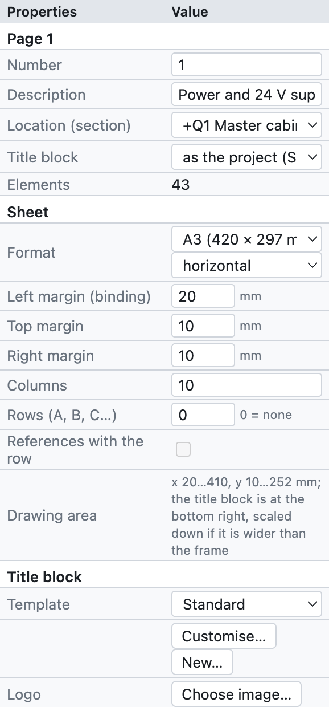
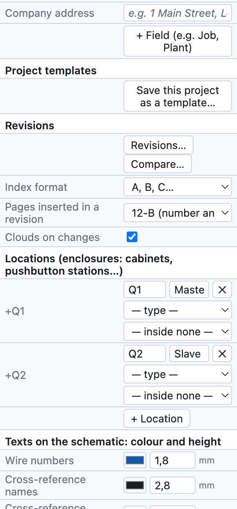
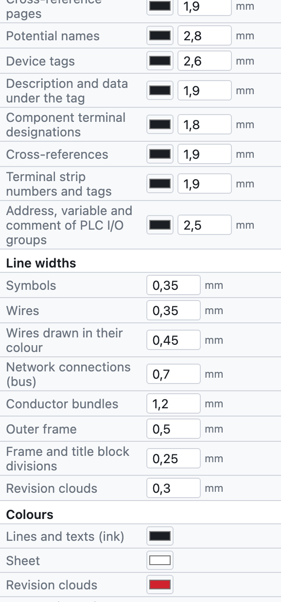
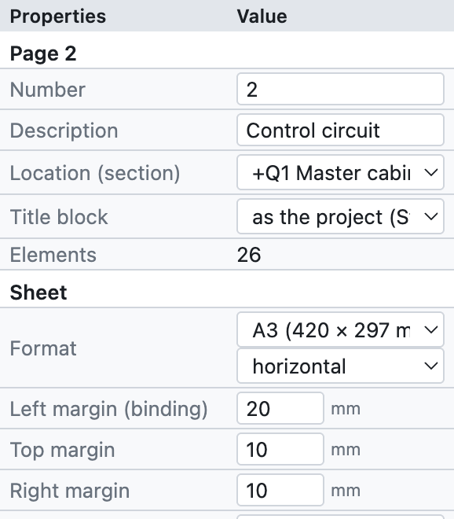
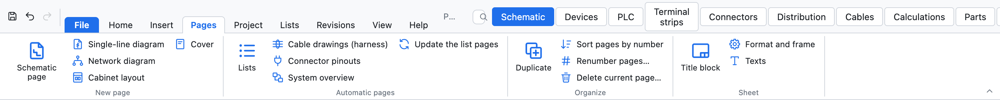
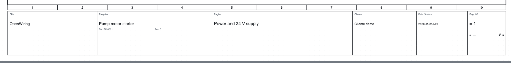
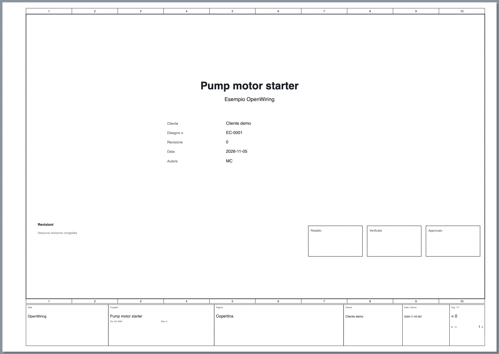

# 4. Proyecto y páginas

## Propiedades del proyecto

Los ajustes del proyecto se abren con *Proyecto ▸ Propiedades del proyecto*, haciendo clic en el nombre del
proyecto en el árbol, o deseleccionando todo (clic en una zona vacía): el panel *Propiedades* muestra la
página actual y, debajo, los datos del proyecto.

*El panel de propiedades del proyecto, de arriba abajo.*

| Grupo | Campos | Consulta |
|---|---|---|
| *Página* | número, descripción, ubicación, cajetín de la página | [Páginas](#páginas) |
| *Cajetín* | modelo, logotipo, dirección de la empresa, campos adicionales | [Cajetín](#cajetín) |
| *Modelos de proyecto* | guardar el proyecto como modelo | [Modelos de proyecto](#modelos-de-proyecto) |
| *Revisiones* | nueva revisión, comparación, nubes | [capítulo 15](15-verifica-ricerca-revisioni.md#revisiones) |
| *Ubicaciones* | cuadros, botoneras, a pie de máquina… | [capítulo 11](11-reti-luoghi-unifilare.md#ubicaciones) |
| *Idiomas* | idioma de los esquemas y segundo idioma | [capítulo 16](16-lingue.md) |
| *Redes IP* | subredes del plan de direcciones | [capítulo 11](11-reti-luoghi-unifilare.md#plan-de-direcciones-ip) |
| *Proyecto (cajetín)* | nombre, descripción, empresa, cliente, autor, número de plano, revisión, fecha | abajo |
| *Siglas de dispositivos* | modelo de la sigla, contador, imagen de contactos | [capítulo 6](06-sigle-e-numerazione.md) |
| *Números de hilo* | visibilidad, sección y color, hilos de colores, numeración, modelo | [capítulo 6](06-sigle-e-numerazione.md#números-de-hilo) |
| *Dibujo* | descripciones en el esquema, paso de la rejilla | abajo |

### Datos del cajetín

Nombre, descripción, empresa, cliente, autor, número de plano, revisión y fecha aparecen en el cajetín de
cada página, en la portada y en las propiedades del PDF. Se escriben una sola vez.

### Dibujo

- **Descripciones en el esquema**: escribe la descripción y los datos técnicos bajo la sigla de los
  dispositivos (se puede cambiar para un solo dispositivo).
- **Paso de la rejilla**: 4 mm (recomendado), o 1, 2, 5 u 8 mm.

## Páginas

La hoja es un **A3 apaisado** (420 × 297 mm) con el marco dividido en **10 columnas** numeradas y el cajetín
abajo. Las columnas sirven para las referencias: `/2.4` significa página 2, columna 4.

*Las propiedades de la página 2 del proyecto de ejemplo.*

- **Número**: el nombre de la página, libre (`1`, `200`, `10.1`). Pasa a las siglas (`-200K1`), a los
  números de hilo (`200.01`) y a las referencias (`/200.4`).
- **Descripción**: el título de la página, en el cajetín y en el índice.
- **Ubicación (sección)**: el cuadro o la ubicación a la que pertenece la página; el árbol agrupa las
  páginas por ubicación.
- **Cajetín**: el cajetín de la página, si es distinto del del proyecto.

### Comandos de las páginas

| Comando | Dónde | Efecto |
|---|---|---|
| Nueva página | *+ Página* bajo el árbol, *Insertar ▸ Página de esquema* | página vacía después de la actual, con el número siguiente |
| Duplicar | *⧉*, *Insertar ▸ Duplicar la página actual*, clic derecho | copia con siglas y números de hilo nuevos |
| Mover | *↑ ↓* bajo el árbol | cambia el orden |
| Eliminar | *✕* bajo el árbol | pide confirmación; se deshace con ⌘Z |
| Cambiar de página | clic en el árbol, **RePág/AvPág** | |

*La pestaña Páginas: páginas nuevas de cada tipo, páginas automáticas, orden de las páginas y hoja.*

### Tipos de página

| Tipo | Cómo se crea | Contenido |
|---|---|---|
| Esquema multifilar | *+ Página* | el esquema eléctrico propiamente dicho |
| Esquema unifilar | *+ Unifilar* | símbolos unifilares ([capítulo 11](11-reti-luoghi-unifilare.md#esquema-unifilar)) |
| Esquema de red | *+ Red* | nodos y conexiones de bus entre cuadros ([capítulo 11](11-reti-luoghi-unifilare.md)) |
| Disposición del cuadro | *+ Disposición* | vista de montaje de la placa ([capítulo 12](12-layout-quadro.md)) |
| Portada | *+ Portada* | título, datos, revisiones, firmas |
| Vista general PLC | vista PLC ▸ *Páginas de vista general* | generada ([capítulo 10](10-plc.md)) |
| Esquema de la regleta | vista Regletas ▸ *Generar esquemas de regletas* | generado ([capítulo 8](08-morsettiere.md)) |
| Página de lista | *Insertar ▸ Páginas automáticas* | generada ([capítulo 14](14-liste-e-pagine-automatiche.md)) |

Las páginas generadas se actualizan solas: su contenido viene siempre del esquema.

## Cajetín

*El cajetín estándar: empresa, proyecto con número de plano y revisión, título de la página, cliente, fecha
y autor, número de página.*

En el grupo *Cajetín* de las propiedades:

- **Modelo**: *Estándar*, *Con tabla de revisiones* (las tres últimas revisiones), *Compacto*, los seis cajetines
  detallados (*ISO 7200*, *Industrial detallado*, *Máquina EN 60204-1*, *Instalación civil DM 37/08*,
  *Cuadro EN 61439*, *Automatización con firmas*, descritos en el [capítulo 13](13-macro-simboli-cartigli.md#cajetines-incluidos)),
  o un cajetín personalizado. *Personalizar…* abre el modelo en el editor, *Nuevo…* crea uno desde cero
  (consulta el [capítulo 13](13-macro-simboli-cartigli.md#cajetines-personalizados)).
- **Logotipo**: una imagen PNG, JPG o SVG.
- **Dirección de la empresa**: debajo del nombre de la empresa.
- **+ Campo**: campos adicionales con nombre y valor, por ejemplo *Pedido* o *Instalación*. Al elegir un modelo
  que usa campos propios (por ejemplo `{campo:Matricola}`), esos campos aparecen solos en las propiedades del proyecto.

Cada página puede tener un cajetín distinto del resto del proyecto (*Propiedades de la página ▸ Cajetín*).

## Propiedades definidas por el usuario

*Proyecto ▸ Propiedades definidas por el usuario…* abre la lista de propiedades propias del proyecto, además de las
incluidas: por ejemplo el pedido del cliente, el número de orden o un código interno. Para cada propiedad se indican:

- el **nombre identificativo**, con al menos un punto (por ejemplo `Empresa.Pedido`);
- el **nombre visible**;
- a qué se asigna: **dispositivos, páginas, conexiones, proyecto o artículos**;
- el **tipo**, la **unidad de medida** y la **categoría**;
- una **lista de selección** (valores separados por `;`) y, si hace falta, *No usar* para dejarla aparte sin borrarla.

Los valores se escriben en las *Propiedades* de los objetos a los que está asignada la propiedad. Para los
dispositivos aparecen también como columnas en la pestaña *Dispositivos* y en Excel; en los cajetines se usan con
el marcador `{prop:nombre}` ([capítulo 13](13-macro-simboli-cartigli.md#marcadores)).

La lista se puede **exportar e importar en XML**. La importación es tolerante: acepta nombres en inglés, alemán o
italiano y textos en varios idiomas; las propiedades con un nombre identificativo no válido se descartan y el
programa indica cuántas.

## Portada

*+ Portada* añade al principio del proyecto la página **0** con logotipo, título, descripción, datos del
proyecto, tabla de revisiones y casillas *Elaborado*, *Revisado*, *Aprobado*. Se actualiza sola con los
datos del proyecto.

*La portada del proyecto de ejemplo.*

## Modelos de proyecto

Un modelo conserva ajustes, cajetín, logotipo, ubicaciones y portada, sin los esquemas.

1. Prepara un proyecto con los ajustes de tu empresa.
2. *Proyecto ▸ Guardar como modelo…* y ponle un nombre, por ejemplo `Estándar taller`.
3. A partir de entonces *Archivo* muestra *Nuevo desde el modelo «Estándar taller»*.

Los modelos se quedan en el ordenador, disponibles para todos los proyectos.
