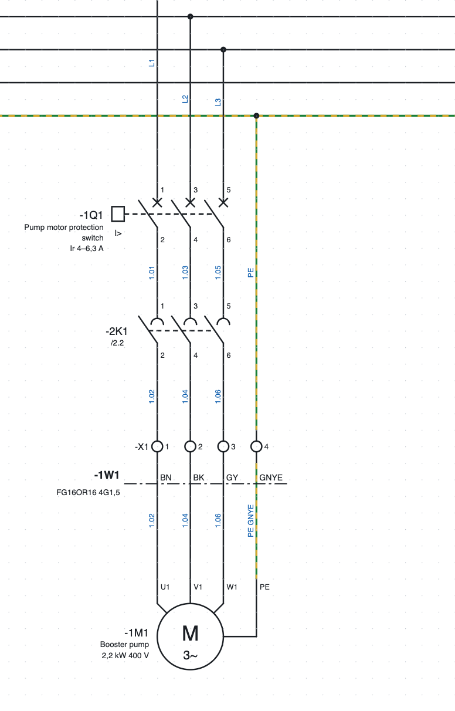
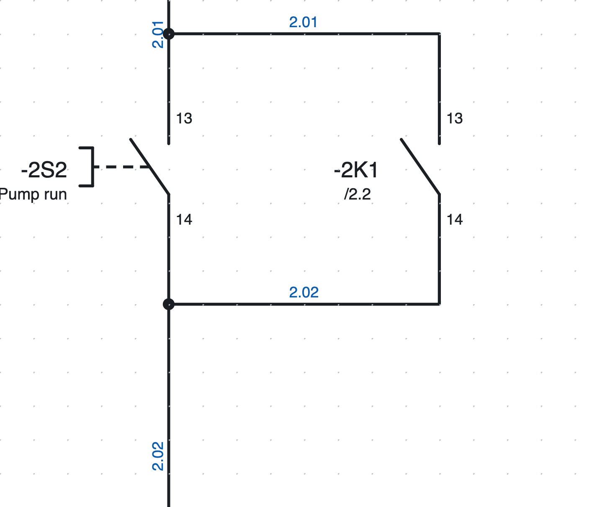
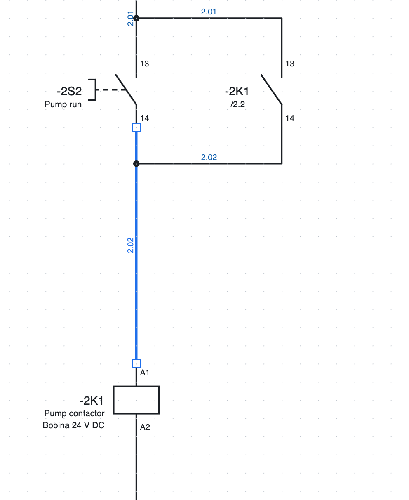
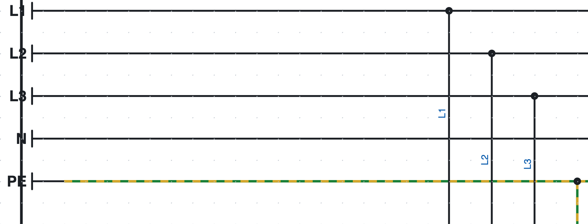
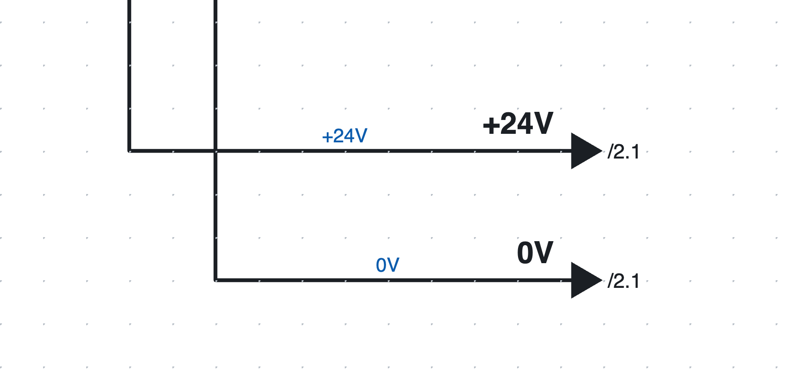

# 5. Dibujar el esquema

## Insertar símbolos

1. En la biblioteca de la derecha (pestaña *Símbolos*) haz clic en un símbolo. El campo *Buscar…* filtra por
   nombre («contacto», «motor»…).
2. Haz clic en la página: el símbolo se inserta ajustado a la rejilla y **sigue activo**, para insertar más
   iguales.
3. **R** gira el símbolo 90° antes de insertarlo.
4. **Esc** o el clic derecho terminan la inserción.

Cada símbolo nuevo recibe una **sigla** libre según el modelo del proyecto (por ejemplo `-2K3`, consulta el
[capítulo 6](06-sigle-e-numerazione.md)). Para un **contacto auxiliar** recién insertado se abre una lista de los dispositivos con los que emparejarlo:
bobinas y aparatos del proyecto, primero los que tienen la misma letra, cada uno con descripción, posición y número
de contactos. La lista se filtra mientras escribes; también puedes escribir una sigla nueva. El programa vuelve a
proponer el último elegido.

### Los símbolos incluidos

| Categoría | Símbolos |
|---|---|
| Bobinas y contactos | bobina de relé/contactor, bobina temporizada, contacto NA, contacto NC, contacto conmutado, contactos de potencia 3P |
| Mandos | pulsador NA, pulsador NC, pulsador de emergencia tipo seta, selector, final de carrera, sensor de proximidad PNP de 3 hilos |
| Protecciones | fusible, interruptores magnetotérmicos 1P, 2P y 3P, guardamotor 3P, relé térmico 3P |
| Receptores | motor trifásico y monofásico, piloto de señalización, electroválvula, fuente de alimentación 230 V CA / 24 V CC, transformador |
| Bornes y conexiones | borne, borne PE, borne seccionable, borne portafusible, pin de base, de clavija y par base+clavija, punto de potencial, tierra de protección PE, puntos de interrupción de salida y de llegada |
| PLC | entrada y salida digital, entrada y salida analógica, alimentación de tarjeta L+/M |
| Redes y buses | nodo de 2 puertos (IN/OUT o P1/P2), nodo de 1 puerto, switch de 5 puertos, terminación |
| Unifilar | interruptor, guardamotor, seccionador, fusible, contactor, motor, transformador, variador, fuente de alimentación, carga |

Otros símbolos se dibujan con el editor o se importan de QElectroTech y de los archivos EDZ de los
fabricantes ([capítulo 13](13-macro-simboli-cartigli.md) y [capítulo 7](07-dispositivi-e-articoli.md)).

*La salida de motor de la página 1: guardamotor `-1Q1`, contactos de potencia del contactor `-2K1`, regleta
`-X1`, cable `-1W1` y motor `-1M1`.*

## Dibujar los hilos

1. Pulsa **W** o *Hilo*.
2. Haz clic en el punto de inicio: un punto de conexión, un hilo existente o un punto libre.
3. Haz clic en cada esquina. El tramo es siempre horizontal o vertical; antes del clic la vista previa
   muestra el recorrido en L.
4. El hilo **termina solo** cuando haces clic en un punto de conexión o en otro hilo. Si no, termínalo con
   doble clic, Intro o clic derecho.
5. **Esc** cancela el hilo en curso.

Los puntos de conexión libres se resaltan en verde mientras se dibuja. Al llegar a un hilo un poco de lado,
el tramo sigue recto hasta el hilo.

### Uniones y cruces

*Las uniones de la autorretención de la página 2: el punto indica la conexión.*

- Un hilo que termina sobre otro hilo forma una **unión en T**, dibujada con un punto.
- Dos hilos que se **cruzan** sin punto no están conectados.
- El punto no se dibuja a mano: lo pone el programa donde los hilos están realmente conectados.

### Modificar los hilos

*Un hilo seleccionado muestra sus vértices como cuadraditos.*

- **Arrastra un tramo** para moverlo en paralelo: los extremos siguen conectados.
- **Arrastra un vértice o un extremo** para alargar, acortar o volver a conectar el hilo.
- El cursor cambia de forma para indicar qué estás arrastrando.
- Para eliminar un hilo selecciónalo y pulsa **Supr**.

### Mover los símbolos con los hilos

Al arrastrar un símbolo, los hilos conectados lo siguen durante el movimiento y siguen siendo ortogonales,
doblándose en Z si hace falta. Un hilo entre dos símbolos movidos a la vez se mueve entero.

### Insertar un contacto sobre un hilo

Si insertas (o mueves) un contacto, un pulsador u otro componente **sobre un hilo**, el hilo se interrumpe en
sus dos puntos de conexión: no hace falta cortarlo a mano. Los dos tramos conservan color y sección.

## Puntos de potencial

*Las barras L1, L2, L3, N y PE de la página 1.*

El **punto de potencial** da nombre a un conductor: `L1`, `L2`, `L3`, `N`, `PE`, `+24V`, `0V`…

- Todos los conductores con el mismo nombre están **conectados**, también en páginas distintas.
- El nombre se escribe en las propiedades (*Nombre*); un punto nuevo se llama `L1`, la tierra **PE** se llama `PE`.
- Los conductores de un potencial pueden mostrar el nombre en lugar del número de hilo
  (*Propiedades del proyecto ▸ Números de hilo ▸ Potenciales*).
- La verificación señala dos potenciales distintos en el mismo conductor (por ejemplo `L1` conectado a `N`).

## Puntos de interrupción entre páginas

*Los puntos de interrupción `+24V` y `0V` de la página 1: el nombre sobre el hilo, las páginas de llegada
junto a la flecha.*

Cuando un conductor continúa en otra página se usa una pareja de **puntos de interrupción**. Cada salida
está unida a **una sola** llegada, aunque el nombre se repita (por ejemplo es el número del hilo):

1. Al final del hilo inserta un **Punto de interrupción (salida)**. Su nombre es el número del hilo, si lo
   hay, si no `R1`, `R2`…, y se cambia en *Propiedades*.
2. En la otra página, al principio del hilo, inserta un **Punto de interrupción (llegada)**: aparece la
   lista de salidas aún libres, primero las que tienen el mismo nombre. Elige una: la llegada toma su nombre
   y las dos quedan unidas. La primera opción (*ninguna salida*) la deja libre, cuando la salida aún no está
   dibujada. Igual al revés: al insertar una salida eliges entre las llegadas libres.
   La lista se **filtra mientras escribes**: cada opción muestra nombre, posición y página del punto.
3. En el campo *Nombre* de las *Propiedades* las sugerencias son los puntos libres y los demás nombres de
   punto de interrupción; al elegir un punto libre, los dos quedan unidos. La unión se cambia en *Propiedades ▸ Conectado a*. Al renombrar un punto se renombra también su
   correspondiente.
4. Junto a cada flecha aparece la página donde continúa el conductor (`/2.1`). Un clic lleva a la página.
   En los hilos verticales el nombre y la página se escriben en vertical, de abajo arriba.

### Remisiones en espera, sin correspondiente y en estrella

Al insertar una remisión, el programa toma el nombre del número del hilo y busca las remisiones libres:

- si hay **una sola** remisión libre con el mismo nombre, las dos se conectan enseguida (un mensaje en la
  vista de informes lo indica);
- si hay varias, se abre la lista con la primera ya elegida: *Intro* la confirma;
- si no hay ninguna, la remisión queda **en espera**: junto a la flecha aparece `/…` en naranja hasta que
  dibujes la correspondiente.

En *Propiedades ▸ Conectado a* se elige la correspondiente, se vuelve a poner la remisión *— en espera del
correspondiente (/…)* o se elige *— ningún correspondiente (el conductor termina aquí)* cuando el conductor
termina realmente ahí: entonces aparece `//` junto a la flecha y la verificación ya no lo señala como error,
solo como información.

En la barra de estado, **Remisiones en espera: N** cuenta las remisiones aún por emparejar; cada clic lleva
a la siguiente. La verificación las lista como avisos.

**Salida en estrella.** Una salida con *Propiedades ▸ En estrella* se conecta a **todas** las llegadas
libres con el mismo nombre (por ejemplo un `+24V` que va a muchas páginas) y muestra la lista de sus
páginas. La verificación propone la estrella (con el botón 🔧) cuando una salida ya está conectada y hay
otras llegadas con su nombre.

## Bus de conductores

Cuando muchos hilos corren en paralelo (por ejemplo las tres fases y el neutro que alimentan varios receptores) se
pueden agrupar en un **bus de conductores**, sin dibujar todas las líneas hasta el final.

1. Elige la herramienta **Bus hilos** en la barra de herramientas (o *Insertar ▸ Bus de conductores*) y traza la
   línea del bus: es una línea gruesa. En las *Propiedades* dale un **nombre** (opcional, por ejemplo
   `400V AC` o `24V DC`).
2. Dibuja los hilos que llegan al bus y las derivaciones que salen de él, de modo que toquen la línea.
3. En cada hilo que toca el bus aparece el **nombre del conductor** (`L1`, `L2`, `PE`…), escrito junto al hilo.
   Se elige de una lista que se filtra mientras escribes.

Las reglas son sencillas:

- los hilos con el **mismo conductor en el mismo bus** son el mismo hilo y tienen el mismo número de hilo;
- los buses que se tocan, o con el mismo nombre en varias páginas, son **un solo bus**: los conductores continúan;
- la verificación ([capítulo 15](15-verifica-ricerca-revisioni.md)) señala los hilos que tocan el bus sin el nombre
  del conductor y los conductores que entran en el bus sin salir por ningún sitio.

En el formato de texto ([capítulo 17](17-assistente-ia.md)) la línea del bus es un hilo con `busfili=nombre` (`busfili=_`
si no tiene nombre) y el conductor en los dos extremos de un hilo se escribe con `cond1=` y `cond2=`.

### Bus hilos usado como cable

Un cable que pasa de un cuadro a otro se puede dibujar como bus hilos: los hilos entran en el bus en la
página de salida y salen de un bus con el mismo nombre en la página de llegada.

1. Da al bus **la sigla del cable** (`W1112S1`). Si el cable aún no está en el proyecto, después del nombre
   se elige el **artículo del cable** (también después, en *Propiedades ▸ Artículo del cable*).
2. Para cada hilo el programa propone los **conductores del cable en orden** (colores o números): los ya
   usados aparecen atenuados, los que entraron en otro lugar y esperan su salida se destacan y se proponen
   primero, los demás están libres.
3. Con **Nombrar los conductores en orden** (*Propiedades* del bus) los hilos de la página reciben su
   conductor de izquierda a derecha: en la salida los primeros libres, en la llegada los que esperan salir.
4. Dibuja la línea del cable sobre los hilos, en las dos páginas: en la vista *Cables* cada hilo toma el
   conductor escrito en el bus. La línea gruesa del bus no cuenta como conductor.

Un **doble clic en el bus** abre sus propiedades: los conductores del cable con su estado (usados
atenuados, a la espera de la salida con ⚠, libres con la barra verde) y la tabla de los hilos del bus,
donde el conductor de cada hilo se corrige escribiéndolo o eligiéndolo de la lista.

La vista **Bus hilos** (*Ver ▸ Bus hilos*, o *Listas ▸ Bus hilos*) muestra todos los buses y, para el
elegido, cada hilo que entra o sale con página, número de hilo y conexiones; el conductor se corrige
directamente en la tabla. Se marcan los hilos sin conductor, los que entran sin salir y los conductores
que el cable no tiene. La lista imprimible **Conexiones de bus hilos** tiene un conductor por fila (como
las conexiones de cables), con los conductores libres del cable.

Un bus con el artículo de un cable (conductores numerados o de colores) tiene también su página de
**cableado**, como los cables: *Listas ▸ Dibujos de los cables (cableado)* crea la página «Cablaggio bus
fili …» con los dos extremos, los conductores y la tabla con los libres. Un bus sin artículo queda solo
en la lista *Conexiones de bus hilos*.

## Textos

*Texto* (o *Insertar ▸ Texto*) y un clic en la página insertan un texto libre. En *Propiedades* se cambian el
texto y su altura en mm. Los textos pasan al diccionario de traducciones ([capítulo 16](16-lingue.md)).

## Imágenes

Fotos, logotipos o dibujos se insertan en el esquema como imágenes.

- *Insertar ▸ Imagen…* y elige un archivo PNG, JPG, SVG, GIF, WebP o BMP; o **pega** una imagen desde el
  portapapeles con ⌘V (Ctrl+V).
- La imagen se **mueve** arrastrándola y se **redimensiona** arrastrando la esquina inferior derecha: las
  proporciones quedan fijas; con **Mayús** pulsada son libres.
- En las *Propiedades* se cambian posición y medidas, se restauran las proporciones originales, se activa el
  marco, se elige si la imagen está **debajo** o **encima** del esquema y se cambia con *Sustituir imagen…*.
- Las imágenes salen en el **PDF**. En el DXF solo queda un recuadro con el nombre de la imagen.
- Las imágenes muy grandes se reducen (a 1600 puntos en el lado largo) para que el archivo sea ligero.

## Seleccionar, copiar, mover

| Acción | Cómo |
|---|---|
| Seleccionar | clic en el elemento |
| Añadir o quitar de la selección | **Mayús** + clic |
| Selección con recuadro | arrastra en una zona vacía: **de izquierda a derecha** toma los elementos contenidos, **de derecha a izquierda** también los tocados |
| Seleccionar todo | ⌘A |
| Mover | arrastrar, o flechas (4 mm; con Mayús 16 mm) |
| Girar, reflejar | **R**, *Editar ▸ Reflejar* |
| Duplicar | ⌘D |
| Copiar, cortar, pegar | ⌘C, ⌘X, ⌘V; *Pegar aquí* del clic derecho pega en el punto pulsado |
| Eliminar | **Supr** o Retroceso |

Las copias reciben **siglas y números de hilo nuevos**; bobina y contactos copiados juntos siguen conectados.
También se puede pegar en otro proyecto: los símbolos y artículos usados se copian con los elementos.

Con **cortar y pegar** los elementos se **mueven**: en otra página conservan referencias, números de borne,
números de hilo y la conexión de las remisiones. Con **copiar y pegar** cada borne copiado propone el
primer número libre de la regleta, empezando por el más bajo y con el mismo piso (A, B…), y se elige el
número; los hilos copiados toman un número nuevo.

Un circuito que se usa a menudo se guarda como **macro** ([capítulo 13](13-macro-simboli-cartigli.md#macros)).

## Textos de los símbolos siempre legibles

Al girar o reflejar un símbolo, sus textos internos (por ejemplo «M 3~» del motor) nunca quedan al revés ni
reflejados: se leen siempre desde abajo o desde la derecha, como pide la norma. Vale en pantalla, en el PDF
y en el DXF.
