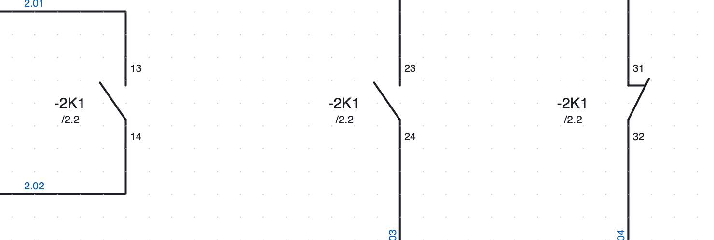
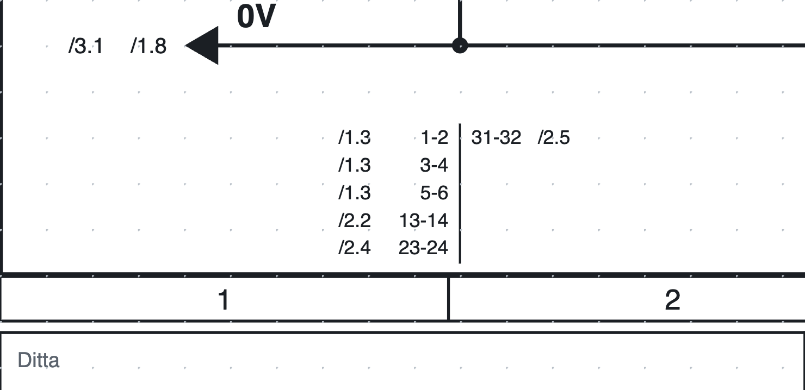
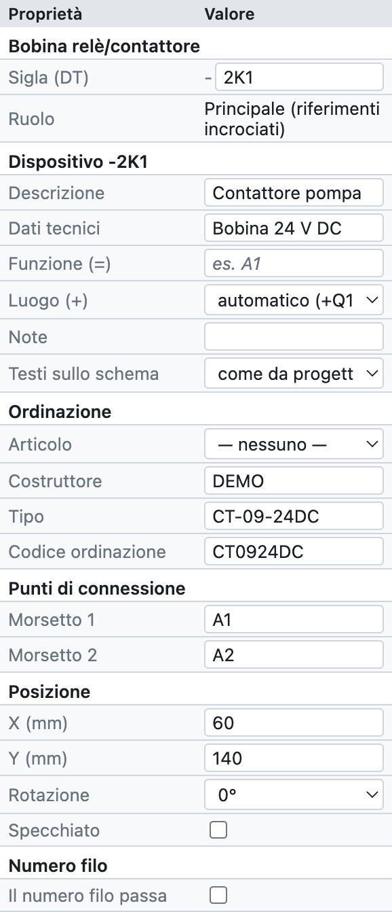
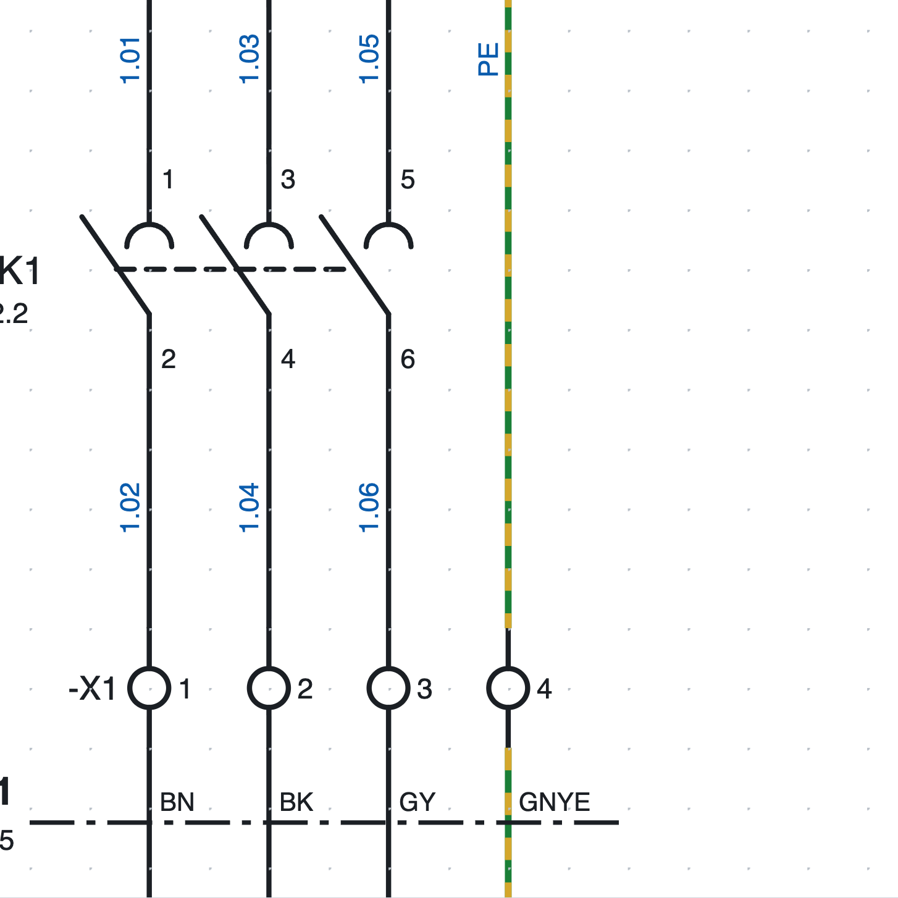
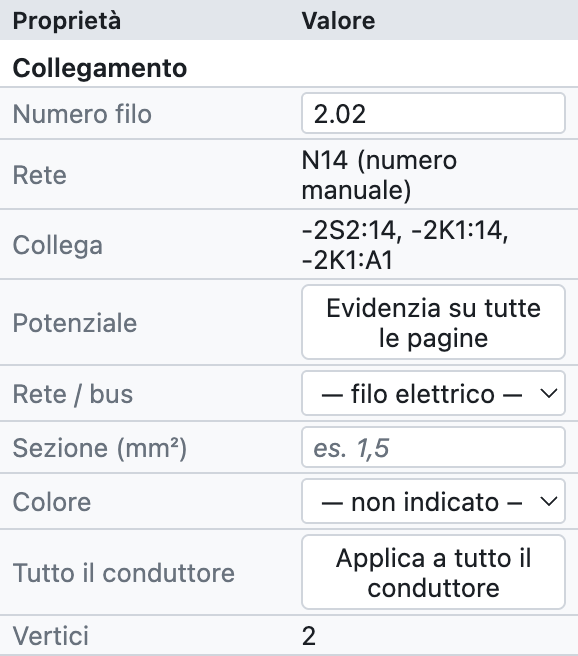
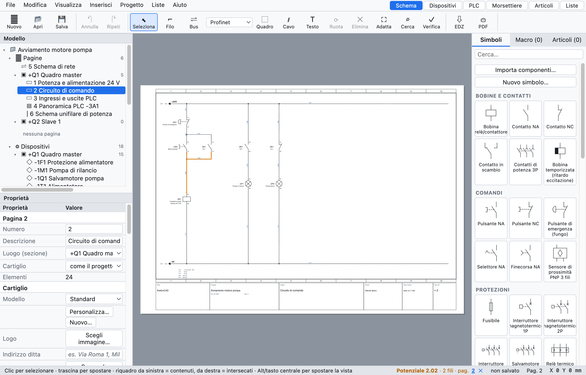

# 6. Siglas, referencias cruzadas y números de hilo

## Siglas de los dispositivos

Cada dispositivo tiene una **sigla** según la IEC 81346: un guion, el número de la página, la **letra** del
tipo de dispositivo y un número correlativo. `-2K1` es el primer contactor de la página 2.

| Letra | Dispositivos |
|---|---|
| K | relés, contactores, bobinas temporizadas |
| Q | interruptores tripolares, guardamotores, seccionadores |
| F | fusibles, interruptores 1P y 2P, relés térmicos |
| S | pulsadores, paradas de emergencia, selectores |
| B | sensores, finales de carrera |
| P | pilotos de señalización |
| M | motores, electroválvulas |
| T | transformadores, fuentes de alimentación |
| A | PLC, tarjetas, nodos de red, aparatos complejos |
| U | variadores |
| E | cargas genéricas (unifilar) |
| X | regletas y conectores |
| W | cables |

La letra depende del símbolo; la sigla se puede cambiar siempre a mano en las propiedades.

### El modelo de la sigla

En *Propiedades del proyecto ▸ Siglas de dispositivos* se elige cómo se forma la sigla:

| Marcador | Significado | Ejemplo |
|---|---|---|
| `{pagina}` | número de la página | `200` |
| `{colonna}` | columna (1–10) del dispositivo | `4` |
| `{lettera}` | letra IEC 81346 | `K` |
| `{n}` | número correlativo | `1` |
| `{n:2}` | número correlativo de dos cifras | `01` |

| Modelo | Resultado en la página 200 |
|---|---|
| `{pagina}{lettera}{n}` (predeterminado) | `-200K1` |
| `{lettera}{n}` | `-K1` |
| `{pagina}{lettera}{n:2}` | `-200K01` |
| `{pagina}.{colonna}{lettera}` | `-200.4K` |

- **Contador**: reinicia en cada página o es único en todo el proyecto.
- **Siglas estables**: un dispositivo nuevo toma el número siguiente al más alto de la página (`-2K3` tras
  `-2K2`) y los demás no cambian.
- **Renumerar dispositivos** (*Proyecto ▸ Renumerar dispositivos…*) renumera todo por orden de página,
  columna y fila. Los contactos siguen a su bobina; los bornes tienen su propia numeración.

### Sigla completa: función y ubicación

Con la **función** (`=`, la instalación o la parte de máquina) y la **ubicación** (`+`, el cuadro o la
botonera) rellenadas, la sigla queda completa: `=A1+Q1-2K1`. Se rellenan en las propiedades del dispositivo
o, para muchos dispositivos a la vez, en el navegador ([capítulo 7](07-dispositivi-e-articoli.md)).

## Bobinas y contactos

El **dispositivo principal** (la bobina de un relé o de un contactor) y sus **contactos** tienen la misma
sigla. El programa los vincula solo:

1. Inserta la bobina: recibe por ejemplo `-2K1`.
2. Inserta los contactos: toman la sigla de la última bobina insertada.
3. Para asignar un contacto a otra bobina, escribe la sigla en las propiedades del contacto: la lista
   propone las siglas existentes con la misma letra.

### Numeración de los contactos (EN 50005)

Los contactos auxiliares se numeran solos con la cifra de orden y la cifra de función: el primer NA es
`13-14`, el segundo `23-24`, el primer NC `31-32` y así sucesivamente. Se puede desactivar para un contacto y
escribir los bornes a mano (*Propiedades ▸ Puntos de conexión*). Los contactos de potencia son `1-2`, `3-4`, `5-6`.

### Referencias cruzadas

*Debajo de cada contacto `-2K1` está `/2.2`: la bobina está en la página 2, columna 2.*

*La imagen de contactos de `-2K1` al pie de la página 2: a la izquierda de la línea los contactos de
potencia y NA, a la derecha los NC, cada uno con su posición.*

- Debajo de cada **contacto** aparece la posición de la bobina (`/2.2`).
- Debajo de la **bobina** aparece la **imagen de contactos**: todos sus contactos con los bornes y la
  posición. Está **al pie de la página**, bajo la barra inferior, en la vertical de la bobina;
  o bien bajo el símbolo (*Propiedades del proyecto ▸ Siglas de dispositivos ▸ Contactos de las bobinas*).
- Cada referencia es **un enlace**: lleva a la página y selecciona el elemento. En el PDF se convierte en enlace.
- El clic derecho en una bobina ofrece *Ir al contacto…*, en un contacto *Ir al elemento principal*.

La verificación señala los contactos sin bobina y más contactos que los del artículo (por ejemplo un quinto
contacto en un contactor con 4 auxiliares).

### Referencias por pares

Un contacto también se puede **mostrar en otra página** sin duplicarlo, por ejemplo un contacto auxiliar del
interruptor en la página de vista general: clic derecho en el contacto ▸ *Dibujar una representación
(referencia por pares)…* y luego un clic donde se debe dibujar.

- La representación es **solo dibujo**: no cuenta como contacto, no se conecta a los hilos y no entra en las
  listas ni en la lista de materiales. Identificador y bornes siguen siempre al contacto real.
- El contacto real y la representación se remiten el uno al otro con referencias cruzadas, en las dos
  direcciones.
- *Propiedades ▸ Representación de* indica el contacto real (un clic lleva a él); *Convertir en contacto
  real* la transforma en un contacto con sus propias conexiones.
- Si se elimina el contacto real, la verificación señala la representación que ha quedado sola y propone
  borrarla.

## Propiedades de un dispositivo

*Las propiedades de la bobina `-2K1` del proyecto de ejemplo.*

| Grupo | Campos |
|---|---|
| *(nombre del símbolo)* | sigla, función (principal, contacto, dispositivo, borne…) |
| *Dispositivo* | descripción, datos técnicos, función (=), ubicación (+), notas, textos en el esquema |
| *Pedido* | artículo, fabricante, tipo, código de pedido |
| *Puntos de conexión* | el nombre de cada borne (A1, A2, 13, 14…) |
| *Posición* | X e Y en mm, rotación, reflejado |
| *Número de hilo* | si el número de hilo pasa a través del elemento |

Los datos de los grupos *Dispositivo* y *Pedido* valen para **todo el dispositivo**: escritos en la bobina,
valen también para los contactos. Si hay un artículo asignado, los campos vacíos muestran sus datos en gris.

## Números de hilo

*Números de hilo de la página 1: `1.01`, `1.03`… encima del contactor, los mismos números debajo, porque los
bornes `-X1` no cambian el número.*

Cada **conductor** (todos los hilos conectados entre sí hasta los puntos de conexión de los componentes)
tiene un número, escrito en cada uno de sus tramos. El modelo predeterminado es `{pagina}.{n:2}`: `200.01`,
`200.02`…

### Numeración bloqueada o recalculada

En *Propiedades del proyecto ▸ Números de hilo ▸ Numeración*:

- **bloqueada** (predeterminada): un conductor numerado conserva su número; un conductor nuevo toma el
  primer número libre de la página, aunque lo dibujes en medio; al unir dos conductores numerados queda un
  solo número, al dividir uno la parte nueva recibe un número nuevo. *Renumerar hilos* recalcula todo por
  orden de columna.
- **recalculada**: los números se recalculan en cada cambio, siempre en orden.

### Número manual

Selecciona un hilo y escribe el número en *Propiedades ▸ Número de hilo*: vale para todo el conductor.
Borrándolo se vuelve al número automático.

### Dónde se escribe

El número se escribe en un **punto libre** del hilo: si en medio del tramo hay un cruce, un componente, una
sigla u otro número, se desplaza a lo largo del hilo o al otro lado. Vale en pantalla, en el PDF y en el DXF.
*Mostrar* (propiedades del proyecto) los oculta del todo.

### Mover o repetir el número

El número se **arrastra** donde se quiera, incluso lejos del hilo: desde entonces se queda ahí y sigue al
hilo cuando lo mueves. Con el botón derecho sobre el hilo:

- **Añadir el número de hilo aquí**: otro número en el mismo hilo, junto al tramo pulsado;
- **Quitar este número de hilo** (pulsando sobre un número, cuando hay más de uno);
- **Número de hilo en posición automática**: vuelve a la posición elegida por el programa.

### El número atraviesa los bornes

Un borne es solo un punto de paso: los hilos de sus dos lados tienen **el mismo número**. Cada elemento con
dos o más puntos de conexión tiene en *Propiedades ▸ Número de hilo* la casilla **El número de hilo pasa**:

- marcada por defecto en los bornes, desmarcada en los demás componentes;
- se puede cambiar en un solo elemento, por ejemplo para que el número pase a través de un seccionador.

Los dos lados siguen siendo conductores distintos para la lista de bornes y la lista de conexiones.

### Contador avanzado

En *Propiedades del proyecto ▸ Números de hilo*:

- **Modelo**: además de `{pagina}` (página), `{colonna}` (columna) y `{n}` se pueden usar `{quadro}`
  (código del cuadro de la página), `{n:2}` (al menos 2 cifras: `01`) y `{n:A}` o `{n:a}` (contador en
  letras: `A`, `B`… `Z`, `AA`). Ejemplo: `{quadro}.{n:A}` da `Q1.A`, `Q1.B`… Los identificadores de los
  dispositivos también aceptan `{quadro}`.
- **Contador**: vuelve a empezar en cada página, vuelve a empezar en cada cuadro o único en el proyecto.
- **Reserva por página**: números que quedan libres después de cada página. Con una reserva de 3, la página
  1 usa 1 y 2 y la página 2 empieza en 6: un hilo añadido después a la página 1 toma el 3 y las páginas
  siguientes conservan sus números. Cuando se acaba la reserva, el contador salta los números ya usados por
  las páginas siguientes.
- **Orden en la página**: por columnas (de izquierda a derecha) o por filas (de arriba abajo).

Los números escritos a mano, los de las remisiones y los nombres de los canales del PLC son fijos: el
contador los salta aunque estén escritos en otra página.

## Sección y color de los hilos

*Las propiedades de un hilo: número, red, conexiones, potencial, sección y color.*

- **Sección** en mm² (`1,5`, `2,5`, `6`…) y **color** con los códigos IEC 60757: `BK` negro, `BN` marrón,
  `GY` gris, `BU` azul, `DBU` azul oscuro, `RD` rojo, `WH` blanco, `GNYE` verde-amarillo…
- El **color** elegido en un tramo vale para todo el conductor, también después de un punto de interrupción
  o de un borne.
- Con *Hilos de colores* (propiedades del proyecto) el hilo se dibuja en su color; el PE en verde-amarillo
  discontinuo.
- La sección puede cambiar a lo largo del conductor (salida de 6 mm², derivación de 1,5 mm²);
  *Aplicar a todo el conductor* copia sección y color en todos los tramos.
- Con *Sección y color* activado, se escriben junto al número (`200.01  1,5 mm² BU`).

## Resaltar un potencial

Para seguir un conductor por todo el proyecto: selecciona un hilo y pulsa **Resaltar en todas las páginas**
en las propiedades (o clic derecho ▸ *Resaltar potencial*).

*El conductor `2.02` resaltado en naranja; la barra de estado de abajo enumera las páginas en las que aparece.*

- Todos los conductores conectados se colorean en **naranja**, también más allá de puntos de interrupción,
  potenciales y bornes.
- La barra de estado muestra el nombre, el número de hilos y las **páginas**, con enlace.
- ✕ en la barra de estado, o *Quitar el resaltado*, lo apaga.
