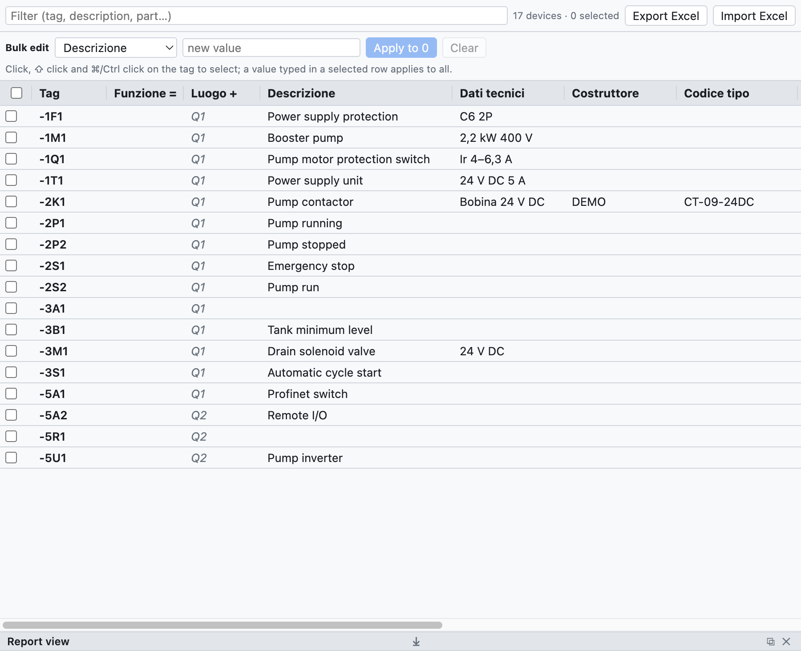
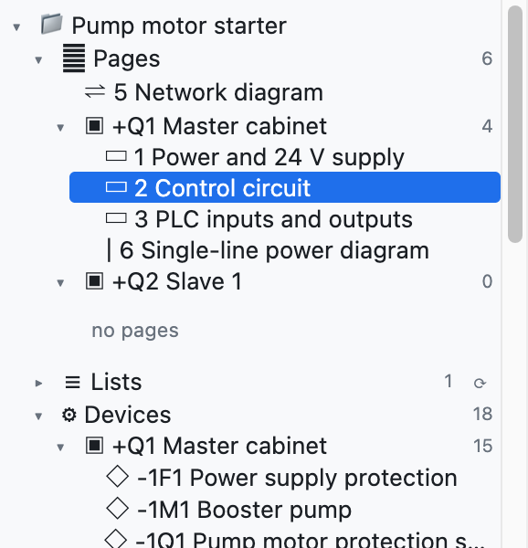
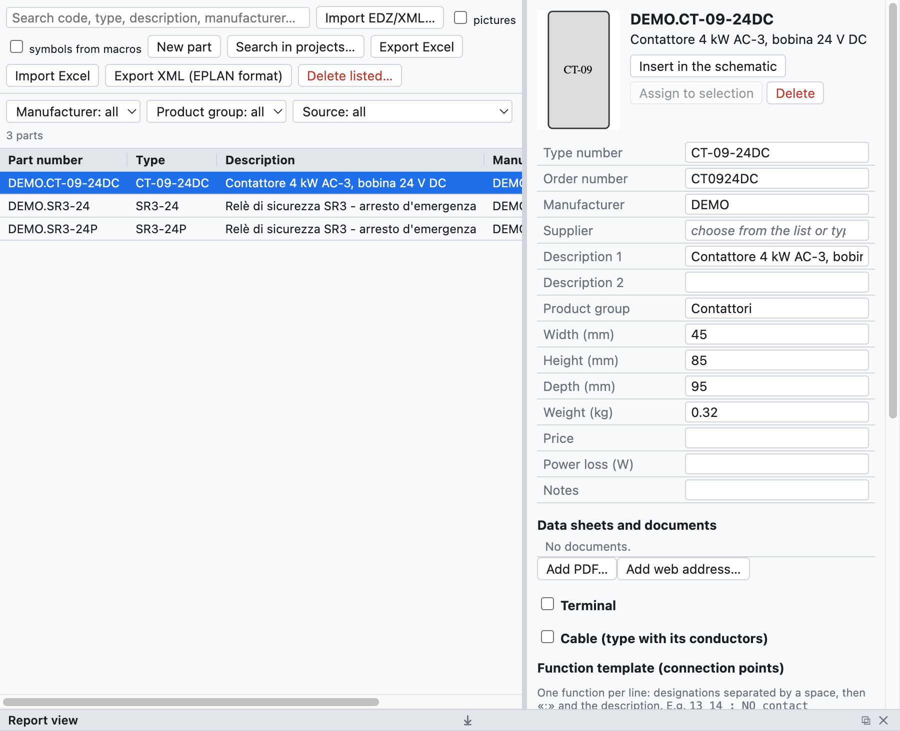

# 7. Dispositivos y artículos

Un **dispositivo** es un componente real con una sigla: el contactor `-2K1` es un dispositivo, aunque en el
esquema aparezca como bobina, tres contactos de potencia y dos auxiliares en páginas distintas. Un
**artículo** es el producto del catálogo de un fabricante (código, descripción, medidas, bornes) que se
asigna a los dispositivos.

## Datos del dispositivo

| Campo | Ejemplo | Dónde aparece |
|---|---|---|
| Descripción | `Contattore pompa` | esquema (debajo de la sigla), listas, etiquetas |
| Datos técnicos | `Bobina 24 V DC`, `2,2 kW 400 V` | esquema, listas |
| Fabricante | `Schneider Electric` | lista de materiales, lista de compra |
| Tipo | `LC1D09BD` | lista de materiales |
| Código de pedido | `LC1D09BD` | lista de materiales, lista de compra |
| Notas | texto libre | lista de dispositivos |
| Función (=) | `A1` | sigla completa `=A1+Q1-2K1` |
| Ubicación (+) | `Q1` | sigla completa, agrupaciones, disposición |
| Artículo | `DEMO.CT-09-24DC` | rellena los campos vacíos con los datos del catálogo |

Los datos pertenecen al dispositivo: se escriben en cualquier elemento (bobina o contacto) y valen para
todos. Los valores escritos a mano prevalecen sobre los del artículo.

**Artículos adicionales**: un dispositivo puede tener varios artículos (por ejemplo un contactor y su bloque de
contactos auxiliares). En el navegador la columna *Artículos adicionales* se escribe como texto, con el código y
la cantidad después de ×: `LADN22 ×2; LA4DA2U`. También se edita en bloque y en Excel.

**Descripciones en el esquema**: con *Propiedades del proyecto ▸ Dibujo ▸ Descripciones en el esquema*
activado, la descripción y los datos técnicos aparecen debajo de la sigla del elemento principal. El campo
*Textos en el esquema* del dispositivo los fuerza o los oculta solo para ese dispositivo.

## Navegador de dispositivos

La pestaña **Dispositivos** (arriba a la derecha) muestra todos los dispositivos del proyecto en una tabla
que se edita como una hoja de cálculo.

*El navegador con los 17 dispositivos del proyecto de ejemplo. Los valores en gris cursiva vienen del
artículo o de la ubicación de la página.*

- **Modificar un valor**: haz clic en la celda, escribe y pulsa Intro.
- **Renombrar**: cambia la sigla en la primera columna; cambian también los contactos y las demás
  representaciones. Si la sigla ya está en uso, el programa lo indica y no cambia nada.
- **Filtrar**: el campo de arriba busca en sigla, descripción, artículo y los demás campos.
- **Seleccionar varias filas**: clic en la sigla, ⇧ clic para un intervalo, ⌘/Ctrl clic para añadir, o las
  casillas de la izquierda.
- **Ir al dispositivo**: clic en la posición `/2.2` de la última columna.

### Edición en bloque

Para dar el mismo valor a muchos dispositivos:

1. Selecciona las filas (por ejemplo todos los dispositivos del cuadro `+Q2`, filtrando por `Q2`).
2. En la fila *Edición en bloque* elige el campo (*Función =*, *Fabricante*…) y escribe el valor.
3. Pulsa **Aplicar a N**. *Vaciar* borra ese campo en todos los seleccionados.

También puedes escribir el valor directamente en una celda de una fila seleccionada: vale para todas las
filas seleccionadas. Todo el cambio se deshace con un solo ⌘Z.

### Excel

- **Exportar Excel** guarda la tabla de dispositivos (sigla, campos, posición).
- Rellénala en Excel, incluso otra persona, y usa **Importar Excel**: los dispositivos se reconocen por la
  columna *Sigla* y solo se actualizan los campos cambiados. Las siglas que no existen en el proyecto se
  indican en la vista de informe.

### Copiar las propiedades

El clic derecho sobre un dispositivo ofrece **Copiar propiedades**: copia todos los datos del dispositivo
(descripción, datos técnicos, fabricante, tipo, códigos, artículo, artículos adicionales, notas, función,
ubicación, propiedades definidas por el usuario) salvo la sigla. Sobre otro dispositivo, o sobre una selección de
varios, el clic derecho ofrece **Pegar propiedades de -X**: los datos copiados sustituyen a los del dispositivo.

Sirve también para **sustituir un símbolo** por otro: copia las propiedades del antiguo, inserta el símbolo nuevo,
pega las propiedades y borra el antiguo.

## Estructura =Instalación +Ubicación

En el árbol, el nodo **Estructura =Instalación +Ubicación** agrupa los dispositivos primero por **función**
(`=A1`, `=A2`…) y después por **ubicación** (`+Q1`, `+P1`…), como prevé la IEC 81346. Los dispositivos sin
función o sin ubicación quedan al final, en *sin función (=)* y *sin ubicación (+)*. Un clic en un
dispositivo lo abre en el esquema.

*En el proyecto de ejemplo los dispositivos no tienen función: están todos en «sin función», repartidos
entre los cuadros `+Q1` y `+Q2`.*

La ubicación de un dispositivo es la escrita en sus propiedades; si falta, la del recuadro en el que está
dibujado en el esquema de red, o la de su página.

## Artículos

La pestaña **Artículos** es la biblioteca personal de artículos, guardada en el ordenador y disponible en
todos los proyectos.

*Un contactor importado de un EDZ: datos, imagen, modelo de función y símbolo.*

### Importar los datos de los fabricantes (EDZ)

1. Descarga el archivo **EDZ** del Eplan Data Portal o de la web del fabricante (Schneider, Siemens,
   Phoenix Contact…). El EDZ es un archivo comprimido con los datos del artículo en el formato del Eplan Data Portal.
2. *Archivo ▸ Importar ▸ Artículos EDZ / XML / CSV…* (o el botón *EDZ*) y elige uno o varios archivos.
3. Los artículos entran en la biblioteca con código, tipo, código de pedido, fabricante, descripciones (en
   italiano si las hay, si no en inglés o alemán), dimensiones, peso, imagen y **modelo de función** (los
   bornes).

Si el EDZ contiene el dibujo del fabricante en una macro en formato EPLAN legible, ese dibujo se convierte en el
símbolo del artículo (categoría *Macro EPLAN / costruttore* en la biblioteca). Si no, el artículo se dibuja
como **caja negra** automática: entradas arriba, salidas abajo, contactos y polos dibujados dentro.

También se importan los archivos **XML** en formato EPLAN; *Exportar XML (formato EPLAN)* escribe los artículos
en un archivo del mismo formato.

Los archivos **CSV de datos comerciales** (`commercial_data.csv` del Eplan Data Portal) se importan con el mismo
comando, también varios a la vez: de cada artículo traen fabricante, tipo, código de pedido, grupo, descripciones y
descripción larga. Los artículos ya importados desde EDZ se completan sin perder símbolo ni bornes. Los enlaces a
fichas técnicas e instrucciones aparecen en la ficha del artículo, en la sección **Documentos**.

### La ficha del artículo

Al seleccionar un artículo se ven y se modifican:

- los datos principales (código, tipo, pedido, fabricante, proveedor, descripciones, grupo, medidas, peso,
  precio, notas);
- el **modelo de función**: una línea por función, con los bornes separados por espacios y la descripción
  después de `;` (por ejemplo `13 14 ; Contatto NA`);
- el **símbolo en el esquema**: uno de los símbolos básicos, un componente importado o el dibujo del
  fabricante.

### Usar los artículos

- **Insertar en el esquema**: inserta el símbolo del artículo, ya asignado.
- **Asignar a la selección**: selecciona un dispositivo en el esquema y asígnale el artículo. También puedes
  elegir el artículo en el campo *Artículo* de las propiedades del dispositivo.
- Los artículos usados se copian en el proyecto (*Artículos del proyecto* en el árbol), así el archivo
  `.ecad` queda completo también en otro ordenador.

### La base de datos de artículos

La biblioteca personal es una base de datos que pasa de una instalación a otra: los datos escritos una vez no se
vuelven a introducir.

- En el campo **Artículo** (en las *Propiedades*, en el navegador *Dispositivos* y en la pestaña *Conectores*) se
  escribe o se elige un código. Si el código es **nuevo**, se convierte en un artículo de la biblioteca, con
  fabricante, tipo, código de pedido y datos técnicos del dispositivo. La próxima vez que se use el código, los
  datos se rellenan solos.
- Si el artículo ya existe y los datos del dispositivo son distintos, **Guardar estos datos en el artículo** los
  escribe en el artículo existente.
- Descripción y fabricante de los artículos adicionales van también a la biblioteca.

### Nuevo artículo

*Nuevo artículo* crea un artículo vacío para rellenar a mano: útil para los componentes sin EDZ.
