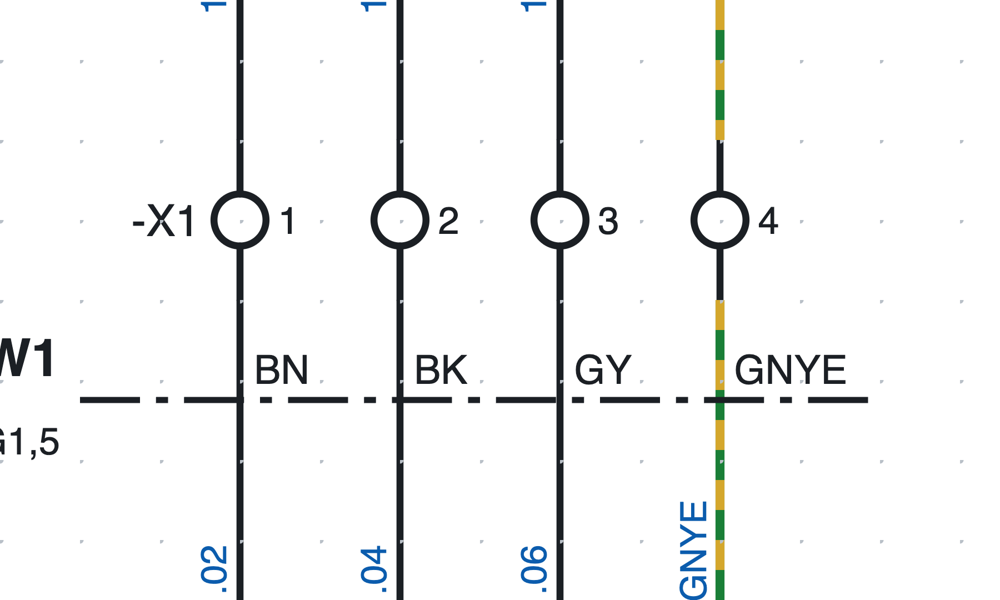
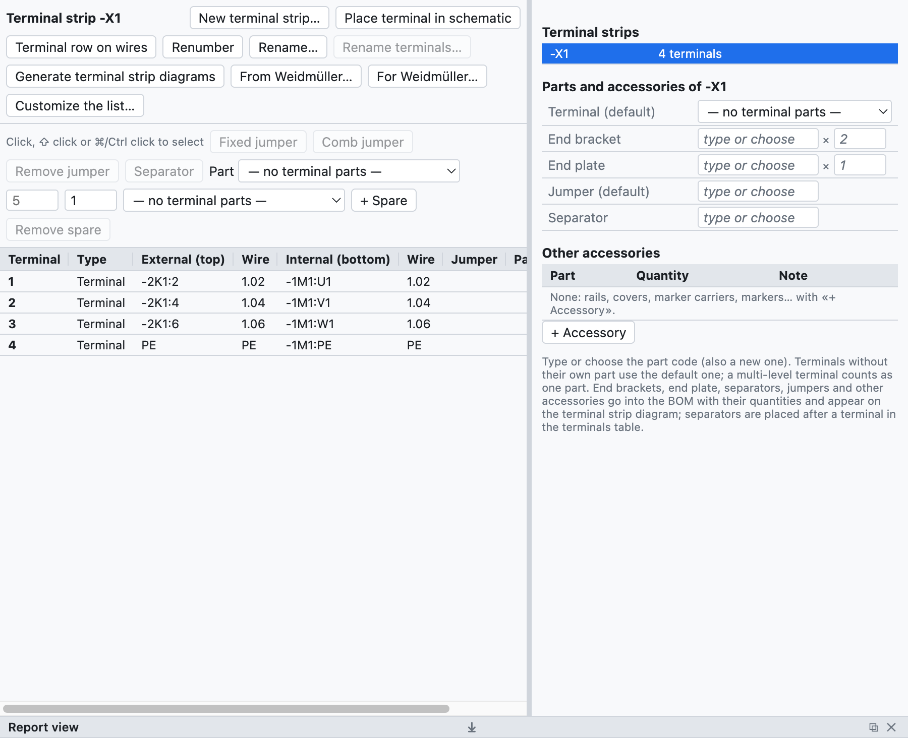
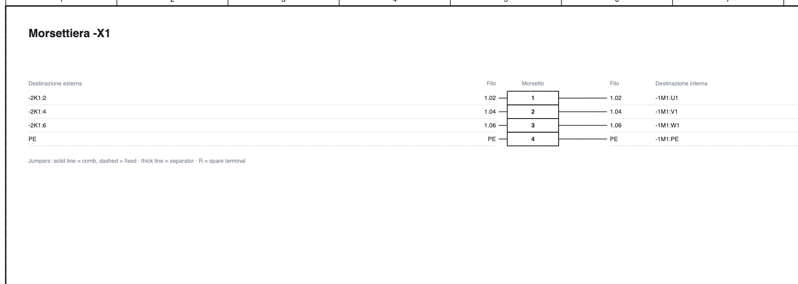

# 8. Regletas

## Bornes en el esquema

*Los bornes `-X1:1…4` de la página 1: la sigla de la regleta aparece solo en el primero de la fila.*

1. En la biblioteca, categoría *Bornes y conexiones*, elige **Borne** (o *Borne PE*, *Borne seccionable*,
   *Borne portafusible*).
2. Insértalo **sobre el hilo**: el hilo se interrumpe a los dos lados del borne.
3. El borne toma la sigla `-X1:1`; los siguientes `-X1:2`, `-X1:3`…

La sigla de un borne es `<regleta>:<número><nivel>`:

- la **regleta** tiene un nombre libre, incluso jerárquico como `X1.1.2`;
- el **número** sigue a los dos puntos (`X1.1.2:3`);
- el **nivel** es una letra para los bornes de varios niveles (`X1:1A`, `X1:1B`).

En un hilo vertical la sigla de la regleta está a la izquierda y el número a la derecha; en un hilo
horizontal (símbolo girado) el número está arriba y la sigla abajo.

> El **número de hilo** atraviesa el borne sin cambiar: los hilos de los dos lados tienen el mismo número
> (ver [capítulo 6](06-sigle-e-numerazione.md#el-número-atraviesa-los-bornes)).

## El navegador de regletas

La pestaña **Regletas** muestra las regletas del proyecto y sus bornes en una tabla.

*La regleta `-X1` del proyecto de ejemplo: destinos externos e internos, números de hilo, artículos y
accesorios.*

- A la derecha la lista de **regletas** del proyecto; un clic abre una.
- En el centro la **tabla de bornes**: número, tipo, destino externo (arriba) e interno (abajo), números de
  hilo, puentes, artículo, posición con enlace.
- Los bornes se seleccionan con clic, ⇧ clic (intervalo) y ⌘/Ctrl clic (añadir).

## Bornes de varios niveles

Un borne de dos o tres niveles tiene el mismo número y una letra por nivel.

1. Selecciona el borne en el esquema, por ejemplo `-X1:1`.
2. En las propiedades pulsa **Añadir nivel** (también con el botón derecho): el borne pasa a ser `-X1:1A`
   y el programa permite insertar `-X1:1B` con un clic, incluso en otra página.
3. Los clics siguientes insertan `1C`, `1D`…

En la lista de materiales un borne de varios niveles cuenta como **un solo artículo** (`-X1:1A/B`).

## Numerar y renombrar

- Un borne nuevo toma el número siguiente al más alto de la regleta; los demás no cambian.
- **Renumerar** numera desde 1 en el orden del esquema (página, luego de izquierda a derecha y de arriba
  abajo): los niveles quedan juntos con su letra, las reservas van al final, los bornes con un nombre no
  numérico (por ejemplo `PE`) quedan como estaban.
- **Renombrar…** cambia el nombre de la regleta en todos sus bornes (`X1` → `X2.1`).

## Puentes

1. Selecciona dos o más bornes en la tabla.
2. Pulsa **Puente fijo** o **Puente en peine**.

Los puentes aparecen en la tabla, en la lista de bornes, en la lista de conexiones y en el esquema de la
regleta; cada uno puede tener su artículo. *Quitar puente* los elimina.

## Reservas y separadores

- **+ Reserva** añade al final bornes no dibujados: entran en la lista y en la lista de materiales.
  *Quitar reserva* los quita.
- **Separador** después de un borne: una placa de separación, dibujada como línea gruesa en el esquema de
  la regleta.

## Artículos y accesorios

En el recuadro *Artículos y accesorios* de la regleta se eligen:

| Campo | Cantidad en la lista de materiales |
|---|---|
| Borne (predeterminado) | uno por borne físico sin artículo propio |
| Placa final | 1 |
| Tope final | 2 |
| Puente (predeterminado) | uno por puente sin artículo propio |
| Separador | uno por separador |

*Artículo ▸ asignar a los seleccionados* da un artículo distinto a bornes concretos (por ejemplo los
seccionables). Todo entra automáticamente en la lista de materiales y en la lista de compra.

## Esquema de la regleta

**Generar esquemas de regletas** crea una página por regleta (varias hojas a partir de 40 bornes) con
destinos, números de hilo, puentes, separadores, reservas y posiciones con enlace, también en el PDF.

*La parte superior del esquema de la regleta `-X1`.*

La página se actualiza sola cuando cambias el esquema; al regenerarla se añaden las páginas de las regletas
nuevas y se quitan las de las que han desaparecido.

## Comprobaciones

La verificación indica bornes repetidos, bornes con un lado libre y datos de regletas que ya no existen.
