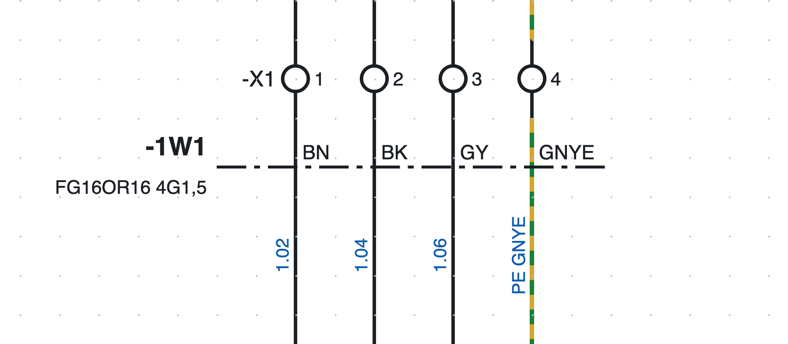
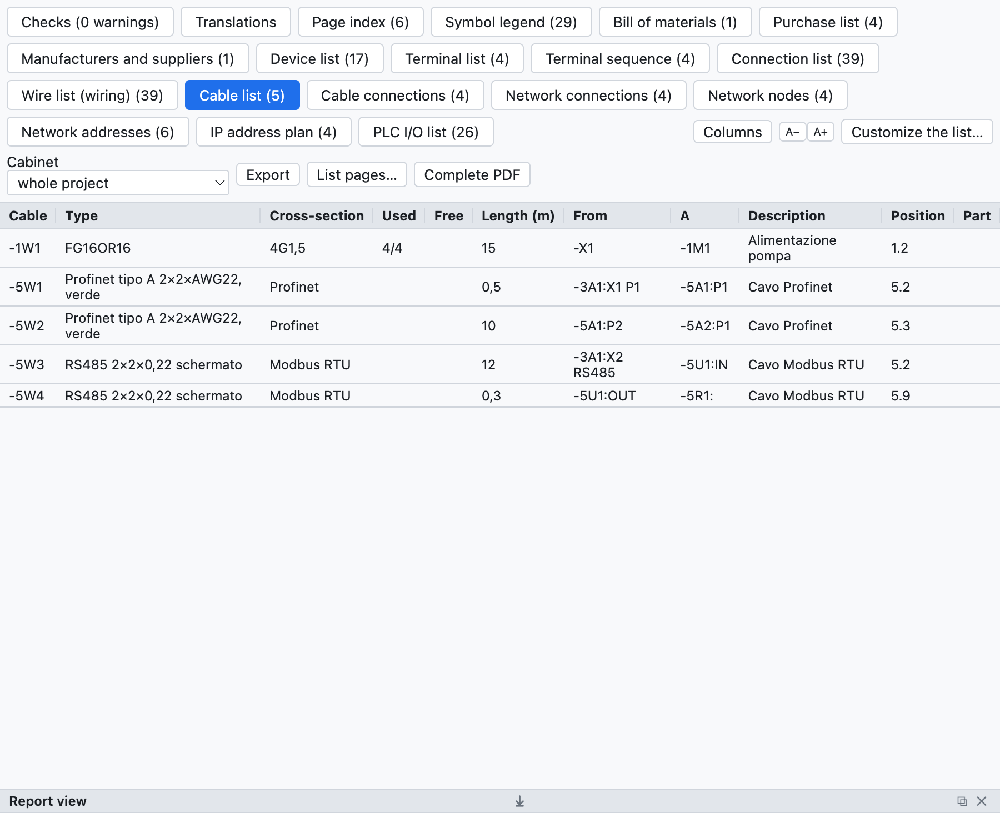

# 9. Cables y conectores

## Cables

Un cable se define con una **línea de definición** que atraviesa los hilos.

*El cable `-1W1 FG16OR16 4G1,5` de la página 1: la línea de trazo y punto atraviesa los cuatro hilos hacia
el motor, cada uno con el color de su conductor.*

1. Pulsa **Cable** en la barra de herramientas (o *Insertar ▸ Línea de definición de cable*).
2. Haz clic en un lado de los hilos y luego en el otro lado.
3. Los hilos atravesados pasan a ser **conductores** del cable `-1W1` (sigla según el modelo del proyecto).

### Conductores

El programa propone los conductores según el número de hilos:

- hasta 5 hilos, en colores: `BN BK GY BU GNYE`;
- a partir de ahí, numerados con el amarillo-verde;
- el hilo PE (o amarillo-verde) toma el conductor amarillo-verde.

En las propiedades del cable se cambian **formación** (`5G1,5`, `7x0,75`…), **tipo** (`FG16OR16`),
**longitud** en metros, **extremos** (desde, hasta), **apantallamiento**, descripción y **artículo**; en las
propiedades de la línea se elige el conductor de cada hilo.

Varias líneas, incluso en páginas distintas, pueden referirse al mismo cable: un conductor atravesado dos
veces cuenta una sola vez.

### Listas de cables

*La lista de cables del proyecto de ejemplo: el cable del motor y los cables de red.*

- **Lista de cables**: un cable por fila con tipo, formación, conductores usados y libres, longitud,
  extremos, posición, artículo.
- **Conexiones de cables**: un conductor por fila con los dos extremos y el número de hilo.
- La **lista de conexiones** tiene la columna *Cable*; en la lista de materiales la cantidad de un cable con
  artículo es su longitud en metros; en la lista de compra los cables sin artículo se suman por tipo.

### Comprobaciones

La verificación indica conductores agotados (más hilos que conductores) o repetidos, cables sin línea de
definición y siglas de cable duplicadas.

## Conectores y clavijas

Para las clavijas y las bases de los conectores multipolares se usan los símbolos de la categoría
*Bornes y conexiones*:

| Símbolo | Uso |
|---|---|
| Pin de base (hembra) | el lado base |
| Pin de clavija (macho) | el lado clavija |
| Pin base + clavija | el par acoplado en un solo símbolo |

- La sigla es como la de los bornes: `-X10:3` es el pin 3 del conector `-X10`; los pines se numeran solos.
- El número total de pines se escribe en las propiedades del conector o se lee del artículo.
- La **contraparte** (por ejemplo la clavija aérea para una base de cuadro) se indica con su artículo y
  entra en la lista de materiales.
- La **lista de conectores** enumera cada pin con su lado, los hilos, la posición y los pines usados.
- La verificación indica los pines que superan el número del conector.
- En la pestaña **Conectores** la tabla de pines tiene las columnas **Descripción** y **Notas**, que se escriben
  directamente en la celda. Descripción, datos técnicos y notas son **propios de cada pin** (en las *Propiedades*
  del pin valen solo para ese pin); fabricante, tipo, artículo y los demás datos valen para todo el conector. Las
  **notas del conector** se escriben en los datos del conector, a la derecha de la tabla.
