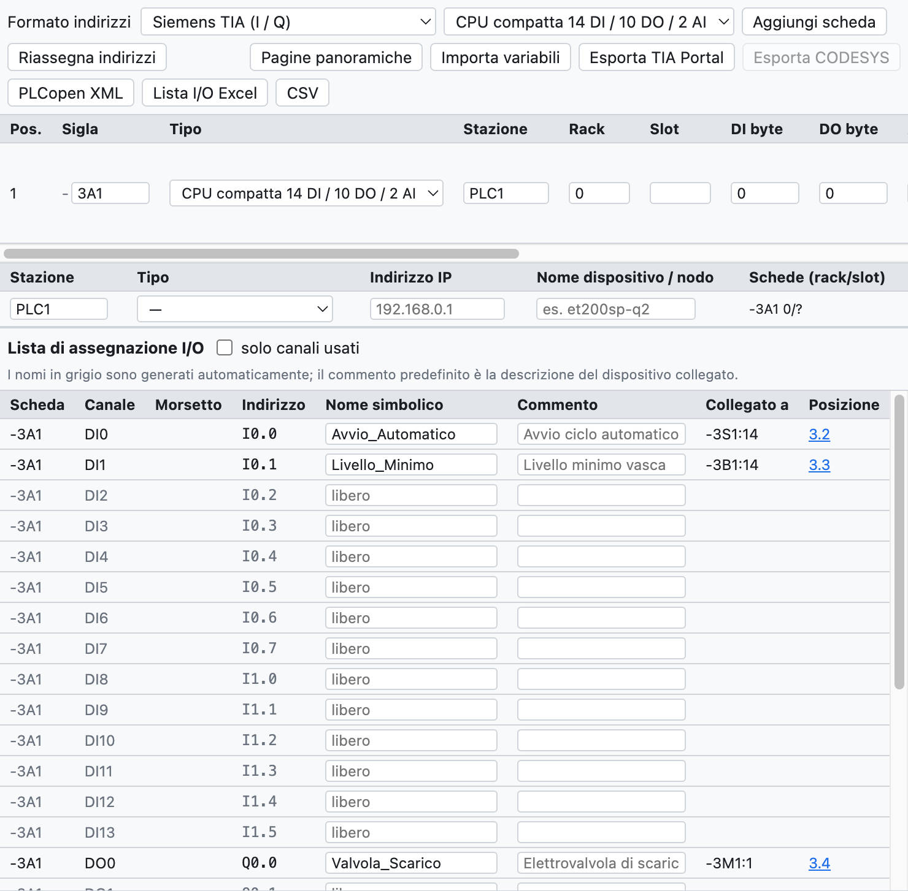
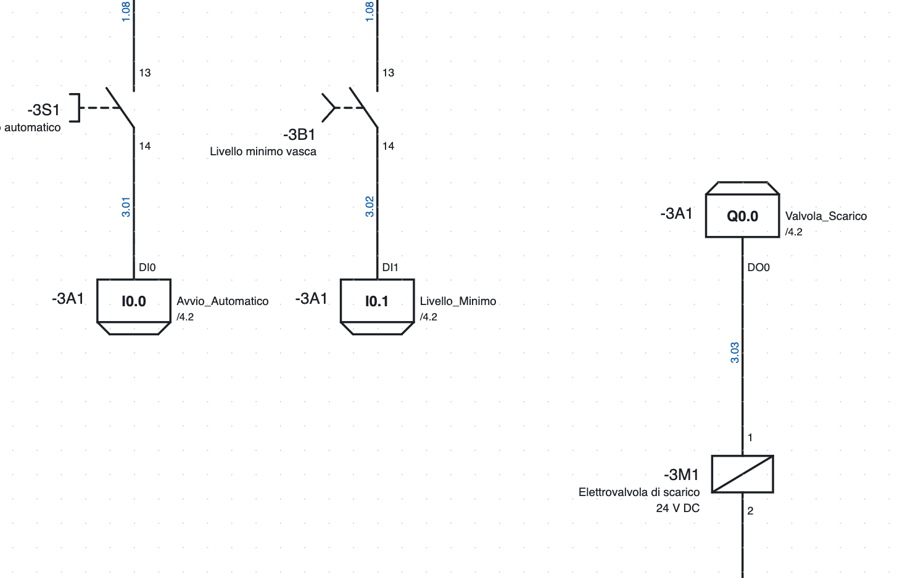
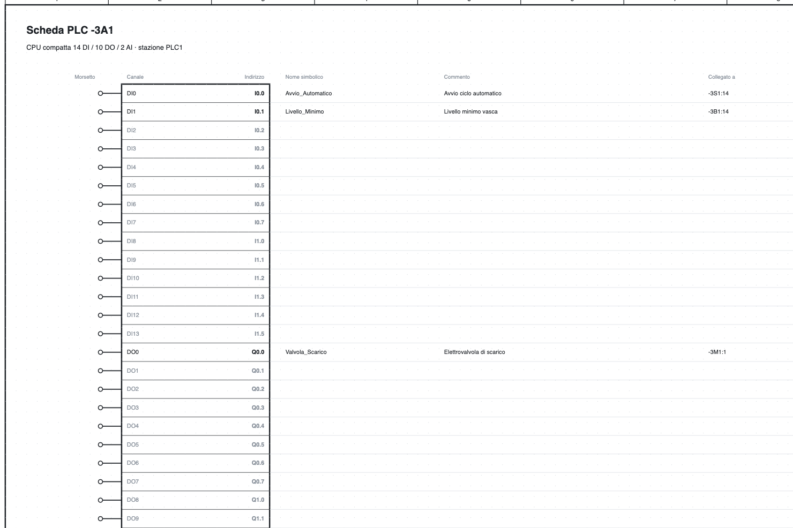

# 10. PLC

OpenWiring mantiene juntos el esquema eléctrico y la asignación de las E/S del PLC: cada entrada y salida
dibujada toma un canal y una dirección, aparece en la lista de E/S y en la vista general de la tarjeta, y se
exporta a TIA Portal, CODESYS o PLCopen.

## La vista PLC

*La vista PLC del proyecto de ejemplo: la CPU `-3A1`, la estación `PLC1` y la lista de asignación de E/S.*

La pestaña **PLC** arriba a la derecha reúne:

- la barra con el formato de las direcciones, el tipo de tarjeta que añadir y la exportación;
- la lista de **tarjetas** con sigla, tipo, estación, rack, slot y direcciones iniciales;
- la lista de **estaciones** con tipo, dirección IP y nombre del dispositivo;
- la **lista de asignación de E/S**.

## Tarjetas

**Añadir tarjeta** añade el tipo elegido en la lista:

- CPU compactas 14 DI / 10 DO / 2 AI y 8 DI / 6 DO;
- módulos digitales 8 DI, 16 DI, 8 DO, 16 DO, 8 DI / 8 DO;
- módulos analógicos 4 AI, 8 AI, 2 AO, 4 AO;
- maestros **IO-Link** de 4 u 8 puertos.

Para cada tarjeta se indican sigla (`-3A1`), estación (`PLC1`: las direcciones se asignan por estación),
rack, slot (asignado automáticamente), direcciones iniciales, descripción y código de pedido. La tarjeta
entra en la lista de materiales.

**Tarjeta desde artículo…** crea una tarjeta a partir de un artículo de la biblioteca, por ejemplo un módulo
de E/S importado de un EDZ: el número de canales se obtiene del modelo de función y se puede corregir antes
de crear la tarjeta. Los puntos de conexión del artículo pasan a ser los bornes de los canales.

**Direcciones estables**: una tarjeta nueva toma las primeras direcciones libres de su estación, las de las
tarjetas existentes no cambian. **Reasignar direcciones** las recalcula en el orden de la lista
(flechas ↑ ↓).

### Estaciones

Cada estación tiene un tipo (CPU local, Profinet, EtherCAT, Profibus DP, EtherNet/IP, Modbus TCP), una
dirección IP y un nombre de dispositivo. La verificación indica slots duplicados, IP y nombres repetidos.

### Formato y orden de áreas por estación

En la tabla de **Estaciones** cada estación tiene dos columnas más:

- **Formato**: una estación puede tener un formato distinto del de arriba, por ejemplo un nodo CODESYS
  junto a una CPU Siemens. El formato de arriba vale para las estaciones sin formato propio. Al cambiar el
  formato de una estación solo se reasignan sus direcciones.
- **Orden de áreas** (formatos IEC y TwinCAT, donde digitales y analógicas comparten la misma área):
  *tarjetas en fila* (por defecto) o *primero las analógicas (WAGO)*, como hacen los nodos WAGO y otros
  acopladores CODESYS. Al añadir una tarjeta a una estación «primero las analógicas» las direcciones se
  reasignan solas.

**TwinCAT (Beckhoff).** Con el formato TwinCAT las direcciones son `%I*` y `%Q*`: las vincula TwinCAT. En la
GVL exportada las variables tienen `AT %I*` / `AT %Q*`; los hilos conectados a un canal toman el nombre de
la tarjeta y del canal (`400A1.DI3`), porque `%I*` es igual para todos.

Las exportaciones trabajan por estación: *Exportar TIA Portal* toma solo las estaciones Siemens, *Exportar
CODESYS* las IEC y TwinCAT.

### IO-Link

Para cada puerto de un maestro IO-Link se indican dispositivo, descripción y bytes de datos de proceso; el
programa calcula las direcciones (`IB4…IB5`, `%IB4`, `EB4`).

## Puntos de E/S en el esquema

*Dos entradas y una salida de la página 3: en el recuadro la dirección, a la derecha el nombre simbólico y
la referencia a la vista general `/4.2`, a la izquierda la sigla de la tarjeta.*

1. En la biblioteca, categoría *PLC*, elige entrada o salida, digital o analógica.
2. Insértala en el esquema y conéctala al dispositivo (pulsador, sensor, electroválvula…).
3. El punto toma automáticamente el **primer canal libre** del tipo correcto; si ninguna tarjeta lo tiene,
   el programa crea una nueva (la primera es una CPU compacta).

En las propiedades del punto se cambian tarjeta, canal (los ocupados están marcados), **nombre simbólico** y
**comentario**. El borne lleva el nombre del canal (`DI0`, `DO3`).

La **alimentación L+ / M** de la tarjeta es un símbolo aparte con la sigla de la tarjeta: se dibuja en el
circuito de alimentación y su posición aparece en la vista general.

## Direcciones

El formato se elige arriba en la vista PLC:

| Formato | Entrada digital | Salida digital | Entrada analógica | Salida analógica |
|---|---|---|---|---|
| Siemens TIA | `I0.0` | `Q0.0` | `IW64` | `QW64` |
| Siemens alemán | `E0.0` | `A0.0` | `EW64` | `AW64` |
| IEC 61131 / CODESYS | `%IX0.0` | `%QX0.0` | `%IW0` | `%QW0` |
| Omron CJ/CP | `0.00` | `100.00` | `2000` | `2100` |
| Beckhoff TwinCAT | `%I*` | `%Q*` | `%I*` | `%Q*` |

Las analógicas empiezan en 64 en los formatos Siemens y en 0 en IEC; al cambiar de formato se adaptan. Omron
usa palabras de 16 bits, así que al pasar de Omron o a Omron las direcciones se reasignan.

## Páginas de vista general

**Páginas de vista general** crea una página por tarjeta, al final del proyecto, y quita las de las tarjetas
eliminadas.

*La vista general de la CPU `-3A1`: para cada canal borne, dirección, nombre simbólico, comentario,
dispositivo conectado y página.*

La vista general está siempre alineada con el esquema, no hay que regenerarla cuando cambias algo. Cada
punto de E/S del esquema remite a su fila de la vista general (`/4.2`) y viceversa.

## Lista de asignación de E/S

La lista contiene todos los canales de todas las tarjetas, usados o libres, con dirección, nombre simbólico,
comentario, **dispositivo conectado** (`-3S1:14`, obtenido de los hilos) y posición.

- El nombre y el comentario se modifican directamente en la tabla.
- Si falta el nombre, se genera (`DI2_3A1`); el comentario predeterminado es la descripción del dispositivo
  conectado.
- *solo canales usados* oculta los libres.
- La lista aparece también en la pestaña *Listas* y en el PDF.
- La verificación indica canales usados dos veces, nombres duplicados, puntos sin tarjeta o con un canal del
  tipo equivocado.

## Intercambio con el software del PLC

### Exportación

| Botón | Archivo | Uso |
|---|---|---|
| *Exportar TIA Portal* | Excel con la hoja `PLC Tags` | en TIA: *Variables PLC ▸ Importar*; las variables van a la tabla `OpenWiring` (formatos Siemens) |
| *Exportar CODESYS* | texto `VAR_GLOBAL … END_VAR` | para pegar en una lista de variables globales (formato IEC) |
| *PLCopen XML* | XML TC6 | variables globales con dirección IEC, también de los datos IO-Link; para CODESYS y entornos compatibles |
| *Lista de E/S Excel*, *CSV* | tabla | documentación |

Ejemplo de línea CODESYS: `Avvio_Automatico AT %IX0.0 : BOOL; (* Avvio ciclo automatico - -3S1:14 *)`.

> La exportación para TIA Portal sigue el formato de la tabla de variables de TIA, pero aún no se ha probado
> en una instalación real: si la importación indica errores, exporta desde TIA una tabla vacía y compara las
> columnas.

### Importación de variables

**Importar variables** lee nombres y comentarios del software del PLC y los lleva al esquema:

- **TIA Portal**: el archivo Excel de *Variables PLC ▸ Exportar*;
- **CODESYS**: una GVL (`Nome AT %IX0.0 : BOOL; (* commento *)`);
- **CSV** con las columnas Nombre, Dirección, Comentario.

La correspondencia se hace por **dirección** (`%E0.0` e `I0.0` son equivalentes). Los canales ya dibujados
reciben nombre y comentario; los que aún no están dibujados los guardan en la tarjeta y los muestran en
cuanto se dibujan. Las variables sin canal se enumeran en la vista de informe.
