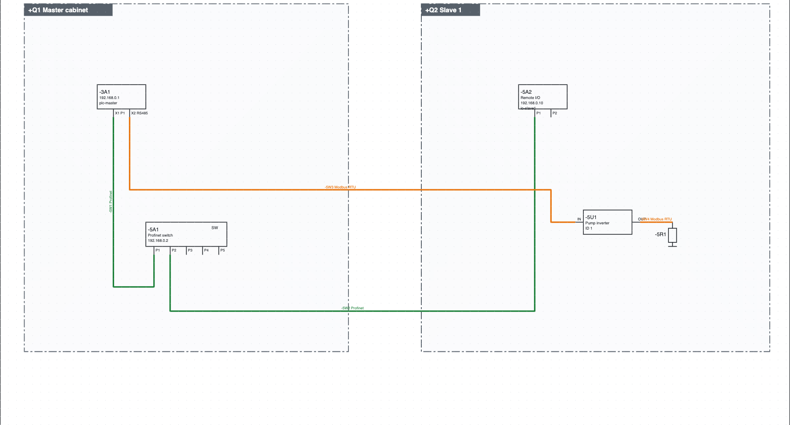
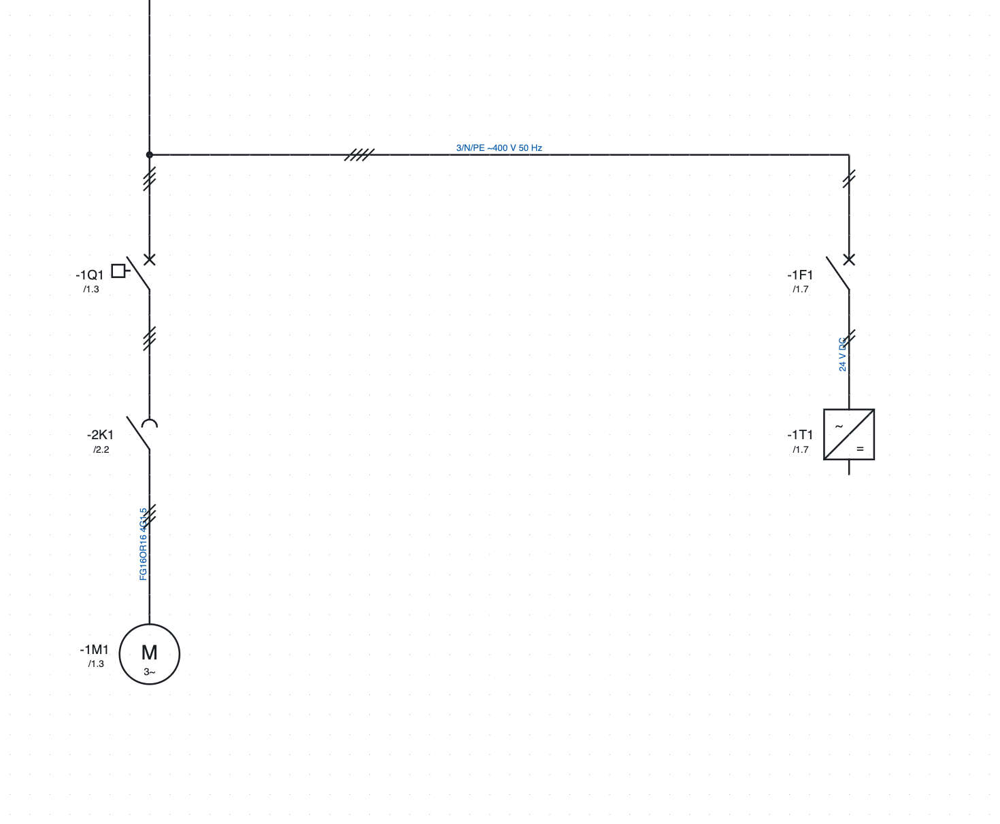

# 11. Redes, ubicaciones y esquema unifilar

## Ubicaciones

Una **ubicación** es un contenedor físico: cuadro eléctrico, botonera, máquina, caja de derivación, campo.
Su código es la parte `+` de la sigla (`+Q1-2K1`).

1. *Proyecto ▸ Nueva ubicación…*, o *+ Ubicación* en las propiedades del proyecto.
2. Escribe el **código** (`Q1`, `BM`, `P1`), el **nombre** (`Quadro master`) y el **tipo**.
3. Asigna las páginas a la ubicación con *Propiedades de la página ▸ Ubicación (sección)*: una página nueva
   queda en la ubicación de aquella desde la que se crea.

Cada dispositivo está en una ubicación: la escrita en sus propiedades; si no, el recuadro en el que está
dibujado en el esquema de red; si no, la ubicación de su página.

Dónde se ven las ubicaciones:

- el **árbol** agrupa páginas y dispositivos por ubicación;
- la **lista de dispositivos** muestra la sigla completa (`+BM-1M1`);
- las **etiquetas** de los dispositivos se agrupan por ubicación;
- una **página de disposición** asignada a una ubicación propone solo sus aparatos.

### Un componente de un cuadro conectado a otro cuadro

Caso típico: un sensor montado en el **+Q2** va a una entrada PLC del **+Q1**. Si lo dibujas en la
página de entradas del +Q1 con el recuadro de ubicación +Q2, la identificación es correcta (`+Q2-B1`)
y el sensor entra en las listas del +Q2. Pero el esquema está en las páginas del +Q1: quien cablea el
+Q2 y recibe solo sus páginas no lo ve.

La técnica recomendada es **dividir el circuito en el límite del cuadro**, en los bornes:

1. en la página del +Q1: entrada PLC → borne `-X1:5` → cable `-W12` → referencia hacia la página del +Q2;
2. en una página del +Q2: referencia desde el +Q1 → cable `-W12` → borne `-X2:5` → sensor `-B1`.

Cada componente se dibuja en las páginas del cuadro donde está montado; la unión entre los cuadros es
el cable, que aparece en los dibujos de cables de los dos; las referencias tienen enlace en el PDF.
Cada cuadro tiene su entrada a bornes y cada cableador trabaja hasta el borne.

Las **verificaciones** avisan cuando un dispositivo de un cuadro, una botonera o una caja de
derivación está dibujado en las páginas de otro cuadro: *+Q2-B1 está dibujado en la página 310 del
cuadro +Q1: imprimiendo solo +Q2 no aparece*. A pie de máquina y en campo no cuentan, porque se
dibujan normalmente en las páginas del cuadro; tampoco una sububicación del mismo cuadro (p. ej. la
puerta).

Si prefieres dejar el componente junto a la entrada PLC, al imprimir solo algunos cuadros marca en el
PDF *Añadir las páginas de otros cuadros con dispositivos de los cuadros elegidos* (capítulo 18).

## Esquema de red

El esquema de red muestra en una sola página todos los nodos de la instalación y las conexiones de bus entre
los cuadros.

*El esquema de red del proyecto de ejemplo: la CPU `-3A1` y el switch `-5A1` en el cuadro `+Q1`, las E/S
remotas `-5A2` y el variador `-5U1` en el cuadro `+Q2`, conectados en Profinet (verde) y Modbus RTU
(naranja).*

1. **+ Red** debajo del árbol crea la página.
2. **Cuadro** en la barra de herramientas: clic en dos esquinas para dibujar el recuadro de un cuadro y
   elegir su ubicación. Los nodos dentro del recuadro pertenecen a ese cuadro.
3. Desde la categoría *Redes y buses* inserta los **nodos**: nodo de dos puertos (IN/OUT o P1/P2), nodo de
   un puerto, switch de 5 puertos, terminación. Un nodo toma la sigla de un dispositivo existente (la CPU,
   un variador…) y pasa a ser una de sus representaciones.
4. Elige el protocolo junto al botón **Bus** y conecta los puertos como un hilo.

### Protocolos

Profinet, EtherCAT, Modbus TCP, Modbus RTU, Profibus DP, EtherNet/IP, CANopen, IO-Link, RS485, Ethernet.
Cada protocolo tiene su color y su nombre escrito en la línea. Los buses no reciben número de hilo y no
entran en las conexiones eléctricas. Un hilo existente se convierte en bus desde sus propiedades
(*Red / bus*).

### Cables de red

Cada conexión de bus es un **cable**: toma sola una sigla (`-5W1`, escrita en la línea junto al protocolo).
En las propiedades de la conexión se indican tipo (propuesto según el protocolo, por ejemplo
*Profinet tipo A 2×2×AWG22*), longitud y artículo. Los cables de red aparecen en la lista de cables con los
puertos en los extremos (`-3A1:X1 P1` → `-5A1:P1`), en las etiquetas y, con el artículo, en la lista de
materiales en metros.

Un cable que continúa en otra página mediante un par de referencias (por ejemplo del controlador del robot
a la página del robot) es **un solo cable**: tiene una sola sigla en todos los tramos. El tramo con la sigla dada por el programa toma por sí solo la
del cable, aunque emparejes las referencias después de dibujarlo. Al cambiar la
sigla, el tipo, la longitud o el artículo en un tramo, cambian también los demás. Si los tramos tienen
siglas distintas, la verificación lo indica, y el botón **Usar -… en todos los tramos** pone en todos la
sigla del tramo de la primera página. Las referencias del cable toman solas el nombre del cable (`1102W1`) y lo siguen si cambias la sigla; renombrar una referencia renombra el cable, en todos los tramos y en la referencia correspondiente. Tipo, longitud y artículo escritos en un tramo pasan a los otros tramos que no los tienen. Así, junto
a la referencia la sigla no se repite. Para mostrarla u ocultarla en un tramo usa el ojo de **Sigla del
cable**; el ojo de **Número de hilo** apaga todos los textos de la conexión.

### Listas y comprobaciones

- **Conexiones de red**: protocolo, puertos, cuadros, conexiones entre cuadros distintos.
- **Nodos de red**: dirección, protocolos, cuadro.
- La verificación indica direcciones repetidas en la misma red (también a través de los switches) y puertos
  Ethernet con más de una conexión (hace falta un switch). Los buses multipunto (Modbus RTU, Profibus,
  CANopen, RS485) admiten varios nodos en el mismo tramo.

## Plan de direcciones IP

1. *Proyecto ▸ Nueva red IP*: nombre, dirección y prefijo (`192.168.0.0/24`), puerta de enlace, protocolo
   que la usa y primera dirección que asignar.
2. En las propiedades de cada nodo está el campo **Dirección IP**, separado de la dirección de bus (nombre
   Profinet, ID Modbus…). La IP se escribe en el recuadro del nodo.
3. *Proyecto ▸ Asignar direcciones IP* da la primera dirección libre a los nodos conectados en Profinet,
   Modbus TCP, EtherNet/IP o Ethernet que no la tienen (EtherCAT y los buses serie no).
4. *Proyecto ▸ Plan de direcciones IP* abre la lista: IP, máscara, puerta de enlace, red, dispositivo,
   nombre, protocolos, ubicación, incluidas las estaciones PLC.

La verificación indica IP repetidas, no válidas, fuera de las redes o iguales a la dirección de red o de
broadcast, y puertas de enlace fuera de la red.

## Direcciones de red

*Proyecto ▸ Direcciones de red…* (también desde el grupo *Redes* de la pestaña *Proyecto* de la cinta) abre una tabla con **todos**
los dispositivos que tienen un puerto de red, también los que aún no tienen dirección, y las estaciones PLC.

**Cómo se encuentran los puertos.** Un puerto es cualquier pin tocado por un hilo de bus (Profinet,
Ethernet, Modbus, EtherCAT…) y cualquier nodo de red. Los símbolos no necesitan pines especiales.

- Los puertos IP de un dispositivo (Profinet, Ethernet, Modbus TCP, EtherNet/IP) forman **una sola
  interfaz**, como un switch integrado: una IP y un nombre.
- Cada bus no IP (Modbus RTU, CAN, EtherCAT…) tiene su propia interfaz, con su dirección.
- **Separar…** da a algunos puertos una interfaz propia, con IP y nombre distintos (por ejemplo X2 fuera del
  switch de X1). **Reunir** la devuelve a la interfaz principal.

En las columnas *Dirección IP* y *Nombre Profinet / dirección* se escribe directamente; *Intro* confirma.
Para una estación PLC los valores quedan alineados con la tabla de estaciones. Abajo:

- **Asignar IP**: una IP libre de la red adecuada a las interfaces IP que no la tienen (antes hace falta una
  red IP);
- **Nombres Profinet automáticos**: un nombre a partir del identificador y del lugar (`+Q1 -2A1` →
  `q1-2a1`, con `pn-` delante si el nombre empezara por una cifra) para los dispositivos Profinet sin
  nombre; los nombres ya escritos se mantienen;
- **Lista y exportación**: la misma tabla entre las listas, para imprimir o exportar a PDF, CSV y Excel.

La última columna muestra los problemas: IP repetidas o fuera de la red, nombres Profinet no válidos o
repetidos.

## Esquema unifilar

El esquema unifilar representa la distribución de potencia con una sola línea por cada salida.

*El unifilar del proyecto de ejemplo: las mismas siglas que el multifilar, con la referencia a su posición.*

1. **+ Unifilar** debajo del árbol crea la página.
2. Desde la categoría *Unifilar* inserta interruptor automático, guardamotor, seccionador, fusible,
   contactor, motor, transformador, variador, fuente de alimentación, carga.
3. Da a cada símbolo **la misma sigla** que el dispositivo en el multifilar: aparece la referencia con
   enlace a su posición (`/1.3`).
4. Las líneas tienen el número de conductores (*Conductores (trazos)*) y un texto (`3/N/PE ~400 V 50 Hz`).

Las líneas del unifilar no entran en los conductores, en los números de hilo ni en las listas: el esquema
eléctrico real sigue siendo el multifilar.
