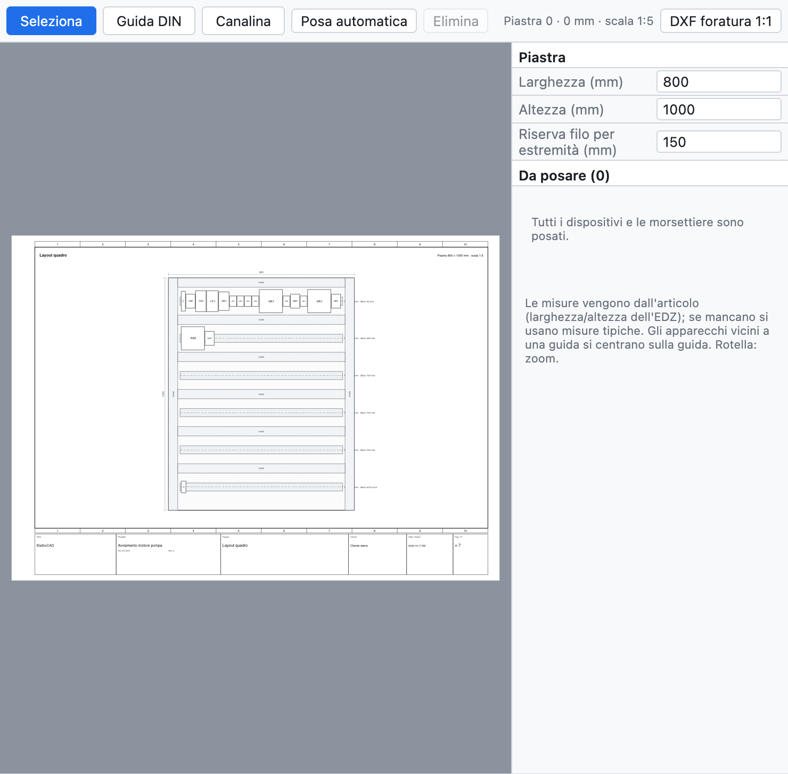

# 12. Disposición del cuadro

La página de disposición es la **vista de montaje** de la placa del cuadro: carriles DIN, canaletas y
aparatos a escala, con las cotas. Sirve para comprobar que todo cabe, para el taladrado y para estimar la
longitud de los hilos.

*Una disposición creada con la colocación automática: dos filas de carriles con canaletas y los aparatos del
proyecto de ejemplo.*

## Crear la disposición

1. **+ Disposición** debajo del árbol crea una página de disposición con la placa a una escala normalizada
   (1:5, 1:10…), acotada.
2. En el panel de la derecha ajusta **anchura** y **altura** de la placa en mm y la **reserva** de hilo por
   extremo.
3. Asigna la página a una **ubicación** para ver solo los aparatos de ese cuadro.

## Carriles DIN y canaletas

Con **Carril DIN** y **Canaleta** en la barra de la vista, arrastra sobre la placa para dibujarlos. Cada
carril muestra los milímetros libres.

## Colocar los aparatos

- La lista *Por colocar* muestra los dispositivos y las regletas aún no colocados: arrástralos sobre la
  placa.
- Los aparatos cercanos a un carril se **centran en el carril**.
- Las **medidas** vienen del artículo (anchura y altura del EDZ); si no, son valores típicos; una regleta
  es tan ancha como sus bornes (un borne de varios niveles ocupa un paso).
- **Colocación automática** crea filas de canaletas y carriles si faltan y coloca en los carriles todos los
  aparatos aún no colocados.

## Comprobaciones

La verificación indica aparatos fuera de la placa, superpuestos y carriles llenos.

## Taladrado

**DXF de taladrado 1:1** exporta placa, carriles, canaletas, contornos de los aparatos y agujeros de
fijación de Ø 5,5 a escala real, listos para el mecanizado.

## Lista de materiales y longitud de los hilos

- Los carriles y las canaletas con artículo entran en la **lista de materiales en metros**.
- La **lista de hilos (cableado)** indica para cada hilo sección, color, **punteras** (DIN 46228) y la
  **longitud estimada** a partir de la disposición: recorrido entre los aparatos más la reserva en los
  extremos.
- La **lista de compra** suma el hilo suelto por sección y color con un 10 % de margen
  ([capítulo 14](14-liste-e-pagine-automatiche.md#lista-de-compra)).
