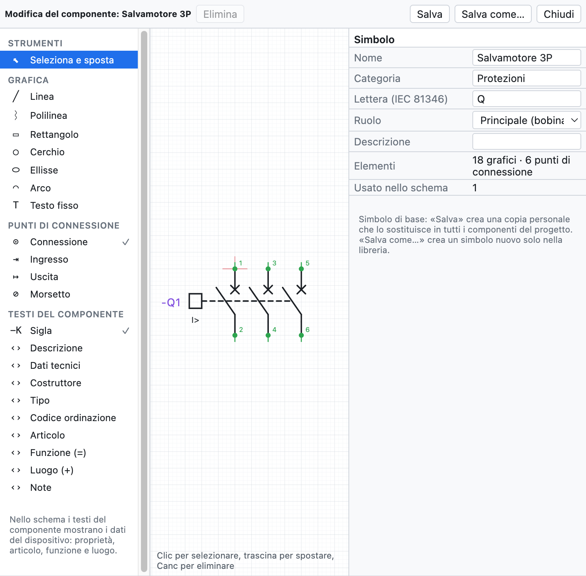
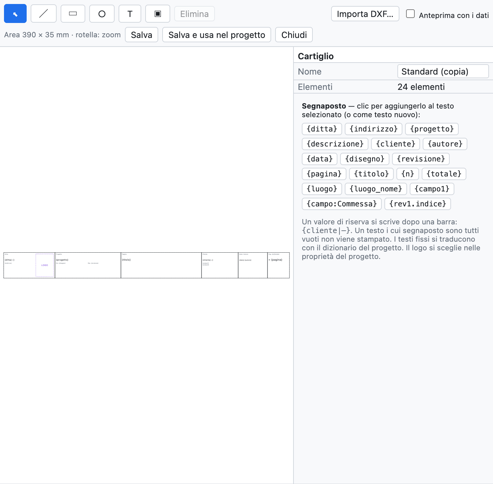

# 13. Macros, símbolos y cajetines

## Macros

Una **macro** es un trozo de esquema para reutilizar: un arranque de motor, un circuito de parada de
emergencia, una salida con variador.

### Crear una macro

1. Selecciona el circuito en el esquema (selección por ventana).
2. Botón derecho ▸ **Crear macro a partir de la selección…** (o desde la pestaña *Macros* de la biblioteca).
3. Escribe nombre, categoría y descripción.

### Insertar una macro

1. En la pestaña **Macros** de la biblioteca haz clic en la macro.
2. Haz clic en la página: el punto pulsado es la esquina superior izquierda del circuito.

Al insertarla **se renumeran siglas, números de hilo, bornes, canales PLC y cables**; la bobina y los
contactos copiados juntos siguen enlazados. Las macros están en la biblioteca personal, disponibles en todos
los proyectos, y se intercambian como archivos `.ecmacro` (*Archivo ▸ Importar ▸ Macros…* y el botón de
exportación en la pestaña *Macros*).

## Editor de componentes

El editor dibuja un componente desde cero o modifica uno existente: símbolos básicos, símbolos personales,
componentes importados de QElectroTech o de EPLAN, incluidas las cajas negras de los artículos EDZ.

*El guardamotor 3P abierto en el editor: a la izquierda los objetos que añadir, en el centro el dibujo con
los puntos de conexión, a la derecha las propiedades.*

- En el esquema: botón derecho en el componente ▸ **Modificar el componente…**. En la biblioteca:
  **Nuevo símbolo…**, o botón derecho en un símbolo.
- Elige un objeto en el panel de la izquierda y haz clic (o arrastra) en el dibujo:

| Grupo | Objetos |
|---|---|
| *Gráfico* | línea, polilínea (clic en cada vértice, doble clic o Intro para terminar), rectángulo, círculo, elipse, arco, texto fijo |
| *Puntos de conexión* | conexión, entrada, salida, borne: en la rejilla de 4 mm, con designación (`13`, `A1`) y dirección del hilo |
| *Textos del componente* | sigla, descripción, datos técnicos, fabricante, tipo, código de pedido, artículo, función (=), ubicación (+), notas |

- Los **textos del componente** muestran en el esquema los datos del dispositivo (propiedades, artículo,
  función y ubicación). La descripción y los datos técnicos colocados aquí no se repiten debajo de la sigla.
- *Seleccionar y mover*: clic para seleccionar, arrastra para mover, **Supr** para eliminar. Las medidas y
  los ángulos se corrigen en el panel de la derecha.
- A la derecha también nombre, categoría, **letra** IEC 81346, **función** (dispositivo, bobina con
  referencias cruzadas, contacto NA/NC/conmutado, borne) y descripción.
- La rueda del ratón hace zoom.

### Guardar

| Comando | Efecto |
|---|---|
| **Guardar** | mismo nombre: el símbolo cambia en la biblioteca personal y en **todos los componentes del esquema** que lo usan |
| **Guardar como…** | nombre nuevo: un símbolo más en la biblioteca personal; el esquema no cambia |

Los símbolos básicos no se sobrescriben: *Guardar* crea una copia personal con el mismo nombre, que los
sustituye en los componentes del proyecto y también en la biblioteca, en la misma casilla: al tomarlo de
nuevo de la biblioteca se obtiene la versión modificada. *Volver al símbolo básico* (en el editor) devuelve
el original a la biblioteca. La caja negra modificada de un artículo EPLAN sigue siendo el
símbolo de ese artículo. Al usarlo en un proyecto, el símbolo se copia en el archivo `.ecad`.

## Componentes de QElectroTech

*Archivo ▸ Importar ▸ Símbolos QElectroTech…* (o *Importar componentes…* en la biblioteca) lee los
componentes de [QElectroTech](https://qelectrotech.org): archivos `.elmt`, proyectos `.qet` con sus
elementos, o archivos `.zip` o `.7z` de carpetas enteras, como la colección oficial descargada de GitHub.

- Se convierte el gráfico (líneas, rectángulos, círculos, elipses, arcos, polígonos, textos) con los bornes
  y su nombre.
- El tipo se convierte en la función: bobina con referencias cruzadas, contacto NA/NC con numeración
  automática, borne, punto de interrupción.
- La letra de la sigla viene del tipo y del nombre: interruptores y seccionadores **Q**, fusibles y relés
  térmicos **F**, bobinas **K**.
- La escala es 10 px = 4 mm; los bornes fuera de la rejilla se llevan a la rejilla con un breve tramo de
  unión, así los hilos se enganchan.
- Los componentes quedan en la biblioteca personal; cuando insertas uno, se copia en el proyecto.

> **Atención**: en GitHub descarga el archivo real con *Raw* o *Download raw file*. Guardando la página web
> se obtiene un archivo HTML que no contiene el componente.

La colección de QElectroTech es © The QElectroTech team, licencia CC-BY 3.0: el uso en los esquemas es
libre; OpenWiring no incluye sus símbolos, los importas tú.

## Cajetines incluidos

Además de *Estándar*, *Con tabla de revisiones* y *Compacto*, el programa incluye seis cajetines completos,
pensados para distintos tipos de trabajo:

| Cajetín | Para |
|---|---|
| *ISO 7200 (normativo)* | el cajetín de los dibujos técnicos según ISO 7200 |
| *Industrial detallado* | esquemas industriales, con tabla de revisiones y recuadros para fecha, dibujante y verificación |
| *Máquina (EN 60204-1)* | equipo eléctrico de las máquinas |
| *Instalación civil (DM 37/08)* | instalaciones eléctricas civiles, con los datos exigidos para la declaración de conformidad |
| *Cuadro eléctrico (EN 61439)* | cuadros de baja tensión |
| *Automatización con firmas* | instalaciones de automatización, con las casillas de las firmas |

Se eligen en las propiedades del proyecto (*Cajetín ▸ Modelo*) o en las de una página. Los campos particulares de
cada modelo (por ejemplo `{campo:Matricola}`) aparecen en las *Propiedades del proyecto*, listos para rellenar. De
cada cajetín incluido se puede elegir *Personalizar…* y partir de ese dibujo.

## Cajetines personalizados

También se puede dibujar el cajetín de la propia empresa.

*El cajetín estándar abierto en el editor, con la lista de marcadores a la derecha.*

1. *Proyecto ▸ Cajetín: personalizar o dibujar…*, o *Personalizar…* / *Nuevo…* en las propiedades del
   proyecto.
2. Dibuja con líneas, rectángulos, círculos, textos y el **área del logotipo**. El área del cajetín es de
   390 × 35 mm.
3. En los textos usa los **marcadores**: un clic en un marcador de la lista lo añade al texto seleccionado.
4. *Vista previa con datos* muestra el cajetín relleno con los datos del proyecto.
5. **Guardar y usar en el proyecto**.

### Marcadores

| Marcador | Valor |
|---|---|
| `{ditta}`, `{indirizzo}` | empresa y dirección |
| `{progetto}`, `{descrizione}`, `{cliente}`, `{autore}`, `{data}`, `{disegno}`, `{revisione}` | datos del proyecto |
| `{pagina}`, `{titolo}` | número y título de la página |
| `{n}`, `{totale}` | posición de la página y número de páginas (`{n}/{totale}`) |
| `{luogo}`, `{luogo_nome}` | ubicación de la página |
| `{campo1}`, `{campo:Commessa}` | campos adicionales |
| `{prop:Empresa.Pedido}` | propiedad definida por el usuario del proyecto o de la página ([capítulo 4](04-progetto-e-pagine.md#propiedades-definidas-por-el-usuario)) |
| `{rev1.indice}`, `{rev1.descrizione}`… | últimas revisiones |

Un valor de reserva se escribe después de una barra: `{cliente|—}`. El valor de reserva puede contener a su vez
un marcador: `{campo:Macchina|{progetto}}` escribe el campo *Macchina* y, si está vacío, el nombre del proyecto. Un texto con todos los marcadores vacíos
no se imprime.

### Importar un cajetín desde DXF

**Importar DXF…** en el editor lleva al modelo un cajetín dibujado en AutoCAD o en otro CAD: líneas,
polilíneas, círculos, arcos, textos y bloques. Los atributos se convierten en marcadores (PROGETTO →
`{progetto}`, DATA → `{data}`, FOGLIO → `{pagina}`…). Si es más grande que el área del cajetín, se reduce a
escala.

Los cajetines guardados quedan en la biblioteca personal para todos los proyectos y se copian en el archivo
del proyecto. Cada página puede usar un cajetín distinto; el cajetín vale en pantalla, en el PDF y en el DXF.
