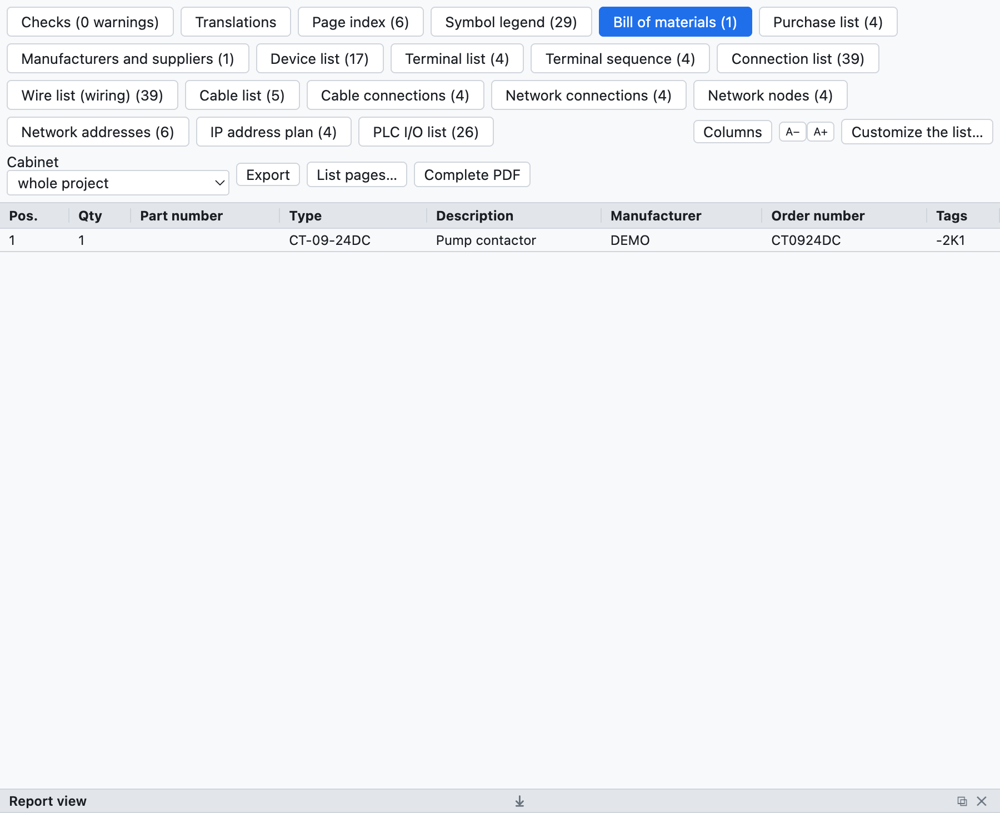
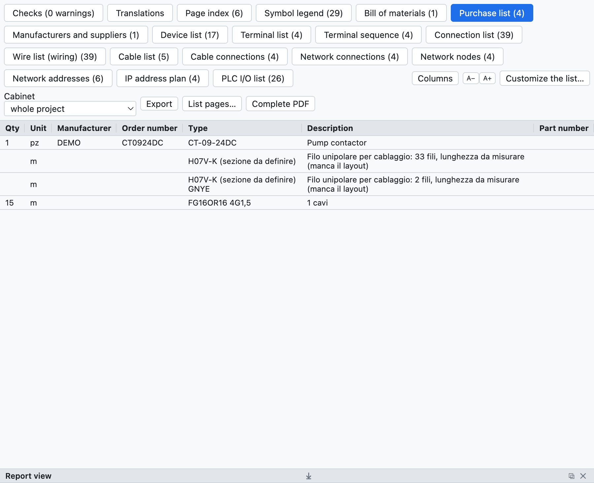
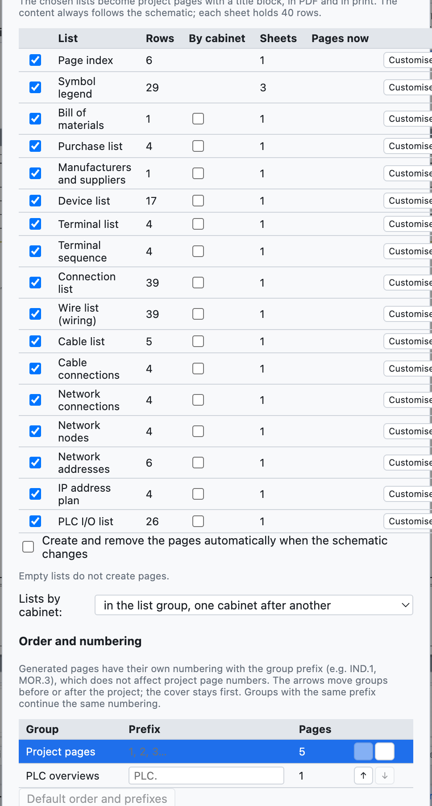
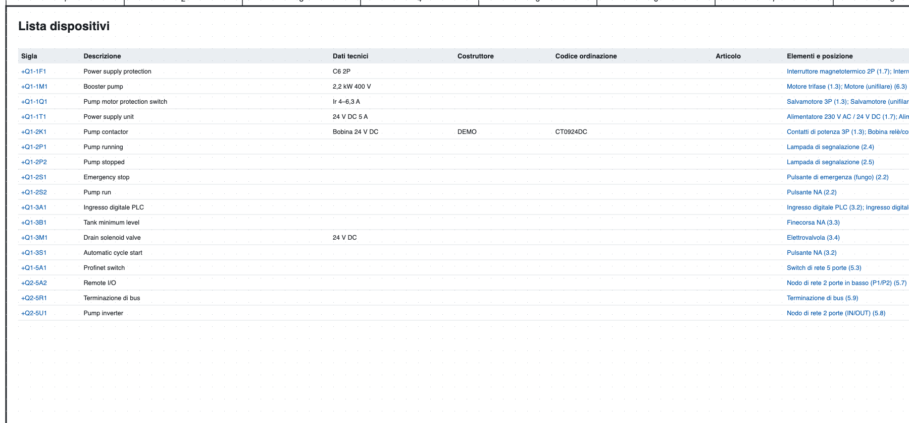
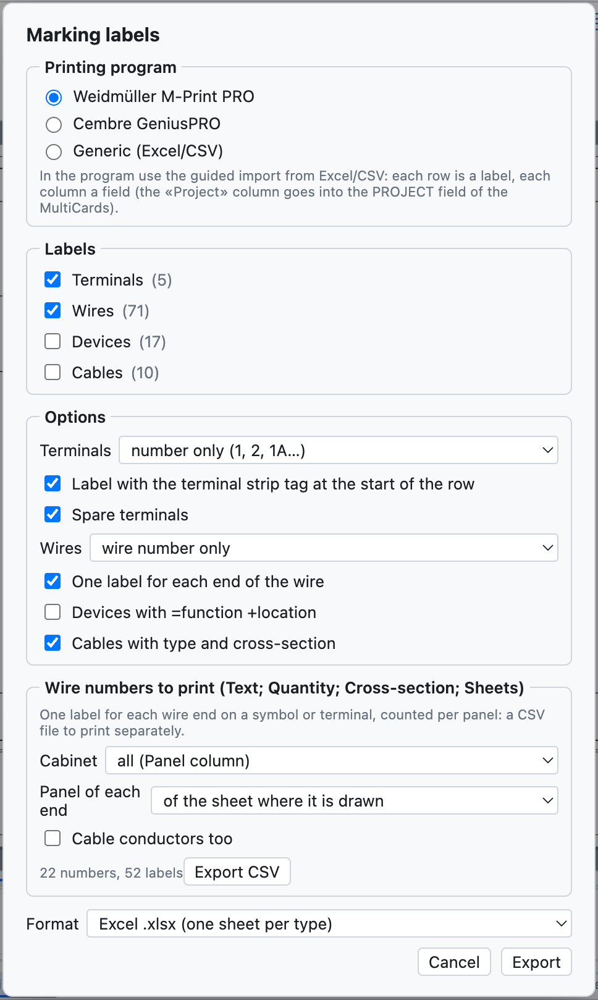

# 14. Listas y páginas automáticas

Todas las listas se **calculan a partir del esquema**: no se rellenan a mano y están siempre actualizadas.

## La vista Listas

*La pestaña Listas con la lista de materiales del proyecto de ejemplo.*

La pestaña **Listas** tiene una subpestaña por cada lista; *Exportar CSV* guarda la lista abierta (separador
`;`, se abre en Excel), *PDF completo* exporta el proyecto con todas las listas al final.

| Lista | Contenido |
|---|---|
| Índice de páginas | número, título, tipo y ubicación de cada página |
| Lista de materiales | artículos agrupados por código (o por fabricante + código de pedido), cantidad, siglas |
| Lista de compra | artículos por fabricante con la unidad de medida, hilo suelto, cables |
| Lista de dispositivos | sigla completa, descripción, datos técnicos, fabricante, códigos, elementos y posiciones |
| Lista de bornes | bornes con destinos externos e internos, números de hilo, puentes |
| Lista de conexiones | cada conexión: número de hilo, desde, hasta, páginas, sección, color, cable |
| Lista de hilos (cableado) | cada hilo con sección, color, punteras y longitud estimada |
| Lista de cables, Conexiones de cables | ver [capítulo 9](09-cavi-e-connettori.md) |
| Conexiones de bus hilos | ver [capítulo 5](05-disegnare.md) |
| Lista de conectores | pines, lados, hilos |
| Conexiones de red, Nodos de red, Plan de direcciones IP | ver [capítulo 11](11-reti-luoghi-unifilare.md) |
| Lista de E/S PLC | ver [capítulo 10](10-plc.md) |

Las listas vacías no aparecen. Un clic en una posición (`/2.4`) lleva al elemento.

## Lista de compra

*La lista de compra del proyecto de ejemplo.*

La lista de compra sirve para pedir el material:

- los artículos de la lista de materiales se **agrupan por fabricante**, así cada grupo es un pedido a un
  proveedor;
- cada fila tiene la **unidad de medida**: piezas, o metros para cables, carriles y canaletas;
- el **hilo suelto** se suma por sección y color (`H07V-K 1,5 mm² BU`), en metros estimados a partir de la
  disposición del cuadro con un 10 % de margen; sin disposición la fila indica cuántos hilos hay y que la
  longitud está por medir;
- los **cables sin artículo** se suman por tipo y formación.

## Páginas automáticas

Las listas se convierten en **páginas del proyecto** con cajetín, para imprimir e incluir en el PDF.

*La ventana de las páginas automáticas: para cada lista las filas, las hojas necesarias y las páginas ya
presentes.*

1. *Insertar ▸ Páginas automáticas (listas)…*, o *Páginas de lista…* en la vista Listas.
2. Marca las listas que quieres como páginas.
3. Pulsa **Crear / actualizar las páginas**.

- Cada hoja contiene 40 filas; una lista más larga ocupa varias hojas.
- El **índice de páginas** va al principio, después de la portada; las demás listas al final.
- El **contenido** de las páginas sigue siempre al esquema.
- Con **Crear y quitar las páginas automáticamente cuando cambia el esquema** también el número de hojas se
  adapta solo: si la lista de bornes pasa de 40 a 41 filas, aparece la segunda hoja.
- *Quitar todas las páginas* quita las páginas de lista.
- *Insertar ▸ Actualizar las páginas de lista* realinea las páginas con las listas elegidas.

*La lista de dispositivos como página del proyecto.*

## Etiquetas de marcado

*Archivo ▸ Exportar ▸ Etiquetas M-Print PRO / GeniusPRO…* prepara las etiquetas para las impresoras de
marcado.

*La ventana de las etiquetas.*

- **Programa**: Weidmüller M-Print PRO (columnas `Project`, `Text 1`, `Text 2`…; la columna `Project` va en el
  campo PROJECT de las MultiCard), Cembre GeniusPRO (columnas `Riga 1`, `Riga 2`…, `Gruppo`) o genérico.
- **Etiquetas**: bornes, hilos, dispositivos, cables.
- **Opciones**: bornes con solo el número o la sigla completa, etiqueta de la regleta al principio de la
  fila, reservas; hilos con solo el número o con el destino, una etiqueta por extremo; dispositivos con
  =función +ubicación; cables con tipo y formación.
- **Formato**: Excel (una hoja por tipo) o CSV.

Ambos programas importan Excel y CSV con un asistente en el que se asocia cada columna a un campo.
