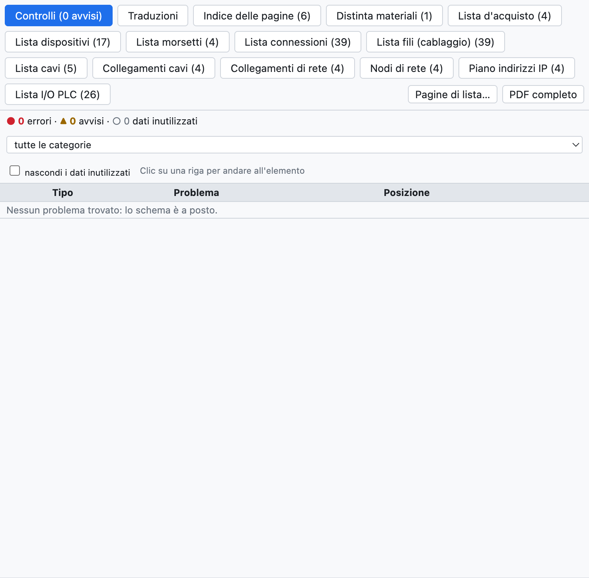
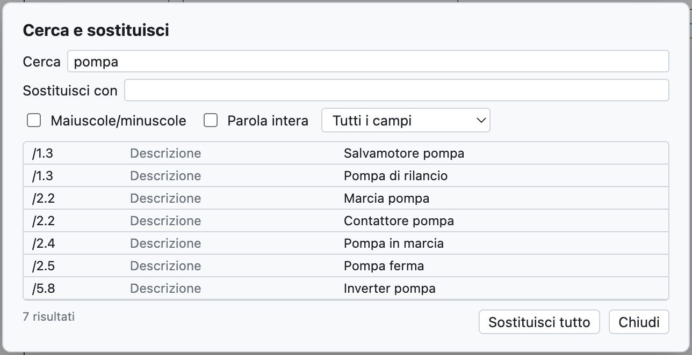

# 15. Verificación, búsqueda y revisiones

## Verificación del proyecto

**Verificación** en la barra de herramientas (o *Proyecto ▸ Verificación*) comprueba todo el proyecto y abre
la pestaña *Comprobaciones* de la vista Listas.

*El proyecto de ejemplo no tiene problemas. Para un ejemplo con avisos ver el [capítulo 3](03-primo-progetto.md#paso-6--verificación).*

Los problemas se dividen en:

- **errores** (●): hay que corregirlos, por ejemplo un cortocircuito;
- **avisos** (▲): errores probables, por ejemplo un punto de conexión libre;
- **datos sin usar** (○): datos que ordenar, por ejemplo un artículo copiado en el proyecto pero no usado.

Se filtran por categoría y *ocultar los datos sin usar* quita los ○. **Un clic en una fila** lleva al
elemento y lo selecciona.

### Qué se comprueba

| Categoría | Ejemplos |
|---|---|
| Cortocircuitos | potenciales distintos en el mismo conductor (`L1` con `N`, `+24V` con `0V`), puntos de interrupción con nombres distintos conectados, componentes con los dos bornes en el mismo conductor |
| Conexiones solo aparentes | un hilo que pasa por encima de un punto de conexión sin terminar en él: parece conectado pero no lo está |
| Huérfanos | componentes, potenciales, puntos de interrupción y nodos sin conexiones, hilos aislados, contactos sin bobina |
| Conexiones incompletas | bornes libres de bobinas, contactos, pilotos, pulsadores, puntos de E/S; hilos con un extremo libre (las barras que llegan al borde se admiten) |
| Dibujo | símbolos inexistentes o superpuestos, hilos superpuestos, elementos fuera de la hoja, números de hilo repetidos, páginas vacías |
| Bus de conductores | hilos que tocan el bus sin el nombre del conductor, conductores que entran en el bus y no salen |
| Siglas y datos | siglas duplicadas o que faltan, más contactos que los del artículo, bornes repetidos |
| Cables, conectores, redes, PLC, disposición | ver los capítulos correspondientes |
| Datos sin usar | artículos, símbolos, datos de regletas y conectores que ya no se usan, ubicaciones vacías |

> **Consejo**: lanza la verificación antes de cada entrega y antes de exportar el PDF.

## Buscar y reemplazar

**⌘F** (o *Buscar*) abre la búsqueda en todo el proyecto.

*La búsqueda de «pompa» encuentra siete descripciones.*

- Busca en siglas, descripciones, textos, números de hilo, nombres PLC, códigos; la lista *Todos los campos*
  limita la búsqueda a un campo.
- *Mayúsculas/minúsculas* y *Palabra completa* afinan la búsqueda.
- Un clic en un resultado lleva al elemento.
- *Sustituir por* y **Sustituir todo** cambian el texto en todos los resultados, en un solo paso que se puede
  deshacer.

## Revisiones

Una **revisión** fija el estado del proyecto entregado, por ejemplo «Rev. A – prima emissione».

1. *Proyecto ▸ Nueva revisión…* (o *Nueva revisión…* en las propiedades del proyecto).
2. Escribe índice, fecha, autor y descripción.

A partir de ese momento:

- los cambios posteriores se marcan con **nubes** rojas en pantalla y en el PDF (se desactivan con
  *Nubes en los cambios* en las propiedades);
- el cajetín de cada página muestra el índice de la última revisión que la cambió;
- el índice del PDF, la portada y el cajetín *Con tabla de revisiones* recogen las revisiones.

## Comparar dos proyectos

*Archivo ▸ Importar ▸ Comparar con un archivo .ecad…* (o *Comparar…* en las propiedades) compara el proyecto
abierto con otro archivo, por ejemplo la versión entregada al cliente. La pestaña *Comparación* de la vista
Listas enumera páginas, dispositivos y datos de proyecto añadidos, quitados o cambiados.
