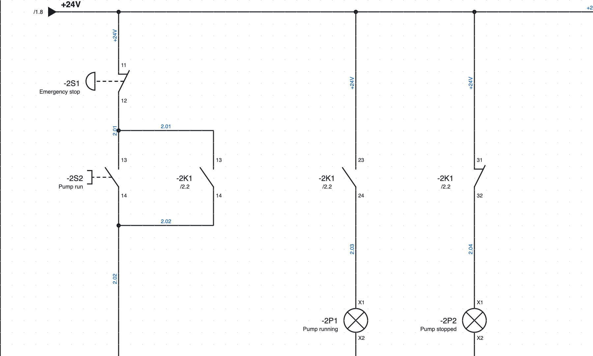
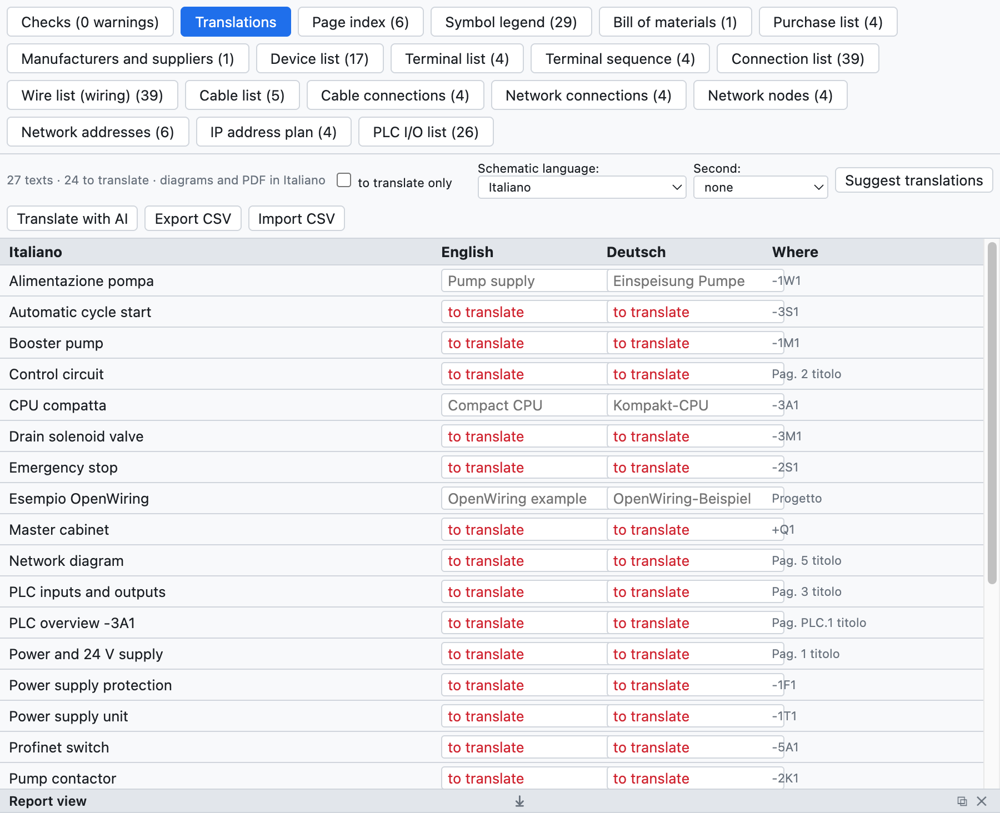

# 16. Idiomas de los esquemas

Los esquemas se dibujan en italiano y se imprimen también en **inglés** o **alemán**, o en dos idiomas a la
vez. El idioma de la interfaz del programa es otro ajuste ([capítulo 1](01-introduzione.md#idioma-de-la-interfaz)).

*La página 2 en inglés con el italiano debajo: «Emergency stop / Arresto di emergenza».*

## El diccionario del proyecto

La pestaña *Traducciones* de la vista Listas (o *Proyecto ▸ Traducciones…*) enumera todos los textos
traducibles del proyecto: títulos de página, textos libres, descripciones de los dispositivos, ubicaciones,
comentarios PLC, campos del cajetín. Para cada uno están la traducción inglesa, la alemana y dónde aparece.

*El diccionario del proyecto de ejemplo.*

- Escribe la traducción en la celda; *solo por traducir* muestra los textos que no la tienen.
- El programa ya contiene los textos fijos (cajetín, títulos y columnas de las listas) y unos 250 términos
  eléctricos comunes.

## Traducir automáticamente

| Comando | Cómo traduce |
|---|---|
| *Proponer traducciones* | frase entera si está en el diccionario incluido, si no palabra por palabra («Lampada guasto» → «Fault lamp») |
| *Traducir con IA* | con el asistente IA elegido (Claude, ChatGPT, Gemini), con la terminología del sector ([capítulo 17](17-assistente-ia.md#traducir-el-diccionario)) |

Las traducciones automáticas se **resaltan** como pendientes de revisar: se confirman con ✓ o modificándolas.

## Elegir el idioma

- **Idioma de los esquemas**: *Ver ▸ Idioma de los esquemas*, las propiedades del proyecto (*Idiomas*) o la
  pestaña Traducciones. Cambia esquemas, cajetín, portada, páginas de lista, vistas generales PLC y esquemas
  de las regletas.
- **Segundo idioma**: escribe los textos en dos idiomas («Contattore pompa / Pump contactor»).
- El **PDF** y la **impresión** se pueden hacer en otro idioma sin cambiar el del proyecto (opción *Idioma*
  en la ventana de exportación).

## Con un traductor

*Exportar CSV* guarda el diccionario como tabla `Italiano;English;Deutsch`: el traductor la completa en Excel
e *Importar CSV* la vuelve a leer.
